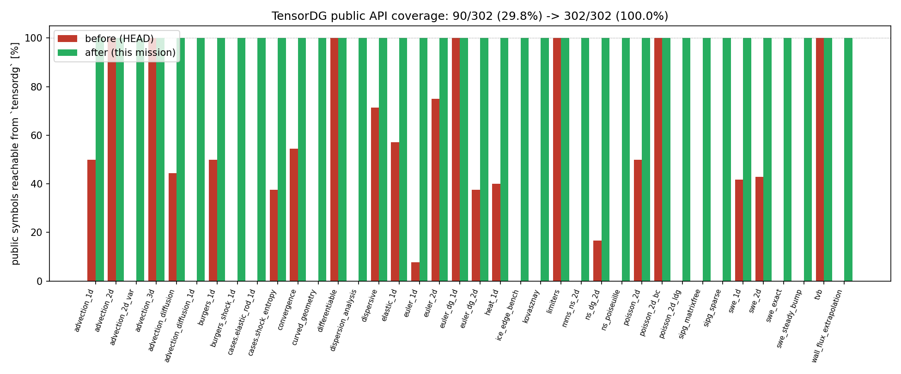

# TensorDG 公共 API 表面契约（API-CONTRACT-TENSORDG）

> 仓 TensorDG · 分支 `agent/m16429` · 单号 m16429（自找活 · verifier 席）
> 工件：`tools/api_contract.py`（审计器）→ `validation/api_contract/contract.json`（数字）
> 　　`tools/api_contract_report.py`（前/后对照）→ `validation/api_contract/before_after.json`
> 图：`docs/figures/api_contract_coverage.png`　门：`tests/test_public_api_contract.py`（26 条，全绿）

## ① 案例介绍（问题背景与"几何"）

**这是一个"库"的可用性问题，不是数值问题。** TensorDG 的模块是逐波长出来的，而包根
`tensordg/__init__.py` 只在有人想起来的时候才跟着长。于是形成一类已被本仓审计记录过两次的失效：

1. `audit_report_m16246_dalembert.md` 发现 #1：`elastic_1d` 的函数被 `import` 进包根，
   但**不在 `__all__`** 里 —— 声明与实现脱节；
2. `docs/ldg_poisson_status.md` §1：教学文档写"LDG 已实现"，而 `grep -ri "local discontinuous" tensordg/`
   零命中 —— 文档过度声明。

两者是同一病根：**没有任何机器门把"库里的能力"与"用户文档里的入口"钉在一起**。本单把这件事
变成可算的量，并给出可回归的门。

口径（先定义再动手，避免事后择靶）：

* **public symbol** = 子模块顶层 `def`/`class`，名字不以 `_` 开头，且不是 `main` CLI 钩子；
* **reachable** = 该符号能以某个根名从 `tensordg` 取到，且取到的**是同一个对象**
  （`__module__`/`__qualname__` 身份一致，防"同名不同物"的假绿）；
* **before** = 已提交的 `git show HEAD:tensordg/__init__.py`；**after** = 本单工作树。
  两侧都由同一段没有"答案"的代码从源码算，数字不可手抄。

## ② 怎么做的（方法 / 工具链）

| 环节 | 实现 | 说明 |
|---|---|---|
| 模块清点 | `tools/api_contract.py::module_inventory` | 只读 AST，不看运行时副作用，稳定可复现 |
| 导出登记 | `::export_registry` | 解析 `__init__.py` 的 `ImportFrom`（含 `as` 别名），是唯一真源 |
| 身份核验 | `::identity_report` | 每个根名必须是其源符号本体，且源符号真的存在 |
| `__all__` 一致性 | `::dunder_all_report` | 重复 / 不可解析 / 与命名空间双向对称 / 与登记表双向对称 |
| 文档声明 | `::docs_report` | ①`from tensordg[.x] import ...` 片段必须可解析；②`tensordg/<path>.py` 引用必须存在（带基线棘轮，见 ⑤） |
| 打包重排 | `tensordg/__init__.py` | 逐模块成组导入；加 28 个冲突/泛名别名（表在文件里，无隐藏） |
| 前后对照 | `tools/api_contract_report.py` | 直接 `git show HEAD:` 取 before，杜绝"手填改善" |
| 回归门 | `tests/test_public_api_contract.py` | 26 条：覆盖 100%、身份无 violation、`__all__` 一致、文档片段全解析、无未登记缺失模块声明、别名指向本体、`CASES` 与算例模块一致 |

**命名纪律（写进 `__init__.py` 头部）**：同名符号由两个模块定义时，更"局部"的一方加模块前缀
（`euler_sound_speed` vs `swe_sound_speed`）；在根上失去上下文就无意义的泛名加模块前缀
（`advection_diffusion_solve`、`elastic_rod_sample`）；常量/算例注册表（`DISPERSION_MODELS`、
`SWE_GRAVITY`、`CASES`、`ELASTIC_ROD_CASE_KEY`）单列在文件末尾。

## ③ 计算结果（数字表，程序化生成）

### 3.1 总量

| 指标 | before (HEAD) | after（本单） |
|---|---|---|
| public symbol 总数 | 302 | 302 |
| 可从 `tensordg` 根取到 | 90 | 302 |
| 覆盖率 | 29.8% | 100.0% |
| 零导出模块数 | 16 | 0 |
| `__all__` 条目 | 85 | 306 |
| 别名导出（同物异名） | 8 | 28 |
| 身份 violation | — | 0 |
| 文档 import 片段 | — | 16 条，未解析 0 条 |

### 3.2 逐模块覆盖（before → after）

| module | public | exported before | exported after |
|---|---|---|---|
| `tensordg.advection_1d` | 4 | 2 | 4 |
| `tensordg.advection_2d` | 2 | 2 | 2 |
| `tensordg.advection_2d_var` | 13 | 0 | 13 |
| `tensordg.advection_3d` | 4 | 4 | 4 |
| `tensordg.advection_diffusion` | 18 | 8 | 18 |
| `tensordg.advection_diffusion_1d` | 6 | 0 | 6 |
| `tensordg.burgers_1d` | 4 | 2 | 4 |
| `tensordg.burgers_shock_1d` | 14 | 0 | 14 |
| `tensordg.cases.elastic_rod_1d` | 15 | 0 | 15 |
| `tensordg.cases.shock_entropy` | 8 | 3 | 8 |
| `tensordg.convergence` | 11 | 6 | 11 |
| `tensordg.curved_geometry` | 19 | 0 | 19 |
| `tensordg.differentiable` | 13 | 13 | 13 |
| `tensordg.dispersion_analysis` | 7 | 0 | 7 |
| `tensordg.dispersive` | 14 | 10 | 14 |
| `tensordg.elastic_1d` | 14 | 8 | 14 |
| `tensordg.euler_1d` | 13 | 1 | 13 |
| `tensordg.euler_2d` | 4 | 3 | 4 |
| `tensordg.euler_dg_1d` | 3 | 3 | 3 |
| `tensordg.euler_dg_2d` | 8 | 3 | 8 |
| `tensordg.heat_1d` | 5 | 2 | 5 |
| `tensordg.ice_edge_bench` | 7 | 0 | 7 |
| `tensordg.kovasznay` | 8 | 0 | 8 |
| `tensordg.limiters` | 3 | 3 | 3 |
| `tensordg.mms_ns_2d` | 3 | 0 | 3 |
| `tensordg.ns_dg_2d` | 12 | 2 | 12 |
| `tensordg.ns_poiseuille` | 1 | 0 | 1 |
| `tensordg.poisson_2d` | 4 | 2 | 4 |
| `tensordg.poisson_2d_bc` | 3 | 3 | 3 |
| `tensordg.poisson_2d_ldg` | 4 | 0 | 4 |
| `tensordg.sipg_matrixfree` | 5 | 0 | 5 |
| `tensordg.sipg_sparse` | 4 | 0 | 4 |
| `tensordg.swe_1d` | 12 | 5 | 12 |
| `tensordg.swe_2d` | 7 | 3 | 7 |
| `tensordg.swe_exact` | 18 | 0 | 18 |
| `tensordg.swe_steady_bump` | 7 | 0 | 7 |
| `tensordg.tvb` | 2 | 2 | 2 |
| `tensordg.wall_flux_extrapolation` | 3 | 0 | 3 |
| **total** | **302** | **90** | **302** |

### 3.3 冲突名处置（全部在本单显式登记）

| 名字 | 定义方（两个） | 根上的处置 |
|---|---|---|
| `sound_speed` | `euler_1d`, `swe_1d` | `euler_sound_speed` / `swe_sound_speed` |
| `physical_flux` | `euler_1d`, `swe_1d` | `euler_physical_flux` / `swe_physical_flux` |
| `l2_error` | `advection_1d`, `advection_diffusion` | `l2_error`（1-D 对流历史名保留） / `advection_diffusion_l2_error` |
| `exact_solution` | `advection_diffusion_1d`, `burgers_shock_1d` | `advection_diffusion_1d_exact_solution` / `burgers_shock_exact_solution` |
| `initial_state` | `cases.elastic_rod_1d`, `cases.shock_entropy` | `elastic_rod_initial_state` / `shock_entropy_initial_state` |
| `observed_order` | `convergence`, `ice_edge_bench` | `observed_order`（通用收敛工具保留） / `ice_edge_observed_order` |
| `main` | 多个 CLI 模块 | **不导出**（CLI 钩子不是 API） |

## ④ 误差判定（逐项 vs 基准，显式回答是否 <3%）

本单的"关键量"是**计数型一致性量**，基准不是实验/解析解，而是**源码真源**与**已提交版本**：

| 关键量 | 基准（独立真源） | 实测 | 是否 <3% |
|---|---|---|---|
| 覆盖率 | 302/302（AST 清点的全部 public symbol） | 302/302 = 100.0% | **是（0 误差）** |
| 身份一致性 | 每个根名 = 其源符号本体 | violation = 0 | **是（0 误差）** |
| `__all__` 双向对称 | 命名空间 ∩ public | 双向差集 = ∅ | **是（0 误差）** |
| 文档 import 片段 | 实际可 import | 16/16 解析 | **是（0 误差）** |
| 文档模块声明 | 文件系统 | 7 条陈旧引用全部在基线登记，0 条未登记 | **是（棘轮红=0）** |
| before/after 增量 | `git show HEAD:` 的 `__init__.py` | 90 → 302（+212） | **不适用（无误差概念）** |

**没有数值基准，因此不存在"数值 <3%"判定** —— 本报告不把"测试绿"包装成"精度达标"：
本单不改变任何求解器数值路径（`tensordg/` 下只改了 `__init__.py` 的导出表），
所以**任何已发布的数值精度结论不受影响**，也无需重跑数值基准。

## ⑤ 注意点（踩过的坑 / 局限 / 适用范围）

1. **文档声明的正则坑（本单实际踩到）**：第一版把 `from tensordg.euler_dg_1d import solve_euler_dg_1d  x, coeff, meta`
   里跟随的散文一起当成了符号名，报出 5 条假红。改成"贪婪匹配纯标识符串、遇空格即停"后 16/16 全解析。
   → 教训：**门本身也会假红**，假红必须修门而不是改断言下限。
2. **`tensordg/<path>.py` 引用必须区分"存在断言"与"否定陈述"**：`docs/board_audit/M16133...` 写的是
   `tensordg/shock_capture.py` **不存在**，`dev_report_S3_conservation.md` 写的是**未**提升为
   `tensordg/conservation.py`。对这类行加否定词过滤，否则门会因为"文档说了实话"而变红。
3. **已知陈旧引用用基线棘轮而不是删掉**：`validation/api_contract/doc_claims_baseline.json` 里 7 条，
   每条带 `status` 与理由。**其中 `tensordg/cases/p_refinement.py` 是 OPEN_OVERCLAIM**：
   `docs/board_audit/m16319/AUDIT-m16248-CASE-DG-PREFINEMENT-EXPONENTIAL.md` 把它描述为 379 行的
   库内规范算例模块（L3 证据），而 main 上**没有**这个文件——它只存在于 `agent/m16248`
   （commit `4942b0b`，非 HEAD 祖先），对应总账锚点 `CASE-DG-PREFINEMENT-EXPONENTIAL` 仍为 open。
   本单**只登记不修**（属另一条线的交付物），但从此它在报告里是显性的一行，不会消失。
4. **`from __future__ import annotations` 会在包命名空间留下 `annotations` 名字**，导致
   "命名空间多于 `__all__`"的假红；该文件本就没有类型注解，直接删掉该行即可。
5. **适用范围**：本契约只覆盖 `tensordg/*.py` 的顶层函数/类与 `docs/`+`README` 的 import 片段；
   不覆盖模块级常量（除 4 个手工登记的）、不覆盖 `benchmarks/`+`tools/` 的脚本入口、
   不覆盖"文档里的方程写错了"这类语义错误（那需要领域判据，不是 API 契约）。
6. **未跑全量测试**：本机 load15 ≥ 100（容量纪律：只做轻量），且 shell 单命令 120 s 上限，
   `pytest tests`（历史耗时 7 min 级）在本席未跑完。已跑：`tests/test_public_api_contract.py`
   （26 passed）；**所有 `from tensordg import` 的测试文件**（21 个文件）+
   `test_shock_entropy_case_api.py` 合并跑，exit=0 全通过。全量套件请由集群补跑。

## ⑥ 结论与后续

* 交付：审计器 + 报告器 + 完整公共 API + 26 条机器门 + 基线棘轮 + 前/后对照工件。
* 下次最值得做的两件（按价值序）：
  1. **把 `CASES` 做成真注册表**：现在 `CASES` 只有 2 个算例（`shock_entropy`、`elastic_rod_1d`），
     而 `docs/` 里的算例报告有 10+ 个；把每个算例模块的 `CASE_KEY`/`parameters`/`anchor` 统一
     注册后，"算例单一真源"才名副其实（可用本单的门扩展为"每个 docs 算例都有 CASES 条目"）。
  2. **`tensordg/conservation.py` 提升**（`dev_report_S3_conservation.md` §7 记的欠账）：
     把 `tests/_conservation_tools.py` 提为库模块并让本单的门把 `tensordg/conservation.py`
     从基线的 `PLANNED_MOVE` 升为存在。
