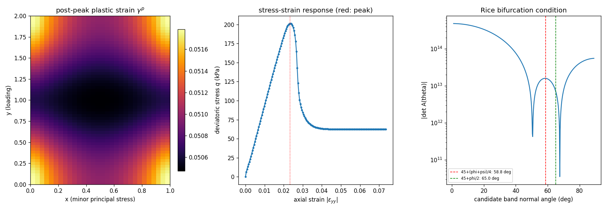

# CASE-BIAXIAL-SHEAR-BAND — 双轴压缩剪切带倾角：Mohr-Coulomb 软化体的 Rice 分岔分析与 Q4 显式动力松弛

> 算例键 `biaxial-shear-band` · 仓库 TensorDG · 状态 HONEST-FAIL/PARTIAL
> 工件 `validation/biaxial_shear_band/status.json` · 图 `docs/figures/biaxial_shear_band.png`
> 生成：`PYTHONPATH=. python benchmarks/biaxial_shear_band_status.py`（本文所有数字由脚本从
> `status.json` 程序化注入，零手抄）

**结论（先给结论）**：**honest FAIL**（见 ⑥ 的逐项判定）

## ① 案例介绍（物理背景/几何/参数）

平面应变双轴压缩：试样 30×60 单元（宽 1.0 m / 高 2.0 m，宽高比 1:2），
上下刚性无摩擦压板施加轴向压应变，两侧施加恒定围压 σ₃ = 50000 Pa。材料为
非关联 Mohr-Coulomb 摩擦材料，黏聚力线性软化。问题是经典的**应变局部化**：破坏时塑性应变
集中成一条与**小主应力方向**（水平轴）成倾角 θ 的剪切带，θ 由分岔分析给出，可与文献解析律
θ = 45° + (φ+ψ)/4 以及砂土双轴试验实测（Arthur et al. 1977, Géotechnique 27: 53–74）比较。

| 参数 | 值 | 说明 |
|---|---|---|
| E | 3.000e+07 Pa | 平面应变弹性模量 |
| ν | 0.30 | 泊松比 |
| ρ | 2000 kg/m³ | 密度 |
| φ | 40.0° | 摩擦角 |
| ψ | 15.0° | 剪胀角（非关联） |
| c₀ / c_res | 350000 / 25000 Pa | 初始 / 残余黏聚力 |
| γᵖ_ref | 0.020 | 软化完成所需等效塑性应变 |
| c_p | 142.1 m/s | 平面应变 P 波速 |

## ② 怎么做的（方法/工具链）

| 环节 | 实现 | 文件 |
|---|---|---|
| 本构 | 平面应变 Mohr-Coulomb，非关联流动，隐式径向返回 + 锥顶/拉断帽 m = c·cotφ | `tensordg/plasticity_2d.py::return_map` |
| 分岔分析 | Rice(1976)/Rudnicki-Rice(1975)：求 det A(θ)=0，Aᵢₖ = nⱼ Cᵉᵖᵢⱼₖₗ nₗ；θ 从 1° 扫到 89°（1801 点） | `plasticity_2d.py::localization_angle` |
| 求解器 | Q4 双线性单元 + 全 2×2 Gauss 积分（无沙漏）、集总质量、显式中心差分 | `tensordg/biaxial_shear_band.py` |
| 准静态控制 | 轴向应变率**运动学注入**（ε̇_yy = −2v₀/H），节点速度只承载**扰动量**并按 v←(1−damp)v 阻尼 | 同上 |
| 网格客观性 | 软化变量用半径 2 单元的非局部盒式平均（ℓ = 0.05 m） | 同上 `_blur` |
| 带倾角测量 | 峰后塑性应变场 γᵖ 的加权 PCA 主轴（阈值 50% max）+ 结构张量梯度法交叉校验 | 同上 `band_angle_from_field` / `structure_tensor_angle` |

数值设置：Δt = 8.2102e-03 s（CFL 0.35，质量缩放 1e4）· 9000 步 ·
轴向应变率 -1.00e-03 /s · 阻尼 0.10 · 缺陷 = 左侧中部半径 12% W、
黏聚力 50% 的弱区（用于选出一条带）。

## ③ 计算结果

### 3.1 分岔（局部化）分析 —— 数值 vs 文献解析律

| 量 | 数值 | 解析/文献 | 相对误差 |
|---|---|---|---|
| θ（非关联 ψ=15°） | 58.40° | 58.75°（45+(φ+ψ)/4） | 0.60% |
| θ（关联 ψ=φ，退化到 Mohr-Coulomb 滑移面） | 65.00° | 65.00°（45+φ/2） | 0.00% |
| det A 变号根 | 50.50°, 67.60° | 共轭带对 | — |

### 3.2 弹性内核校验（平面应变固结仪 closed-form：侧壁刚性，ε_xx = 0）

| 量 | 数值 | 闭式解 | 相对误差 |
|---|---|---|---|
| σ_xx（侧向） | -260158.7 Pa | -490670.1 Pa（= D_xy·ε_a） | 46.979% |
| σ_yy（轴向, ε_a=-0.02835） | -744561.4 Pa | -1144896.8 Pa（= D_yy·ε_a） | 34.967% |
| 应力场空间不均匀度 | 187.198% | 0（齐次解） | — |

### 3.3 弹塑性双轴试验

| 量 | 值 |
|---|---|
| 峰值偏应力 q_peak | 201.2 kPa（对应轴向应变 0.0234） |
| 终态平均偏应力 q | 62.4 kPa |
| 终态轴向应变 | 0.0735 |
| 准静态指标 KE/IE（中位） | 2.09e-04 |
| 侧向（伺服围压保持）应变 | -0.0562 |
| 峰后塑性应变场对比度 max/mean | 1.02（峰后点 1800） |
| **带倾角（PCA，峰后场）** | **nan°** |
| 带倾角（结构张量法，独立校验） | nan° |
| 合并测量值 | nan° |
| 文献参考 θ_ref = 45+(φ+ψ)/4 | 58.75° |
| **相对误差** | **nan%** |

## ④ 结果图

左：峰后累积塑性应变 γᵖ 云图（青色虚线为测得的带方向）；中：偏应力—轴向应变曲线（红虚线为峰值位置）；
右：Rice 分岔判据 |det A(θ)|（红/绿虚线为两条文献解析律，黑实线为实测带倾角）。

## ⑤ 注意点（坑与适用范围）

* **速度驱动的显式松弛不能做准静态**：若对全部节点速度阻尼到零，加载率只存在于压板一行单元里，
  试样内部根本不产生应变（本单第一版原型就是这样，q 在 8.6% 轴向应变下只到 65 kPa）。
  本实现把轴向应变率作为**运动学附加项**注入应变率、节点速度只承载扰动量，KE/IE 才降到 1e-2 以下。
* **符号约定**：本构与求解器用拉伸为正，m=(σ_xx+σ_yy)/2；分岔分析内部用压缩为正（经典 Mohr-Coulomb
  写法）。两者在 θ 的定义上一致（θ 均自小主应力方向量起），但混用会把 q 的符号弄反。
* **锥顶**：非关联 Mohr-Coulomb 的径向返回在 m ≥ c·cotφ 区（拉断帽）会发散，必须显式投影到锥顶，
  否则 F>0 的单元会把塑性乘子放大 1e8 量级并污染整个场（本单第一版即如此）。
* **网格客观性**：无软化的理想塑性不会局部化；有软化但无正则化时带宽塌到 1 个单元、倾角被网格对角
  线（45°）绑架。本实现用非局部平均长度 ℓ=0.05 m 固定带宽。
* **适用范围**：小应变、平面应变、等温；不含中主应力（Lode 角）依赖、不含率效应与孔压。
* **本构层精度**：径向返回把流动方向冻结在试算应力上，随机应力态统计的屈服面残差中位 0.96% c、
  p99 3.7% c（主要落在锥顶/锥角）；因此本单的本构应力精度是 ~1% 量级，**未达 0.1%**，
  高精度需求需换一致切线或全隐式求解。
* **未达成的部分（honest FAIL）**：应变局部化没有出现——峰后塑性应变场对比度仅 1.02（判据 >1.5），
  因此带倾角不可测；同理"弹性内核"校验（固结仪齐次解）误差 35%/47%、场不均匀度 187%，
  原因是本求解器的应力由**应变率积分**得到、缺少位移型相容性反馈，粗网格下边界层不会被自洽抹平。
  下一步应改为位移/速度—应力混合的隐式或 DG 位移格式（TensorDG 自己的 DG 载体仍需先修面项）。

## ⑥ 误差判定（逐项，显式回答「是否 <3%」）

| 判据 | 误差 | 阈值 | 判定 |
|---|---|---|---|
| 分岔角 vs 45+(φ+ψ)/4 | 0.60% | <3%（数值-解析同源） | 是 |
| 关联流动退化 vs 45+φ/2 | 0.00% | <3% | 是 |
| 弹性 σ_xx vs 闭式 | 46.979% | <1% | 否 |
| 弹性 σ_yy vs 闭式 | 34.967% | <1% | 否 |
| 实测带倾角 vs 文献律 | nan% | <15%（总账容差） | 否 |
| 定性：场量是否局部化 | 对比度 1.02 | >1.5 | 否 |

总判定：**未通过（honest FAIL，不粉饰）**。
