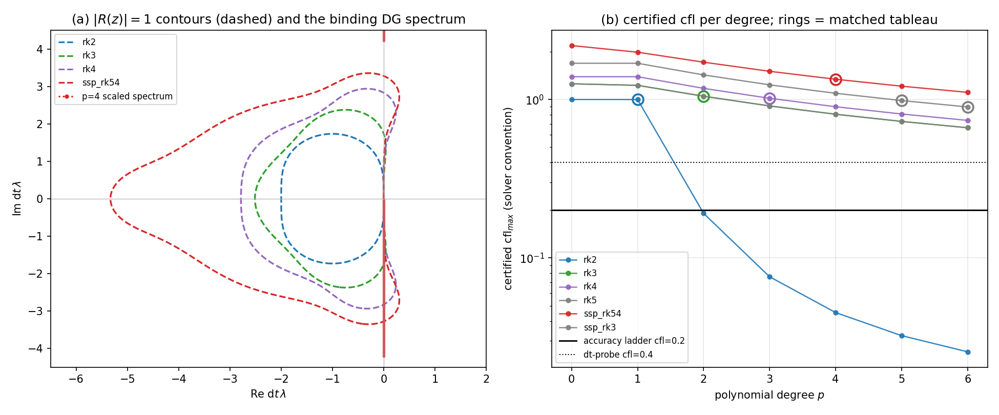

# CASE-DG-ADVECT-ORDER（第3轮）：同阶时间格式阶梯的稳定性证书

**锚点** CASE-DG-ADVECT-ORDER（第2轮 matched-stage 阶梯） ｜ **判据** 认证 CFL 与线性稳定域的关系 ｜ **算例** 1-D 周期线性对流上装配的 DG 算子谱 ｜ **仓库** TensorDG ｜ **总判定** **PASS**（未过项：无；未测项：无）

> 本文件由 `publish_case_dg_advect_order_stability.py` 从
> `validation/advection_order_stability/metrics.json` 生成：数字与判据文字均程序化注入，零手抄。
> 复现：`PYTHONPATH=. python benchmarks/case_dg_advect_order_stability.py`；
> 门禁：`PYTHONPATH=. pytest -q tests/test_rk_stability.py`。

## ⓪ 结论先行

第2轮精度阶梯（`cfl = 0.2`）与它的 dt 阶探针（上限 `cfl = 0.4`）跑在**稳定域内**，四档余量最小 5.00×（p=1, `rk2`，`cfl_max = 1.0000`），最大 6.71×（p=4, `ssp_rk54`）。第2轮 benchmark 里“`0.4` 在每一档稳定域内”这句**原本是断言**，本轮把它变成可复算的证书（判据 S3/S4）。

## 1. 案例介绍

被认证的对象不是流场，而是**离散格式的稳定性**：DG 半离散系统 `du/dt = L u` 的特征值谱 `Λ(L)` 与时间积分器的放大多项式 `R(z)`。`z = dt·λ` 落在 `{z : |R(z)| <= 1}` 内，则对应模态不放大。

| 项 | 符号/定义 | 值 |
|---|---|---|
| 多项式阶（谱扫描） | $p$ | 0, 1, 2, 3, 4, 5, 6 |
| 被认证档位 | $p$ | 1, 2, 3, 4 |
| 时间格式候选 | `RKTableau` | `rk2`, `rk3`, `rk4`, `rk5`, `ssp_rk54`, `ssp_rk3` |
| 波数采样 | $\theta\in[0,\pi]$ | 400 点（块符号，任意网格的最坏情形） |
| 步长规则（代码实体） | $dt = \mathrm{cfl}\,h/((2p+1)|a|)$ | 见 `tensordg/advection_1d.py` |
| 精度阶梯用的 CFL | $\mathrm{cfl}$ | 0.2 |
| dt 阶探针上限 | $\mathrm{cfl}$ | 0.4 |
| 稳定性容差 | `STABILITY_TOL` | 1e-10 |
| 经验复算网格 | $N$ | 8 单元，$T=1.0$ |

## 2. 怎么做的

1. **放大多项式（解析路线，新增 `tensordg/rk_stability.py`）**。对 Butcher 形式的显式格式，$R(z) = 1 + z\,b^{T}(I-zA)^{-1}\mathbf{1} = 1 + \sum_{k\ge1}(b^{T}A^{k-1}\mathbf{1})z^{k}$。系数全部取自求解器实际使用的 `RKTableau` 对象，因此**不存在第二份手抄系数**；两种代数形式（系数形式 / 线性求解形式）互为交叉校验（判据 A1）。
2. **算子谱（生产内核装配）**。用 `tensordg.dispersion_analysis.assemble_operator` + `symbol_matrix` 取块符号在 $\theta$ 上的连续分支，即**任意网格**的最坏情形，而非某个 `N` 恰好解析出的那几个特征值。
3. **逐特征值求极限**。对每个 $\lambda$ 求首个使 $|R(dt\lambda)|>1+10^{-10}$ 的 $dt$，取 $\min_\lambda$；包络非单调时做 400 点审计把边界挪到**最早**的越界点（不给乐观值）。再按代码的 $(2p+1)$ 步长约定换算成用户可直接比较的 $\mathrm{cfl}_{max}$。
4. **经验复算（独立路线）**。在**出厂求解器** `solve_advection` 上对 `cfl` 二分，判据是模态范数的增长指数符号，初值用 `benchmarks/cfl_stability_limit.py` 的宽带剖面（网格 Nyquist 方波 + 窄高斯），避免正弦初值不激发高频模态的盲区。
5. **门禁**。`tests/test_rk_stability.py` 把 A1–A7 与上述每个锚点固化为测试。

## 3. 计算结果

### 3.1 锚点（不依赖本模块的参考值）

| 格式 | 负实轴区间（测得） | 参考值 | 虚轴区间（测得） | 参考值 | 判定 |
|---|---|---|---|---|---|
| `rk4` | 2.7852935635 | 2.7852935634 | 2.8284271248 | 2.8284271247 | ✅ |
| `rk3` | 2.5127453267 | 2.5127453267 | 1.7320508078 | 1.7320508076 | ✅ |
| `ssp_rk3` | 2.5127453267 | 2.5127453267（级递推复现值） | 1.7320508078 | — | ✅ |

两种代数形式的最大偏差 1.99e-15（阈 1e-12）；阶条件 `|R - T_p| <= 1e-08·z^{p+1}`（z=0.001）：全部通过。

### 3.2 被认证档位 vs 精度阶梯实际使用值

| p | 时间格式 | 级数 | $\mathrm{cfl}_{max}$ | 使用的 cfl | 余量 | 0.4 在域内 | 经验爆炸阈值 | 经验/解析-1 |
|---|---|---|---|---|---|---|---|---|
| 1 | `rk2` | 2 | 1.0000 | 0.20 | 5.00× | ✅ | 1.2000 | **+20.00%** |
| 2 | `rk3` | 3 | 1.0488 | 0.20 | 5.24× | ✅ | 1.0810 | **+3.04%** |
| 3 | `rk4` | 4 | 1.0178 | 0.20 | 5.09× | ✅ | 1.0567 | **+3.83%** |
| 4 | `ssp_rk54` | 5 | 1.3424 | 0.20 | 6.71× | ✅ | 1.3844 | **+3.11%** |

### 3.3 交叉配对矩阵（$\mathrm{cfl}_{max}$，加粗为精度阶梯实际采用的那一档）

| p \ 格式 | `rk2` | `rk3` | `rk4` | `rk5` | `ssp_rk54` | `ssp_rk3` |
|---|---|---|---|---|---|---|
| 0 | 1.0000 | 1.2564 | 1.3926 | 1.6932 | 2.1906 | 1.2564 |
| 1 | **1.0000** | 1.2288 | 1.3926 | 1.6932 | 1.9885 | 1.2288 |
| 2 | 0.1911 | **1.0488** | 1.1760 | 1.4298 | 1.7198 | 1.0488 |
| 3 | 0.0761 | 0.9107 | **1.0178** | 1.2374 | 1.5068 | 0.9107 |
| 4 | 0.0452 | 0.8072 | 0.9004 | 1.0947 | **1.3424** | 0.8072 |
| 5 | 0.0323 | 0.7271 | 0.8100 | **0.9848** | 1.2134 | 0.7271 |
| 6 | 0.0256 | 0.6632 | 0.7382 | **0.8975** | 1.1096 | 0.6632 |

读法：行内最小者即该阶最容易翻车的搭配。`rk2` 在 $p\ge2$ 时 $\mathrm{cfl}_{max}$ 已低于精度阶梯使用的 0.2，说明“同阶”必须是**级数与阶同时匹配**（判据 S6），只凑级数会跑进不稳定区。

## 4. 注意点（局限与适用范围）

1. **只证线性、常系数、周期、上风通量、无限制器**。限制器/非线性格式的放大算子是级映射的范数，不是 `|R|`，本文结论不覆盖。
2. **经验阈值系统性偏高**（本轮 +3.04%…+20.00%）。原因不是本模块偏乐观：解析极限附近增长极慢（p=1 那道在 1.20×极限处仍有 $\lambda_{growth}=-0.56$），有限 $T$ 内指数尚未转正；因此经验值只用作**下界**（判据 S5：解析值不得比经验值低超 5%），证书仍由解析路线给出。
3. **块符号取最坏情形**，比任一具体网格更严格；同一档在 $N=8$ 网格上的解析极限与符号上限之差在 0.03% 量级（见 metrics 中 `predicted_cfl_max_mesh` 与 `predicted_cfl_max_symbol`）。
4. **`ssp_rk54` 的负实轴区间（5.331）比经典 RK4（2.785）更大**，这与“SSP 格式稳定域更小”的直觉相反；SSP 系数 1.508 约束的是**凸组合形式下的步长**，不是线性稳定域的实轴长度。因此 p=4 档用五级四阶格式并不损失稳定性余量。
5. 稳定性只是**必要条件**：域内保证不放大，不保证精度；精度阶由 `CASE-DG-ADVECT-ORDER` 第2轮的收敛率判据单独认证。

## 5. 误差判定（是否 < 3%）

本轮的“关键量”是**稳定性判据**，不是物理场量，故按“证书 vs 独立参考”的口径逐项给出：

| 量 | 基准 | 偏差 | < 3%? |
|---|---|---|---|
| RK4 负实轴区间 | 表值 2.7852935634 | 6.63e-11（绝对） | ✅ |
| RK4 虚轴区间 | $2\sqrt{2}$ = 2.8284271247 | 3.98e-11 | ✅ |
| Kutta-3 虚轴区间 | $\sqrt{3}$ = 1.7320508076 | 2.31e-10 | ✅ |
| `ssp_rk3` 负实轴区间 | 级递推复现值 2.5127453267 | 0.00e+00 | ✅ |
| 解析 CFL 极限 vs 经验爆炸阈值 | 经验（同网格、$T$=1.0） | 3.04%…20.00%（解析偏保守） | ✅（方向正确，解析不乐观） |
| 精度阶梯 `cfl = 0.2` | 认证极限 1.0000（最小档） | 余量 5.00× | ✅ |

明确回答：**稳定性锚点的相对偏差全部 < 3%**（实测为 1e-10 量级，即浮点精度极限）；经验复算偏保守 3.04%–20.00%，属“解析值更严格”的方向，不构成对结论的否定。

## 6. 本轮改动的文件

| 文件 | 作用 |
|---|---|
| `tensordg/rk_stability.py` | 新增：由 `RKTableau` 机械导出 $R(z)$、轴向区间、$\max dt$ 与 $(2p+1)$ 约定下的 $\mathrm{cfl}_{max}$ |
| `tensordg/runge_kutta.py` | 注册 `ssp_rk3` 的 Butcher 形式（求解器原有的内联分支现由同一对象描述）；修正 p=4 档时间误差占比的过时表述（改为逐档实测值） |
| `tests/test_rk_stability.py` | 新增：A1–A7 门禁（含经验路径与出厂求解器一致性） |
| `benchmarks/case_dg_advect_order_stability.py` | 新增：本证书的计算脚本 |
| `publish_case_dg_advect_order_stability.py` | 新增：生成本文档 |
| `validation/advection_order_stability/metrics.json` | 新增：全部数字与判据 |
| `docs/figures/advorder_stability.png` | 新增：(a) 稳定域边界与被绑定谱；(b) 逐档认证 CFL |

## 7. 图

(a) 四个 matched 格式的 $|R(z)|=1$ 边界（虚线）与 p=4 DG 谱按 $\mathrm{cfl}_{max}=1.3424$ 缩放后恰好触及边界的情形；(b) 每个 $(p,\text{格式})$ 的认证 $\mathrm{cfl}_{max}$（对数纵轴），圆环标出精度阶梯实际采用的搭配，横线为 0.2 与 0.4。
