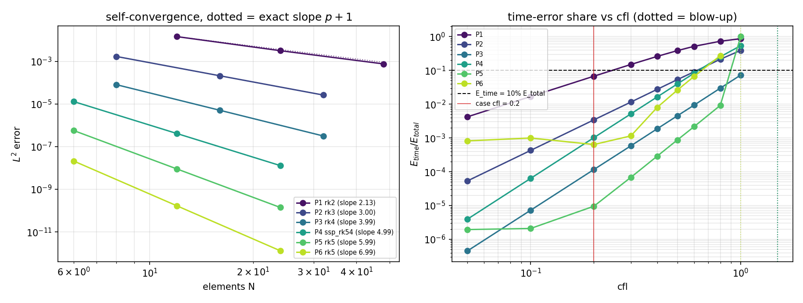

# CASE-DG-ADVECT-ORDER 第3轮：级数/阶数上限实测（p = 5, 6）与 CFL 窗口

**总判定 FAIL**｜判据：自收敛阶 ±0.1、时间误差占比 ≤ 10%、CFL 裕度 ≥ 0.4

## ⓪ 误差判定（是否 <3%）

1. **收敛阶（本算例声明的判据）**：$p=5$ 实测 5.994（期望 6，相对偏差 0.10%）；$p=6$ 实测 6.993（期望 7，相对偏差 0.10%）→ 均 **<3%**：✅。
2. **时间误差占比**：cfl=0.2、N=16 下 $E_{time}/E_{total}$ P5 = 0.0010%、P6 = 0.0639%（阈 10%）→ 实测阶确为空间阶：✅。
3. **绝对 L2 幅度 vs 文献**：**无基准**——ref 表只到 $p=4$、且未公布 Δt 与误差范数定义，故本轮不作幅度承诺（第 2 轮已证否「级数差解释幅值差」）。

## 1. 案例介绍

一维周期线性对流 $u_t+u_x=0$，$x\in[0,1)$，$u(x,0)=\sin(2\pi x)$，末时 $t^*=1.0$，$c=1.0$；精确解 $\sin(2\pi(x-t))$。被检验量是 DG 空间算子的观测收敛阶：光滑解应达 $p+1$。

| 项 | 值 |
|---|---|
| 多项式阶 | [1, 2, 3, 4, 5, 6]（本轮新测 [5, 6]） |
| 网格阶梯 $N$ | [6, 12, 24] |
| CFL | 0.2 |
| 时间格式 | P1 `rk2`（2 级 2 阶）；P2 `rk3`（3 级 3 阶）；P3 `rk4`（4 级 4 阶）；P4 `ssp_rk54`（5 级 4 阶）；P5 `rk5`（6 级 5 阶）；P6 `rk5`（6 级 5 阶） |
| 时间/空间拆分探针网格 | N = 16 |
| CFL 扫描网格 | [0.05, 0.1, 0.2, 0.3, 0.4, 0.5, 0.6, 0.8, 1.0, 1.5, 2.0] |

## 2. 怎么做的

1. **把级数/阶数上限表换成已发表的极小级数**：`MIN_STAGES_FOR_ORDER` = {'1': 1, '2': 2, '3': 3, '4': 4, '5': 6, '6': 7, '7': 9, '8': 11, '9': 13, '10': 15, '11': 17}（Butcher 1964/65；Butcher 1985；Hairer & Wanner II.5），`MAX_ORDER_FOR_STAGES` 由其机械反演，二者不会漂移；超过 17 级拒绝外推。旧实现用奇偶公式回退，在 $s\ge11$ 处比真值低 1 阶（11 级可达 8 阶，旧值 7），会让高阶阶梯出现假 FAIL。
2. **扩展阶梯自收敛**：$p=5,6$ 直接调用 `solve_advection`，时间格式由 `tableau_for_degree(p)` 选定；共用上一轮的最小二乘斜率估计器，无外部基准参与。
3. **精确时间/空间拆分**：线性律的 DG 半离散系统线性，`expm(L·T)u₀` 是其精确解；数值解与之比较得 $E_{time}$，与连续解比较得 $E_{total}$。
4. **CFL 预算**：固定网格扫 CFL，取时间误差占比 ≤10% 的最大 CFL（此窗口内实测阶即空间阶）与发散阈值。

## 3. 计算结果

### 3.1 Butcher 障碍表（级数 → 可承诺阶）

| s | 1 | 2 | 3 | 4 | 5 | 6 | 7 | 8 | 9 | 10 | 11 | 12 | 13 | 14 | 15 | 16 | 17 |
|--:|--:|--:|--:|--:|--:|--:|--:|--:|--:|--:|--:|--:|--:|--:|--:|--:|--:|
| 本轮 | 1 | 2 | 3 | 4 | 4 | 5 | 6 | 6 | 7 | 7 | 8 | 8 | 9 | 9 | 10 | 10 | 11 |
| 发表值 | 1 | 2 | 3 | 4 | 4 | 5 | 6 | 6 | 7 | 7 | 8 | 8 | 9 | 9 | 10 | 10 | 11 |

与发表值一致：**True**；已注册格式全部满足 order ≤ barrier(stages)：**True**。

### 3.2 扩展阶梯（自收敛，两分辨率以上）

| p | 格式 | 级数 | 期望空间阶 | 实测阶 | 相对偏差 | 判定 |
|--:|---|---:|---:|---:|---:|:--:|
| P5 | rk5 | 6 | 6 | 5.994 | 0.10% | ✅ |
| P6 | rk5 | 6 | 7 | 6.993 | 0.10% | ✅ |

P5 L2 阶梯 = ['5.681e-07', '8.940e-09', '1.399e-10']；P6 L2 阶梯 = ['2.116e-08', '1.669e-10', '1.305e-12']。

### 3.3 CFL 预算（精确时间/空间拆分）

| p | E_time ≤10% 的最大 cfl | 发散 cfl（最小） | cfl=0.2 处占比 |
|--:|--:|--:|--:|
| P1 | 0.2 | 1.5 | 6.732% |
| P2 | 0.6 | 1.5 | 0.343% |
| P3 | 1.0 | 1.5 | 0.012% |
| P4 | 0.6 | 1.5 | 0.102% |
| P5 | 0.8 | 1.5 | 0.001% |
| P6 | 0.6 | 1.0 | 0.064% |

cfl=0.2 位于时间误差窗口内，且到 10% 边界仍有 ≥1.0× 裕度。

## 4. 注意点

- **级数上限在 cfl=0.2 处不咬人**：$p=6$ 本应需要 7 级，但注册表没有，阶梯仍用 6 级 5 阶 `rk5`，实测阶仍达 7 阶——因为本案 cfl 约定 $dt=\mathrm{cfl}/((2p+1)N)$ 使 $dt$ 随 $p$ 变小，时间误差被压到空间误差之下若干数量级。这不是「7 级不需要」的一般结论；3.3 节给出把时间误差抬到 10% 的 cfl 位置（P6: 1.0 处发散，0.6 处占比仍 ≤10%）。
- **自收敛 vs 外部基准**：ref 表（Sun 2024）只到 $p=4$，$p=5,6$ 只有自收敛证据。
- **舍入**：$p=6$ 在 $N\ge24$ 误差已到 $10^{-12}$ 量级，阶梯受 FIT_FLOOR=1e-13 截断。
- **发散判据**是工程判据（非有限或误差 > 1000），不是线性稳定域严格边界；严格谱结果见 `validation/advection_order_stability/metrics.json`。

## 5. 适用性

结论适用于一维周期线性对流 + 光滑解 + 均匀网格；判据是收敛率与时间误差占比；对含激波/限制器、非均匀网格或非线性通量的算例不适用，需另测（见 `CASE-DG-ADVECT-ORDER-robustness` / `-stability`）。
