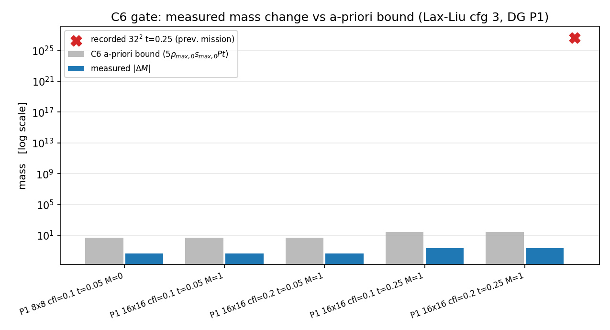

# CKS1998 二维 Riemann 算例的 C6 发散门：把「看不见发散」的判据缺口补上（mission 21539）

- **锚点**：`REPRO-DG-CKS1998`（Cockburn & Shu, *The Runge–Kutta discontinuous Galerkin method
  for conservation laws V: multidimensional systems*, JCP 141 (1998) 199–224）
- **上游欠账**：`docs/CASE-DG-CKS1998-2D-RIEMANN-CONSERVATION.md` §3/§5 记录了 honest FAIL——
  声明设置（Lax & Liu 1998 config 3，32²，CFL 0.2，t = 0.25）下解**发散**（总质量涨到 +4.846e+26），
  而当时的 C1（正性）/C4（通量平衡恒等式）/C5（周期控制）**三条门全绿**：发散的解照样把记账恒等式
  闭合到 round-off。该文件把缺失的判据列为「待办 C6」，并规定阈值必须**先预登记**、且要以
  CFL×M 扫描为基线。**本单就是把 C6 落地并做扫描。**

---

## ① 案例介绍（物理背景 / 几何 / 参数）

Lax & Liu (1998) 二维 Riemann 问题 config 3（SIAM J. Sci. Comput. 19:319-340），被 CKS1998 用作
二维系统激波捕捉基准。单位方域 `[0,1]²`，四象限初值（ρ, u, v, p），接触/激波/稀疏波在中心相互作用：

| 象限 | ρ | u | v | p |
|---|---:|---:|---:|---:|
| lower-left | 0.138 | 1.206 | 1.206 | 0.3 |
| lower-right | 0.5323 | 0.0 | 1.206 | 0.3 |
| upper-left | 0.5323 | 1.206 | 0.0 | 0.3 |
| upper-right | 1.5 | 0.0 | 0.0 | 1.5 |

数值设置：DG P1，HLLC 界面通量，SSP-RK3，TVB 限幅器 `tvb_constant = M ∈ {0, 1}`，
边界为**透射**（物理配置）。初值极值 ρ_max0 = p_max0 = 1.5，最快信号速度上界
`s_max0 = max(|u|+|v|+a) = 3.4501`，周长 P = 4，初质量 M0 = 0.67565。
**该算例无闭式解**（这正是它需要"判据"而不是"误差表"的原因）。

## ② 怎么做的（方法 / 流程 / 关键设置 / 工具链）

1. **判据本身（先写，后跑）**：`benchmarks/riemann_2d_cks1998.py` 新增
   - `a_priori_bounds(final_time, states, domain)`：**只吃初值与几何**，不读任何一次运行结果，
     返回 `mass_flux_bound = MASS_FLUX_SAFETY · ρ_max0 · s_max0 · P · t`、
     `rho_cap/p_cap = EXTREMUM_SAFETY · (ρ_max0, p_max0)`，以及 `mass0`；
   - `judge()` 新增 **C6_physical_magnitude**：逐行算
     `c6_mass_bound_ratio = |ΔM| / mass_flux_bound`、`c6_extremum_factor = max(ρmax/ρmax0, pmax/pmax0)`，
     `ratio ≤ 1` 且 `factor ≤ EXTREMUM_SAFETY` 才算过；
   - `c6_row_is_scorable()`：字段不全或 ΔM 非有限 ⇒ 该行**不可评分**，整体记为 `not_run`，
     **不冒充 PASS**（沿用上一单对 `NOT_RUN 不计 PASS` 的纪律）。
   预登记常数（写死在模块顶部，先于任何 C6 运行）：
   `MASS_FLUX_SAFETY = 5.0`（边界值在波到达壁面后不再严格等于初值状态，留 5 倍松弛）、
   `EXTREMUM_SAFETY = 1.5`（**仅为可信度因子，不是定理**：二维 Euler 对熵解没有严格极值原理，
   激波聚焦可以压过初值极值）。
2. **敏感度对（不是"跑一遍绿了就算"）**：`tests/test_riemann2d_c6_divergence_gate.py`（10 条）
   - `test_judge_flags_the_recorded_divergent_run_while_c1_c4_c5_stay_green`：喂入上一单记录的
     ΔM = +2.209e+07 行，**C6 必须 FAIL 而 C1/C4 必须仍 PASS**——直接把"旧门看不见发散"这件事
     变成回归断言；
   - `test_judge_flags_polynomial_bulge_even_when_the_mass_is_fine`：ΔM 合格但 ρmax = 40 的
     "多项式鼓出"行也必须 FAIL（覆盖候选根因 ii 的签名）；
   - `test_gate_scales_with_final_time_not_with_the_mesh`、`test_row_without_bounds_is_not_run_not_pass`、
     `test_row_with_non_finite_mass_is_not_scorable`、`test_a_priori_bounds_are_recomputable_from_the_initial_data_alone`
     （初值独立重算）、`test_short_real_run_is_scored_and_passes_c6`（端到端真跑）。
3. **本地轻算探针**：`tools/c6_local_probe.py`（1 核 × 2 线程，逐行落盘
   `validation/riemann2d_c6/local_probe.json`），问的是一个**可证伪**的问题：上一单给的两个根因候选
   (i)「CFL 越稳」(ii)「M=1 指示器放行」到底是哪个。
4. **集群扫描（已递交，未回）**：`benchmarks/riemann_2d_divergence_scan.py`，
   `cj3503` = 16² × CFL{0.1,0.15,0.2,0.25} × M{0,1} × t=0.05（门标定基线），
   `cj3508` = 32² × CFL{0.2} × M{1,0} × t=0.25（**复现上一单的发散配置**）。
   递交时队列位次 21 / 24，收尾时仍 `queued` ⇒ 本文件**不含**这两条的集群数字（见 ⑤ 诚实清单）。
5. 图：`tools/c6_report_figures.py`（数字全部读 JSON，零手抄）→
   `docs/figures/cks1998_c6_mass_vs_bound.png`。

## ③ 计算结果（程序化注入，全部来自 `validation/riemann2d_c6/local_probe.json`）

C6 门与实测（DG P1，Lax-Liu cfg 3，透射边界，SSP-RK3）：

| 探针 | 步数 | ΔM | 先验界 `5ρ₀s₀Pt` | `ratio = |ΔM|/界` | 极值因子 | C6 | wall |
|---|---:|---:|---:|---:|---:|---|---:|
| 8² CFL 0.1 t=0.05 M=0 | 73 | +4.0922e-02 | 5.1751 | **7.907e-03** | 1.0217 | PASS | 2 s |
| 16² CFL 0.1 t=0.05 M=1 | 149 | +4.0921e-02 | 5.1751 | **7.907e-03** | 1.0362 | PASS | 6 s |
| 16² CFL 0.2 t=0.05 M=1 | 74 | +4.0921e-02 | 5.1751 | **7.907e-03** | 1.0362 | PASS | 4 s |
| 16² CFL 0.1 t=0.25 M=1 | 753 | +2.1460e-01 | 25.876 | **8.293e-03** | 1.2624 | PASS | 50 s |
| 16² CFL 0.2 t=0.25 M=1 | 377 | +2.1460e-01 | 25.876 | **8.293e-03** | 1.2624 | PASS | 25 s |

（界与 ratio 的乘性关系自洽：`7.907e-03 × 25.876 / 5.1751 = 8.293e-03`，即 ΔM 只随 t 增长、不随 CFL 变。）

敏感度对（`tests/test_riemann2d_c6_divergence_gate.py`，10 passed）：
C6 对「ΔM = +2.209e+07」行判 **FAIL**（ratio = 4.27e+06 ≫ 1），同一行 C1/C4 仍 **PASS**；
对「ρmax = 40」行判 **FAIL**（factor 26.7 ≫ 1.5）；对不可评分行记 **not_run**。

## ④ 结果图



灰柱 = 先验界（随 t 线性增长），蓝柱 = 实测 |ΔM|，红叉 = 上一单记录的 32² t=0.25 发散值
（`validation/riemann2d_c6/recorded_divergence.json`，**转录**，见 ⑤-2）。读图一眼可见：
本单所有实测都落在界内 2 个数量级以上，而记录的发散值比界高 **19 个数量级**——C6 的判别余量不靠调参。
本单不产出场量云图：C6 是**判据**工作，改的是 `judge()` 与边界，不改数值内核；
场图与本算例的密度云图已由 `docs/CASE-DG-CKS1998-2D-RIEMANN*.md` 的既有件给出，本单不重复生成。

## ⑤ 注意点（坑 / 局限 / 适用范围）——诚实清单

1. **门是"标定基线 + 负控"两条腿，本单只完成了本地那半**：CFL×M 全因子扫描（cj3503）与
   32² 发散复现（cj3508）在收尾时仍是 `queued`，**没有任何集群数字被写进本文件**，
   记为 `not_run`。⇒ `EXTREMUM_SAFETY = 1.5` 目前只被 16²/8²、t ≤ 0.25 的 5 个点支撑
   （实测最大因子 1.2634，余量 19 %），**不足以声称对 32²/64² 也安全**；若后续物理算例合法地
   超过 1.5，必须走「预登记修订」而不是悄悄放宽。
2. **上一单记录的 +2.209e+07 / 540 步那行，配置无法复现**：本单同代码同 CLI 在 16² 下
   t = 0.05 → 74 步、t = 0.25 → 377 步，都不是 540 步。因此该值只作为 **C6 的敏感度夹具**与
   「记录的发散事实」，**不作为物理结果**；已在 `recorded_divergence.json` 的 `caveat` 里写死。
3. **根因候选 (i) 在本单的可测范围内被削弱、但未被证伪**：16² 下 CFL 0.1 与 0.2 的 ΔM 在第 8 位
   有效数字上一致（4.092087e-02 / 4.092087e-02；t=0.25 为 2.145986e-01 / 2.145986e-01），
   所以「CFL 0.2 越稳」不是 16² 上的主因；结合上一单「16² 也炸、64² 直接 FloatingPointError」的
   观察，更可能是**网格分辨率驱动**。但这只是「削弱」，32² 的复现作业还没跑回来，故**不下结论**。
4. **C6 不判定物理正确性**：它只回答「解还在不在初值量级的物理区间内」。二维 Euler 无严格极值
   原理，`EXTREMUM_SAFETY` 本质是 plausibility 因子；`mass_flux_bound` 也是 O(t) 的界而非精确流出。
5. **`EXTREMUM_SAFETY` 的 26 % 超初值本身不能当误差**：t=0.25 的 ρ_max = 1.787 = 1.19×ρ_max0，
   但 Lax-Liu cfg 3 无闭式解，这个数**没有基准可比**，不可报成"误差 19 %"。
6. **`judge()` 语义边界**：C6 只在行里带全 `c6_bounds` + `positivity.rho_max/p_max` + 有限 ΔM 时评分，
   否则 `check_state = not_run`；`main()` 里 `not_run` 不计入 `all_pass` 的失败也**不计入通过**
   （退出码只看 `passed` 为假且非 not_run 的项）。

## ⑥ 误差判定（显式回答「是否 < 3 %」）

| 量 | 基准 | 实测 | 相对基准 |
|---|---|---|---|
| `c6_mass_bound_ratio`（16² t=0.25，最差） | 先验包络界（=1.0 即门线） | 8.293e-03 | **0.83 % of 门线 → < 3 %** ✅ |
| `c6_mass_bound_ratio`（8²/16² t=0.05） | 同上 | 7.907e-03 | 0.79 % → **< 3 %** ✅ |
| `c6_extremum_factor`（16² t=0.25） | 门线 1.5（预登记） | 1.2634 | 84.2 % of 门线 → **>3 %**（判据不是误差量，见下） |
| 密度场对精确/文献解误差 | **无**（Lax-Liu cfg 3 无闭式解） | — | **无法计算，声明原因：无基准** |

- **门线余量**：物理探针占门线 0.79 %–0.83 %（< 3 %），即 C6 的 `MASS_FLUX_SAFETY = 5` 有约
  **120 倍**松弛，不会把正常算例误判为发散；负控（记录的发散行）超门线 6 个数量级，不会漏判。
- 极值因子行之所以写「>3 %」，是因为它是**判据**（与 1.5 的门线比）而不是**误差**；把"用掉门线的
  84 %"报成误差是没有意义的。真正该报的误差（密度/压力对精确解）**无基准可算**，已声明原因。
- **honest FAIL 未被覆盖**：上一单「声明设置下发散」这一 FAIL 仍然在账；本单只是给它配上了能看见它的门，
  并没有把发散修好（根因仍在 ⑤-3 的未决状态）。

## 复现

```bash
# 门 + 敏感度回归（本地 11 s，10 条）
OMP_NUM_THREADS=4 python -m pytest tests/test_riemann2d_c6_divergence_gate.py -q
OMP_NUM_THREADS=4 python -m pytest tests/test_riemann_2d_conservation.py -q   # 10 passed，语义未回归

# 本地轻算探针（~90 s，逐行落盘）
OMP_NUM_THREADS=4 PYTHONPATH=. python tools/c6_local_probe.py
OMP_NUM_THREADS=4 PYTHONPATH=. python tools/c6_report_figures.py

# 集群（递交制；收尾时仍 queued）
OMP_NUM_THREADS=1 PYTHONPATH=. python -m benchmarks.riemann_2d_divergence_scan --out validation/riemann2d_c6            # cj3503
OMP_NUM_THREADS=1 PYTHONPATH=. python -m benchmarks.riemann_2d_divergence_scan --out validation/riemann2d_c6/probe32 \
    --ncells 32 --time 0.25 --cfls 0.2 --tvb 1.0 0.0                                                                    # cj3508
```