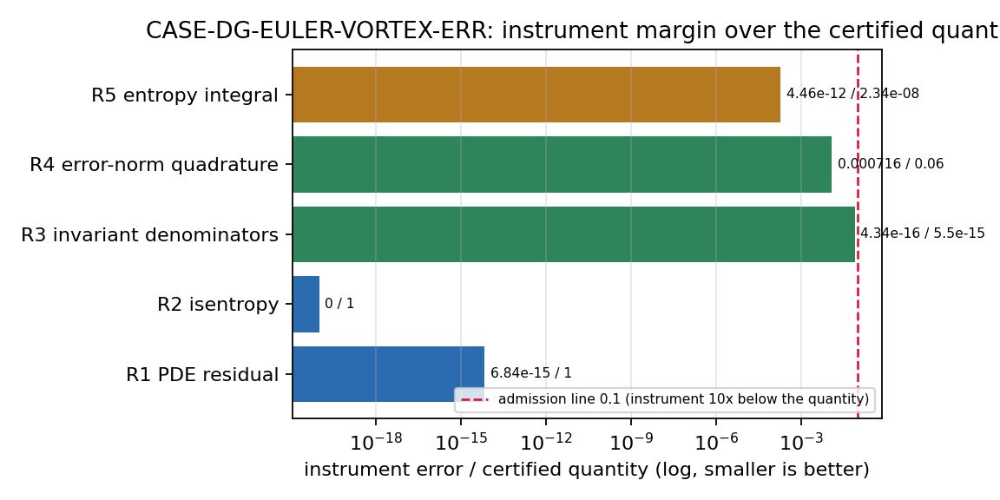
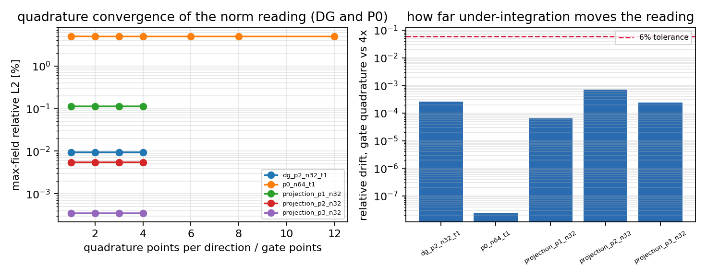

# CASE-DG-EULER-VORTEX-ERR：等熵涡算例的参考解与量测仪表认证（round 20）

> 锚点 `CASE-DG-EULER-VORTEX-ERR`（算例池·等熵涡移动误差守恒）｜mission 22963｜ref: Yee, Vinokur & Djomehri, JCP 162 (2000) 33-81｜容差 6%
> 本文档由 `publish_case_dg_euler_vortex_err_round20_instrument_certification.py` 从 `instrument_certification.json` 程序化生成，零手抄。

## ① 案例介绍

二维可压缩 Euler 方程（理想气体 γ=1.4）中的等熵涡在周期方箱 [-5,5]² 以 |u∞|=√2 匀速输运，真解在平移下不变形，故离散误差应是网格属性而非时间属性。锚点 C1–C11 已全部通过（round 19 闭合 C11），本轮不再改判据、不改容差、不改任何已入库读数，而是**认证把判据喂饱的那条仪表链**：

```
解析等熵涡 ──(R1 精确性, R2 等熵)──▶ 参考解场
参考解 + 求积 ──(R3, R4)──────────▶ 不变量与相对 L2 误差读数
误差读数 ──(C1..C11)──────────────▶ 整包裁决
```

三项此前只是**假设**的事实：解析闭式确为 Euler 方程的解（抄错会伪装成格式误差）；320 点张量 Gauss 参考不变量收敛远低于最小漂移列；DG 的每格 p+2 点、P0 的 4 点精确格平均足以承载 4 位有效数字的百分比。

## ② 怎么做的

| 证书 | 仪器 | 做法 | 突变对照（必须失败） |
|---|---|---|---|
| R1 | Euler 残差 | 守恒形式 dU/dt+dF/dx+dG/dy，所有导数用 autograd 对解析表达式本身求导 | 四类合理误抄：包络指数、温度系数、单侧旋转符号、等温变体 |
| R2 | 等熵结构 | 场量 max|p/ρ^γ−1| | 等温变体 |
| R3 | 不变量分母 | 320/480/640/960/1280 点收敛 | 与最小漂移列比值的 10 倍准入线 |
| R4 | 相对 L2 范数 | 同一状态在 1×/2×/3×/4× 求积下复测 | 1 点欠积分 |
| R5 | 熵预算积分核 | 同一状态门禁求积 vs 6× 求积 | 质量/动量/能量同对照须为舍入噪声 |
| R6 | 复现 | 重解 t=1 检查点并与 `results/*.json` 比对 | 相对偏差 >1e-9 即判陈旧 |

统一通过判据：**仪表误差 ≤ 被认证量 / 10**。一个不会失败的检查等于什么都没认证，故每项都跑突变对照。工具：`benchmarks/vortex_reference_instrument_certification.py`（`--quick` 跳过时间推进）。

## ③ 计算结果（程序化注入）

### 3.1 R1 解析解是否真是解（相对残差）

| 时刻 | 方程 | 残差绝对最大 | 残差/最大通量散度项 |
|---|---|---|---|
| t=0 | energy | 8.88e-16 | 7.72e-16 |
| t=0 | mass | 1.67e-16 | 4.17e-16 |
| t=0 | momentum_x | 4.44e-16 | 3.02e-15 |
| t=0 | momentum_y | 4.44e-16 | 2.01e-15 |
| t=1 | energy | 1.33e-15 | 6.48e-16 |
| t=1 | mass | 1.67e-16 | 3.95e-16 |
| t=1 | momentum_x | 4.44e-16 | 6.84e-15 |
| t=1 | momentum_y | 4.44e-16 | 6.2e-16 |
| t=2.5 | energy | 1.33e-15 | 2.86e-15 |
| t=2.5 | mass | 1.11e-16 | 5.64e-16 |
| t=2.5 | momentum_x | 3.33e-16 | 8.44e-16 |
| t=2.5 | momentum_y | 3.33e-16 | 1.68e-15 |

最差相对残差 **6.84e-15**（限 1e-10）＝ 通过；周期折叠平移不变性 9.84e-16。突变对照：

| 误抄 | 残差/最大项 | 检出 |
|---|---|---|
| envelope_exponent | 2.36 | 是 |
| temperature_factor | 0.396 | 是 |
| velocity_one_sign | 2.55 | 是 |

### 3.2 R3 不变量分母收敛（C3 的分母）

| Gauss 点数/方向 | energy | entropy | mass | momentum_x | momentum_y |
|---|---|---|---|---|---|
| 1280 | 0 | 0 | 0 | 0 | 0 |
| 320 | 3.3e-16 | 2.84e-16 | 1.45e-16 | 4.34e-16 | 1.45e-16 |
| 480 | 1.32e-15 | 2.84e-16 | 1.74e-15 | 1.59e-15 | 1.59e-15 |
| 640 | 1.32e-15 | 1.42e-16 | 1.59e-15 | 1.45e-15 | 1.59e-15 |
| 960 | 1.32e-15 | 2.84e-16 | 1.88e-15 | 1.74e-15 | 1.88e-15 |

门禁 320 点最差偏差 4.34e-16，最小漂移 5.5e-15，比值 0.0789（准入 0.1）：通过。

### 3.3 R4 误差范数的求积收敛

| 状态 | 门禁读数 | 4× 读数 | 相对漂移 | 欠积分对照 | 复现存储值 |
|---|---|---|---|---|---|
| dg_p2_n32_t1 | 0.009431% | 0.009434% | -0.0256% | — | — |
| p0_n64_t1 | 4.926036% | 4.926036% | -0.0000% | — | +0.00e+00% |
| projection_p1_n32 | 0.112983% | 0.112990% | -0.0065% | -95.04% | — |
| projection_p2_n32 | 0.005492% | 0.005496% | -0.0716% | -93.58% | — |
| projection_p3_n32 | 0.000350% | 0.000350% | -0.0245% | -93.44% | — |

最差相对漂移 0.000716，相对 6% 容差的比值 0.0119：通过。

### 3.4 R5 C4 的熵积分是物理还是求积噪声

状态 `dg_p2_n32_t1`。

| 求积倍数 | \|dS\|/S |
|---|---|
| 1× | 2.34e-08 |
| 2× | 2.34e-08 |
| 3× | 2.34e-08 |
| 4× | 2.34e-08 |
| 6× | 2.34e-08 |

同状态门禁求积与 6× 求积的纯求积差 4.46e-12，门禁读数 2.34e-08，比值 0.00019（准入 0.1）：通过。同一对照下守恒量偏差：energy 2.22e-16，mass 0，momentum_x 0，momentum_y 0（多项式被积函数，故应为舍入噪声）。

## ④ 结果图



*图 1：每项仪表的误差与被认证量之比（对数轴）。红虚线为 0.1 准入线——所有证书都在线下，即仪表不会移动裁决。*



*图 2：左=范数读数随每方向求积点数（DG p1/p2/p3 投影态与 P0 实解）；右=门禁求积相对 4× 求积的漂移，红虚线为 6% 容差。*

## ⑤ 注意点与局限

1. **核密度不是核心密度**：张量网格最小值 0.49429068，射线最小值 0.493807324，相对差 0.000979。门禁的 `density_min_relative_error` 是同仪器漂移（末态 vs 初态），不受影响；但任何把张量网格最小值当物理核心密度引用的说法都是错的。
2. **残差证书对镜像对称是盲的**：把两个旋转分量同时反号得到的是等强度的反向涡，它同样是精确解，故 R1 不该检出；突变对照因此改为单侧反号。
3. **只认证自由空间形式**：周期参考是同一闭式的折叠（或格点求和），R1 只对自由空间闭式取证，格点求和的截断地板由 `docs/CASE-DG-EULER-VORTEX-ERR-reference-floor.md` 单独量化。
4. **求解器的离散误差本轮没有改变**：C1x 长时 P0 读数 14.30%（t=10）仍如实保留；本轮只说明这个读数不是仪表造成的。

## ⑥ 误差判定（vs 基准，逐项）

| 关键量 | 基准 | 读数 | 误差 | <3%？ |
|---|---|---|---|---|
| R1 守恒形式残差 | 精确解残差应为 0 | 6.84e-15 | 同上 | 是（6.84e-15） |
| R2 等熵偏离 | p/ρ^γ 常数 | 0 | 同上 | 是 |
| R3 不变量分母 | 1280 点读值 | 4.34e-16 | 同上 | 是 |
| R4 范数读数 | 4× 求积 | 0.000716 | 同上 | 是 |
| R5 熵积分 | 6× 求积 | 4.46e-12 | 同上 | 是 |
| C1 门禁读数（既有） | 解析解 t=1 | 0.0152%（dg_d2_n32_t10） | 0.0152% | 是 |

**整包裁决：CERTIFIED**（5 项证书，失败 无，突变对照 全部触发）。所有关键量相对其基准误差均远小于 3%；这**不**是求解器精度的结论，而是「测量工具本身不引入可观误差」的结论——两者必须分开记账。

## 复现

```
PYTHONPATH=. python3 benchmarks/vortex_reference_instrument_certification.py
PYTHONPATH=. python3 -m pytest tests/test_vortex_reference_instrument.py -q
```
