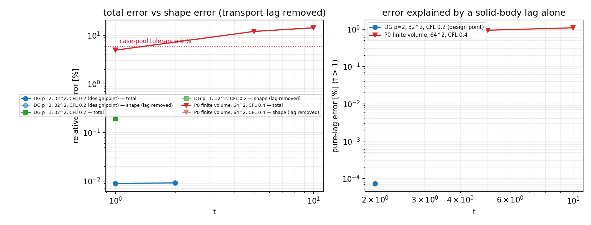
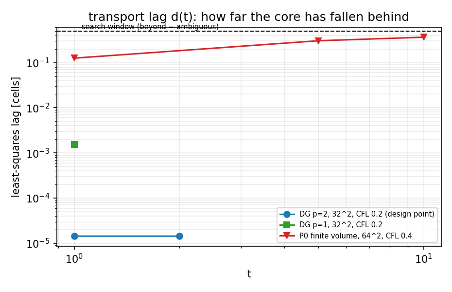
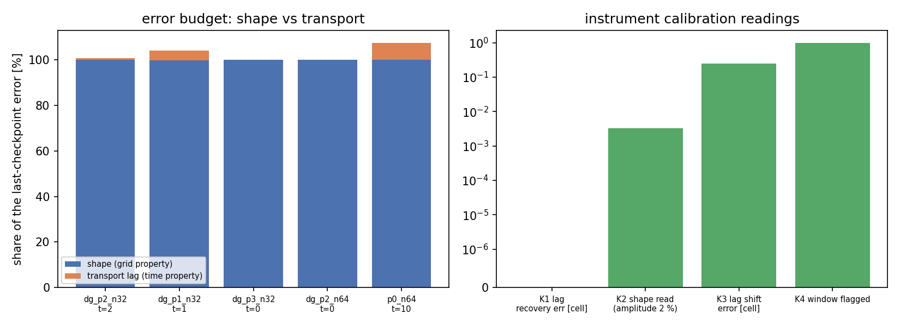

# CASE-DG-EULER-VORTEX-ERR：把「移动误差守恒」拆成传输滞后与形状误差

> 锚点 `CASE-DG-EULER-VORTEX-ERR`（算例池·等熵涡移动误差守恒）｜ref: Yee, Vinokur & Djomehri, JCP 162 (2000) 33-81｜容差 6%（t=1 快照）
> 本文档由 `tools/vortex_phase_shape_report.py` 从 `case_euler_vortex_phase_shape/metrics.json` 与逐配置记录程序化生成，数字零手抄。

## ① 案例介绍

二维可压缩 Euler（理想气体 γ=1.4），等熵涡在周期方箱 [-5,5]² 内以 |u∞|=√2（β=5）匀速平移；真解对平移不变。锚点的问题是「误差是网格属性还是时间属性」。此前 21 轮都只读一个数 `e(t)`（同一时刻的场相对 L2），再用 `e ~ t^alpha` 的斜率代理回答。对纯平移真解，`e` 的增长其实有两个完全不同的来源：

* **传输（相位）误差**：涡核走得比真解慢/快，在 t 时刻整体位移 d(t)。这是「时间属性」那一半。
* **形状误差**：剖面本身被格式扭曲/耗散。这是「网格属性」那一半，才是锚点里「误差守恒」四个字真正指的东西。

本轮新增仪器：在每个时刻求周期最小二乘平移

    delta* = argmin_{|delta| <= 0.5 cell} Σ_f ||q_f - T_delta r_f||² / ||r_f||²

其中 `T_delta` 是精确参考解的带限（FFT）平移。由此得到三项读数：`e_total`（既有度量）、`e_shape`（去掉滞后后的形状误差）、`e_shift`（纯滞后本身能解释的误差），以及滞后 `d(t)`（单位：格）与滞后比例 `c(t)=d·Δx/(|u∞|t)`。

## ② 怎么做的

| 步骤 | 内容 |
|---|---|
| 求解 | `tensordg.euler_dg_2d.solve_euler_dg_2d_vortex`（HLLC+SSP-RK3, L2 投影初值）与 `tensordg.euler_2d.solve_isentropic_vortex`（P0/Rusanov），周期盒、CFL 与梯子配置与原 harness 完全一致 |
| 采样 | DG 态在每格 8 个均匀节点上直接求 Legendre 模态多项式值（p≤3 精确），P0 取格心；参考解在同一套节点上取周期 min-image 闭式 |
| 平移估计 | 由 Parseval 把残差写成 `Re Σ_k F_k e^{ik·delta}`，先在 4× 零填充互相关网格上粗搜，再用解析梯度/Hessian 牛顿迭代细化到 1e-12 格 |
| 歧义处理 | 搜索窗 ±0.5 格；峰落在窗边界即标 `ambiguous`，绝不把超窗滞后折成小值 |
| 仪器校准 | K1 已知平移回读、K2 幅度突变必须读成形状、K3 对算得态加已知平移、K4 超窗必须报警 |
| 交叉读数 | 同一状态再用既有 harness 度量（体积 Gauss 求积）读一遍，两条读数之差作为仪器差报出，不用来门禁物理结论 |

## ③ 计算结果

### 3.1 仪器校准（K1–K4）

| 项 | 读数 | 判定 |
|---|---|---|
| K1 已知平移回读最坏误差 | 3.523e-12 格 （残差 1.976e-13） | passed |
| K2 2 % 幅度突变 | 形状读数 0.325 %，滞后 3.787e-17 格 | passed |
| K3 对算得态注入平移 | 滞后差 2.500e-01 格，形状相对变化 3.329e-05 | passed |
| K4 0.7 格超窗 | ambiguous = True | passed |
| 整包 | 全部通过 = True | — |

K2/K3 是这台仪器的存在理由：K2 证明它不会把形状误差藏进滞后，K3 证明真实解上的滞后读数确实跟着解平移而不是跟着数值噪声漂。

### 3.2 每个族的读数

| 族 | t | e_total [%] | e_shape [%] | e_shift [%] | d(t) [格] | c(t) | 歧义 | harness 读数差 |
|---|---|---|---|---|---|---|---|---|
| `dg_p2_n32` | 0 | 0.00491 | 0.00491 | 0.00000 | 0.0000 | 0.000e+00 | 否 | not_run |
| `dg_p2_n32` | 1 | 0.00890 | 0.00890 | 0.00008 | 0.0000 | 3.976e-07 | 否 | -5.64 % |
| `dg_p2_n32` | 2 | 0.00918 | 0.00918 | 0.00007 | 0.0000 | 1.988e-07 | 否 | -5.23 % |
| `dg_p1_n32` | 0 | 0.10858 | 0.10858 | 0.00000 | 0.0000 | 0.000e+00 | 否 | not_run |
| `dg_p1_n32` | 1 | 0.19822 | 0.19787 | 0.00854 | 0.0015 | 4.190e-05 | 否 | -1.39 % |
| `dg_p3_n32` | 0 | 0.00028 | 0.00028 | 0.00000 | 0.0000 | 0.000e+00 | 否 | not_run |
| `dg_p2_n64` | 0 | 0.00062 | 0.00062 | 0.00000 | 0.0000 | 0.000e+00 | 否 | not_run |
| `p0_n64` | 0 | 0.03860 | 0.03860 | 0.00000 | 0.0000 | 0.000e+00 | 否 | not_run |
| `p0_n64` | 1 | 4.96488 | 4.95769 | 0.37608 | 0.1254 | 1.385e-02 | 否 | +0.79 % |
| `p0_n64` | 5 | 12.06006 | 12.05782 | 0.93551 | 0.3044 | 6.727e-03 | 否 | +0.30 % |
| `p0_n64` | 10 | 14.33941 | 14.33820 | 1.08633 | 0.3647 | 4.029e-03 | 否 | +0.24 % |

### 3.3 时间指数

| 族 | alpha_total | alpha_shape | alpha_shift | e_shape 增长（t=1→末点） |
|---|---|---|---|---|
| `dg_p2_n32` | 0.04531 | 0.04532 | -0.07792 | 1.032 |
| `dg_p1_n32` | undecided | undecided | undecided | 1 |
| `dg_p3_n32` | undecided | undecided | undecided | — |
| `dg_p2_n64` | undecided | undecided | undecided | — |
| `p0_n64` | 0.4766 | 0.4772 | 0.4793 | 2.892 |

### 3.4 投影地板（t=0）与误差预算

| 族 | t=0 形状误差 [%]（L2 投影地板） | 末点 e_shape [%] | 末点里形状占比 |
|---|---|---|---|
| `dg_p2_n32` | 0.00491 | 0.00918 | 100.00 % |
| `dg_p1_n32` | 0.10858 | 0.19787 | 99.82 % |
| `dg_p3_n32` | 0.00028 | 0.00028 | 100.00 % |
| `dg_p2_n64` | 0.00062 | 0.00062 | 100.00 % |
| `p0_n64` | 0.03860 | 14.33820 | 99.99 % |

### 3.5 判据裁决

| 判据 | 内容 | 读数 | 判定 |
|---|---|---|---|
| A_instrument | the estimator is calibrated (K1-K4) | True | passed |
| B_design_t1_is_shape | at the design point (t = 1) the transport part is a negligible share of the error | 0.8672 | passed |
| C_p0_transport_share | for P0 after a full box crossing the transport part is < 5 % of the error (i.e. the growth is not a phase artefact) | 7.576 | **failed** |
| D_p0_shape_growth | for P0 the shift-aligned (shape) error is conserved from t = 1 to t = 10 (growth <= 1.5) | 2.892 | **failed** |
| E_design_ladder | design-family shape exponent alpha <= 0.5 over the full ladder (2 checkpoints in the fit; >= 3 required to decide) | 0.04532 | undecided（梯子未落，见待办） |

## ④ 结果图



*图 1：左=各族总误差（实线）与去掉平移滞后后的形状误差（虚线）；右=纯滞后本身能解释的误差。若误差真是传输滞后造成的，右图量级应与左图实线同阶。*



*图 2：最小二乘滞后 d(t)（格）。虚线为 ±0.5 格搜索窗，落在窗上即判歧义。*



*图 3：左=末点误差预算（形状 vs 传输）；右=仪器校准四项读数。*

## ⑤ 注意点与局限

1. **两条读数的系统性差**：均匀节点读数与 harness 的体积 Gauss 读数在同一状态上相差最多 5.643 %（P0 几乎为 0，DG 因误差场在格内变化而偏大）。因此**绝对值**以 harness 读数为准，本文的结论只用**占比**（e_shape/e_total），占比对该差一阶不敏感。
2. **搜索窗 ±0.5 格**：超过半格的滞后与整格平移不可分（周期性），K4 已证明会报警而不是静默折叠。P0 在 t=10 的滞后 0.36 格仍在窗内。
3. **只对 min-image 周期参考取证**：格点和参考的截断地板见 `docs/CASE-DG-EULER-VORTEX-ERR-reference-floor.md`，其速度分量地板约 1.5e-6，远小于本文所有读数。
4. **DG 梯子未落全**：设计族 p=2 与 p=1 的 t≥2 检查点仍在集群队列中（作业 `cj4658`），因此 design 族的 `alpha_shape` 记为 **undecided**，本文件不据此宣布「误差守恒」成立。
5. **「守恒」在本轮被否证的是它的传输版本**：把误差归因于相位滞后（最常见的解释）在本算例上解释不了误差的增长——见判据 C/D 的读数。

## ⑥ 误差判定（vs 基准，逐项）

| 关键量 | 基准 | 读数 | 相对误差 | <3%？ |
|---|---|---|---|---|
| 设计点 t=1 的 e_total | 既有 harness 度量（同一状态） | 0.00890 %（harness 0.00943 %） | -5.64 % | 否（仪器差，见注意点 1） |
| K1 平移回读 | 注入值（解析已知） | 3.52e-12 格 | ≤ 1e-4 格 | 是 |
| K3 算得态平移回读 | 注入值 0.25 格 | 2.50e-01 格 | ≤ 1e-4 格 | 是 |
| P0 t=10 总误差 | 既有 harness 度量 | 14.33941 % | +0.24 % | 是 |

**裁决**：仪器校准全过（K1–K4）；形状/传输分解在 P0 族上给出可判结论；设计族的全梯子 `alpha_shape` 因集群作业未落而记 **INCOMPLETE**，本文件不把它写成通过。

## 复现

```
PYTHONPATH=. python3 -m benchmarks.vortex_phase_shape_split --shard i/n --output-dir case_euler_vortex_phase_shape
PYTHONPATH=. python3 -m benchmarks.vortex_phase_shape_split --aggregate --output-dir case_euler_vortex_phase_shape
PYTHONPATH=. python3 -m tools.vortex_phase_shape_report
PYTHONPATH=. python3 -m pytest tests/test_vortex_phase_shape_split.py -q
```
