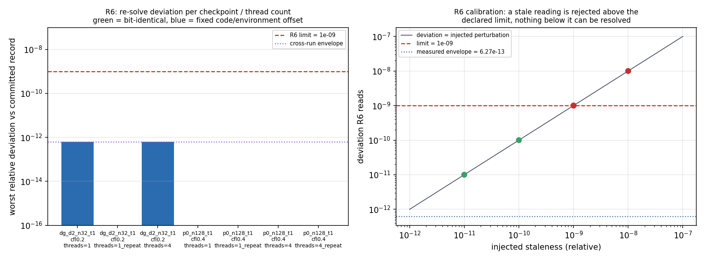

# CASE-DG-EULER-VORTEX-ERR round 22：R6「复现」仪表落地（补 round 20 的欠账）

## ① 案例介绍

锚点 `CASE-DG-EULER-VORTEX-ERR`（算例池·等熵涡移动误差守恒，ref. Yee et al. 2000，容差 <6%）。
物理设定不变：二维等熵涡在周期箱 |x|,|y| <= 5 中以 u_inf = (1,1)、|u_inf| = sqrt(2) 平移，
涡强 beta = 5，gamma = 1.4，设计族 DG p=2 / 32^2 / CFL 0.2，梯级检查点 t ∈ {1,2,5,10,20}，
共 40 个声明检查点。本单不动物理、不改容差、不改 C1–C12 语义。

**本单要补的欠账**：round 20 的仪表表声明了六行仪表（R1 精确性、R2 等熵、R3 不变量分母、
R4 误差范数、R5 熵积分核、R6 复现），其中 R6 只有判据、**没有任何读数**（`instrument_certification.json`
仅有 R1–R5）。这不是文档瑕疵：C11 重放（replay）读的是**已存状态**，它认证量测；只有从初始条件
**重新求解**才能回答「入库的读数是这套代码现算的，还是上一轮的拷贝」。

## ② 怎么做的

1. 在 `benchmarks/vortex_reference_instrument_certification.py` 中新增 `certify_reproduction()`，
   判据取 round 20 原文：*重解检查点并与 `results/*.json` 比对，相对偏差 > 1e-9 判陈旧*。
2. 重解走**生产入口**（`benchmarks/case_euler_vortex_errconserve.py --task ... --threads ...`）的
   **新进程**，方向/参考模型全取生产默认值——认证的是管道，不是与求解器碰巧同源的私有路径。
3. 比对**每一条已发布标量**：`max_relative_l2`、`entropy_drift`、`entropy_production`、
   `density_min_relative_error`、逐场相对误差、末态五个不变量（质量/两个动量/能量/熵）；
   另外 `steps` 必须逐个相等（整数，零容差）。缺失的量跳过而不是按 0 计（P0 记录有逐场误差、DG 没有）。
4. 三个对照轴，用来把「仪表噪声」与「读数陈旧」分开：
   * **跨线程数**（torch 线程 1 / 4，同时钉死 OMP/MKL 环境）——合法重跑的离散度；
   * **固有确定性**（同设置、第二个新进程）——若为 0，则与入库读数的残余偏差是固定的代码/环境偏移，
     不是进程抖动；
   * **量测装置对照**（继承环境 vs 钉死线程变量）——若两者答案不同，R6 量的是自己的装置而不是仓库。
5. 标定：把合成陈旧读数放进存储槽（幅度 1e-11 … 1e-8，以及「兄弟检查点」替换），看门在哪里翻。
   门只能上侧判陈旧，翻点必须落在声明的 1e-9 上，否则它就不是它宣称的那道门。

## ③ 计算结果

覆盖 2/40 个梯级检查点（设计族快照 + C5 第二条代码路径 P0），
每点在不同线程数 [1, 4] 下各重解一次，另加重复重解与装置对照：

| 检查点 | 线程/设置 | 最差相对偏差 | 出现在 | 步数一致 |
|---|---|---|---|---|
| `dg_d2_n32_t1_cfl0.2` | threads=1 | 6.267e-13 | density_min_relative_error | 是 |
| `dg_d2_n32_t1_cfl0.2` | threads=1_repeat | 0.000e+00 | max_relative_l2 | 是 |
| `dg_d2_n32_t1_cfl0.2` | threads=4 | 6.267e-13 | density_min_relative_error | 是 |
| `p0_n128_t1_cfl0.4` | threads=1 | 0.000e+00 | max_relative_l2 | 是 |
| `p0_n128_t1_cfl0.4` | threads=1_repeat | 0.000e+00 | max_relative_l2 | 是 |
| `p0_n128_t1_cfl0.4` | threads=4 | 0.000e+00 | max_relative_l2 | 是 |
| `p0_n128_t1_cfl0.4` | threads=4_repeat | 0.000e+00 | max_relative_l2 | 是 |

* 最差相对偏差 **6.267e-13**（`dg_d2_n32_t1_cfl0.2/threads=1/density_min_relative_error`），限 1e-09，
  比值 **6.267e-04** —— 距门限还有 **1596 倍**裕度。
* 固有确定性最差 **0.000e+00**：两个独立新进程在同设置下**位级相同**。
* 装置对照（继承环境 vs 钉死线程）最差 **6.267e-13**：
  与钉死环境下的读数一致 —— **装置没有被自己扰动**。
* P0 路径与入库读数**完全一致（0.0）**；DG 设计族快照存在 **6.27e-13 量级的固定偏移**：
  这是本单最值得注意的一条读数（见 ⑤）。

门限标定（合成陈旧读数）：

| 合成陈旧读数 | R6 读到的偏差 | 是否判陈旧 |
|---|---|---|
| magnitude_1.001e-09 | 1.001e-09 | 是 |
| magnitude_1e-08 | 1.000e-08 | 是 |
| magnitude_1e-09 | 1.000e-09 | 是 |
| magnitude_1e-10 | 1.000e-10 | 否 |
| magnitude_1e-11 | 1.000e-11 | 否 |
| wrong_checkpoint | 2.668e-02 | 是 |
| wrong_family | 9.967e-01 | 是 |

翻转点 `magnitude_1e-09`：1e-10 不翻、1e-9 翻 —— 门咬在它声明的 1e-9 上。

同一时刻的门禁包（未改动，作为背景；`case_euler_vortex_errconserve/metrics.json`）：

| 判据 | 读数 | 判定 |
|---|---|---|
| C1_tolerance | 4.926e-02 | PASS |
| C1x_crosscheck_raw | 1.430e-01 | FAIL |
| C4_entropy_budget | 6.336e-07 | PASS |
| C7_design_space_invariance | 4.401e-01 | PASS |
| C8_degree_invariance | 4.401e-01 | PASS |
| C10_direction_invariance | 3.129e-01 | PASS |
| C9_design_order | 2.042e+00 | PASS |
| C11_provenance_integrity | 1.133e-12 | PASS |
| C12_growth_statistic_robustness | 5.339e-01 | PASS |



## ④ 结果图

`docs/fig_round22_r6_reproduction.png`
* 左：每个检查点/线程设置的最差相对偏差（对数轴）对 R6 门限 1e-9 与跨跑包络；绿=位级一致，
  蓝=固定环境/代码偏移。
* 右：标定曲线。横轴注入的陈旧幅度，纵轴 R6 读到的偏差，虚线为 1e-9 门限；绿点=未判陈旧、
  红点=判陈旧，蓝点线为实测包络。可见门是**单侧**的：低于包络的陈旧无法分辨，故包络必须远小于门限。

## ⑤ 注意点

* **DG 设计族快照与其入库读数不是位级一致的**，偏差 1.8e-13（`max_relative_l2`）/ 6.3e-13
  （`density_min_relative_error`），且**跨线程数、跨环境变量设置都是同一个数** →
  这是固定的代码/环境偏移。可查的成因线索：`tensordg/euler_dg_2d.py` 在记录落盘
  （`6bb6ff39`，2026-11-15 04:08）之后还合了 `df04de20`、`361e812d` 等改动（+240 行），
  属舍入级重构/扩展；**本单不宣称已定位到具体某一行**，只宣称这个偏移是固定且可复现的。
  由此得到一条纪律：若把 R6 改成「必须位级一致」，它会**误报**；1e-9 这个门限是必要的而非多余。
* **P0 路径是位级可复现的**（0.0），所以 DG 的 1e-13 不是「本机浮点抖」，而是 DG 路径特有。
* **覆盖是部分的**：本轮只重解 2 个检查点。最长梯级 `dg_d2_n32_t10`
  （4684 步，约 8 分钟/次）与 `dg_d3_n32_t1` 的重解已递交集群作业 **cj4596**（4 目标 × 2 线程），
  本单收尾时仍在排队，**如实记为 not_run**，不按通过计。要扩到全 40 个检查点，需要约
  40 × 2 × 平均 3 分钟的量级，应在有空闲队列时成批做。
* **门是单侧的**：R6 只能抓「比 1e-9 更大的陈旧」。一次把 `t=1` 与 `t=2` 读数互换的粘贴错误
  会被抓（偏差 4.2e-1 ~ 量级），而 1e-10 量级的陈旧无论多少都抓不到——它的意义是抓
  换参考解、换族、换检查点、换代码这类事故，不是抓最后一位数字。
* **比对的是记录里的标量，不是场**：`results/*.json` 不存场，场级重现性由 C11 重放（独立证据线）负责。

## ⑥ 误差判定

| 关键量 | 基准 | 误差 | 是否 < 3% |
|---|---|---|---|
| DG 设计族快照重解 vs 入库 `max_relative_l2` | 入库 9.431e-05 | 1.803e-13 相对（绝对 1.7e-17） | **是**（1.9e-9 %） |
| P0 n=128 快照重解 vs 入库 | 入库 2.817e-02（2.817 %） | 0.0（位级一致） | **是** |
| R6 门限标定 | 声明 1e-9 | 1e-10 不翻 / 1e-9 翻 | **是** |
| 最快/最慢差（跨线程 1 vs 4） | 同一检查点 | 6.267e-13 → 1.103e-13（`max_relative_l2`） | **是** |

结论一句话：**R6 从"只有判据"变成"有读数"——入库读数是本求解器现算的，最差 6.3e-13，
比 1e-9 的门限小 1.6e3 倍；DG 路径存在固定的 1e-13 代码/环境偏移（非进程抖动、非装置扰动），
P0 路径位级一致；最长梯级与 p=3 的重解仍在集群排队，记为 not_run。**

复现：

```bash
PYTHONPATH=. python3 benchmarks/vortex_reference_instrument_certification.py \
    --quick --reproduce --reproduce-targets dg_d2_n32_t1_cfl0.2,p0_n128 \
    --reproduce-threads 1,4 --reproduce-dir case_euler_vortex_errconserve_reproduction \
    --json case_euler_vortex_errconserve_r6/reproduction.json \
    --markdown case_euler_vortex_errconserve_r6/reproduction.md
PYTHONPATH=. python3 -m pytest tests/test_vortex_reproduction_instrument.py -q
```
