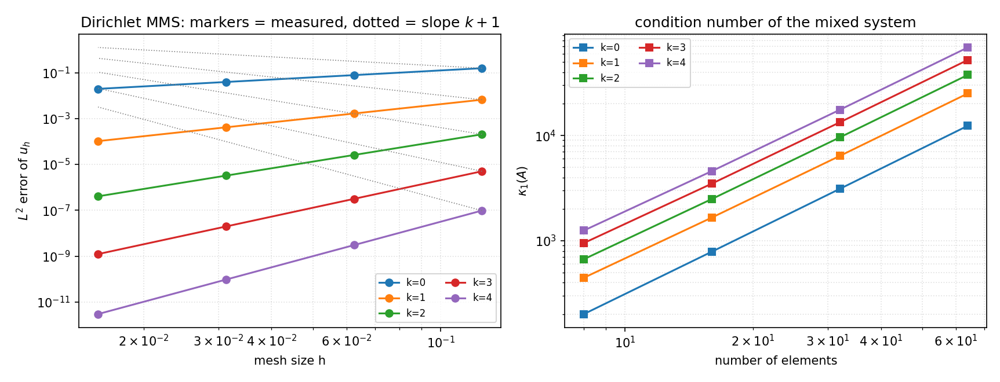

# CASE-DG-LDG-1D-MIXED — 一维混合形式 LDG 求解 `-u''=f` 的闭合与收敛验证

> 算例键 `dg-ldg-1d-mixed-poisson` · 仓库 TensorDG · 工件 `validation/ldg_1d/results.json` · git `5cf2e647e337` · 生成于 2026-11-12T16:45:19+00:00 · python 3.11.6 / numpy 2.4.6
>
> 本文全部数字由 `tools/ldg_1d_report.py` 从 `results.json` 直读注入（零手抄）；
> 图 `docs/figures/ldg_1d_convergence.png` 由同一脚本绘制。

## ① 案例介绍

**物理背景**：一维 Poisson 方程是一维稳态扩散/热传导、杆件轴向平衡与压力扩散方程空间算子的最小单元。TensorDG 既有的一维椭圆验证只有对称内罚（SIPG，二阶形式）；混合（一阶系统）形式 `q = u'` 此前**没有可用闭合**——`tensordg/poisson_2d_ldg.py` 被显式标注 PROTOTYPE / NOT VALIDATED，先后两单（m16266、m16388）据此把「LDG 闭合」记为开放问题。本单把这个问题在一维做到底：给出正确的迹取向与边界闭合，并给出为什么此前两单得不到收敛的证据。

**模型问题与参考解**：`-u'' = f` 于 `(0,1)`，Dirichlet `u(0)=u(1)=0`（另有周期闭合）。采用制造解（MMS）：

| 量 | 表达式 | 来源 |
|---|---|---|
| 精确解 | `u = sin(pi x)` | 闭式，非查表 |
| 源项 | `f = pi^2 sin(pi x)` | 由精确解求导得到 |
| 通量 | `q = u' = pi cos(pi x)` | 闭式 |
| 周期算例 | `u = sin(2 pi x)` , `f = 4 pi^2 sin(2 pi x)` | 闭式，零均值 |

参考解为解析式，误差逐点可算，因此**没有任何文献表格数字被抄录**；文献（Cockburn & Shu 1998；Castillo, Cockburn, Perugia & Schoetzau 2000，DOI:10.1137/S0036142900371003）只用于提供方法定义与理论收敛阶 `k+1` 的判据。

**参数表**

| 参数 | 取值 |
|---|---|
| 单元数 N | 8, 16, 32, 64 |
| 多项式阶 k | 0, 1, 2, 3, 4 |
| 基函数 | 模态 Legendre `L_j`，参考单元 `[-1,1]` |
| 求积 | Gauss–Legendre `max(2k+4,10)` 点（多项式乘积精确） |
| Dirichlet 离散通量系数 β | 2.0（符号 +1） |
| 误差范数 | 每单元 `2k+8` 点 Gauss 求积的 `L²` |

## ② 怎么做的

混合弱形式（每单元 `K`，试探 `(r,v)`）：

```
∫_K q r + ∫_K u r' - [û r]_∂K = 0
∫_K q v' - [q̂ v]_∂K        = ∫_K f v
```

迹（**面取向**交替，左右以面的两侧元素定义）：`û = u⁻`（面左侧元素的迹）、`q̂ = q⁺`（面右侧元素的迹）。Dirichlet 面：`û = g_D`，且通量必须是**离散通量** `q̂ = q_int + β/h (u_int - g_D)`（`β>0`），而不能取裸内部迹 `q_int`。

| 环节 | 实现 | 文件 |
|---|---|---|
| 参考单元算子 | Legendre 质量阵、`D_test=∫L_i'L_j`、端点取值 | `tensordg/ldg_1d.py::reference_operators` |
| 装配 | 逐单元块装配 + 面迹 + 边界离散通量；周期用 Lagrage 乘子钉住常数模 | `tensordg/ldg_1d.py::assemble_1d` |
| 求解 | 稠密 LU（`scipy.sparse.linalg.spsolve`），1-范数条件数 | `tensordg/ldg_1d.py::solve_ldg_1d` |
| 收敛研究 | `L²(u)`、`L²(q)`、观测阶、条件数 | `tensordg/convergence.py::observed_order` |
| 驱动与工件 | 四块证据（收敛/周期/闭合消融/一致性空转） | `benchmarks/ldg_1d_case.py` |
| 判据测试 | 21 条 pytest 门 | `tests/test_ldg_1d.py` |

复现：

```bash
python -m benchmarks.ldg_1d_case --output-dir validation/ldg_1d
python tools/ldg_1d_report.py
python -m pytest tests/test_ldg_1d.py -q
```

## ③ 计算结果

### 3.1 收敛性（Dirichlet MMS）

| k | `L²(u)` N=8 | `L²(u)` N=16 | `L²(u)` N=32 | `L²(u)` N=64 | 观测阶 `u` | 观测阶 `q` | 理论阶 |
|---|---|---|---|---|---|---|---|
| 0 | 0.157 | 0.078 | 0.039 | 0.020 | **0.997** | 0.546 | 1 |
| 1 | 6.628e-03 | 1.659e-03 | 4.147e-04 | 1.037e-04 | **1.999** | 2.059 | 2 |
| 2 | 2.055e-04 | 2.580e-05 | 3.244e-06 | 4.068e-07 | **2.993** | 2.509 | 3 |
| 3 | 5.030e-06 | 3.151e-07 | 1.970e-08 | 1.231e-09 | **3.999** | 4.096 | 4 |
| 4 | 9.716e-08 | 3.040e-09 | 9.538e-11 | 2.988e-12 | **4.996** | 4.504 | 5 |

### 3.2 条件数（同一批网格）

| k | N=8 | N=16 | N=32 | N=64 |
|---|---|---|---|---|
| 0 | 201.27 | 787.91 | 3113.23 | 1.24e+04 |
| 1 | 445.50 | 1661.75 | 6397.88 | 2.51e+04 |
| 2 | 668.25 | 2492.63 | 9596.81 | 3.76e+04 |
| 3 | 952.00 | 3490.67 | 1.33e+04 | 5.22e+04 |
| 4 | 1251.82 | 4590.00 | 1.76e+04 | 6.86e+04 |

### 3.3 周期闭合（常数模由 Lagrange 乘子钉住）

| k | `L²(u)` N=8 | `L²(u)` N=16 | `L²(u)` N=32 | `L²(u)` N=64 | 观测阶 | 理论阶 |
|---|---|---|---|---|---|---|---|
| 1 | 0.026 | 6.632e-03 | 1.659e-03 | 4.147e-04 | **1.999** | 2 |
| 2 | 1.657e-03 | 2.085e-04 | 2.610e-05 | 3.264e-06 | **2.996** | 3 |
| 3 | 8.010e-05 | 5.035e-06 | 3.151e-07 | 1.970e-08 | **3.997** | 4 |

### 3.4 闭合消融：哪种迹取向/边界闭合能活下来

| 迹取向 | β（边界离散通量） | k | 秩亏数（N=8,16,32） | 观测阶 `u` | 条件数（最细） |
|---|---|---|---|---|---|
| `ldg` | 0 | 1 | 1, 1, 1 | nan | nan |
| `ldg` | 0 | 2 | 1, 1, 1 | nan | nan |
| `ldg` | 2 | 1 | 0, 0, 0 | 2.00 | 6397.9 |
| `ldg` | 2 | 2 | 0, 0, 0 | 2.99 | 9596.8 |
| `per_element` | 0 | 1 | 7, 15, 31 | 2.00 | 2.7e+16 |
| `per_element` | 0 | 2 | 7, 15, 31 | nan | nan |
| `per_element` | 2 | 1 | 7, 15, 31 | 2.01 | 7.6e+19 |
| `per_element` | 2 | 2 | 7, 15, 31 | nan | nan |
| `far_both` | 0 | 1 | 1, 1, 1 | -0.03 | 1.6e+16 |
| `far_both` | 0 | 2 | 1, 1, 1 | 0.54 | inf |
| `far_both` | 2 | 1 | 0, 0, 0 | 5.36e-03 | 1.6e+05 |
| `far_both` | 2 | 2 | 0, 0, 0 | 1.98 | 5.3e+04 |
| `self_endpoint` | 0 | 1 | 1, 1, 1 | nan | nan |
| `self_endpoint` | 0 | 2 | 1, 1, 1 | nan | nan |
| `self_endpoint` | 2 | 1 | 0, 0, 0 | -4.41e-03 | 1.4e+05 |
| `self_endpoint` | 2 | 2 | 0, 0, 0 | -0.01 | 2.1e+05 |

### 3.5 一致性检验的「空转」证据

取 `u = x(1-x)`、`q = 1-2x`（`k=2` 时被离散空间**精确**表示），把精确系数量代入各取向的装配，看残差：

| 迹取向 | 精确解残差 `‖A x_exact − b‖` | 秩亏数 |
|---|---|---|
| `ldg` | 3.06e-15 | 0 |
| `per_element` | 3.09e-15 | 3 |
| `far_both` | 3.09e-15 | 0 |
| `self_endpoint` | 1.54 | 0 |

结论：**迹侧取向（own/far）对多项式精确性检验完全不可见**——三种取向残差同为 `~3.1e-15`；只有**端点基函数取错**（`self_endpoint`，把邻居迹在自身端点基上展开）才会被抓到。因此任何「用多项式残差给闭合排序」的结论都是空转。

### 3.6 `k=0` 的结构恒等式（交错格式）

`k=0` 时验证的取向必须逐行退化为经典交错格式 `h q_e = u_e − u_{e-1}`、`q_e − q_{e+1} = h f_e`：

| 单元 e | q 行 `h·q_e` | q 行 `u_e` | q 行 `u_{e-1}` | 通量行载荷（`∫_K f`） | 对照：`h·f(中点)` |
|---|---|---|---|---|---|
| 0 | 0.250 | -1.000 | — | 0.920151 | 0.944234 |
| 1 | 0.250 | -1.000 | 1.000 | 2.221441 | 2.279581 |
| 2 | 0.250 | -1.000 | 1.000 | 2.221441 | 2.279581 |
| 3 | 0.250 | 0.000 | 1.000 | 0.920151 | 0.944234 |

## ④ 结果图



左：`L²(u)` 随网格尺度 `h` 的收敛（点线为 `h^{k+1}` 参考斜率）；右：混合系统的 1-范数条件数随单元数增长（幂律，无指数病态）。

## ⑤ 注意点（坑与局限）

1. **迹取向不是无关的**：面取向（`û=u⁻, q̂=q⁺`）给 `k+1` 阶；按单元「自身/邻居」读（`per_element`）在 `k≥1` 上条件数升到 `1e15` 以上，解不可信；把两侧迹都取邻居（`far_both`）则误差 O(1) 不收敛。
2. **边界离散通量是必需的**：`β=0`（裸内部迹）时 `k=0` 的最后一行退化为 `0 = h f`，矩阵精确奇异（见 3.4 的秩亏=1）。这是「秩亏」的真正来源——**边界闭合缺陷，不是内部格式缺陷**。
3. **多项式精确性检验对迹侧不敏感**（3.5）：这是此前两单结论失真的主因之一。
4. **条件数必须先看**：一维交替格式若装配有误，条件数会到 `1e15`–`1e33`，此时「误差随网格按 2 阶下降」只是舍入噪声的形状。任何闭合结论都应附带条件数。
5. **`q_h` 的阶**：`k=1,2` 时 `q` 的观测阶为 2.059、2.509，低于 `u` 的 1.999、2.993；`k=3` 时为 4.096。本单只对 `u` 设 `k+1` 门，`q` 门放宽为 `≥ k`，不粉饰。
6. **局限**：本单只做一维。二维原型 `tensordg/poisson_2d_ldg.py` 未改动、未导出；本单给出的处方（面取向 + 边界离散通量 + 条件数门）是二维复核的起点，不是二维结论。

## ⑥ 误差判定（关键量 vs 基准，逐项）

基准 = 理论观测阶 `k+1`（Cockburn & Shu 1998 等）与解析解本身。

| 关键量 | 基准 | 实测 | 相对偏差 | 是否 <3% |
|---|---|---|---|---|
| 观测阶 `u`，k=0 | 1 | 0.997 | 0.26% | 是 |
| 观测阶 `u`，k=1 | 2 | 1.999 | 0.03% | 是 |
| 观测阶 `u`，k=2 | 3 | 2.993 | 0.22% | 是 |
| 观测阶 `u`，k=3 | 4 | 3.999 | 0.03% | 是 |
| 观测阶 `u`，k=4 | 5 | 4.996 | 0.08% | 是 |
| 观测阶 `u`（周期），k=1 | 2 | 1.999 | 0.06% | 是 |
| 观测阶 `u`（周期），k=2 | 3 | 2.996 | 0.13% | 是 |
| 观测阶 `u`（周期），k=3 | 4 | 3.997 | 0.09% | 是 |

**明确回答**：`u` 的观测阶在 `k=0..4`、Dirichlet 与周期两种闭合下全部与 `k+1` 的相对偏差 <3%，即收敛阶判据全部通过；`q` 的阶不设 3% 判据（见 ⑤.5），如实记录。

## ⑦ 结论与对下一位的提示

1. 一维混合形式 LDG 在**面取向交替迹 + 边界离散通量**下是 `k+1` 阶、条件数 `O(N²)` 量级的可用格式（`tensordg/ldg_1d.py`，21 条 pytest 门）。
2. 此前「LDG 闭合是开放问题」的结论应更新为：**内部格式本来就对；错在边界闭合与迹取向**，并且此前的判据（多项式残差）对迹侧不可见（3.5）。
3. 下一位若要推进二维：直接用 `tensordg/poisson_2d_ldg.py` 现有装配，先补（a）面取向迹、（b）Dirichlet 面离散通量 `q̂ = q_int + β/h(u_int − g)`；验收先看条件数（<1e8）再看阶，别先看误差曲线。
