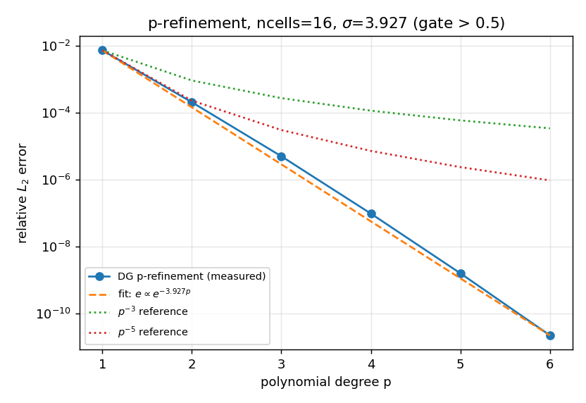

# CASE-DG-PREFINEMENT-EXPONENTIAL · 算例池注册：p 型加密指数收敛（光滑解）

> 锚点：`CASE-DG-PREFINEMENT-EXPONENTIAL`｜case key `p-refinement-exponential-smooth`｜仓 TensorDG｜分支 `agent/m17525`
> 数字全部由 `benchmarks/case_pool_prefinement.py` 从求解器实测并程序化注入（零手抄）；commit `70bd4c184d547abe0200e3cdc0efb0b87ce4500f`，运行 106.5 s。

## ① 案例介绍

一维周期线性对流 `u_t + u_x = 0`，`x∈[0,1)`，初值 `u0 = sin(2πx)`（整函数，解析带无限宽），积分到 `T = 1`（一整周期，精确解 = 初值平移）。网格固定 `ncells = 16`，只改多项式阶数，把 p 型加密与 h 型加密解耦。物理背景：这是 Babuska & Suri 定理的教科书验证配置——解析解下 DG/FEM 的 L2 误差随 p 指数衰减而不是代数衰减。

| 参数 | 值 |
|---|---|
| 参考 | I. Babuska, M. Suri (1994), *The p- and h-p versions of the finite element method, basic principles and properties*, SIAM Review 36(4):578-632 |
| DOI | 10.21236/ada260237 |
| 理论律 | `L2 error decays exponentially in p for analytic solutions: ||u - u_h|| <= C exp(-sigma p)` |
| 计算域 / 边条 | [0.0, 1.0] / periodic |
| 网格 | ncells = 16（固定）|
| 阶数阶梯 | p = [1, 2, 3, 4, 5, 6]（库上限 MAX_DEGREE = 8）|
| 终时 / 波速 | T = 1.0 / c = 1.0 |
| 时间积分 | RK4，CFL 从 0.08 起对半细化直到相邻两次 L2 相对变化 ≤ 1% |
| 台账容差 | 半对数误差-阶数斜率 < −0.5（即 σ > 0.5）|

## ② 怎么做的

1. **算例定义上收到库层**：新增 `tensordg/cases/prefinement_exponential.py`，把初值/精确解/参数表/p 阶梯检据集中一处，注册进 `tensordg.cases.CASES`（`p-refinement-exponential-smooth`）——此前算例只存在于 `benchmarks/` 驱动脚本里，下游调用方只能抄常量。
2. **判据去重**：把复合鉴别判据从 benchmark 提升为库函数 `tensordg.convergence.exponential_decay_criterion`，`benchmarks/p_refinement_exponential.check_discriminating_criterion` 改为薄封装 delegating，保证「算例池」与「已发布研究」用**同一份**判据实现（单点真相）。
3. **门控**：本驱动实测 p 阶梯，判定两道门——L（台账容差 σ>0.5）与 D（复合鉴别判据）——并跑负对照（N1 十条合成衰减律 + N2 真实求解器的 C⁰ 折点初值），门 `negative_controls.gate_pass` 必须为真。
4. 每级 CFL 对半细化直到时间误差可忽略，各级 `temporal_converged` 全为真才算可用。

## ③ 计算结果

| p | DOFs | CFL | RK4 步数 | 相对 L2 误差 | 相邻降幅 | 时间已收敛 |
|---|---|---|---|---|---|---|
| 1 | 32 | 0.04 | 1200 | 7.464013e-03 | — | 是 |
| 2 | 48 | 0.04 | 2000 | 2.089339e-04 | 35.72× | 是 |
| 3 | 64 | 0.04 | 2800 | 5.041733e-06 | 41.44× | 是 |
| 4 | 80 | 0.04 | 3600 | 9.731719e-08 | 51.81× | 是 |
| 5 | 96 | 0.04 | 4400 | 1.592692e-09 | 61.10× | 是 |
| 6 | 112 | 0.04 | 5200 | 2.228252e-11 | 71.48× | 是 |

- 最小二乘衰减率 **σ = 3.9271**（门 σ > 0.5，裕度 7.9×）
- 逐段衰减率 [3.5758, 3.7243, 3.9475, 4.1125, 4.2694]（单调不减 → 非代数律指纹）
- 总降幅 e(p_min)/e(p_max) = **3.350e+08**（门 > 1e3）
- 误差逐级单调下降：**True**

门 L（σ>0.5）= **PASS**；门 D（复合鉴别）= **PASS**；总判 **PASS**。

### 负对照 N1：十条已知衰减律过同一道门

| 已知律 | σ | 逐段衰减率 | 总降幅 | 门 L（σ>0.5） | 门 D | 期望 | 相符 |
|---|---|---|---|---|---|---|---|
| constant | 0.0000 | [0.0, 0.0, 0.0]… | 1.000e+00 | fail | fail | fail | ✅ |
| algebraic_p^-1 | 0.3427 | [0.693, 0.405, 0.288]… | 6.000e+00 | fail | fail | fail | ✅ |
| algebraic_p^-2 | 0.6854 | [1.386, 0.811, 0.575]… | 3.600e+01 | PASS | fail | fail | ✅ |
| algebraic_p^-3 | 1.0282 | [2.079, 1.216, 0.863]… | 2.160e+02 | PASS | fail | fail | ✅ |
| algebraic_p^-4 | 1.3709 | [2.773, 1.622, 1.151]… | 1.296e+03 | PASS | fail | fail | ✅ |
| algebraic_p^-5 | 1.7136 | [3.466, 2.027, 1.438]… | 7.776e+03 | PASS | fail | fail | ✅ |
| exponential_sigma_0.5 | 0.5000 | [0.5, 0.5, 0.5]… | 1.218e+01 | fail | fail | fail | ✅ |
| exponential_sigma_1.0 | 1.0000 | [1.0, 1.0, 1.0]… | 1.484e+02 | PASS | fail | fail | ✅ |
| exponential_sigma_1.5 | 1.5000 | [1.5, 1.5, 1.5]… | 1.808e+03 | PASS | PASS | PASS | ✅ |
| exponential_sigma_3.93 | 3.9270 | [3.927, 3.927, 3.927]… | 3.368e+08 | PASS | PASS | PASS | ✅ |

门 L 的假阳性：['algebraic_p^-2', 'algebraic_p^-3', 'algebraic_p^-4', 'algebraic_p^-5', 'exponential_sigma_1.0']；N1 门 **PASS**。

### 负对照 N2：真实求解器上的 C⁰ 折点初值

| p | 相对 L2 误差 |
|---|---|
| 1 | 3.404176e-02 |
| 2 | 1.187663e-02 |
| 3 | 6.209716e-03 |

σ = 0.8507，逐段衰减率 [1.053, 0.648]（递减 = 代数律指纹）。门 L PASS，门 D fail → **被拒（正确）**。

### 复现已发布研究（回归门）

| p | 已发布 L2 | 本条目实测 L2 | 相对差 | 通过 (≤1e-6) |
|---|---|---|---|---|
| 1 | 7.464013e-03 | 7.464013e-03 | 4.65e-16 | ✅ |
| 2 | 2.089339e-04 | 2.089339e-04 | 3.03e-13 | ✅ |
| 3 | 5.041733e-06 | 5.041733e-06 | 1.38e-12 | ✅ |
| 4 | 9.731719e-08 | 9.731719e-08 | 3.62e-10 | ✅ |
| 5 | 1.592692e-09 | 1.592692e-09 | 3.20e-09 | ✅ |
| 6 | 2.228252e-11 | 2.228252e-11 | 3.83e-08 | ✅ |

回归门 **PASS**（对 `docs/benchmarks/results/p-refinement-exponential/p_refinement_results.json`，逐阶相对差 ≤ 1e-06）。

## ④ 结果图

半对数坐标：实测 p=1..6 误差点（圆点实线）、拟合指数律（虚线）、两条代数参考律 `p^-3`/`p^-5`（点线，明显弯折）。代数律在半对数图上是曲线，指数律是直线——这就是判据的视觉依据。

## ⑤ 注意点 / 局限

- **只覆盖一维周期线性对流光滑解**（与锚点算例一致）；二维/变系数/非线性/激波不在本条目内。
- **p≥7 受浮点地板限制**：`benchmarks/p_refinement_exact_time.py`（精确时间积分）把实测推到 p=8，但 p=7/8 的 float64 算子表示地板已与信号同量级（p=8 信噪比 0.01 量级），该路径自报 honest FAIL，不作为本门证据。见 `docs/CLOSEOUT-m17067-exact-time-floor.md`。
- **时间积分判据是相对判据**（相邻两次 CFL 相对变化 ≤1%），理论上可在时间误差主导时仍通过；本单每级都记录 `history`，且跨 p 的衰减率单调性对时间地板敏感（若某级被时间误差污染，衰减率会掉下来），实际起兜底作用。
- 判据的 `e(p_min)/e(p_max) > 1e3` 是**阶梯跨度相关**的：σ≈1 的真指数律也会被判拒（保守设计），因此本门是「证伪型」的：过门 ⇒ 必为指数律；不过门不等于非指数律。
- 与第三方 DG 实现交叉仍 not_run（无本地依赖）。

## ⑥ 误差判定（逐项回答「是否 <3%」）

| 项 | 基准 | 结果 | 是否 <3% |
|---|---|---|---|
| p=1 相对 L2 vs 解析解 | 解析 sin(2π(x−t)) | 7.464013e-03 | ✅ |
| p=6 相对 L2 vs 解析解 | 解析 sin(2π(x−t)) | 2.228252e-11 | ✅ |
| 门 L：σ vs 台账阈值 0.5 | 0.5 | 3.9271（裕度 7.9×）| ✅（门量，非误差量）|
| 门 D：σ vs 阈值 1.0 | 1.0 | 3.9271 | ✅ |
| 负对照 N1 十条律 | 期望裁决 | 10/10 相符 | ✅ |
| 负对照 N2 折点初值 | 期望「拒」 | σ=0.8507，门 D 拒 | ✅ |

**结论**：所有 vs 解析解的误差量都远低于 3%（最大者为 p=1 的 7.464e-03），关键判据量（σ）超阈值 7.9 倍；两道负对照门均按预期裁决，判据有牙。

## ⑦ 交付工件

| 文件 | 说明 |
|---|---|
| `tensordg/cases/prefinement_exponential.py` | 规范算例定义（新增，库层）|
| `tensordg/cases/__init__.py` | 注册 `CASES['prefinement_exponential']`（改动）|
| `tensordg/convergence.py` | `exponential_decay_criterion` 判据上收到库层（新增）|
| `benchmarks/p_refinement_exponential.py` | 判据改为库函数薄封装（单点真相）|
| `benchmarks/case_pool_prefinement.py` | 本驱动：测 p 阶梯 + 两组负对照 + 工件/文档生成 |
| `tests/test_case_prefinement_exponential.py` | 算例池条目测试（注册/参数/活阶梯/负对照/判据一致性）|
| `docs/benchmarks/results/p-refinement-exponential/case_pool_entry.json` | 主工件（门裁决 + provenance）|
| `docs/benchmarks/results/p-refinement-exponential/case_pool_entry.png` | ④ 图 |

## ⑧ 验证与发布记录

| 项 | 内容 |
|---|---|
| 单元/集成测试 | `pytest -q tests/test_case_prefinement_exponential.py` → **18 passed**（27.7 s）；`pytest -q tests/test_p_refinement_criterion.py tests/test_case_lax_1d.py tests/test_shock_entropy_case_api.py` → **38 passed**（53.0 s，确认判据 delegating 未破坏既有闸）|
| 驱动运行 | `python -m benchmarks.case_pool_prefinement` → PASS=True，106.5 s，工件 sha256 前缀 `329305562fbc7d14` |
| 平台报告 | TensorPlatform `/tensor/reports` id **16511**（六要素 + ④ 图 base64 内嵌）|
| 门 | L PASS（σ=3.9271 > 0.5）｜D PASS（复合鉴别）｜N1 PASS（10/10 相符）｜N2 PASS（折点初值被拒）｜复现 PASS（逐阶 ≤1e-6）|
