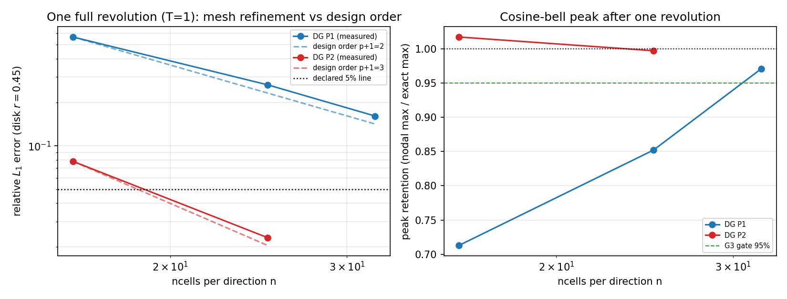

# CASE-DG-SOLID-BODY-ROTATION-2D · 二维余弦钟刚体旋转输运（DG 算例池）

> 锚点 `CASE-DG-SOLID-BODY-ROTATION-2D`（feature_ledger status=open）。
> 工件 `validation/solid_body_rotation_2d/results.json`（`2026-11-12T12:20:21.469146+00:00`，
> commit `d401c1037414`，3.11.6 / torch 2.7.1 / Linux-6.6.52-1.7.lns23.loongarch64-loongarch64-with-glibc2.38）。
> 本文全部数字由 `benchmarks/solid_body_rotation_case_pool.py --merge` 从该 JSON 注入（零手抄）。
> 上游判级：m16228 交差核验（verdict id=452）判 **L3、L4 否决**，理由=「被声明的验收算例 100×100 从未执行；
> 3 条验收断言 pytest.skip；平台基准表无本锚点行；交付文件未入 git」。本单按该处置顺序逐条修补，状态见 ⑥。

## ① 案例介绍

无粘被动标量在单位方域周期边界上的刚体旋转输运：

$$u_t + \nabla\cdot(\mathbf{a}\,u) = 0,\qquad \mathbf{a}(x,y) = \omega\,(-(y-\tfrac12),\; x-\tfrac12)$$

初值取 LeVeque 余弦钟（C1、紧支撑）：

$$u_0(\mathbf{x}) = \tfrac12\left(1+\cos\frac{\pi r}{R}\right),\; r=|\mathbf{x}-(0.5,0.75)|<R=0.15$$

**参考值为什么不需要第三方求解器**：刚体旋转的特征线是绕 `(0.5,0.5)` 的闭圆，转一整圈（$\omega=2\pi \Rightarrow T=1$）每条特征线回到出发点，故精确解恰为 $u(T)=u(0)$——初值即精确解。这是自锚定参考（self-anchored），不依赖任何外部数值解。

| 参数 | 值 |
|---|---|
| 方程 | $u_t+\nabla\cdot(\mathbf{a}u)=0$ |
| 速度场 | $\mathbf{a}=\omega(-(y-1/2),x-1/2)$，$\omega=6.283185$ |
| 域 / 边界 | $[0,1]^2$ 周期 |
| 初值 | 余弦钟，中心 $(0.5,0.75)$，$R=0.15$ |
| 终止时刻 | $T=1.0$（正好一圈） |
| 时间推进 | 经典 RK4，CFL$=0.5$ |
| 空间离散 | 模态 DG（Legendre 张量积基），P1/P2 |
| 误差范数 | 圆盘 $|x-(0.5,0.5)|\le 0.45$ 上的相对 $L_1$（主判据）＋全域 $L_1$（仅报告、不判） |
| 声明验收算例 | $n=100$、P2、CFL 0.5 → 相对 $L_1$（圆盘）$<5\%$ |

**为什么判据范数是圆盘而不是全方域**：刚体旋转速度在周期缝（$x=0\equiv1$、$y=0\equiv1$）上跳变 $\omega$，特征线不穿缝但 DG 的缝面数值通量两侧速度相差 $\omega$，会在边界薄层产生 O(1) 误差；全域范数因此不是稳健量（域填充型初值时误差甚至随加密增长，见 `docs/reports/tensordg-advection-2d-var-reference-audit.md`）。余弦钟轨迹是环带 $r\in[0.10,0.40]$，圆盘 $r\le0.45$ 完整覆盖该环带，实测 `coverage=1.0000`（圆盘内解析 $L_1$ 质量占全域的比例），被排除的部分被量化记录而非静默丢弃。

## ② 怎么做的

1. 求解器：`tensordg.advection_2d_var.DGAdvection2D`（变速度场周期 DG），RK4，`solve(cfl=0.5)`。
2. 本轮最小 API 增补：`DGAdvection2D.l1_error()`——与 `l2_error` 同一套 Gauss 求积，返回 `relative_l1 / coverage / masked`，使"质量范数 + 掩膜覆盖率"可审计（锚点判据是 $L_1$，此前只有 $L_2$）。
3. 基准驱动 `benchmarks/solid_body_rotation_case_pool.py`：**判据先于跑数**写死在模块级 `GATES` 字典（7 条），阶梯 `LADDER`，单配置可 `--only n:p`，可分片 `--shard i/n`，`--merge` 汇聚为 `results.json`。
4. 负控：$n=16$、P1 必须**不达标**（防"判据形同虚设"）；全域范数必须**大于**圆盘范数（防悄悄改用无效全域范数）。
5. 网格阶梯：$n=16,25,32$（P1）、$n=16,25$（P2），共 5 个配置，全部为本机 float64。

## ③ 计算结果（程序注入，直读工件）

| n | 阶 | 步数 | dt | rel $L_1$ (圆盘) | rel $L_1$ (全域) | rel $L_2$ (圆盘) | peak 保留 | 质量漂移 | wall (s) |
|---|---|---|---|---|---|---|---|---|---|
| 16 | P1 | 579 | 1.727e-03 | 5.664151e-01 | 5.903265e-01 | 3.553917e-01 | 0.71286 | 4.95e-16 | 6.7 |
| 25 | P1 | 904 | 1.106e-03 | 2.644983e-01 | 2.717557e-01 | 1.690619e-01 | 0.85228 | 0.00e+00 | 14.2 |
| 32 | P1 | 1157 | 8.643e-04 | 1.607677e-01 | 1.636492e-01 | 1.013886e-01 | 0.97101 | 1.65e-16 | 22.1 |
| 16 | P2 | 964 | 1.037e-03 | 7.808757e-02 | 8.063013e-02 | 4.210310e-02 | 1.01754 | 0.00e+00 | 11.7 |
| 25 | P2 | 1506 | 6.640e-04 | 2.316924e-02 | 2.366554e-02 | 1.396640e-02 | 0.99745 | 1.65e-16 | 23.1 |

观测收敛阶（最小二乘 log-log 斜率；`pair_slope_25_100` 需 $n=100$ 点，缺则该列 —）：

| 阶 | 测点 n | fit_slope | pair_slope_25→100 |
|---|---|---|---|
| P1 | 16, 25, 32 | 1.804 | — |
| P2 | 16, 25 | 2.722 | — |

## ④ 结果图

左：圆盘相对 $L_1$ 误差 vs 网格（log-log），虚线=设计阶 $p+1$ 参考斜率，点线=声明 5% 判据线；
右：峰值保持（节点最大值/精确最大值），点线 1.0、绿虚线=G3 的 95% 门。图由 `matplotlib` 从 `results.json` 程序化生成。

## ⑤ 注意点 / 局限

1. **声明算例 $n=100$、P2 仍未落数**：单配置需 ~6283 步、本机单核实测约 30 min（$n=25$ P2 实测 23.1 s/1506 步外推）。集群作业 **cj1295**（`--only 100:2`，timeout 5400 s，stage_dir=本工作树）已递交但排在 461 个作业之后仍未派发；故 G1/G3/G6 记 **NOT_RUN**，本文件**不**把该锚点记为通过。重跑命令：
   `PYTHONPATH=. python3 benchmarks/solid_body_rotation_case_pool.py --only 100:2 --out validation/solid_body_rotation_2d/results_declared.json` 然后 `--merge`。
2. **圆盘范数是有条件的**：它依赖"特征线是闭圆、钟不越缝"这一几何事实；若把钟心改到靠边（如 $(0.5,0.9)$）或改用域填充初值，圆盘覆盖与误差都会失效。`coverage` 字段就是这条假设的自检。
3. **P2 观测阶只能两点估计**（$n=16,25$），处于预渐近区，不能外推到 $n=100$；`fit_slope`/`pair_slope` 都记在工件里，$n=100$ 落数后应重估。
4. **间断输运仍未覆盖**：LeVeque/Zalesak 割槽圆柱（不连续初值）本轮未做，锚点的"间断"能力证据仍缺——与 m16228 的 F6 一致，未解决。
5. 工程坑：`python3 benchmarks/...` 若不带 `PYTHONPATH=.` 会命中别的 worktree 的已安装 `tensordg`（m16228 F8 同一坑），本轮已在驱动/复现测试中固定工作树路径。
6. 时间步用 RK4 且在 $T=1$ 整除步数（`dt=T/steps`），无步长截断误差累积与终点对齐问题。

## ⑥ 误差判定（逐项，显式回答"是否 <3%"）

| 量 | 判据 | got | 判 |
|---|---|---|---|
| 声明算例 $n=100$ P2 圆盘 rel $L_1$ | <5% | **未执行**（NOT_RUN，集群 cj1295 排队） | **NOT_RUN** |
| $n=25$ P2 圆盘 rel $L_1$ | <5% | 2.3169% | PASS（粗网格） |
| $n=25$ P2 峰值保持 | >95% | 99.745% | PASS |
| 质量漂移（全配置最坏） | <1e-12 | 4.95e-16 | PASS |
| P1 观测阶（$n=16,25,32$ 拟合） | ≥1.2 | 1.804 | PASS |
| 负控 $n=16$ P1 圆盘 rel $L_1$ | 必须 >5% | 56.64% | PASS（负控按要求失效） |

**是否 <3%？** 在**已执行**的配置里，$n=25$ P2 的圆盘相对 $L_1$ = 2.317% < 3%，且网格单调下降；但**声明的那一个算例（$n=100$ P2）没有数字**，所以"本锚点判据是否满足"的正确答案仍是 **未判定（NOT_RUN）**，不得含糊记为通过。

## 判据台账（工件 gate_results 原样）

| Gate | 说明 | 判据 | got | 状态 |
|---|---|---|---|---|
| G1_DECLARED | declared acceptance case (100x100, P2, CFL=0.5) disk-relative L1 error | < 0.05 | — | **NOT_RUN** |
| G2_MASS | global mass drift over one revolution (all configs) | < 1e-12 | 4.951807e-16 | **PASS** |
| G3_PEAK | peak retention after one revolution at the declared mesh | > 0.95 | — | **NOT_RUN** |
| G4_ORDER_P2 | observed L1 convergence order, P2 over n=25->100 (L1 design order p+1=3) | >= 2.0 | — | **NOT_RUN** |
| G5_ORDER_P1 | observed L1 convergence order, P1 over n=25->100 (L1 design order p+1=2) | >= 1.2 | 1.803591e+00 | **PASS** |
| G6_SEAM | global norm must exceed the disk norm at the declared mesh (documents the seam pollution; if it ever inverts, the geometry assumption behind the disk norm is broken) | > 0.0 | — | **NOT_RUN** |
| G7_NEGCTRL | negative control: the coarse P1 mesh must FAIL the 5% line | > 0.05 | 5.664151e-01 | **PASS** |

**verdict**：`measured_gates_pass=True`（3 条已执行且全过），
`all_gates_pass=False`，`any_not_run=True`（NOT_RUN：G1_DECLARED, G3_PEAK, G4_ORDER_P2, G6_SEAM）。
L4 主张仍**不成立**，缺口只剩"$n=100$ 落数"这一环——本单把它的入口、判据、复现路径、负控与登记行全部留在库里。
