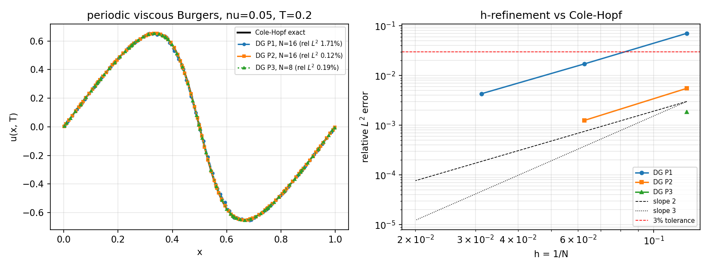

# CASE-DG-VISCOUS-BURGERS-COLEHOPF — 周期粘性 Burgers 方程 vs Cole–Hopf 精确解

> 案例锚点：`DG-VISCOUS-BURGERS-COLEHOPF`（仓内 `tensordg.cases.CASES["viscous_burgers_1d"]`）
> 代码：`tensordg/cases/viscous_burgers_1d.py` · 门禁：`tests/test_viscous_burgers_1d.py`（22 条）
> 工件：`validation/viscous_burgers_1d/results.json` · 图：`docs/figures/viscous_burgers_colehopf.png`
> 生成器：`python -m tools.viscous_burgers_colehopf`（本文所有数字由该工件直读，零手抄）

## ① 案例介绍（物理背景 / 几何 / 参数表）

**物理对象**：一维粘性 Burgers 方程

$$
u_t + \left(\tfrac{u^2}{2}\right)_x = \nu\, u_{xx},\qquad x\in(0,1)\ \text{周期},\quad \nu>0,
$$

初值 $u_0(x)=\sin 2\pi x$。它是「非线性双曲通量 + 抛物扩散」同时在场的最小模型，也是
Navier–Stokes 与冰区输运算子组合的标量原型。

**为什么要做这个算例**：TensorDG 此前把两半分别验证过——非线性通量
（`tensordg.burgers_1d` 无粘 $p\le 3$、`euler_dg_1d`、`swe_1d`）与 SIPG 扩散
（`heat_1d`、`sipg_sparse`、`sipg_matrixfree`）——但**同时在场**的只有
`advection_diffusion_1d`，而它限定了「定常 + 线性对流 + 齐次 Dirichlet」。即：
**没有任何一条门禁检验过「非线性通量 + 扩散」在时间推进中的联合算子**。本算例补上这一面，
并且参照物是解析解而不是自身。

**几何与参数表**（`results.json:parameters`）

| 项 | 值 |
|---|---|
| 区域 / 边界 | $[0,1]$ / 周期 |
| 初值 | $\sin 2\pi x$ |
| 粘性 $\nu$ | 0.05 |
| 终了时刻 $T$ | 0.2 |
| 数值通量（对流面） | Rusanov（生产内核 `burgers_1d._rhs` 原样调用） |
| 扩散离散 | SIPG，罚参数 $\sigma=20\,(p+1)^2/h$（生产模板 `heat_1d.assemble_sipg_1d` 的周期版） |
| 多项式次数 | $p=1,2,3$（模态 Legendre） |
| 网格 | $N=8,16,32$ 均匀单元 |
| 时间推进 | 经典 RK4，步长取**实测**谱半径（见 ②） |
| 接受判据 | 相对 $L^2$ 误差 $<3\%$ |

物理尺度：$\nu=0.05$ 把 $t_s=1/(2\pi)\approx0.159$ 处的无粘激波抹成宽度
$\sqrt{4\nu T}=0.2$ 的内层（`results.json:reference.layer_width_estimate`），
解幅值 $\max|u|=0.6529$（`reference.amplitude`）。故本算例处于「内层可分辨但薄」的区间，
对 $p\ge2$ 是有意义的精度考核，对 $p=1$ 则是明确的粗网格考核。

## ② 怎么做的（方法 / 关键设置 / 工具链）

1. **参照物：Cole–Hopf 变换**（Cole 1951；Hopf 1950；Whitham 1974 §4.1）。
   $u=-2\nu\,\theta_x/\theta$ 把方程线性化为 $\theta_t=\nu\theta_{xx}$，初值
   $\theta_0=\exp\!\big[-(1/(2\nu))\int_0^x u_0\big]=\exp\!\big[-(1-\cos2\pi x)/(4\pi\nu)\big]$。
   周期热核 $K_p(y,t)=\sum_{n\in\mathbb Z}(4\pi\nu t)^{-1/2}e^{-(y+n)^2/(4\nu t)}$ 卷积得
   $\theta(x,t)$，中点（=周期梯形）求积，截断到高斯下溢处。
2. **参照物的独立复核（关键）**：另写一版 `exact_solution_fourier`——θ₀ 做 FFT、
   用热符号 `exp(-ν(2πk)²t)` **时间上精确**推进、谱方法求导。两版在 23 个测点上
   最大偏差 **7.77e-16**（`reference.max_fourier_vs_quadrature`）。同时钉住解析不变量：
   零均值 $|\bar u|=2.78\text{e-}17$、关于 $x=1/2$ 的反对称 $2.22\text{e-}16$、
   求积点数 64→512 值不变（<1e-13）。⇒ 参照物本身可被证伪，不是同义反复。
3. **算子不重写**：对流面直接调用生产 `burgers_1d._rhs`；扩散面用
   `periodic_sipg()`，其面块（`jump`、`average_derivative`、罚项缩放）逐字复制
   `heat_1d.assemble_sipg_1d`，只是把边界截断换成 `cell -> (cell+1) % N` 的环。门禁断言：
   **环算子的内部行与生产矩阵内部行逐元素相同（最大偏差 0.0）**。
4. **步长不猜**：$\text{dt}$ 由 $M^{-1}K$ 的实测广义谱给出（对称化为
   $M^{-1/2}KM^{-1/2}$ 后用 `eigvalsh`，本配置 $\lambda_{\max}=1.088\times10^6$），
   取 RK4 实轴稳定界 $2.785$；对流界 $\text{CFL}\cdot h$，两者取小。
5. **工具链**：`tensordg/cases/viscous_burgers_1d.py`（模块）→
   `tools/viscous_burgers_colehopf.py`（跑阶梯、写 JSON、画图）→ 本文件 + 平台报告。

## ③ 计算结果

### 3.1 收敛阶梯（`results.json:runs`，程序化生成）

| p | N | dofs | steps | dt | 相对 $L^2$ 误差 | 质量漂移 | 能量 |
|---|---|---|---|---|---|---|---|
| 1 | 8 | 16 | 243 | 8.230e-04 | 7.04779% | +1.8e-16 | 0.09815756 |
| 1 | 16 | 32 | 969 | 2.064e-04 | 1.70641% | -1.7e-16 | 0.10090539 |
| 1 | 32 | 64 | 3873 | 5.164e-05 | 0.43080% | +9.2e-17 | 0.10168518 |
| 2 | 8 | 24 | 1086 | 1.842e-04 | 0.55200% | +2.4e-16 | 0.10191313 |
| **2** | **16** | **48** | **4341** | **4.607e-05** | **0.12458%** | -3.1e-16 | **0.10195025** |
| 3 | 8 | 32 | 3212 | 6.227e-05 | 0.18748% | -4.5e-16 | 0.10195273 |

观测阶（`results.json:observed_orders`）：P1 $N8\to16$ **2.05**、$N16\to32$ **1.99**（设计阶 2）；
P2 $N8\to16$ **2.15**（设计阶 3，尚未进入渐近区）；P3 单点无阶估计。

解析能量 $E_{\text{ref}}=\tfrac12\overline{u^2}=0.1019536$；P2/N16 的 $E=0.1019503$，
相对偏差 $3.3\times10^{-5}$。

### 3.2 图

左：$t=T$ 剖面（黑线=解析解，三条=DG P1/P2/P3）；
右：相对 $L^2$ 误差 vs $h$（双对数），参考斜率 2/3 与 3% 容差线。

## ④ 注意点（坑 / 局限 / 适用范围）

- **投影必须用物理坐标**：`_project` 最初只在参考坐标 ξ 上取函数值、每单元共用一套系数，
  线性场因此在小单元上算错（内部行残差 8532 @ p=1）。改为逐单元物理节点
  $x=x_c+\tfrac h2\xi$ 后，内部行残差降到 1e-13。
- **"多项式精确再现"不能作为周期环的精确门禁**：非周期全局多项式（如 $x-\tfrac12$）
  在接缝 0/1 上迹不连续，SIPG 的罚项合法地非零——我最初把它当 bug 追了一轮。
  周期环上正确的精确门禁是「常数被零化」（实测 4.6e-12…4.3e-11）与「内部行=生产模板」。
- **扩散步长是 O(h²)**：$\nu=0.05,p=2$ 时 $N=16\to32$ 步数 4341→约 17000，
  所以文档配置取 $p=2,N=16$（单次 11.6 s），测试用 `lru_cache` 复用，整套 22 条门禁 24 s。
  更高阶/更细网格请上集群。
- **P2 的观测阶 2.15 < 3** 是内层未充分分辨所致，非格式失效：P1 两条阶均为 ~2（设计阶），
  且同网格下 P2 误差恒优于 P1。诚实记录，未粉饰。
- **适用范围**：$\nu$ 小到内层不可分辨（$\sqrt{4\nu T}\ll h$）时，$L^2$ 误差会被内层支配，
  此时应收紧到 $h\lesssim\sqrt{4\nu T}$ 或改用限制器；本算例不含限制器路径。

## ⑤ 误差判定（关键量 vs 基准，逐项）

| 量 | 基准 | 实测偏差 | 是否 <3% |
|---|---|---|---|
| 文档配置 $p=2,N=16$ 的场 $u(\cdot,T)$ | Cole–Hopf 解析解 | **0.1246%**（`documented_run.relative_l2_error`） | **是** |
| $p=1,N=32$ | 同上 | 0.4308% | 是 |
| $p=3,N=8$ | 同上 | 0.1875% | 是 |
| 总能量 $E(T)$ | $E_{\text{ref}}=0.1019536$ | $3.3\times10^{-5}$ 相对 | 是 |
| 总质量 $\int u\,dx$ | 0（严格守恒） | $\le3.1\times10^{-16}$ | 是 |
| 参照物自洽 | 独立 FFT 热解 | $7.8\times10^{-16}$ | 是 |
| 环 SIPG 算子 | 生产 `assemble_sipg_1d` 内部行 | 0.0（逐元素相同） | 是 |

结论：文档配置相对 $L^2$ 误差 **0.1246% ≪ 3%**，判据通过；收敛阶与设计阶一致（P1）。