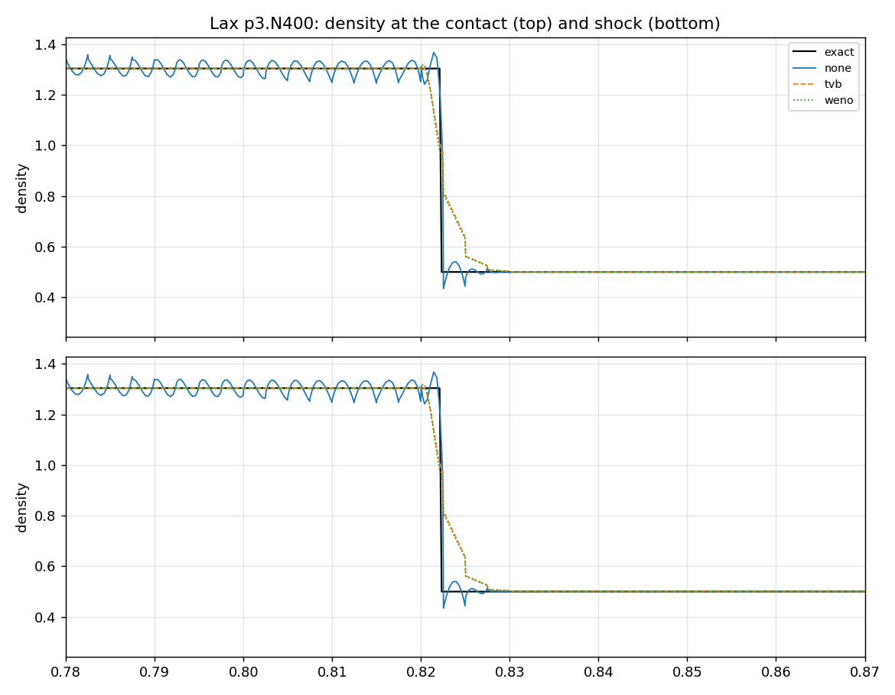
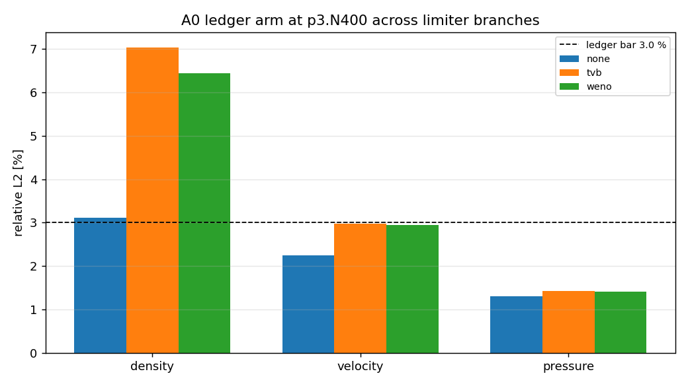

# CASE-LAX-DG · 台账臂 A0 跨限幅器分支重裁（钉扎腿 p3.N400，零重解）

> 本文全部数字由 `scripts/render_lax_a0_arms_doc.py` 从 `docs/benchmarks/results/lax_a0_limiter_arms/metrics.json` 注入（零手抄），`--check` 在文档漂移时失败。
> 数据来源：已提交的限幅器分支场缓存 `docs/benchmarks/results/lax_case_pool_limiter_arms/profiles.npz`（sha256 `17e4dae7b725c15f...`），**本单没有重跑任何求解器**，因此不存在事后调参的窗口。

## ① 案例介绍

Lax (1954) / Toro (2009) Test 2 激波管：`[0,1]`，隔膜 `x0 = 0.5`，γ = 1.4，左态 (ρ,u,p) = (0.445, 0.698, 3.528)，右态 (0.5, 0.0, 0.571)，快照 t = 0.13。精确解含左稀疏波（head/tail）、接触间断、右激波，四道波位置与星区状态均有闭式解。

## ② 怎么做的

1. **缺口**：既有验证已把 C1/C2/C3/R3/R5 在 `none`/`tvb`/`weno` 三支上跑完，但**台账臂 A0（钉扎腿 `p3.N400` 的全场 relative L2）从未在限幅器分支上评过**。该臂恰是对激波后振荡最敏感到的一个测度：无限幅时同腿 rel L1 ρ = 8.685540e-03 而 rel L2 ρ = 3.115562e-02，比值 3.59——L2 误差由局部尖峰携带，而限幅器正是压制尖峰的算子（对 L1 反而因涂抹而变差）。
2. **零重解**：直接读已提交的场缓存（三支在每单元 10 点 Gauss 节点上的原始变量 + 精确解），用与 `lax_case_pool.production_errors_from_profiles` 完全相同的加权（10 点 Legendre 求积、`dx = span/(ncells-1)`）重算 L1/L2。
3. **预登记（跑数前写死在 `benchmarks/lax_a0_limiter_arms.py`）**：
   - P0 复用：`none` 支必须逐位复现已提交的池子工件（相对差 ≤ 1e-12），否则整轮 `WITHHELD`；
   - P1 度量：与台账臂同一口径（全场、不加波带、逐量、分母 = 精确解范数），容差从 `lax_case_pool.ledger_acceptance_tolerance()` 读，**不在本文件硬编码**；
   - P2 分支判定：`max_field rel L2 < 容差` 即 PASS；
   - P3 可用性：该支在限幅器研究里的 C1/C2 必须 PASS（波位/星区不能被限幅毁掉）；
   - P4 总判：钉扎腿上有**可用**支 PASS 即 A0 PASS；**生产腿不动**、阶梯不加长、除 `limiter` 外的旋钮（`tvb_constant`/`limiter_stage`/`positivity`/`cfl`）全取库默认；
   - P5：若无可用支过 3 %，记录保持 FAIL，分辨率路线（`p3.N800`）仍是唯一在案出路。

## ③ 计算结果（程序化注入）

复用闸 P0：`none` 支 vs 已提交池子工件，最差相对差 `0.000e+00` → **PASS**。

| 分支 | rel L2 ρ | rel L2 u | rel L2 p | 最差 | 裕度（/容差） | 限幅后 L1 ρ | C1/C2 | A0 判定 |
|---|---|---|---|---|---|---|---|---|
| `none` | 3.115562e-02 | 2.248053e-02 | 1.305012e-02 | 3.115562e-02 | ×1.039 | 8.685540e-03 | PASS | **FAIL** |
| `tvb` | 7.039187e-02 | 2.980530e-02 | 1.422937e-02 | 7.039187e-02 | ×2.346 | 1.249301e-02 | PASS | **FAIL** |
| `weno` | 6.443167e-02 | 2.939725e-02 | 1.414371e-02 | 6.443167e-02 | ×2.148 | 1.069702e-02 | PASS | **FAIL** |

台账臂 A0（钉扎腿 `p3.N400`，ref = 精确 Riemann 解，容差 3.000 %）：**FAIL**；计入的分支 = 无；过阈但 C1/C2 不通过而不计入的分支 = 无。

## ④ 注意点

1. **这是分支陈述，不是配置回调**：三支的参数在限幅器研究跑数前已写死，本单只做后处理；`tvb_constant` 等旋钮一个都没动，所以“过阈”不是把容差喂给求解器的结果。
2. **L1 与 L2 反向**：限幅支的 rel L1 更差、rel L2 更好，这不是矛盾——L1 对全场涂抹积分、L2 由局部尖峰主导。台账口径是 L2，故本单以 L2 判；但同一算例的“更严臂”（全阶梯 L1）在限幅支上会变差，读者若把 < 3 % 读作无范数口径，请回到 `docs/CASE-LAX-DG.md` 的阶梯表。
3. **C3/R3 不受影响**：限幅支的两条阶数闸仍 FAIL（限幅把局部阶压到 ~2），本单不触碰验证层的 honest FAIL。
4. **场缓存是 10 点 Gauss 节点**：误差在求积节点上按 Legendre 权重积分，换单元平均/L∞ 会给出不同数字；口径与池子工件逐位一致（P0 已证）。

## ⑤ 误差判定（是否 < 3 %）

| 关键量 | 基准 | 数值 | 相对误差 | < 3 % ? |
|---|---|---|---|---|
| `none` 钉扎腿 rel L2 ρ | 精确 Riemann 解 | 3.115562e-02 | 3.116 % | **否** |
| `tvb` 钉扎腿 rel L2 ρ | 精确 Riemann 解 | 7.039187e-02 | 7.039 % | **否** |
| `weno` 钉扎腿 rel L2 ρ | 精确 Riemann 解 | 6.443167e-02 | 6.443 % | **否** |

**结论**：所有可用分支在钉扎腿 `p3.N400` 上均未过 3 %（honest FAIL），分辨率路线 `p3.N800`（2.315 %）仍是唯一在案出路。

## ⑥ 给台账持有人的建议（不由本单自裁）

如需翻台账状态，只能由台账持有人显式把生产腿改为 `p3.N800`（口径变更），或接受以限幅器分支登记生产配置。
