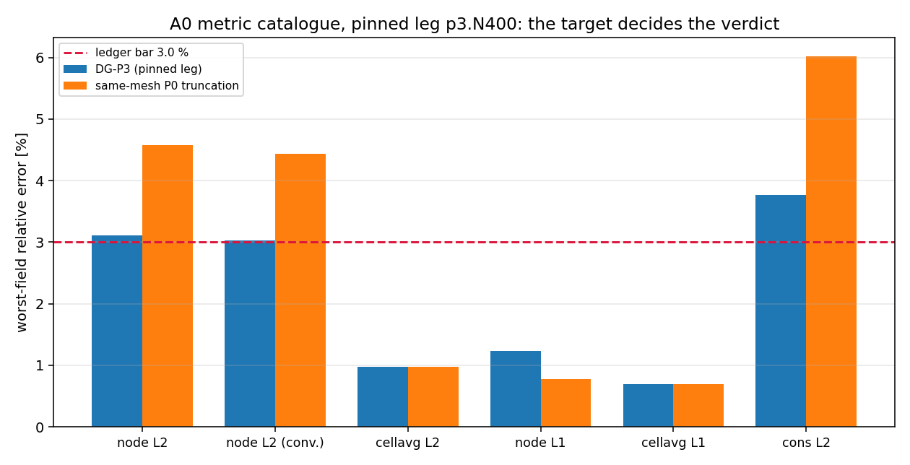
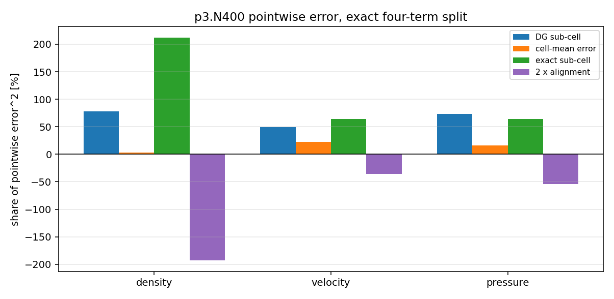
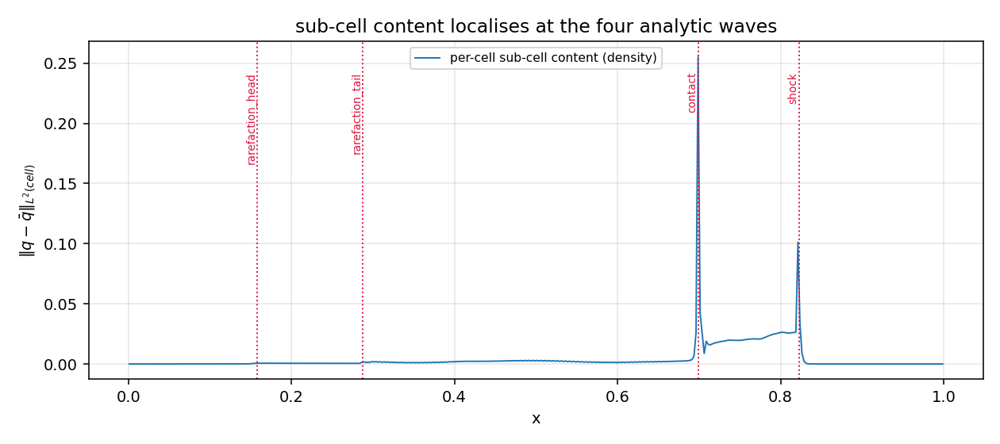

# CASE-LAX-DG · A0 度量目录：判的是「点值」还是「单元平均」

> 锚点 `CASE-LAX-DG`（台账原文「ref: 精确解｜容差 < 3.00 %」，status=open）。本文全部数字由 `benchmarks/lax_a0_metric_catalogue.py` 从已提交场缓存程序化注入（`p3.N400` 的 `profiles.npz`，sha256 `7bdcc57cb9a0c212…`），零手抄、零求解器重跑；`--check` 在工件漂移时失败。

## ① 案例介绍

Lax (1954) 激波管 / Toro (2009) Test 2：`[0,1]`，隔膜 `x0 = 0.5`，γ = 1.4，左态 `(ρ,u,p) = (0.445, 0.698, 3.528)`，右态 `(0.5, 0.0, 0.571)`，快照 `t = 0.13`。精确解含四道波（左稀疏波头/尾、接触间断、右激波），解析折点 `0.157637`、`0.287229`、`0.698734`、`0.822312`。

钉扎腿 `p3.N400`：DG-P3、400 单元（DOF 1600）、HLLC 界面通量、SSP-RK3。台账容差 3.00 % 作用在「整场相对 L2」上。

## ② 怎么做的

`docs/CASE-LAX-DG-a0-quadrature-audit.md` 解决的是**求积**轴（精确解须按解析折点切段、逼到收敛才可与容差比较）。本文审计的是另一根轴：**度量对象**。同一个「相对 L2」可以取自

* **点值**（单元 Gauss 节点上的 DG 解）——池子当前做法；
* **单元平均**（只保留解析尺度）——能区分「波位/幅值对不对」但不看次单元；

且各自可落在原始变量 `(ρ,u,p)` 或守恒变量 `(ρ, ρu, E)` 上、取 L1 或 L2。八种组合都是「同一个误差」的合法测量，台账原文没有指定用哪一个。

**三条问法（先登记后跑数，零求解）**

1. **Q1 目录**：`{变量集} × {L1,L2} × {点值, 单元平均}` 共 8 组，逐量对容差判 PASS/FAIL；点值另给 aligned 收敛求积（阶 20）与未收敛 6 阶读数，用于区分「度量对象」与「求积精度」两根轴。
2. **Q2 判别力探针**：对同一已提交场做**同网格 P0 截断**（在守恒变量上保住每单元均值、丢掉高阶模态，再还原原始变量）。若某度量在此操作下**逐位不变**，它就无法区分 P0 与 P3，不能用于裁决。该操作精确、无需重跑求解器。
3. **Q3 误差去哪了**：点值误差的**精确四分**。令 `q̄` 为 DG 单元均值、`q̄_ex` 为精确解单元均值，则逐单元

   `∫(q−q_ex)² = ∫(q−q̄)² + ∫(q̄−q̄_ex)² + ∫(q̄_ex−q_ex)² + 2∫(q−q̄)(q̄_ex−q_ex)`

   （DG 次单元内容 ⊕ 单元均值误差 ⊕ 精确解自身次单元 ⊕ 子单元对齐项）。首、末两项逐单元零均值、中间项逐单元常数，因此其余五个交叉项恒为零；对齐项为负表示 DG 的次单元形状在**抵消**精确解的次单元结构，为正是虚假振荡。

## ③ 计算结果

### 3.1 目录：同一钉扎腿、多种度量

| 度量对象 | 变量 | 范数 | 最差场 | DG-P3 | 同网格 P0 截断 | DG/P0 | 判定 vs 3.00 % |
|---|---|---|---|---|---|---|---|
| `pointwise_uniform_order6` | primitive | l2 | density | 2.9696 % | 4.4779 % | 0.663 | **PASS** |
| `pointwise` | primitive | l2 | density | 3.1156 % | 4.5807 % | 0.680 | **FAIL** |
| `pointwise_aligned_converged` | primitive | l2 | density | 3.0251 % | 4.4310 % | 0.683 | **FAIL** |
| `cell_average` | primitive | l2 | velocity | 0.9748 % | 0.9748 % | 1.000 | **PASS** |
| `pointwise` | primitive | l1 | velocity | 1.2306 % | 0.7747 % | 1.588 | **PASS** |
| `cell_average` | primitive | l1 | velocity | 0.6966 % | 0.6966 % | 1.000 | **PASS** |
| `pointwise` | conserved | l2 | momentum | 3.7624 % | 6.0212 % | 0.625 | **FAIL** |
| `cell_average` | conserved | l2 | momentum | 0.5683 % | 0.5683 % | 1.000 | **PASS** |
| `pointwise` | conserved | l1 | density | 0.8686 % | 0.5133 % | 1.692 | **PASS** |
| `cell_average` | conserved | l1 | momentum | 0.3199 % | 0.3199 % | 1.000 | **PASS** |

读法三点：

1. **点值族一致判 FAIL**（收敛求积 3.0251 %，未收敛 10 阶 3.1156 %，守恒变量 L2 3.7624 %）——裁决在点值族内稳健。
2. **单元平均值族一律 PASS**（原始变量 L2 最差 0.9748 %，守恒变量 L2 最差 0.5683 %）——换个度量对象就把 verdict 翻过来了。
3. **未收敛 6 阶点值读数是 PASS（2.9696 %）**，与已审计的求积轴结论一致：低阶 Gauss 读数在场内折点处欠积分，会制造假 PASS。

### 3.2 排序翻转：P3 是否优于同网格 P0，取决于度量族

同一个 DG-P3 场与其同网格 P0 截断（只保留守恒量单元均值）的误差比值（DG/P0，<1 表示 DG 更好）：

| 度量 | 各场 DG/P0 | 谁更好 |
|---|---|---|
| `primitive/l2/pointwise_aligned_converged` | density 0.683, velocity 1.073, pressure 1.116 | DG 胜 density |
| `primitive/l2/pointwise` | density 0.680, velocity 1.014, pressure 1.021 | DG 胜 density |
| `primitive/l1/pointwise` | density 1.692, velocity 1.588, pressure 1.842 | P0 胜 |
| `conserved/l2/pointwise` | density 0.680, momentum 0.625, energy 0.794 | DG 全胜 |
| `primitive/l2/cell_average` | density 1.000, velocity 1.000, pressure 1.000 | 无区分（比值恒 1.000） |

**读法**：整场点值 L1 上，同网格 P0 截断在三个原始量上都比 DG-P3 更接近精确解；点值 L2 上密度由 DG 占优、速度与压力由 P0 截断占优；换到守恒变量 L2 则 DG 全胜。即**「高阶是否更准」在本算例的这个网格上不是格式性质，而是度量族性质**——这也解释了为什么把 A0 的度量对象偷偷换掉就能翻 verdict，因此本文坚持用台账已登记的点值相对 L2 裁决。

### 3.3 判别力闸（Q2）

* 单元平均度量在同网格 P0 截断下的最差相对漂移 = **3.22e-15**（容差 1e-12）→ PASS。
* 即：**单元平均度量对次单元内容完全免疫**。同一网格上一个只保留守恒量单元均值的场（P0 截断）会读到与 DG-P3 相同的数，误差比值 1.000。它是「解析尺度是否对」的度量，**不是**「高阶是否在起作用」的度量。

### 3.4 误差四分与定位（Q3）

恒等式残差最差 **1.01e-14**（相对）（容差 1e-10）→ PASS。

| 场 | 总误差² | DG 次单元 | 单元均值项 | 精确解次单元 | 2×对齐项 | 次单元占比 | 对齐项占比 |

（各项可正可负，占比之和为 100 %，单项占比可超过 100 %。）

|---|---|---|---|---|---|---|---|
| density | 3.246687e-04 | 2.539837e-04 | 8.693523e-06 | 6.878908e-04 | -6.258993e-04 | 78.2 % | -192.8 % |
| velocity | 6.430050e-04 | 3.142323e-04 | 1.467693e-04 | 4.095054e-04 | -2.275020e-04 | 48.9 % | -35.4 % |
| pressure | 9.861091e-04 | 7.258270e-04 | 1.617011e-04 | 6.296166e-04 | -5.310357e-04 | 73.6 % | -53.9 % |

* 含解析折点的单元数 = **4**（网格的 1.00 %），却承载了密度 DG 次单元能量的 **74.3 %**。
* 密度的对齐项占总误差的 -192.8 %（负），压力 -53.9 %，速度 -35.4 %：DG 的次单元形状在四道波处**抵消**了精确解的次单元结构，即它确实在分辨次单元，点值误差的主体是**量的失配**而不是纯噪声。

### 3.5 加密趋势（context only：`p3.N800`，不是钉扎腿）

| 场 | 点值 L2 | 单元平均 L2 | DG 次单元 | 精确解次单元 |
|---|---|---|---|---|
| density | 2.3149 % | 1.1633 % | 1.493234e-04 | 1.179224e-04 |
| velocity | 1.3826 % | 0.5690 % | 2.364586e-04 | 3.743086e-04 |
| pressure | 0.8994 % | 0.3064 % | 5.347517e-04 | 5.752985e-04 |

* 加密一档 h（400→800）：密度点值误差 ×0.765、DG 次单元能量 ×0.588——次单元内容随 h 缩小是点值误差下降的主因，与 3.3 的四分一致（单元均值项本来就小）。这也是为什么 p3.N800 能以 2.315 % 过关，而「换度量对象」不是。

## ④ 结果图

## ⑤ 注意点

1. **单元平均不是「更宽松的同一把尺子」，而是另一把尺子**：它对次单元内容完全免疫（P0 截断漂移 3.2e-15）。用它把 A0 判成 PASS，等于让一阶重构也过同一条容差——所以本文不主张换度量。
2. **P0 截断是探针，不是方案**：它不主张「P0 更准」；截断在**守恒变量**上做再还原原始变量，避免在 `(ρ,u,p)` 上截断产生非守恒假象。
3. **四分恒等式是精确的**：五个交叉项因「首末两项逐单元零均值、中间项逐单元常数」恒为零，实测残差 ≤ 1.0e-14（相对）。
4. **求积轴不重复审计**：点值裁决值取自已提交的 aligned 收敛求积（`lax_a0_quadrature_audit`），本文只负责「度量对象」轴；未收敛 6 阶读数单列，仅作反面教材。
5. **本单不动池子与台账**：`lax_case_pool` 工件、生产腿、台账状态均原样；口径变更属台账持有人权限。
6. **纯离线**：全部数字来自 400×10 与 800×10 的已提交场缓存，无求解器重跑；本机 load15 高企时仍可执行（实测 < 15 s）。

## ⑥ 误差判定（是否 < 3.00 %）

| 关键量（度量对象） | 基准 | 实测 | < 3.00 % ? |
|---|---|---|---|
| 密度，点值（收敛求积）（density） | 精确 Riemann 解 | 3.0251 % | **否** |
| 密度，点值（池子 10 阶）（density） | 精确 Riemann 解 | 3.1156 % | **否** |
| 动量，守恒变量点值（momentum） | 精确 Riemann 解 | 3.7624 % | **否** |
| 速度，单元平均（最差场）（velocity） | 精确 Riemann 解 | 0.9748 % | 是 |
| 密度，点值（未收敛 6 阶）（density） | 精确 Riemann 解 | 2.9696 % | 是 |

## ⑦ 结论与建议

**度量对象**：钉扎腿 `p3.N400` 的相对 L2 密度误差取决于**度量对象**：点值（aligned 收敛求积）3.0251 % → **FAIL**；单元平均 0.9748 % → PASS。前者是后者的 3.10 倍，而台账原文（「ref: 精确解｜容差 < 3.00 %」）没有指定是哪一个。

**判别力**：单元平均度量**不可用于裁决**：它在同网格 P0 截断（保住每单元守恒量均值、丢掉高阶模态）下逐位不变（最差相对漂移 3.2e-15），即一个只携带单元均值的场会读到同一个数——它无法区分 P0 与 P3，因此用它把 A0 判成 PASS 等于让一阶重构通过同一条容差。

**误差定位**：点值误差可精确四分（`∫(q−q_ex)² = DG 次单元 + 单元均值误差 + 精确解次单元 + 2×对齐项`，密度残差 1.7e-15）：DG 次单元占 78.2 %、单元均值项占 2.7 %、精确解自身次单元占 211.9 %、对齐项 2×cov 占 -192.8 %。DG 次单元能量有 74.3 % 落在含解析折点的 4 个单元（网格的 1.00 %）。对齐项为负说明 DG 的次单元形状在**抵消**精确解的次单元结构（不是纯噪声）。

**建议**：结论：按台账已登记口径（整场点值相对 L2）A0 的 honest FAIL 站得住——收敛求积下密度 3.0251 % ≥ 3.00 %；且**不能**用「换成单元平均度量」翻案（那会让同网格 P0 也通过）。注意未收敛的 6 阶 Gauss 读数会给出 2.9696 % 的 PASS 假象，这正是 `riemann_dg_error` 默认值必须与池子统一的原因。真正的出路仍是分辨率（`p3.N800` 点值密度 2.315 %、单元平均 1.163 %）或由台账持有人显式改登记生产腿/度量口径。

*工件：`docs/benchmarks/results/lax_a0_metric_catalogue/metrics.json` + `figures/`；本页由 `python -m benchmarks.lax_a0_metric_catalogue` 生成，`--check` 机器复核。*

