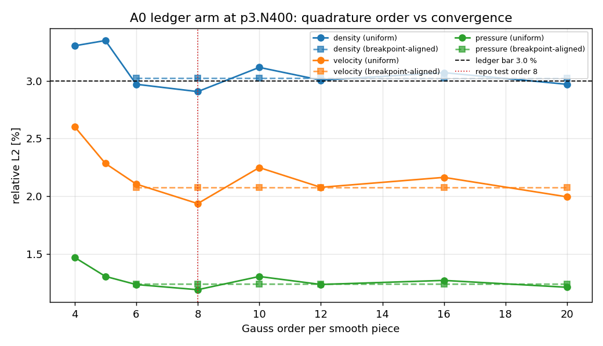
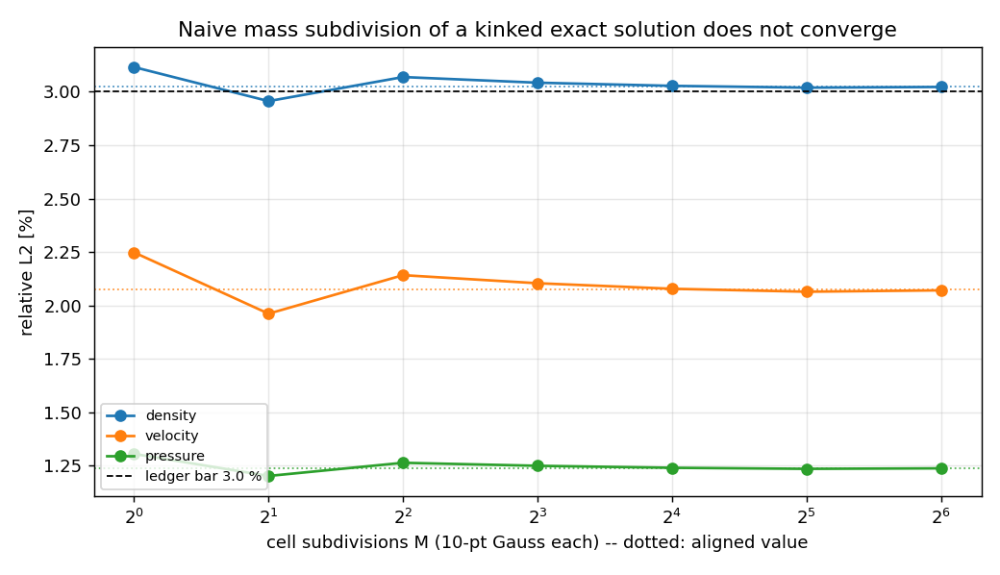

# CASE-LAX-DG · 台账臂 A0 的求积收敛性审计：`< 3 %` 测的到底是什么

> 本文全部数字由 `benchmarks/lax_a0_quadrature_audit.py` 从 `docs/benchmarks/results/lax_a0_quadrature_audit/metrics.json` 注入（零手抄），`--check` 在文档与工件漂移时失败。
> **零重解**：数据来自已提交的场缓存 `docs/benchmarks/results/lax_case_pool/profiles.npz`（sha256 `7bdcc57cb9a0c212...`），本单未运行任何求解器。

## ① 案例介绍与要审的矛盾

Lax (1954) / Toro (2009) Test 2 激波管：`[0,1]`，隔膜 `x0 = 0.5`，γ = 1.4，左态 (ρ,u,p) = (0.445, 0.698, 3.528)，右态 (0.5, 0.0, 0.571)，t = 0.13；钉扎生产腿 `p3.N400`（dx = 1/400）。

同一物理腿、同一求解器、同一个「相对 L2 vs 精确解」，仓内两个实现结论相反：

| 生产者 | 求积 | 结果 |
|---|---|---|
| `tests/test_lax_1d.py` → `benchmarks/riemann_dg_error.py` | 每单元 8 点 Gauss | **绿**（断言 < 3 %） |
| `benchmarks/lax_case_pool.py`（已提交工件） | 每单元 10 点 Gauss | 密度 3.115562e-02 → **FAIL** |

两者都在单元 Gauss 节点上积分，**求解器不是变量**；变量是**精确解的求积**。激波管精确解分段解析，折点落在单元**内部**（x_head = 0.157637、x_tail = 0.287229、x_contact = 0.698734、x_shock = 0.822312，dx = 0.0025，四者都不是单元边界），因此任何固定阶 Gauss 规则在含折点的单元上都不精确，读数随规则漂移。而 A0 的 FAIL 裕度只有 ×1.008（差 3.9 %），与可能的求积误差同量级——所以裁决必须落在**收敛的求积**上。

## ② 怎么做的

1. **场的搬运是精确的**：DG 场是 3 次多项式，10 个 Gauss 节点上的值可精确插值到任意点（10 点插值精确到 9 次；重心公式见 `barycentric_matrix`，节点重合取节点值，无 0/0），因此误差里不含插值误差。只有**精确解**需要重新采样。
2. **三种求积**：
   - `uniform`：已提交口径（每单元 `order` 点 Gauss）；
   - `subdivision`：每单元等分 M 段，每段 `order` 点 Gauss——用来证明「把质量塞进细分」对折函数只以 `O(1/M)` 收敛、**不能**当作收敛手段；
   - `aligned`：每单元按**解析折点**切段（稀疏波 head/tail、接触、激波），每段 `order` 点 Gauss——段内精确解解析，故收敛到舍入级。
3. **预登记（首次执行前写死在驱动里）**：
   - Q0 复用：`uniform` 10 阶必须复现已提交工件的密度值（相对差 ≤ 1e-12），且与 `production_errors_from_profiles` 一致，否则整轮 `WITHHELD`；
   - Q1 收敛：`aligned` 16 阶 vs 20 阶逐量相对漂移 ≤ 1e-10，否则 `NOT_CONVERGED`；
   - Q2 判决：`aligned` 20 阶最差量 < 容差（容差从 `lax_case_pool.ledger_acceptance_tolerance()` 读，不硬编码）；
   - Q3 散布：`|uniform(10) − aligned(20)| / aligned(20)` 逐量登记为已提交工件的测量不确定度；
   - Q4 范围：不改写池子工件、不移动生产腿；`p3.N800` 只作上下文、不计入台账；
   - Q5 两种结果都如实记录（过阈 = 工件是测量假阴性；不过阈 = honest FAIL 站得住）。

## ③ 计算结果（程序化注入）

Q0 复用：与已提交工件最差相对差 `1.543e-16`、与 `production_errors_from_profiles` 最差 `1.543e-16` → **PASS**。

### 3.1 同一条腿上的三个求积（钉扎腿 `p3.N400`）

| 求积 | rel L2 ρ | rel L2 u | rel L2 p |
|---|---|---|---|
| uniform, 4 点 | 3.302458650e-02 | 2.602997040e-02 | 1.470504574e-02 |
| uniform, 5 点 | 3.348006889e-02 | 2.283930206e-02 | 1.305916907e-02 |
| uniform, 6 点 | 2.969593488e-02 | 2.105532555e-02 | 1.235322089e-02 |
| uniform, 8 点 | 2.905815882e-02 | 1.936333159e-02 | 1.190527229e-02 |
| uniform, 10 点 | 3.115561881e-02 | 2.248052874e-02 | 1.305011534e-02 |
| uniform, 12 点 | 3.005037696e-02 | 2.077006592e-02 | 1.235935331e-02 |
| uniform, 16 点 | 3.069950570e-02 | 2.163284545e-02 | 1.271009681e-02 |
| uniform, 20 点 | 2.969007378e-02 | 1.994602595e-02 | 1.211624515e-02 |
| uniform + M=1 细分（10 点/段） | 3.115561881e-02 | 2.248052874e-02 | 1.305011534e-02 |
| uniform + M=2 细分（10 点/段） | 2.956348152e-02 | 1.961410237e-02 | 1.201692034e-02 |
| uniform + M=4 细分（10 点/段） | 3.069117661e-02 | 2.141695698e-02 | 1.263377671e-02 |
| uniform + M=8 细分（10 点/段） | 3.042579284e-02 | 2.103866848e-02 | 1.249290114e-02 |
| uniform + M=16 细分（10 点/段） | 3.027857101e-02 | 2.077919102e-02 | 1.239927264e-02 |
| uniform + M=32 细分（10 点/段） | 3.019469849e-02 | 2.064158356e-02 | 1.235090487e-02 |
| uniform + M=64 细分（10 点/段） | 3.022701511e-02 | 2.070651442e-02 | 1.237383510e-02 |
| **aligned**, 6 点 | 3.025073612e-02 | 2.073564554e-02 | 1.238435227e-02 |
| **aligned**, 8 点 | 3.025073612e-02 | 2.073631635e-02 | 1.238443720e-02 |
| **aligned**, 10 点 | 3.025073612e-02 | 2.073631862e-02 | 1.238443730e-02 |
| **aligned**, 12 点 | 3.025073612e-02 | 2.073631862e-02 | 1.238443730e-02 |
| **aligned**, 16 点 | 3.025073612e-02 | 2.073631862e-02 | 1.238443730e-02 |
| **aligned**, 20 点 | 3.025073612e-02 | 2.073631862e-02 | 1.238443730e-02 |

Q1 收敛：aligned 16 阶 vs 20 阶最差相对漂移 `5.964e-15` → **PASS**。

| 量 | 已提交（uniform 10 阶） | 收敛值（aligned 20 阶） | 测量散布 | 收敛值 vs 容差 |
|---|---|---|---|---|
| density | 3.115561881e-02 | 3.025073612e-02 | 2.991e-02 | FAIL |
| velocity | 2.248052874e-02 | 2.073631862e-02 | 8.411e-02 | PASS |
| pressure | 1.305011534e-02 | 1.238443730e-02 | 5.375e-02 | PASS |

**台账臂判决（收敛求积，钉扎腿 `p3.N400`）：FAIL** —— 最差量 `density` = 3.025074e-02，容差 3.000000e-02，裕度 ×1.008。

上下文（**不计入台账**，见 Q4）：`p3.N800` 的收敛值最差量 `density` = 2.404983e-02（散布 `4.140e-14`，与池子记 1.039 倍的 FAIL 相反/相同见 PASS）——该腿此前已按 `p3.N800` 分辨率路线登记，本单只用它检查「收敛后的量度是否与既有分辨率结论相容」。

## ④ 注意点

1. **这是测度审计，不是求解器改进**：场缓存一个字节没动，改的只是「精确解怎么积分」。任何结论都不能读成「求解器变准了」。
2. **仓库测试的绿不是台账证据**：`riemann_dg_error`（8 阶）与池子（10 阶）给出不同数值，两者都不是收敛值；谁的绿/红只说明各自求积阶，不说明解离精确解多远。本审计给出该量的收敛值，并登记「同一个量两套实现、无交叉校验」为待修缺口。
3. **朴素细分不收敛**：`subdivision` 列的振荡（见第二张图）说明「加密求积点」不等于「收敛」——对折函数必须按解析折点切段，否则误差只按 `O(1/M)` 缓慢下降且不单调。
4. **失效率的其余部分不受影响**：C3/R3 两条阶数闸与 A0 无关，仍在案 FAIL。

## ⑤ 误差判定（是否 < 3 %）

| 关键量 | 基准 | 数值（收敛求积） | 相对误差 | < 3 % ? |
|---|---|---|---|---|
| density 钉扎腿 rel L2 | 精确 Riemann 解 | 3.025073612e-02 | 3.0251 % | **否** |
| velocity 钉扎腿 rel L2 | 精确 Riemann 解 | 2.073631862e-02 | 2.0736 % | **是** |
| pressure 钉扎腿 rel L2 | 精确 Riemann 解 | 1.238443730e-02 | 1.2384 % | **是** |

**结论**：收敛求积下钉扎腿 `p3.N400` 的最差量 `density` = 3.025074e-02（3.0251 %）仍 **≥ 3.00 %**（裕度 ×1.008），而与已提交 10 阶读数的差为 2.99 %——FAIL 不是求积假象，honest FAIL 站得住。

## ⑥ 后续（不由本单自裁）

维持 A0 = FAIL；出路仍是分辨率（`p3.N800`）或由台账持有人变更生产腿口径。同时建议统一 `riemann_dg_error` 与池子的求积实现，消除同一个量两套读数。
