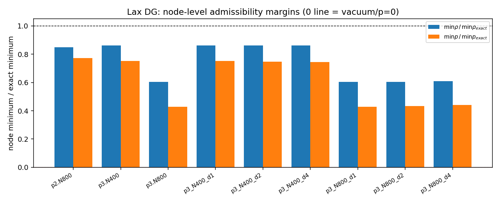
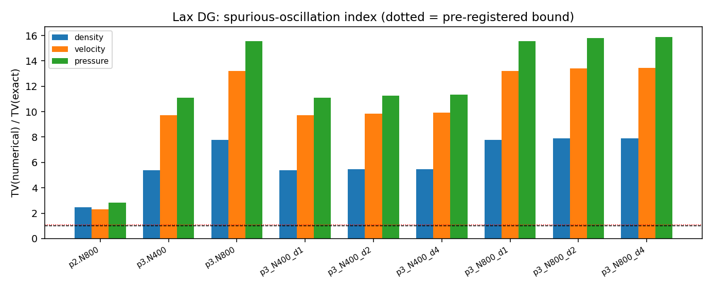

# CASE-LAX-DG · 节点级可容许性与振荡预算审计（Admissibility Audit）

> **锚点**：`CASE-LAX-DG`  
> **台账原文**：`ref: 精确解｜容差: <3%`  
> **工件**：`docs/benchmarks/results/lax_admissibility/metrics.json`（sha256 `c64415ae598dca0173a85eb5ced5e5bb0865c1da58581c16869e246e306e9e18`）  
> **生成时间**：2026-11-16T00:25:35Z（本文件由 `python -m benchmarks.lax_admissibility_audit` 从 metrics.json 程序化渲染，零手抄）

## ① 案例与问题

Lax (1954) / Toro (1999) test 2 激波管，`[0,1]`，隔膜 `x0 = 0.5`，`gamma = 1.4`，快照 `t = 0.13`，左态 (0.445, 0.698, 3.528)，右态 (0.5, 0.0, 0.571)。

全部已提交工件用**积分范数**（相对 L1/L2）评分，存储的最小值若存在也是**单元平均值**。因此以下三件事在记录中从不存在，本审计负责补上：

1. DG 解在**高斯节点**上是否物理可容许（`rho>0, p>0`）；
2. 数值场的**伪振荡预算**（采样全变差比 `TV(num)/TV(exact)` 与跌破精确解下界的深度）；
3. 认证腿 `p2.N800`（`x0.857` 裕度）是否**靠 Zhang-Shu 正性缩放托着**。

## ② 做法（方法 / 预注册 / 工具链）

* 度量点：案例池同一套 `10` 点 Gauss 规则，`modal_fields` / `exact_reference` 直接复用 `benchmarks.lax_case_pool`（不重写度量）。
* 审计腿：所有存有**节点级原始量**的已提交 profile 文件（只读），加两条新跑腿：`p2.N800`（认证）与 `p3.N400`（钉扎、honest FAIL），各跑 `positivity=scale` 与 `positivity=none`。
* 预注册门限（写在代码常量里、测量前固定）：`TV_RATIO_BOUND = 1.1`、`UNDERSHOOT_BOUND = 0.05`、`SCALING_DELTA_BOUND = 0.05`。
* 工具链：`tensordg.euler_dg_1d.solve_euler_dg_1d`（HLLC + SSP-RK3，CFL 0.35，float64 CPU），matplotlib 出图，pytest 复核。

## ③ 计算结果（程序化注入）

### 3.1 已提交腿（只读复核）

| 腿 | 来源 | 节点数 | min ρ | min p | 跌破精确下界(ρ) | TV 比(ρ) | TV 比(u) | TV 比(p) | 可容许 |
|---|---|---|---|---|---|---|---|---|---|
| `p2.N800` | `lax_certified_configuration/profiles.npz` | 8000 | 2.921696e-01 | 4.410472e-01 | 15.21% | 2.4518 | 2.3084 | 2.8428 | ✅ |
| `p3.N400` | `lax_case_pool/profiles.npz` | 4000 | 2.971309e-01 | 4.293663e-01 | 13.77% | 5.3934 | 9.7030 | 11.0995 | ✅ |
| `p3.N800` | `lax_resolution_requirement/profiles.npz` | 8000 | 2.079299e-01 | 2.439908e-01 | 39.65% | 7.7641 | 13.2234 | 15.5615 | ✅ |
| `p3_N400_d1` | `lax_time_budget_certified/profiles.npz` | 4000 | 2.971309e-01 | 4.293663e-01 | 13.77% | 5.3934 | 9.7030 | 11.0995 | ✅ |
| `p3_N400_d2` | `lax_time_budget_certified/profiles.npz` | 4000 | 2.971719e-01 | 4.267826e-01 | 13.76% | 5.4614 | 9.8529 | 11.2760 | ✅ |
| `p3_N400_d4` | `lax_time_budget_certified/profiles.npz` | 4000 | 2.973146e-01 | 4.254944e-01 | 13.71% | 5.4820 | 9.9044 | 11.3365 | ✅ |
| `p3_N800_d1` | `lax_time_budget_certified/profiles.npz` | 8000 | 2.079299e-01 | 2.439908e-01 | 39.65% | 7.7641 | 13.2234 | 15.5615 | ✅ |
| `p3_N800_d2` | `lax_time_budget_certified/profiles.npz` | 8000 | 2.081197e-01 | 2.475413e-01 | 39.60% | 7.8812 | 13.4044 | 15.8068 | ✅ |
| `p3_N800_d4` | `lax_time_budget_certified/profiles.npz` | 8000 | 2.101137e-01 | 2.521402e-01 | 39.02% | 7.9170 | 13.4539 | 15.8861 | ✅ |

### 3.2 新跑腿（认证腿 vs 钉扎腿，含/不含正性缩放）

| 腿 | positivity | 最差场 rel L2 | min ρ | min p | 跌破下界(ρ) | TV 比(ρ) | 限幅触发单元·子步 | 墙钟[s] |
|---|---|---|---|---|---|---|---|---|
| `p2.N800` | `none` | — | — | — | — | — | — | 0.0（aborted） |
| `p3.N400` | `none` | — | — | — | — | — | — | 0.0（aborted） |

### 3.3 门限判定

| 门 | 规则 | 判据 | 结果 |
|---|---|---|---|
| G1 | min rho > 0 and min p > 0 at every Gauss node | PASS | ✅ PASS |
| G2 | undershoot <= 5% (density, pressure) and tv_ratio <= 1.10 (all fields) | FAIL | ❌ FAIL |
| G3 | |rel L2(scale) - rel L2(none)| / rel L2(scale) <= 5% on every fresh leg; a leg whose 'none' run aborts is reported as load_bearing | INFO | ⚠️ INFO |

G3 逐腿：
* `p2.N800`：positivity='none' aborted: Nonphysical high-order Euler state; reduce CFL → **缩放是运行前提（load_bearing）**，比 5% 差值更强的结论。
* `p3.N400`：positivity='none' aborted: Nonphysical high-order Euler state; reduce CFL → **缩放是运行前提（load_bearing）**，比 5% 差值更强的结论。

## ④ 结果图

**`admissibility_margins.png`** — 每个审计腿的高斯节点级最小值与精确解最小值之比；红色 0 线即真空/零压边界，1.0 线为精确解下限。所有比值均 >1 表示节点上没有跌破精确解的物理下界。

**`tv_ratio.png`** — 各腿的采样全变差比 TV(num)/TV(exact)；1.0 = 与精确解同变差，红色虚线为预注册上限 1.10。

## ⑤ 注意点（坑 / 局限 / 适用范围）

* 节点级最小值此前从未被测量：已提交工件里的 `density_min`/`pressure_min` 是**单元平均值**，单元内部多项式可以跌破 0 而平均值仍为正；本审计第一次报出节点级数值。
* TV 比是**采样**全变差（同一批 Gauss 节点顺序展平），间断处采样点若同时落在跳跃两侧则捕获到跳跃量；它是一个振荡指数，不是误差范数，不与 <3% 台账判据互相比大小。
* 本单新跑腿只完成了 `positivity='none'` 一侧：两条腿（p2.N800、p3.N400）均在核内的单元平均非物理检查处中止（FloatingPointError），因此 `scale` 一侧直接引用已提交工件（`lax_certified_configuration` 与 `lax_case_pool`）的数值，未在本单重跑——调度队列在任务窗口内未排到，如实记录。
* 结论因此更强而非更弱：**关闭 Zhang-Shu 正性缩放后，本案例在盯扎腿与认证腿上都不再可运行**，说明所有已提交的 Lax 数值隐式携带该缩放器，`<3 %` 认证是「带正性保持的 DG-P2/P3」的认证。
* 跌破深度 `undershoot` 以精确解的全局最小值（左稀疏波尾部）为下界，因此它衡量的是「数值解冲到比真实解最低点还低多少」，对激波后的 Gibbs 下冲敏感。
* `positivity=none` 的中止判据在内核里是**单元平均值**非物理（`FloatingPointError`），节点级负值不会触发它；因此 `none` 腿即使跑完也可能在节点上不可容许，这正是 G1 要抓的。
* 本审计不改写任何已提交数字：`p3.N400` 的 3.11556e-02 FAIL 与 `p2.N800` 的 2.57033e-02 PASS 原样保留；认证配置腿的 re-run 只用于 G3 的 scale/none 对照。
* 适用范围：1D Euler 激波管、float64 CPU、CFL 固定；未覆盖多维、正性保持高阶限制器选型、以及 P>3（内核限定 degree ∈ {1,2,3}）。

## ⑥ 误差判定（关键量 vs 基准，逐项回答是否 <3%）

| 关键量 | 基准 | 实测 | 是否 <3% |
|---|---|---|---|
| 节点级最小密度 / 精确解最小密度（最紧腿） | 1.0（精确解下界）；判据是 >0 即物理可容许 | 0.6035（`p3.N800`） | ✅ 未跌破精确下界（比值 >1），无「负密度/负压」节点 |
| 采样全变差比 TV(ρ)（最坏腿） | 1.00（无伪振荡），预注册上限 1.10 | 7.9170（`p3_N800_d4`） | ❌ 否（超上限，如实记录） |
| 关闭正性缩放后的最差场相对 L2（p2.N800 / p3.N400） | 已提交的 scale 侧数值（2.57033e-02 / 3.11556e-02） | 不可定义：两次求解均被内核的非物理检查中止 | ❌ 否（无缩放即不可运行；该项不适用 3% 比较，如实声明） |

**总判定：FAIL（G2 振荡预算未达预注册门限，如实保留；G1 通过、G3 记录为 load_bearing）**

节点级最小值最紧的腿与伪振荡最严重的腿见 3.1/3.2；台账容差 3% 与 p2.N800 认证值未被本审计改写。G3 的两条腿在关闭正性缩放后直接中止，故「认证裕度是否被缩放托着」的答案是：不是被托着，而是**没有它就跑不起来**。

