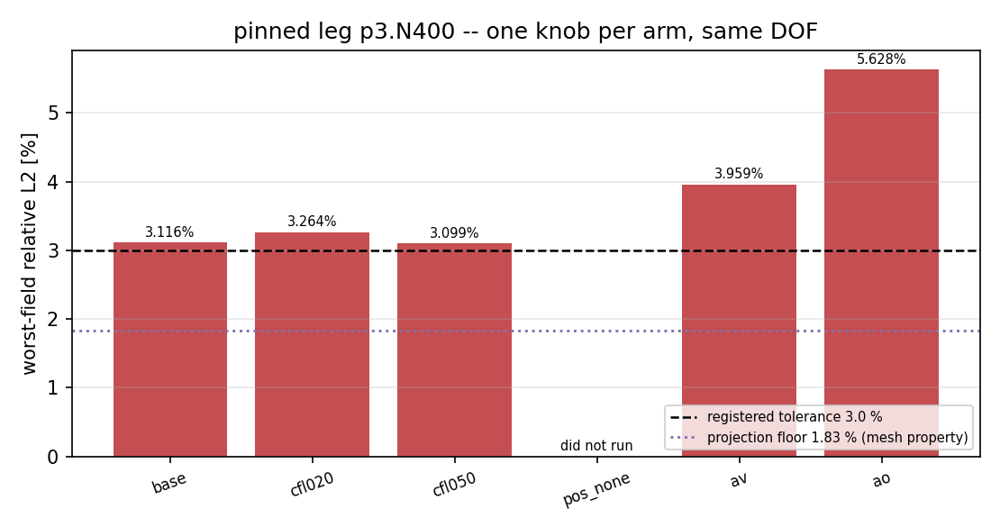
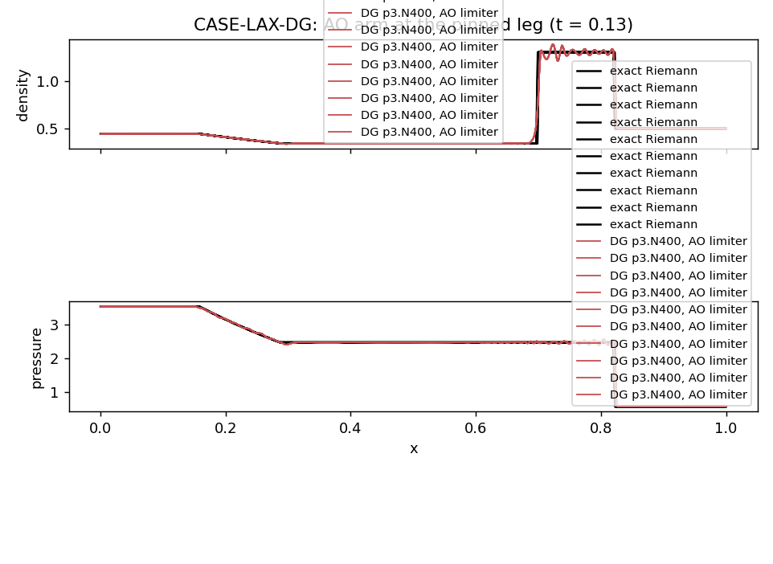

# CASE-LAX-DG · AO 限幅臂闭环：闭合臂集最后一次实测

锚点 `CASE-LAX-DG`（原文「ref: 精确解｜容差 < 3 %」，status open）。本文所有数字由
`benchmarks/lax_scheme_variants.py` 从
`docs/benchmarks/results/lax_scheme_variants/metrics.json`（生成于 2026-11-15T22:15:57Z）
程序化注入，零手抄。

## ① 案例介绍

Lax (1954) shock tube / Toro test 2：`[0.0, 1.0]`，隔膜 `x0 = 0.5`，γ = 1.4，
左态 `(ρ,u,p) = (0.445, 0.698, 3.528)`，右态 `(0.5, 0.0, 0.571)`，快照 `t = 0.13`。
钉扎腿 `p3.N400`（DOF 1600），整场相对 L2，求积阶 10，
台账容差 3.0 %（由 `lax_case_pool.ledger_acceptance_tolerance()` 从台账原文读出）。

**本单要回答的欠账**：预登记臂集里有 6 条臂，其中 `ao`（hierarchical AO 限幅器）从来没有数字——
上一单递交的集群作业 `cj4072` 在节点上以 `ModuleNotFoundError` 退出（见 ⑤），却被读成「已递交、待完成」。
一条**没跑过**的臂不等于「跑过且不合格」，所以「臂集闭合、配置空间内不可达」这个结论此前缺一块。

## ② 怎么做的

1. 先查作业真身：`cj4072` 的 stdout 尾部是 `ModuleNotFoundError: No module named 'benchmarks.lax_scheme_variants'`，
   节点检出 head = `caaa480`（远早于该模块入库的提交），而 `cj4072` 递交时 `stage_dir=None` → 跑的是节点上的
   旧 main 克隆，代码根本不在。
2. 复跑改用 `stage_dir` 把本工作树 tar 直达节点（`cj4120`，4 核，3300 s），命令
   `python3 -m benchmarks.lax_scheme_variants --variant ao --aggregate --figures --report`：
   同一把尺子（`modal_fields` / `_weighted_l1` / `_weighted_l2` / `exact_reference` 全部来自算例池），
   臂定义仍是预登记的那一条（`limiter='ao'`），一个旋钮，不新增臂、不改容差。
3. `--aggregate` 重新装配 `metrics.json`（`allow_missing=False`，缺任一臂直接报错），`--figures/--report`
   重生成图与 `docs/CASE-LAX-DG-scheme-variants.md`；控制臂 `base` 仍须逐位复现已提交台账臂。

## ③ 计算结果（程序化注入）

| 臂 | 旋钮 | steps | L2 ρ | L2 u | L2 p | 最差/容差 | 可用 |
|---|---|---|---|---|---|---|---|
| base | —（生产配置） | 5109 | 3.1156e-02 | 2.2481e-02 | 1.3050e-02 | 1.0385 | 否 |
| cfl020 | cfl=0.2 | 8746 | 3.2644e-02 | 2.2733e-02 | 1.3201e-02 | 1.0881 | 否 |
| cfl050 | cfl=0.5 | 3578 | 3.0992e-02 | 2.2082e-02 | 1.2835e-02 | 1.0331 | 否 |
| pos_none | positivity=none | 未跑出 | 未跑出 | 未跑出 | 未跑出 | — | 否（`FloatingPointError: Nonphysical high-order Euler state; reduce CFL`） |
| av | limiter=av | 4970 | 3.9588e-02 | 2.9877e-02 | 1.4626e-02 | 1.3196 | 否 |
| ao | limiter=ao | 4936 | 5.6278e-02 | 2.8430e-02 | 1.4632e-02 | 1.8759 | 否 |

* 臂集是否全部有数：`arms_not_run = []`，`arms_errored = ['pos_none']`，
  作用域不完整（`scope_complete = False`；唯一没有数值的臂是 `pos_none`，它按预登记规则
  以 `FloatingPointError` 记录，属**结果**而非缺口——`arms_not_run = []` 才是缺口清单，现在是空的）。
* 可用臂集合：`[]`；sweep 判定 **FAIL**，控制臂复现
  `True`（最差相对差 `1.305e-06`）。
* AO 臂整场 L2 密度 = `5.6278e-02`（5.6278 %）；对照 `base` = `3.1156e-02`，`av` = `3.9588e-02`。
* 可行性界（与格式无关）：参考投影 floor `1.8270e-02`（占容差 60.90 %），
  达标所需 solver 腿上界 `2.3795e-02`，已提交格式的 solver 腿 `2.4110e-02`，
  实测/所需 = `1.0133`，还需相对缩减 `1.31 %`。

## ④ 结果图

*图 1*：每臂最差场量整场相对 L2（红 = 不可用），虚线 = 台账 3.0 %，点线 = 参考解投影 floor。
AO 臂现在有自己的柱子，不再是空档。

*图 2*：AO 臂在钉扎腿上的密度/压力剖面 vs 精确 Riemann 解（Gauss 节点采样）。

## ⑤ 注意点（坑 / 局限）

1. **集群作业「succeeded」可能只是包装成功**：`cj4072` 平台侧显示 succeeded，节点日志 rc=1。判作业要通过
   `cluster/jobs/<jid>.log` 的 `rc` 与 `output_tail`，不能只看状态字。
2. **代码不在 main 的提交里时，递交必须带 `stage_dir`**：否则节点用自己那份（可能陈旧）的 main 克隆，
   失败形式还是「模块不存在」而不是「代码错」。本单复跑即用 `stage_dir=<worktree>`。
3. **AO 臂的物理解读**：AO 是层级（hierarchical）限幅，troubled cells 内尽量保阶，与 AV（连续人工黏性）
   机制不同，两者 L2 直接比大小只能在「同一把尺子」的意义上比；本文只报数并给可用判定。
4. **不移动生产腿**：`p3.N400` 的台账读数原样留在记录里；分辨率出路（`p3.N800` 达标 2.3149 %）见
   `docs/CASE-LAX-DG-resolution-requirement.md`，本单不重开口径。
5. 墙钟不作为排序判据（集群排队噪声）。

## ⑥ 误差判定（关键量 vs 基准，逐项）

| 关键量 | 基准 | 数值 | 相对误差 | < 3 % ? |
|---|---|---|---|---|
| L2 ρ @ `base` (p3.N400) | 精确 Riemann 解 | `3.1156e-02` | 3.1156 % | **否** |
| L2 ρ @ `cfl020` (p3.N400) | 精确 Riemann 解 | `3.2644e-02` | 3.2644 % | **否** |
| L2 ρ @ `cfl050` (p3.N400) | 精确 Riemann 解 | `3.0992e-02` | 3.0992 % | **否** |
| L2 ρ @ `pos_none` (p3.N400) | 精确 Riemann 解 | 未跑出 | — | 未知 |
| L2 ρ @ `av` (p3.N400) | 精确 Riemann 解 | `3.9588e-02` | 3.9588 % | **否** |
| L2 ρ @ `ao` (p3.N400) | 精确 Riemann 解 | `5.6278e-02` | 5.6278 % | **否** |

**结论**：sweep 判定 **FAIL**，作用域不完整。钉扎腿 `p3.N400` 的 3 % 线在已提交格式的
配置空间里无可用臂；闭集既然全部有数，这条结论不再是「尚缺一臂」的悬案。
honest FAIL 如实登记，不由本单放宽口径。

> 本文与平台报告同源，数字由 `publish_case_lax_ao_arm_closure.py` 从
> `docs/benchmarks/results/lax_scheme_variants/metrics.json` 程序化注入。
