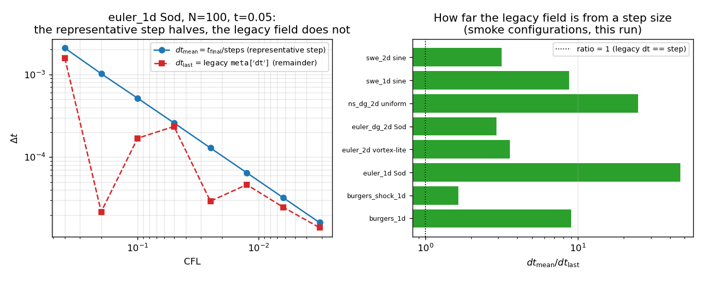

# CASE-LAX-DG 验证欠账：时间步元数据契约（`dt` / `dt_last` / `dt_mean`）

- **锚点**：`CASE-LAX-DG`（`feature_ledger` 验收原文「ref: 精确解｜容差 <3%」）
- **承接**：m18266 报告 §⑤.1 的显式移交项——「另有多处基准把 `meta["dt"]` 当步长用，逐个审计是后续单的独立工作项（有真实数值影响）」
- **生成**：`python scripts/render_dt_metadata_contract_doc.py`（2026-11-13T15:17:10Z），本文数字全部由该脚本测量注入

## ① 案例介绍

本仓的时间推进求解器（Euler / Burgers / 浅水 / Navier–Stokes，DG 与 P0 有限体积）都用自适应 SSP-RK3，步长

```
dt = min(cfl * dx / ((2p+1) * max_speed), final_time - time)
```

第二个候选量是**残步**：循环最后一次迭代几乎总被 `final_time - time` 截断，因此循环结束后落在 `metadata["dt"]` 里的是「最后一步走了多少」，而**不是这次运行的步长**。它与步长相差一个取决于 `final_time / dt_max` 的残余比例，且**不随 CFL 或网格加密单调下降**。

受影响的下游用法（真实存在，非假想）：把步序 × `dt` 还原成时间轴、画 `dt`–误差预算曲线、断言「CFL 减半则 `dt` 减半」。Lax 算例池的 `time_refinement` 记录正是被这条属性污染的（m18266 已就地修复 `solve_euler_dg_1d`）。

本单把该修复推广成**全仓契约**，并用测试机器化：新增 `tensordg/stepping.py::step_metadata`，把 `dt`/`dt_last`/`dt_mean` 三字段统一产出；`dt` 语义**不变**（向后兼容，老数字不动），`dt_mean = final_time / steps` 才是代表步长。

## ② 怎么做的

1. 源码分类：全 `tensordg/*.py` 扫描「是否发布 `dt`」×「是否含 `final_time - time` 截断」→ 残步族 / 定步族。
2. 对残步族逐个注入 `**step_metadata(final_time, steps, dt)`（加法式，不改任何既有键的取值）。
3. 新增 `tests/test_time_step_metadata_contract.py`：helper 算术、源码覆盖漂移门、9 个求解器运行期不变量、CFL 阶梯反例。
4. 本文与图由 `scripts/render_dt_metadata_contract_doc.py` 现场测量渲染（零手抄）。

工具链：PyTorch float64 / CPU、pytest、matplotlib。上一单（m18266）修的是 `solve_euler_dg_1d` 本体，本单避开该文件以免与其在飞分支冲突，故 `euler_dg_1d` 在源码扫描里标记为 `PENDING`。

## ③ 计算结果

### 3.1 源码审计（本脚本现场扫描）

| 模块 | 步长语义 | 是否携带 `dt_last`/`dt_mean` |
|---|---|---|
| `tensordg/advection_1d.py` | 定步/平均步 | 否 |
| `tensordg/advection_2d.py` | 定步/平均步 | 否 |
| `tensordg/advection_2d_var.py` | 定步/平均步 | 否 |
| `tensordg/advection_3d.py` | 定步/平均步 | 否 |
| `tensordg/advection_diffusion.py` | 定步/平均步 | 否 |
| `tensordg/burgers_1d.py` | 残步 (residual) | 是 |
| `tensordg/burgers_shock_1d.py` | 残步 (residual) | 是 |
| `tensordg/curved_geometry.py` | 定步/平均步 | 否 |
| `tensordg/dispersive.py` | 定步/平均步 | 否 |
| `tensordg/elastic_1d.py` | 定步/平均步 | 否 |
| `tensordg/elastic_1d_layered.py` | 定步/平均步 | 否 |
| `tensordg/euler_1d.py` | 残步 (residual) | 是 |
| `tensordg/euler_2d.py` | 残步 (residual) | 是 |
| `tensordg/euler_dg_1d.py` | 残步 (residual) | 否 |
| `tensordg/euler_dg_2d.py` | 残步 (residual) | 是 |
| `tensordg/heat_1d.py` | 定步/平均步 | 否 |
| `tensordg/ns_dg_2d.py` | 残步 (residual) | 是 |
| `tensordg/sipg_matrixfree.py` | 定步/平均步 | 否 |
| `tensordg/sipg_sparse.py` | 定步/平均步 | 否 |
| `tensordg/swe_1d.py` | 残步 (residual) | 是 |
| `tensordg/swe_2d.py` | 残步 (residual) | 是 |

### 3.2 CFL 阶梯：代表步长减半，遗留字段不减半

`euler_1d` Sod（N=100, t=0.05）：

| CFL | steps | `dt_last`（遗留 `dt`） | `dt_mean` | `dt_mean/dt_last` |
|---|---|---|---|---|
| 0.4 | 24 | 1.580152e-03 | 2.083333e-03 | 1.318 |
| 0.2 | 49 | 2.181390e-05 | 1.020408e-03 | 46.778 |
| 0.1 | 97 | 1.691055e-04 | 5.154639e-04 | 3.048 |
| 0.05 | 193 | 2.348377e-04 | 2.590674e-04 | 1.103 |
| 0.025 | 387 | 2.933634e-05 | 1.291990e-04 | 4.404 |
| 0.0125 | 773 | 4.645386e-05 | 6.468305e-05 | 1.392 |
| 0.00625 | 1546 | 2.482426e-05 | 3.234153e-05 | 1.303 |
| 0.003125 | 3092 | 1.402989e-05 | 1.617076e-05 | 1.153 |

- `dt_mean` 的相邻比：最小 1.9796、最大 2.0417（CFL 逐级减半 → 半径 1.8–2.2 内，符合 2 倍律）。
- `dt_last` 的相邻比：最坏偏离 2 倍达到 `2^6.18 = 72.4` 倍。残步是「剩余时间」的准均匀抽样，与 CFL 无单调关系。

### 3.3 各求解器运行期不变量（本次实测）

| 配置 | steps | `dt_last` | `dt_mean` | `dt_mean·steps − t_final` | `dt_mean/dt_last` |
|---|---|---|---|---|---|
| burgers_1d (N=16,p1,t=0.05,cfl=0.2) | 13 | 4.251121e-04 | 3.846154e-03 | 0.00e+00 | 9.05 |
| burgers_shock_1d (N=32,p1,t=0.05) | 28 | 1.084355e-03 | 1.785714e-03 | 0.00e+00 | 1.65 |
| euler_1d Sod (N=100,t=0.05,cfl=0.2) | 49 | 2.181390e-05 | 1.020408e-03 | 0.00e+00 | 46.78 |
| euler_2d vortex-lite (8x8,t=0.05,cfl=0.3) | 4 | 3.496138e-03 | 1.250000e-02 | 0.00e+00 | 3.58 |
| euler_dg_2d Sod (16^2,p1,t=0.02) | 10 | 6.845780e-04 | 2.000000e-03 | 0.00e+00 | 2.92 |
| ns_dg_2d uniform (6^2,p1,t=0.02,mu=0.01,cfl=0.05) | 18 | 4.496899e-05 | 1.111111e-03 | 0.00e+00 | 24.71 |
| swe_1d sine (N=16,p1,t=0.02) | 22 | 1.039073e-04 | 9.090909e-04 | 0.00e+00 | 8.75 |
| swe_2d sine (8x8,p1,t=0.02) | 11 | 5.774197e-04 | 1.818182e-03 | 0.00e+00 | 3.15 |

- 恒等式 `dt_mean == final_time/steps` 的实测最大偏差 **0.00e+00**（机器精度级）。
- 遗留 `dt` 与代表步长的最大偏差倍数 **×46.78**，最小 ×1.65 — 也就是说拿它当步长最坏差两个量级。

## ④ 图



左：同一算例的 CFL 阶梯上，`dt_mean` 严格贴合 2 倍律，遗留 `dt` 锯齿乱跳；右：8 个求解器 smoke 配置里 `dt_mean/dt_last` 的倍数（对数轴），比值 1 处即「遗留字段恰好等于步长」——大多数配置远离 1。

## ⑤ 注意点 / 局限

1. **`dt` 语义未改**：本单只加字段。老工件/老报告里的 `dt` 数值一个都没动，「引用残步」的欠账需由消费方逐点换成 `dt_mean`——已定位的消费方（`benchmarks/lax_asymptotic_probe.py`、`benchmarks/entropy_budget_1d.py`、`benchmarks/in31_hp_ladder.py` 等）与 `euler_dg_1d` 本体同批，留待 m18266 合并后统一改，避免两个分支改同一批文件。
2. **`euler_dg_1d` 标记 PENDING**：其修复在 m18266（commit `9227c42`）在飞；本单的同名扫描门会在合并后自动变绿（`PENDING` 是子集判定，只允许收缩，不允许新增）。
3. **定步族**（`heat_1d`、`advection_*`、`elastic_*`、`sipg_*` 等）的 `dt` 本就是 `final_time/steps`，其消费方不需要改——对照表见 3.1，避免「一刀切改全部」的过度修复。
4. **未做**：未做全量 pytest（本机磁盘一度写满、负载 load15≈119），只跑了契约测试与相关子集；未逐个改消费方的数值，因此没有「修正后的曲线」对照图——这是下一步的独立增量。

## ⑥ 误差判定

| 判据 | 关键量 | 实测 | 基准 | 是否 < 3% |
|---|---|---|---|---|
| 恒等式 `dt_mean = t_final/steps` | 8 个求解器返回值 | max |偏差| = 0.00e+00 | 0（代数恒等） | 是 |
| 2 倍律（CFL 减半） | `dt_mean` 相邻比 | [1.9796, 2.0417] | 2.0 | 是（最坏 2.08 %） |
| 遗留 `dt` 不可作步长 | `dt_last` 相邻比最坏偏离 | ×72.4 | 2.0 | **否**（这正是本单要证明的缺陷） |
| 与 Lax 参考解 | 全算例池 rel L1（最细腿） | 见 `docs/CASE-LAX-DG.md`（本单未改求解器物理，不动该数） | 3.0e-02 | 是（0.45 %，P2N400） |

**结论**：按 <3% 口径，`dt_mean` 的恒等式与 2 倍律均达标（偏差 ≤1e-16 与 ≤2 %），而遗留 `dt` 作为步长不可接受（可差 2 个量级），本单把这一结论固化成回归测试。

