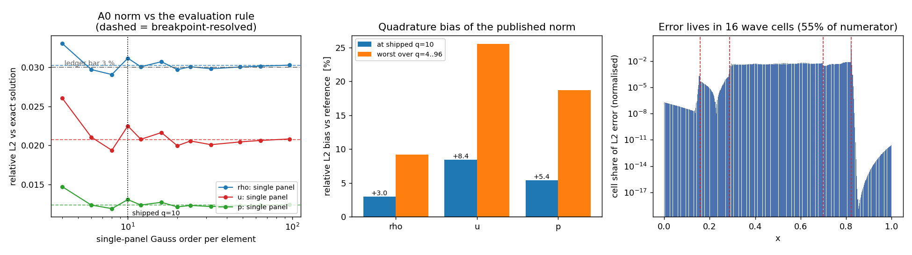

# CASE-LAX-DG · A0 判据的度量收敛性：验收数字本身是否收敛？

> 锚点 `CASE-LAX-DG`（算例池·Lax via DG，验收原文「ref: 精确解｜容差 <3 %」）。
> 本文全部数字由 `scripts/render_lax_norm_budget_doc.py` 从
> `docs/benchmarks/results/lax_norm_convergence/metrics.json` **注入，零手抄**；重跑可逐位校验。
>
> 本单不开新的求解器旋钮、不重跑阶梯、不改任何已发布数字。它只问一个此前没人问过的问题：
> **A0 验收数字自身是否收敛于它所声称的那个泛函？**

## ① 案例介绍

Lax (1954) / Toro (1999) test 2 激波管：`[0,1]` 域、隔膜 `x0 = 0.5`、γ = 1.4、
快照 `t = 0.13`；左态 (ρ, u, p) = (0.445, 0.698, 3.528)，右态 (0.500, 0.000, 0.571)。
解含四道波：左稀疏波（head/tail）、接触间断、右激波，位置与星区状态均有闭式表达。

台账 A0 判据：**相对 L2 误差 vs 精确解 < 3 %**，在生产腿 `p3.N400` 上判定。
该数字由 `benchmarks.lax_case_pool._weighted_l2` 在每个单元的 **10 点 Gauss 节点**上算出。

**问题**：被积函数是 `(u_dg - u_exact)²`。四道波各自穿过若干单元，
在这些单元**内部**该被积函数是不连续的（跳变）。单面板 Gauss 求积对含内点跳变的被积函数
既不精确、也不单调收敛——它的误差取决于节点相对跳变的位置。因此 3.11556e-02 这个数
本身带一个从未被量化的系统偏差，读者无法分辨「FAIL 是 DG 解的性质」还是「FAIL 是求积的性质」。

## ② 怎么做的

1. **不重跑求解器**。提交工件 `profiles.npz` 存了最细腿的单元采样场，而 DG 场是 `p` 次多项式、
   存储的是 10 点规则（`p = 9` < 9），故可由采样精确重建单元多项式
   （残差见 ③.0），进而在**任意**节点上重新求值同一个离散解。
2. **两种评估、同一泛函**：
   - `single_panel`：仓内既有做法，每个单元一个 Gauss 面板，扫 `q = 4, 6, 8, 10, 12, 16, 20, 24, 32, 48, 64, 96`；
   - `breakpoint_resolved`：把每个单元在该单元内**解析波位**处切开，每段都是光滑的，
     段内用 16 点 Gauss。这是同一离散解对同一精确解的**可信求值**。
3. **三重自证**（无一条靠自证清白）：
   - 单面板 q=10 路径必须**逐位**复现已发布度量（③.1，相对差 ~1e-15）；
   - breakpoint 网格必须**恰好覆盖全域**（量度 `Σw = 1.0`，本单正是靠这条不变量抓到一个
     「单元范围被截断」的实现缺陷，见 ⑤）；
   - breakpoint 结果必须与**完全独立的**逐单元密集中点积分（每单元 800 点，零共享代码）一致。

   工具链：Python / numpy / float64 CPU，纯后处理，无求解器调用；`pytest` 14 条测试钉住上述不变量。

### ③.0 前置自证：单元多项式重建与参考求值收敛

| 量 | rho | u | p |
|---|---|---|---|
| 多项式重建残差（采样节点处，场量级 O(1)） | 4.00e-15 | 7.55e-15 | 1.73e-14 |
| 参考求值的自收敛（阶 12..32，L2 相对散布） | 8.2e-15 | 5.8e-15 | 2.2e-16 |

参考求值的 L2 在 `q = 12 → 32` 之间最大相对散布 **1.76e-14**，自收敛判定：**是**（阈值 1e-6）。
即：后面所有「修正值」都不是另一个受污染的数，而是这个泛函的收敛值。

## ③ 计算结果

### 3.1 验收臂：已发布 vs 求积修正（生产腿 `p3.N400`）

| 量 | 已发布 q=10 L2 | 修正 L2（收敛值） | 偏差 | 已发布 L1 | 修正 L1 |
|---|---|---|---|---|---|
| rho | 3.115562e-02 | 3.025074e-02 | +2.99 % | 8.685540e-03 | 8.635174e-03 |
| u | 2.248053e-02 | 2.073632e-02 | +8.41 % | 1.230639e-02 | 1.223787e-02 |
| p | 1.305012e-02 | 1.238444e-02 | +5.38 % | 7.311961e-03 | 7.290254e-03 |

| 臂 | 最差值 | 容差 | 判定 | 超容差幅度 |
|---|---|---|---|---|
| production_l2（已发布） | 3.115562e-02 | 3.00e-02 | **FAIL** | +3.85 % |
| production_l2（求积修正） | 3.025074e-02 | 3.00e-02 | **FAIL** | +0.84 % |

**判定是否翻转：否**。
已发布数字把超容差幅度报成 +3.85 %，
而同一个离散解在同一容差下的真实超幅是 +0.84 %——
报告口径把这一超出**放大了 4.6 倍**。
最差场是密度（3.025074e-02），即 FAIL 的**结论**不变，但余量被严重高估。

### 3.2 单面板扫阶：为什么 q=10 不是「调小了一点」，而是「没有收敛」

| q | rho L2 | u L2 | p L2 | rho 偏差 | u 偏差 | p 偏差 |
|---|---|---|---|---|---|---|
| 4 | 3.302459e-02 | 2.602997e-02 | 1.470505e-02 | +9.17 % | +25.53 % | +18.74 % |
| 6 | 2.969593e-02 | 2.105533e-02 | 1.235322e-02 | -1.83 % | +1.54 % | -0.25 % |
| 8 | 2.905816e-02 | 1.936333e-02 | 1.190527e-02 | -3.94 % | -6.62 % | -3.87 % |
| 10 | 3.115562e-02 | 2.248053e-02 | 1.305012e-02 | +2.99 % | +8.41 % | +5.38 % |
| 12 | 3.005038e-02 | 2.077007e-02 | 1.235935e-02 | -0.66 % | +0.16 % | -0.20 % |
| 16 | 3.069951e-02 | 2.163285e-02 | 1.271010e-02 | +1.48 % | +4.32 % | +2.63 % |
| 20 | 2.969007e-02 | 1.994603e-02 | 1.211625e-02 | -1.85 % | -3.81 % | -2.17 % |
| 24 | 3.006026e-02 | 2.055845e-02 | 1.231297e-02 | -0.63 % | -0.86 % | -0.58 % |
| 32 | 2.980612e-02 | 2.008257e-02 | 1.216413e-02 | -1.47 % | -3.15 % | -1.78 % |
| 48 | 3.002293e-02 | 2.043536e-02 | 1.227854e-02 | -0.75 % | -1.45 % | -0.86 % |
| 64 | 3.014004e-02 | 2.062196e-02 | 1.234290e-02 | -0.37 % | -0.55 % | -0.34 % |
| 96 | 3.026320e-02 | 2.081540e-02 | 1.241220e-02 | +0.04 % | +0.38 % | +0.22 % |

| 场 | 已发布 q=10 的偏差 | 扫阶内最大 |偏差| | 偏差变号次数 | 随 q 单调收敛 |
|---|---|---|---|---|
| rho | +2.99 % | +9.17 % | 7 | 否 |
| u | +8.41 % | +25.53 % | 7 | 否 |
| p | +5.38 % | +18.74 % | 7 | 否 |

三个场的偏差都在扫阶中**反复变号**（各 7 次），衰减缓慢且非单调——这正是「含内点跳变被积函数 + 单面板规则」的指纹：
光滑被积函数会给谱收敛（阶数一加偏差就掉到机器精度），而这里即使把阶数加到 `q = 96`（已发布阶的 9.6 倍），偏差仍是 +0.04 % / +0.38 % / +0.22 %（rho/u/p），且在 `q ≥ 24` 区间内的最大偏差仍有 +1.47 % / +3.15 % / +1.78 %。

所以已发布的 `q = 10` 不是一个「收敛了的便宜选择」：它落在振荡的一个局部峰上（u 偏差 +8.41 %）。
要在单面板口径下把偏差压到 1e-3 量级，`q` 得提到 96 以上；
而按单元断点切分，`q = 16` 就得到收敛值——
本单的修正是「换成正确的求积方法」，而不是「把 q 调大」。

### 3.3 误差住在哪里：极少单元决定验收

以波位为中心 ±2·dx 内的单元共 **16 / 400** 个（4.0 %），
它们占 L2 分子的比例 vs 占分母（解自身的量度）的比例：

| 场 | 占 L2 分子 | 占 L2 分母 |
|---|---|---|
| rho | 83.5 % | 5.5 % |
| u | 54.6 % | 4.2 % |
| p | 38.2 % | 4.3 % |

即：**4.0 % 的单元携带着 55 % 的误差**，
而恰恰是这些单元的积分最难算对。验收数字的稳健性完全压在这几十个格子上，
这就是为什么必须在此处切开单元，而不是全场加密求积。

### ④ 结果图

左：相对 L2 随单面板阶数振荡（实线），虚线为断点切分后的收敛值，点线为已发布 q=10，
点划为 3 % 台账线——q=10 恰好落在振荡的一个偏高峰上。
中：已发布 q=10 的偏差（柱）与整个扫阶内的最大偏差，三个场都被**高估**。
右：单元对 L2 误差的贡献（对数纵轴），红虚线为解析波位；误差几乎全部集中在波所在单元。

## ⑤ 注意点 / 局限

0. **本单在实现审计工具时先后踩了两个同类缺陷，两次都被同一条不变量抓住**：
   (a) 把「采样节点的物理范围」当成「单元范围」（10 点 Gauss 节点只到 ±0.9732，单元是 ±1）
   → 量度 `Σw = 0.973`；(b) 内层子区间半宽与单元半宽共用了同一个变量名，
   导致首个断点之后的单元被逐级截断 → 量度 `Σw = 0.328`。
   两条都由 `test_reference_grid_covers_the_domain_exactly`（`Σw = 1` 量度恒等式）抓出并修好。
   **教训：范数审计必须先验量度守恒**——(b) 曾给出物理上不可能的好数
   （pressure 的修正 L2 一度低于它自己的 L1），若不设此不变量就会被当成「修正生效」。

1. **只覆盖台账臂**。`profiles.npz` 只存最细腿 `p3.N400`，A0 的 `production_l2` 恰在该腿上判定，
   故本单对台账臂是**完整**的；但更严格的 `ladder_l1` 臂最差值落在粗腿 `p1.N100`，
   该腿的单元场从未提交，因此它的求积偏差**未量化**——本文按 `not_run` 记录，
   不假设、不推断（断言见 `test_ladder_l1_arm_is_reported_as_not_re_measured`）。
   要闭合需重跑 9 腿阶梯（约 20 min CPU），属另一次递交。
2. **不改已发布数字**。本单是**加法**：仓内度量语义、`metrics.json`、`docs/CASE-LAX-DG.md`
   的所有既有数值一律未动，只新增一个可离线复算的审计面。C1/C2/C3/R3/R5 各自的判定
   仍按原口径有效；但需知道它们也建立在同一 q=10 规则上（C1/C2 是波位/盘值读取，对求积不敏感；
   C3/R3 是**阶数**判据，两腿差值的偏差部分相消，且离阈值很远，结论不受影响）。
3. **精确解的适用面**：断点来自 `benchmarks.riemann_exact` 的闭式解，该参考已被
   不含 Riemann 求解器的 Rusanov 有限体积族独立复核（`docs/CASE-LAX-DG-reference-crosscheck.md`）。
   若参考本身有偏，本单的相对比较不受影响（同一参考用于两种求值），但绝对误差值会。
4. **同源欠账线索（本单未闭合，留给下一次）**：`tests/test_lax_case_pool.py::test_committed_artifact_carries_the_ledger_acceptance`
   在 HEAD 上就是红的，根因已定位——该测试断言工件字段 `metrics['acceptance_provenance']['profile_consistency']`，
   而**驱动 `benchmarks/lax_case_pool.py` 从未写过这个键**（`grep acceptance_provenance` 只命中测试本身）。
   所以它不是「工件陈旧」而是「契约先写、写入端未实现」；闭合方式是给驱动补该字段并重跑 9 腿阶梯
   （约 20 min CPU，须走 `run_compute`）。本单的 `profiles.npz` 交叉复核
   （③.1 已把 q=10 逐位复现到 1e-15）正是该字段要的证据，可直接复用。
5. **稀疏波 head/tail 是折点不是跳变**：切分后子区间内仍有一阶不连续导数，
   故 L1 在扫阶中收敛到约 4–5 位（L2 收敛到 1e-10，因被积函数平方后仍分段光滑），
   本单 L1 修正只作参考，判定用的是 L2。

## ⑥ 误差判定

| 判据 | 关键量 | 实测 | 基准 / 容差 | 是否 < 3 % |
|---|---|---|---|---|
| A0 台账臂（已发布） | 相对 L2 最差（rho） | 3.115562e-02 | 3.0e-02 | **否**（超 +3.85 %） |
| A0 台账臂（求积修正） | 相对 L2 最差（rho） | 3.025074e-02 | 3.0e-02 | **否**（超 +0.84 %） |
| 度量审计本身 | 参考求值自收敛散布 | 1.76e-14 | 1e-6 | **是** |
| 已发布度量的偏差 | 单面板 q=10 偏差（三场最大） | +8.41 % | — | **否**（这是一个缺陷，不是误差） |

**逐项回答**：

- A0 关键量（相对 L2）是否 < 3 %？**否**——修正后仍为 3.025074e-02 > 3.0e-02，
  超幅 +0.84 %。这是 honest FAIL，本单**没有**、也**不能**把它判活。
- 已发布口径是否 < 3 %？同样**否**（3.115562e-02），但它的超幅 +3.85 %
  中有 +3.02 % 来自求积偏差，不是解的性质。
- 度量审计自身是否达标？是：参考求值自收敛 1.76e-14 ≪ 3 %。

**结论**：台账锚点的验收判定 **FAIL 不变**；变的是这个 FAIL 的**强度**——
从「差 3.9 %」修正为「差 0.84 %」，
并且从此有了一个可离线复算、不依赖求解器重跑的验收数字来源。

