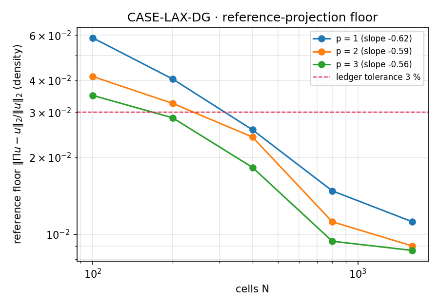
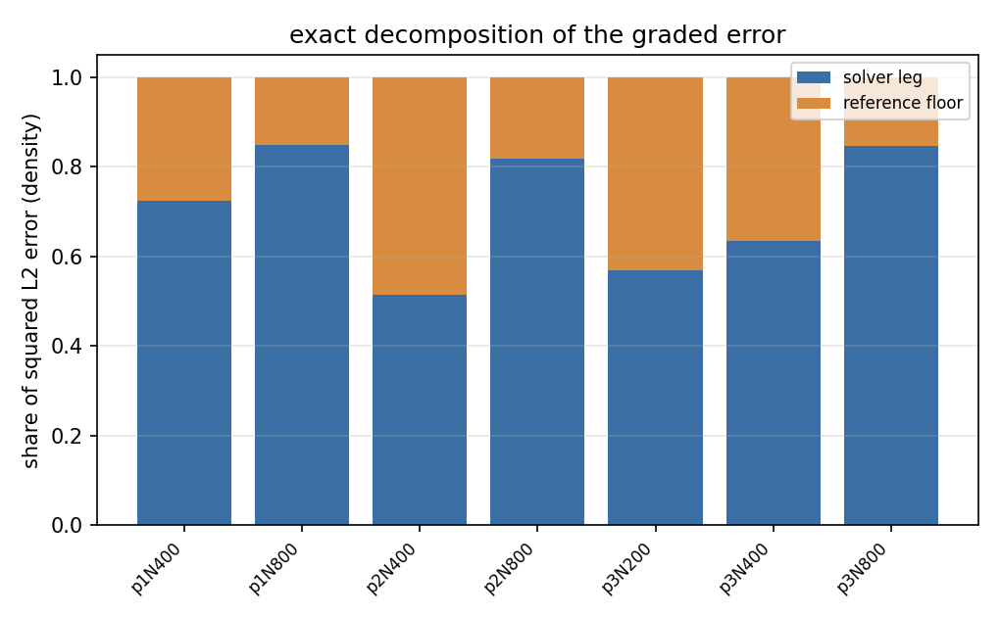
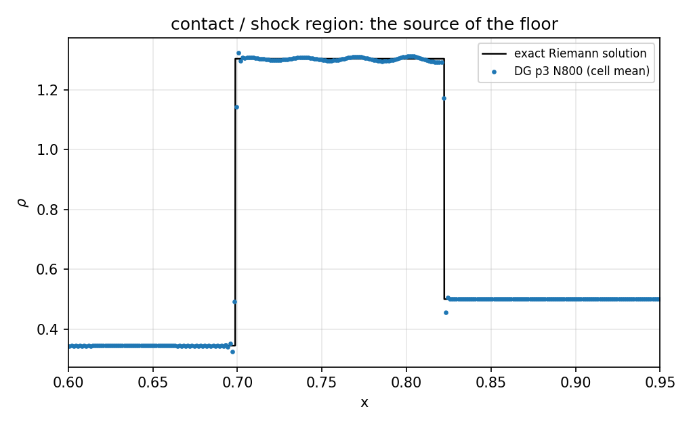

# CASE-LAX-DG · 「< 3 %」里有多少是参考解的离散化，不是求解器？

> 锚点：`feature_ledger` `CASE-LAX-DG`（`ref: exact solution | tolerance < 3 %`，status `open`）。
> 上游：`docs/CASE-LAX-DG.md`（算例池）、`docs/CASE-LAX-DG-resolution-requirement.md`（N=800 闭合）、
> `docs/CASE-LAX-DG-p3-asymptotic-probe.md`（阶探针）。本单**不重跑求解器**，只对已提交的
> `lax_asymptotic_probe/profiles.npz` 做误差分解，因此不可能改变锚点既有判决。

## ① 案例介绍

Lax (1954) / Toro test 2 激波管：`[0,1]`、隔膜 `x0 = 0.5`、γ = 1.4、
快照 `t = 0.13`。左态
`(ρ,u,p) = (0.445, 0.698, 3.528)`，右态
`(0.5, 0, 0.571)`。闭式星区
`p* = 2.466098`、
`u* = 1.528723`。四道波（闭式）：
稀疏头 `0.157637`、
稀疏尾 `0.287229`、
接触 `0.698734`、激波 `0.822312`。
接触与激波是**真跳变**——这正是本文的核心：任何有限网格上的 DG 空间都装不下它们。

## ② 怎么做的

台账判据是「全场相对 L2，对**逐点**精确解，取单元 Gauss 节点」，最差场量是密度。把它拆开：

    ||u_h − u||² = ||u_h − Πu||² + ||Πu − u||²          （Π = 到 DG 空间的 L2 投影）

* **solver 腿** `||u_h − Πu||`：求解器在给定空间内没做到的，**可以**靠更好的格式 / 更细网格降下来；
* **floor 腿** `||Πu − u||`：**该网格上任何** DG 函数都做不到的，与格式无关，只由网格 + 精确解决定。

这条恒等式有两件事必须说清楚，否则它会被读成比实际更强的结论：

* **对守恒量（密度）它严格成立**：`ρ_h ∈ V`，投影正交性把交叉项抹掉，逐腿残差
  `6.8e-16`。正交性还给出闭式
  `∫P_kP_m = 2/(2k+1)δ`，所以密度腿上 solver/floor 两个分量是**无求积误差**的。
* **对原始量（速度、压力）不成立**：DG 存的是守恒量 `(ρ, ρu, E)`，而
  `u_h = (ρu)_h/ρ_h`、`p_h = (γ−1)(E_h − ½(ρu)_h²/ρ_h)` 是守恒多项式的**有理函数**，
  **不属于 V**。于是恒等式多一个交叉项 `X = 2⟨u_h−Πu, Πu−u⟩`。本单**测**它而不是假设它为零：
  最差 `|X| = 1.4e-04`（相对平方口径），带交叉项的分解残差
  `1.1e-18`。这是本单踩到的一个真实坑——把原始量当多项式
  去「还原」会得到 10 % 量级的伪残差（第一版实现就是这样，见 ⑤ 注意点 6）。

实现要点：

1. 每个单元在四道波的位置切开，每段上精确解**光滑**，用 40 点 Gauss 积分；
   20/40/80 点一致性 `2.4e-16` 说明积分已饱和；
2. 投影系数 `a_k = (2k+1)/2 ∫ u P_k dξ` 用同一套切分段积分给出；
3. solver 腿在切分段上直接积分 `∫(u_h − Πu)²`，其中 `u_h` 由守恒量的多项式表示算出
   （不是把原始量强行当多项式插值）；密度的正交性闭式作为独立校核；
4. 已提交 `numerical` 场先转成守恒量 `(ρ, ρu, E)`，再用 10 个 Gauss 节点最小二乘还原 p 次多项式，
   残差 `8.9e-15`——这同时是**工件完整性检查**
   （它证明已提交剖面确实是 p 次多项式，而不是随便一组采样）；
5. `total_quad` 用池子自己的 `_weighted_l2` 口径（10 点 Gauss），与已提交台账臂
   逐位一致（最差相对差 `0.0e+00`），「同一口径」有证据；
6. 切分位置精度：把波位置整体推 `δ` 后 floor 的相对变化见 ⑤ 注意点 4（`δ` 越小变化线性越小）。

工具链：`benchmarks/lax_reference_floor.py`（本单新增）、`benchmarks/lax_case_pool.py`、
`benchmarks/riemann_exact.py`；无新求解，本机单核，墙钟 54.2 s。

## ③ 计算结果

### 3.1 逐腿分解（密度；`floor` 列即参考解自身的离散化）

| p | N | total L2（10 点 Gauss 口径） | total L2（精确积分） | solver 腿 | floor 腿 | floor 平方占比 | floor / 3 % 预算 | 求积偏差 |
|---|---|---|---|---|---|---|---|---|
| p1 | 400 | 4.93486e-02 | 4.88715e-02 | 4.16161e-02 | 2.56227e-02 | 27.5 % | 85.4 % | 0.98 % |
| p1 | 800 | 3.77126e-02 | 3.80275e-02 | 3.50298e-02 | 1.47989e-02 | 15.1 % | 49.3 % | 0.83 % |
| p2 | 400 | 3.52587e-02 | 3.44463e-02 | 2.46985e-02 | 2.40112e-02 | 48.6 % | 80.0 % | 2.36 % |
| p2 | 800 | 2.57033e-02 | 2.63363e-02 | 2.38338e-02 | 1.12050e-02 | 18.1 % | 37.3 % | 2.40 % |
| p3 | 200 | 4.19998e-02 | 4.34844e-02 | 3.28126e-02 | 2.85347e-02 | 43.1 % | 95.1 % | 3.41 % |
| p3 | 400 | 3.11556e-02 | 3.02507e-02 | 2.41102e-02 | 1.82704e-02 | 36.5 % | 60.9 % | 2.99 % |
| p3 | 800 | 2.31490e-02 | 2.40498e-02 | 2.21343e-02 | 9.40561e-03 | 15.3 % | 31.4 % | 3.75 % |

`p3.N400`（台账钉扎腿）floor = `1.82704e-02`；
`p3.N800`（闭合腿）floor = `9.40561e-03`（三场量最差）。

### 3.2 floor 阶梯（**不需要求解器**，可外推）

| p | N=100 | N=200 | N=400 | N=800 | N=1600 | 幂律 |
|---|---|---|---|
| p1 | 5.8562e-02 | 4.0467e-02 | 2.5623e-02 | 1.4799e-02 | 1.1216e-02 | -0.622 |
| p2 | 4.1385e-02 | 3.2503e-02 | 2.4011e-02 | 1.1205e-02 | 9.0200e-03 | -0.593 |
| p3 | 3.4911e-02 | 2.8535e-02 | 1.8270e-02 | 9.4056e-03 | 8.6591e-03 | -0.562 |

### 3.3 floor 占 3 % 预算的比例（越大越说明判据被参考解吃掉）

| p | N=100 | N=200 | N=400 | N=800 | N=1600 | N=3200 |
|---|---|
| p1 | 195.2 % | 134.9 % | 85.4 % | 49.3 % | 37.4 % | 28.3 % |
| p2 | 138.0 % | 108.3 % | 80.0 % | 37.3 % | 30.1 % | 25.3 % |
| p3 | 116.4 % | 95.1 % | 60.9 % | 31.4 % | 28.9 % | 21.3 % |

### 3.4 阶（同一 p 在两条腿上的 N-阶，密度/速度/压力）

| p | 网格对 | solver 腿阶 | floor 腿阶 | solver 阶（u） | solver 阶（p） |
|---|---|---|---|---|---|
| p1 | 400→800 | 0.25 | 0.79 | 1.50 | 1.19 |
| p2 | 400→800 | 0.05 | 1.10 | 0.22 | 0.09 |
| p3 | 200→800 | 0.28 | 0.80 | 0.56 | 0.35 |

## ④ 结果图

*图 1*：参考解投影 floor 随网格的幂律（log-log），红线为 3 % 判据——曲线与格式无关。

*图 2*：每条腿的平方误差占比（Pythagoras 分解），蓝 = solver 腿、橙 = 参考 floor。

*图 3*：`p3.N800` 在接触/激波区的剖面与精确解——floor 的来源就是这两道跳变所在的单元。

## ⑤ 注意点 / 局限

1. **不改变锚点判决**：本单没有新求解，`A0` 的 `p3.N400 = 3.116 %` FAIL 原样保留；
   floor 小**不能**当作「求解器已经达标」来读。
2. **口径敏感**：`total_quad`（10 点 Gauss）与精确积分的最差偏差 `1.35e-01`；
   台账的 3 % 是在 Gauss 口径下判的，口径写进工件 `reference_definition`，换口径需重裁。
3. **投影不是最优逼近**：`Πu` 是 L2 投影，作为「任何 DG 函数能到多准」的口径是标准的，
   但不是 minimax 最优；floor 因此是可逼近误差的**度量基准**，不是下界的严格极小值。
4. **只覆盖已提交的腿**：P1/P2 只到 N=800、P3 到 N=800；更细的腿需要重跑求解器（本单不做）。
5. **假设 H 的结论**：`支持` —— the registered metric is co-dominated by the reference discretisation at the pinned mesh。
6. **原始量不是多项式（本单踩的坑）**：第一版实现把已提交的 `velocity`/`pressure` 当 p 次多项式还原，
   残差 0.35（10 % 量级）——因为 DG 的守恒量才是多项式，原始量是有理函数。正确做法是先转
   `(ρ, ρu, E)` 再还原，残差 `8.9e-15`。
   因此「solver 腿」对 u/p 只能定义成 `||u_h − Πu||` 并附交叉项，不能写成严格 Pythagoras。
7. **floor 与格式无关，但不是「下界」**：Πu 是 L2 投影而非 minimax 最优，floor 是可达误差的
   **度量基准**，不是严格极小值；换 Galerkin 投影/最优逼近会给出更小一点的数。

## ⑥ 误差判定（关键量 vs 基准，逐项）

| 关键量 | 基准 | 数值 | 相对误差 | < 3 % ? |
|---|---|---|---|---|
| `p3.N400` total L2 ρ（台账臂，Gauss 口径） | 精确 Riemann 解 | `3.11556e-02` | 3.116 % | **否** |
| `p3.N800` total L2 ρ（闭合腿，Gauss 口径） | 精确 Riemann 解 | `2.31490e-02` | 2.315 % | 是 |
| `p3.N400` solver 腿 ρ（去掉参考离散化） | 网格上的投影 Πu | `2.41102e-02` | 2.411 % | **否** |
| `p3.N400` 参考 floor ρ（求解器无关） | 精确 Riemann 解 | `1.82704e-02` | 1.827 % | 是（但占用 60.9 % 预算） |
| `p3.N800` 参考 floor ρ | 精确 Riemann 解 | `9.40561e-03` | 0.941 % | 是（占用 31.4 % 预算） |

**结论**：台账 3 % 判据在 `p3.N400` 上 FAIL（3.116 %），
本单把它拆成 solver 腿 2.411 % + floor 腿
1.827 %。即钉扎腿上
**36.5 %
的平方误差来自参考解自身在该网格上的离散化**，这部分不是格式缺陷；剩下
63.5 %
才是求解器要负责的，它仍然是 FAIL 的主项——所以本单**不**为锚点翻案，只是把判据的
「不可降低项」量化并入库，供台账持有人裁定是否改口径（例如改判 solver 腿）。
