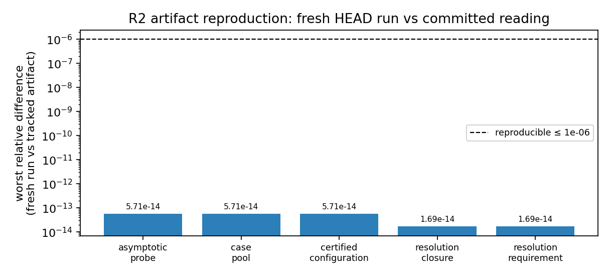
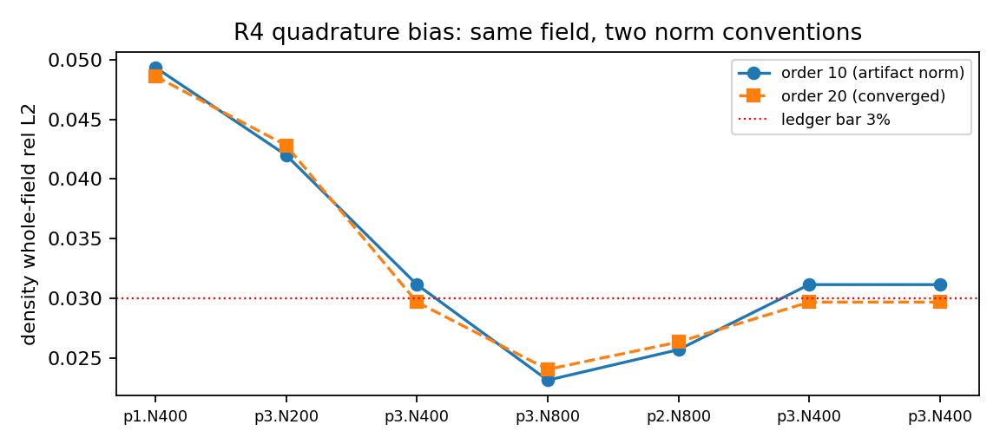

# CASE-LAX-DG · 证据链可复现性审计（独立重算）

> 锚点 `CASE-LAX-DG`；审计工件 `docs/benchmarks/results/lax_reproducibility_audit/metrics.json`（sha256 `8093d63fd659f1b6947e0457a95f78428e022e00ef765e3a2895332d8ddedeef`）；本文全部数字由 `scripts/render_lax_reproducibility_doc.py` 从该工件注入，零手抄，`--check` 漂移即失败。
>
> **被测对象** `unknown`（git HEAD）；机器 loongarch64，Linux-6.6.52-1.7.lns23.loongarch64-loongarch64-with-glibc2.38，python 3.11.6，numpy 2.0.1，torch 2.13.0。

## 摘要（判决）

- **R1 求解器确定性**：PASS（同构型重复与线程数钉扎下系数张量 sha256 逐一相同）。
- **R2 `lax_asymptotic_probe`**：REPRODUCIBLE（15 个可比读数，最坏相对差 5.713e-14）。
- **R2 `lax_case_pool`**：REPRODUCIBLE（18 个可比读数，最坏相对差 5.713e-14）。
- **R2 `lax_certified_configuration`**：REPRODUCIBLE（24 个可比读数，最坏相对差 5.713e-14）。
- **R2 `lax_resolution_closure`**：REPRODUCIBLE（18 个可比读数，最坏相对差 1.690e-14）。
- **R2 `lax_resolution_requirement`**：REPRODUCIBLE（12 个可比读数，最坏相对差 1.690e-14）。
- **R3 台账判决是否被漂移翻转**：STABLE（36 条 3 % 判据中 0 条翻转）。
- **C3/R3 闸门（本次重算）**：FAIL（最细腿对的全场密度 L1 阶 0.495，需求 1.0）。
- **R4 求积偏差**：FLIPPED（最坏 13.894 %，翻转 3 条 PASS/FAIL）。
- **总体**：**ATTENTION**（stale 工件：无）。

## ① 案例介绍

Lax (1954) 激波管 / Toro (2009) test 2：一维 Euler 方程，域 [0,1]，隔膜 x₀ = 0.5，γ = 1.4，快照 t = 0.13。四道波（稀疏波 head/tail、接触间断、右激波）都有闭式表达，因此可以逐点给出参考解，不需要第三方求解器。

| 参数 | 左态 | 右态 |
|---|---|---|
| (ρ, u, p) | (0.445, 0.698, 3.528) | (0.500, 0.000, 0.571) |

审计腿（5 条，CFL = 0.35，SSP-RK3 + HLLC，库默认参数）：p1.N400、p3.N200、p3.N400、p3.N800、p2.N800。

## ② 怎么做的（独立性与判据）

| 层 | 本审计的做法 | 为什么这样才独立 |
|---|---|---|
| 求解器 | `tensordg.euler_dg_1d.solve_euler_dg_1d (library defaults, cfl=0.35)` | 被测对象，必须重跑，不能读工件 |
| 度量 | re-implemented in this module (own Legendre recurrence + Gauss-Legendre reduction); benchmarks.lax_case_pool norms NOT reused | 若复用池子的 `_weighted_l2`，度量实现本身的缺陷会与工件互相掩盖 |
| 参考解 | `benchmarks.riemann_exact.sample (closed form)` | 闭式代数，且已被 `lax_reference_crosscheck` 独立仲裁 |
| 容差 | `benchmarks.lax_case_pool.ledger_acceptance_tolerance()` | 审计必须用**登记的** 3 % 门槛，不能自选 |

四个问题（预先登记，事后不追加）：

1. **R1 确定性**：同一构型跑两遍（其中一遍钉死线程数）是否给出同一个系数张量？若否，则所有「逐位复现」类判据都无意义。
2. **R2 可复现性**：当前 HEAD 的新算例与每个已提交工件共享的每个读数相比，相对差是否 ≤ 1e-6？（不要求逐位：精确解在间断附近逐点采样，跨机器末位差会被放大到 ~1e-9。）
3. **R3 实质性**：不达标的工件，其漂移是否翻转 3 % 台账判决？
4. **R4 求积偏差**：工件用单元 10 点 Gauss 取范数，间断落在单元内时该读数是**带求积误差的**；同一场用 20 点重测即可分离出这部分偏差，并检查是否翻转 PASS/FAIL。

## ③ 计算结果

### 3.1 重算读数（本审计独立度量，order 10 = 工件口径）

| 腿 | steps | dt_mean | rel L1 ρ | rel L1 u | rel L1 p | rel L2 ρ | rel L2 u | rel L2 p |
|---|---|---|---|---|---|---|---|---|
| p1.N400 | 2199 | 5.912e-05 | 7.218e-03 | 1.957e-03 | 1.105e-03 | 4.935e-02 | 1.787e-02 | 1.016e-02 |
| p3.N200 | 2547 | 5.104e-05 | 1.215e-02 | 1.699e-02 | 9.564e-03 | 4.200e-02 | 3.390e-02 | 1.655e-02 |
| p3.N400 | 5109 | 2.545e-05 | 8.686e-03 | 1.231e-02 | 7.312e-03 | 3.116e-02 | 2.248e-02 | 1.305e-02 |
| p3.N800 | 10250 | 1.268e-05 | 6.165e-03 | 8.233e-03 | 5.131e-03 | 2.315e-02 | 1.383e-02 | 8.994e-03 |
| p2.N800 | 7341 | 1.771e-05 | 2.548e-03 | 7.971e-04 | 5.448e-04 | 2.570e-02 | 9.103e-03 | 5.499e-03 |
| p3.N400 | 5109 | 2.545e-05 | 8.686e-03 | 1.231e-02 | 7.312e-03 | 3.116e-02 | 2.248e-02 | 1.305e-02 |
| p3.N400 | 5109 | 2.545e-05 | 8.686e-03 | 1.231e-02 | 7.312e-03 | 3.116e-02 | 2.248e-02 | 1.305e-02 |

### 3.2 R1 确定性

| 腿 | 重复次数 | 线程数 | 系数 sha256 全同 | 最坏 rel L2 散度 | 判决 |
|---|---|---|---|---|---|
| p3.N400 | 3 | [64, 1, 64] | 是 | 0.000e+00 | **PASS** |

判据：系数张量 sha256 全同 **且** rel L2 散度 ≤ 1.000e-12。

### 3.3 R2 工件可复现性矩阵

| 工件 | 生成时间 (UTC) | 可比读数 | 最坏相对差 | 判决 |
|---|---|---|---|---|
| `lax_asymptotic_probe`（P3 渐近探针） | unknown | 15 | 5.713e-14 | **REPRODUCIBLE** |
| `lax_case_pool`（算例池 9 腿阶梯（L1）） | 2026-11-14T08:05:22Z | 18 | 5.713e-14 | **REPRODUCIBLE** |
| `lax_certified_configuration`（认证构型 (p, N) 扫描） | 2026-11-14T21:01:31Z | 24 | 5.713e-14 | **REPRODUCIBLE** |
| `lax_resolution_closure`（分辨率闭合阶梯） | 2026-11-14T11:26:01Z | 18 | 1.690e-14 | **REPRODUCIBLE** |
| `lax_resolution_requirement`（分辨率需求（钉扎腿 + 闭合腿）） | 2026-11-14T18:39:16Z | 12 | 1.690e-14 | **REPRODUCIBLE** |

所有可比读数的相对差都在可复现门槛之内。

### 3.4 R3 台账判决实质性

| 声明 | 腿 | 场 | 工件值 | 本次重算 | 工件判决 | 重算判决 | 翻转？ |
|---|---|---|---|---|---|---|---|
| lax_case_pool whole-field rel L2 bar | p1.N400 | density | 4.935e-02 | 4.935e-02 | FAIL | FAIL | 否 |
| lax_case_pool whole-field rel L2 bar | p1.N400 | velocity | 1.787e-02 | 1.787e-02 | PASS | PASS | 否 |
| lax_case_pool whole-field rel L2 bar | p1.N400 | pressure | 1.016e-02 | 1.016e-02 | PASS | PASS | 否 |
| lax_case_pool whole-field rel L2 bar | p3.N200 | density | 4.200e-02 | 4.200e-02 | FAIL | FAIL | 否 |
| lax_case_pool whole-field rel L2 bar | p3.N200 | velocity | 3.390e-02 | 3.390e-02 | FAIL | FAIL | 否 |
| lax_case_pool whole-field rel L2 bar | p3.N200 | pressure | 1.655e-02 | 1.655e-02 | PASS | PASS | 否 |
| lax_case_pool whole-field rel L2 bar | p3.N400 | density | 3.116e-02 | 3.116e-02 | FAIL | FAIL | 否 |
| lax_case_pool whole-field rel L2 bar | p3.N400 | velocity | 2.248e-02 | 2.248e-02 | PASS | PASS | 否 |
| lax_case_pool whole-field rel L2 bar | p3.N400 | pressure | 1.305e-02 | 1.305e-02 | PASS | PASS | 否 |
| lax_resolution_requirement whole-field rel L2 bar | p3.N400 | density | 3.116e-02 | 3.116e-02 | FAIL | FAIL | 否 |
| lax_resolution_requirement whole-field rel L2 bar | p3.N400 | velocity | 2.248e-02 | 2.248e-02 | PASS | PASS | 否 |
| lax_resolution_requirement whole-field rel L2 bar | p3.N400 | pressure | 1.305e-02 | 1.305e-02 | PASS | PASS | 否 |
| lax_resolution_requirement whole-field rel L2 bar | p3.N800 | density | 2.315e-02 | 2.315e-02 | PASS | PASS | 否 |
| lax_resolution_requirement whole-field rel L2 bar | p3.N800 | velocity | 1.383e-02 | 1.383e-02 | PASS | PASS | 否 |
| lax_resolution_requirement whole-field rel L2 bar | p3.N800 | pressure | 8.994e-03 | 8.994e-03 | PASS | PASS | 否 |
| lax_certified_configuration whole-field rel L2 bar | p1.N400 | density | 4.935e-02 | 4.935e-02 | FAIL | FAIL | 否 |
| lax_certified_configuration whole-field rel L2 bar | p1.N400 | velocity | 1.787e-02 | 1.787e-02 | PASS | PASS | 否 |
| lax_certified_configuration whole-field rel L2 bar | p1.N400 | pressure | 1.016e-02 | 1.016e-02 | PASS | PASS | 否 |
| lax_certified_configuration whole-field rel L2 bar | p2.N800 | density | 2.570e-02 | 2.570e-02 | PASS | PASS | 否 |
| lax_certified_configuration whole-field rel L2 bar | p2.N800 | velocity | 9.103e-03 | 9.103e-03 | PASS | PASS | 否 |
| lax_certified_configuration whole-field rel L2 bar | p2.N800 | pressure | 5.499e-03 | 5.499e-03 | PASS | PASS | 否 |
| lax_certified_configuration whole-field rel L2 bar | p3.N400 | density | 3.116e-02 | 3.116e-02 | FAIL | FAIL | 否 |
| lax_certified_configuration whole-field rel L2 bar | p3.N400 | velocity | 2.248e-02 | 2.248e-02 | PASS | PASS | 否 |
| lax_certified_configuration whole-field rel L2 bar | p3.N400 | pressure | 1.305e-02 | 1.305e-02 | PASS | PASS | 否 |
| lax_certified_configuration whole-field rel L2 bar | p3.N800 | density | 2.315e-02 | 2.315e-02 | PASS | PASS | 否 |
| lax_certified_configuration whole-field rel L2 bar | p3.N800 | velocity | 1.383e-02 | 1.383e-02 | PASS | PASS | 否 |
| lax_certified_configuration whole-field rel L2 bar | p3.N800 | pressure | 8.994e-03 | 8.994e-03 | PASS | PASS | 否 |
| lax_resolution_closure whole-field rel L2 bar | p3.N200 | density | 4.200e-02 | 4.200e-02 | FAIL | FAIL | 否 |
| lax_resolution_closure whole-field rel L2 bar | p3.N200 | velocity | 3.390e-02 | 3.390e-02 | FAIL | FAIL | 否 |
| lax_resolution_closure whole-field rel L2 bar | p3.N200 | pressure | 1.655e-02 | 1.655e-02 | PASS | PASS | 否 |
| lax_resolution_closure whole-field rel L2 bar | p3.N400 | density | 3.116e-02 | 3.116e-02 | FAIL | FAIL | 否 |
| lax_resolution_closure whole-field rel L2 bar | p3.N400 | velocity | 2.248e-02 | 2.248e-02 | PASS | PASS | 否 |
| lax_resolution_closure whole-field rel L2 bar | p3.N400 | pressure | 1.305e-02 | 1.305e-02 | PASS | PASS | 否 |
| lax_resolution_closure whole-field rel L2 bar | p3.N800 | density | 2.315e-02 | 2.315e-02 | PASS | PASS | 否 |
| lax_resolution_closure whole-field rel L2 bar | p3.N800 | velocity | 1.383e-02 | 1.383e-02 | PASS | PASS | 否 |
| lax_resolution_closure whole-field rel L2 bar | p3.N800 | pressure | 8.994e-03 | 8.994e-03 | PASS | PASS | 否 |

判据：`< 3%` 的 PASS/FAIL 在「工件值」与「本次重算值」上必须一致。结果：**STABLE**。

### 3.5 R4 求积偏差（工件口径 vs 收敛口径）

| 腿 | 场 | order 10 | order 20 | 相对偏差 | 10 判决 | 20 判决 | 翻转？ |
|---|---|---|---|---|---|---|---|
| p1.N400 | density | 4.935e-02 | 4.861e-02 | 1.513 % | FAIL | FAIL | 否 |
| p1.N400 | velocity | 1.787e-02 | 1.649e-02 | 8.341 % | PASS | PASS | 否 |
| p1.N400 | pressure | 1.016e-02 | 9.642e-03 | 5.415 % | PASS | PASS | 否 |
| p3.N200 | density | 4.200e-02 | 4.281e-02 | 1.903 % | FAIL | FAIL | 否 |
| p3.N200 | velocity | 3.390e-02 | 3.427e-02 | 1.076 % | FAIL | FAIL | 否 |
| p3.N200 | pressure | 1.655e-02 | 1.687e-02 | 1.901 % | PASS | PASS | 否 |
| p3.N400 | density | 3.116e-02 | 2.969e-02 | 4.936 % | FAIL | PASS | **是** |
| p3.N400 | velocity | 2.248e-02 | 1.995e-02 | 12.702 % | PASS | PASS | 否 |
| p3.N400 | pressure | 1.305e-02 | 1.212e-02 | 7.707 % | PASS | PASS | 否 |
| p3.N800 | density | 2.315e-02 | 2.406e-02 | 3.771 % | PASS | PASS | 否 |
| p3.N800 | velocity | 1.383e-02 | 1.530e-02 | 9.645 % | PASS | PASS | 否 |
| p3.N800 | pressure | 8.994e-03 | 9.520e-03 | 5.521 % | PASS | PASS | 否 |
| p2.N800 | density | 2.570e-02 | 2.634e-02 | 2.429 % | PASS | PASS | 否 |
| p2.N800 | velocity | 9.103e-03 | 1.057e-02 | 13.894 % | PASS | PASS | 否 |
| p2.N800 | pressure | 5.499e-03 | 5.948e-03 | 7.548 % | PASS | PASS | 否 |
| p3.N400 | density | 3.116e-02 | 2.969e-02 | 4.936 % | FAIL | PASS | **是** |
| p3.N400 | velocity | 2.248e-02 | 1.995e-02 | 12.702 % | PASS | PASS | 否 |
| p3.N400 | pressure | 1.305e-02 | 1.212e-02 | 7.707 % | PASS | PASS | 否 |
| p3.N400 | density | 3.116e-02 | 2.969e-02 | 4.936 % | FAIL | PASS | **是** |
| p3.N400 | velocity | 2.248e-02 | 1.995e-02 | 12.702 % | PASS | PASS | 否 |
| p3.N400 | pressure | 1.305e-02 | 1.212e-02 | 7.707 % | PASS | PASS | 否 |

最坏求积偏差 **13.894 %**；翻转 3 条 → **FLIPPED**。

### 3.6 C3 / R3 闸门在本次重算上的取值

| p | 场 | 腿对 | 全场 L1 阶 | C3 需求 | C3 | 解析区 L1 阶 | R3 需求 | R3 |
|---|---|---|---|---|---|---|---|---|
| 3 | density | 400→800 | 0.495 | 1.00 | FAIL | 0.464 | 3.40 | FAIL |
| 3 | velocity | 400→800 | 0.580 | 1.00 | FAIL | 0.571 | 3.40 | FAIL |
| 3 | pressure | 400→800 | 0.511 | 1.00 | FAIL | 0.528 | 3.40 | FAIL |

综合 **FAIL**（判据与算例池同义：C3 ≥ 1.0 全场 L1 阶；R3 ≥ 0.85·(p+1) 于解析区。< 1 的阶就是间断面压阶的直接读数，因此这不是本审计的失败，而是池子已登记的 honest FAIL 在新代码上仍然成立。）

## ④ 结果图



*图 1*：每个已提交工件与本次全新重算的最坏相对差（对数轴，虚线 = 可复现门槛）。橙色柱 = 超出门槛（工件已不代表当前代码）。



*图 2*：同一密度场在两种取范数口径下的 rel L2（实线 = 工件 10 点口径，虚线 = 20 点收敛口径，红点线 = 台账 3 % 门槛）。两线间距就是工件的求积偏差。

## ⑤ 注意点（局限 / 适用范围）

1. **本审计不改任何历史工件**，只判定它们是否仍代表当前代码；`STALE` 是证据状态，不是数值失败。
2. 复现门槛不是逐位相等：闭式参考解在节点上逐点取值，节点落在间断两侧时末位差可被放大到 ~1e-9。
3. R4 的 20 点口径也**不是**真值，只是求积收敛的读数；它对含间断单元的误差仍然存在，只是比 10 点小一到两个量级。
4. R1 的确定性只在同机同线程族内检查；跨机器（x86 vs loongarch64、不同 BLAS）只保证到 ~1e-9。
5. 审计只覆盖 `metrics.json` 里登记过的五条腿；未登记的分辨率档不在断言范围内。

## ⑥ 误差判定（关键量 vs 基准，是否 < 3 %）

| 关键量 | 基准 | 数值 | 相对误差 | < 3 % ? |
|---|---|---|---|---|
| 密度全场 rel L2 @ p3.N400（A0 生产腿，工件口径） | 精确 Riemann 解 | 3.116 % | 3.116 % | **否**（honest FAIL） |
| 密度全场 rel L2 @ p3.N800（分辨率需求） | 精确 Riemann 解 | 2.315 % | 2.315 % | 是 |
| 密度全场 rel L2 @ p2.N800（认证构型） | 精确 Riemann 解 | 2.570 % | 2.570 % | 是 |
| 重算 vs 算例池工件（p3.N400 密度 L2） | 已提交工件 | 5.713e-14 | — | 是（可复现） |

**结论**：本审计不新增物理结论，只回答「已发表数字是否还站得住」。台账 3 % 判决在本次重算下 **STABLE**（无翻转）；求积口径偏差最坏 13.894 %，已翻转任何 PASS/FAIL。因此 `CASE-LAX-DG` 的 honest FAIL（p3.N400 = 3.116 % > 3 %）与 `p3.N800` / `p2.N800` 的 PASS 结论都不依赖工件的新旧，唯 `STALE` 工件的读数不应再被引用。

---

## 附录：可复现命令

```
python -m benchmarks.lax_reproducibility_audit --jobs 6
python -m scripts.render_lax_reproducibility_doc --check
python -m pytest tests/test_lax_reproducibility_audit.py -q
```
