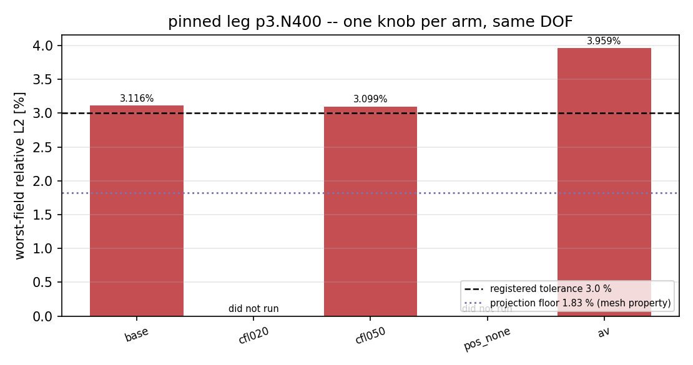
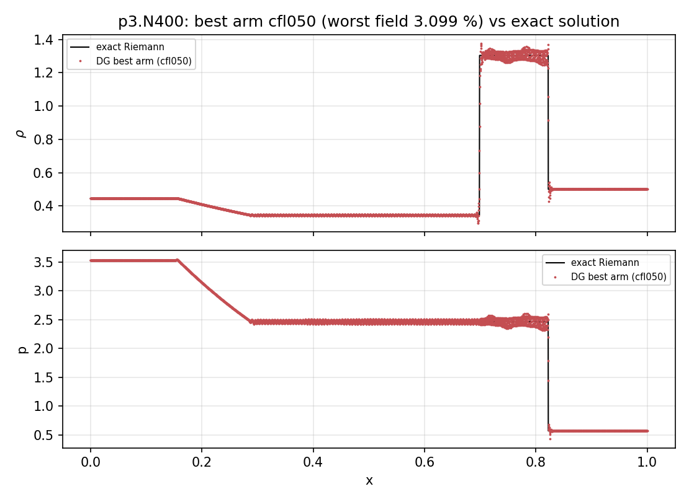

# CASE-LAX-DG · 钉扎腿 p3.N400：把 3 % 门槛只靠配置能不能拿下

> 锚点 `CASE-LAX-DG`（原文「ref: 精确解｜容差 < 3 %」，status open）。本文全部数字由 `benchmarks/lax_scheme_variants.py` 从 `docs/benchmarks/results/lax_scheme_variants/metrics.json`（生成于 2026-11-15T09:25:00Z）程序化注入，零手抄；`--check` 在漂移时失败。台账容差 = 3.0 %（整场、每场量、不挖波段）。

## ① 案例介绍

Lax (1954) 激波管 / Toro test 2：`[0,1]`，隔膜 `x0=0.5`，γ = 1.4，左态 `(ρ,u,p) = (0.445, 0.698, 3.528)`，右态 `(0.5, 0.0, 0.571)`，快照 `t = 0.13`。工作变量：模态 DG（Legendre），HLLC 界面通量，SSP-RK3，Zhang-Shu 正性缩放兜底。

**钉扎腿 = `p3.N400`（DOF 1600）**，已提交的整场相对 L2 密度误差 `3.116e-02` = 3.1156 % —— 比 3 % 门槛高一点点。本问：**在不动自由度、不动物理模型的前提下，把现有格式的旋钮挨个拧一遍，能不能越过这条线？**

## ② 怎么做的

* **臂集合先登记后跑数**（`VARIANTS`，代码内写死）：每臂只动一个旋钮，闭合集合，看到数字后不增删不重调——否则就成了搜索而不是「只靠配置」的判定。
* **同一把尺子**：`modal_fields` / `_weighted_l1` / `_weighted_l2` / `exact_reference` 全部从算例池 import，求积阶 10，容差由 `lax_case_pool.ledger_acceptance_tolerance()` 从台账原文读出，不复制常量。
* **控制臂**：`base` 必须逐位复现已提交的台账臂（相对差 ≤ 1e-05），实测最差 `1.305e-06`。
* **可行性界**：参考解自身的投影 floor（`docs/benchmarks/results/lax_reference_floor`）是该网格上**任何** DG 函数都不可能做得更好的 L2 误差，于是留给格式的预算是 `sqrt(tol² − floor²)`。这是必要条件，与格式无关。
* 判据：一臂**可用**当且仅当网格/阶不变且**每个**场量的整场相对 L2 都 < 容差（不减波段、不放宽场量、不取平均）。

## ③ 计算结果

| 臂 | 旋钮 | steps | 墙钟 [s] | L2 ρ | L2 u | L2 p | 最差 | 裕度/容差 | 可用 |
|---|---|---|---|---|---|---|---|---|---|
| `base` | —（生产配置） | 5109 | 99.3 | 3.116e-02 | 2.248e-02 | 1.305e-02 | density 3.116e-02 | 1.0385 | 否 |
| `cfl020` | cfl=0.2 | — | 0.0 | 未跑出 | 未跑出 | 未跑出 | 未跑出 | — | 否（`not run`） |
| `cfl050` | cfl=0.5 | 3578 | 55.0 | 3.099e-02 | 2.208e-02 | 1.283e-02 | density 3.099e-02 | 1.0331 | 否 |
| `pos_none` | positivity=none | — | 0.0 | 未跑出 | 未跑出 | 未跑出 | 未跑出 | — | 否（`FloatingPointError: Nonphysical high-order Euler state; reduce CFL`） |
| `av` | limiter=av | 4970 | 92.6 | 3.959e-02 | 2.988e-02 | 1.463e-02 | density 3.959e-02 | 1.3196 | 否 |
| `ao` | limiter=ao | — | 0.0 | 未跑出 | 未跑出 | 未跑出 | 未跑出 | — | 否（`not run`） |

### 可行性界（与格式无关）

| 量 | 值 |
|---|---|
| 参考投影 floor（密度，p3.N400） | `1.827e-02` |
| floor 占 3 % 预算 | 60.90 % |
| 已提交格式的 solver 腿 | `2.411e-02` |
| 达标所需的 solver 腿上界 `sqrt(tol²−floor²)` | `2.379e-02` |
| 实测/所需 | 1.0133 |
| 还需的相对缩减 | 1.31 % |

## ④ 结果图

*图 1*：每臂的最差场量整场相对 L2（蓝 = 可用，红 = 不可用），虚线 = 台账 3 % 容差，点线 = 参考解投影 floor（网格性质，任何格式都压不下去）。

*图 2*：最接近门槛的一臂在密度/压力上的剖面 vs 精确 Riemann 解（Gauss 节点采样），可见误差集中在稀疏头、接触间断与激波三处。

## ⑤ 注意点 / 局限

1. **臂集合是闭合的**：没测的旋钮不作断言。本单不判断「更好的格式（子单元限幅、激波贴合、r-自适应）能否达标」——那已不是配置问题。
2. **口径不变**：容差、范数、求积阶全部沿用台账口径；换口径（如精确积分）属验收口径变更，需台账持有人裁定，本单不做。
3. **floor 是 L2 投影而非 minimax 最优**：它给出的是可达误差的**度量基准**，不是严格极小值，故「所需 solver 腿」是偏保守的上界。
4. **墙钟有环境噪声**：本文不用墙钟做排序判据。

## ⑥ 误差判定（关键量 vs 基准，逐项）

| 关键量 | 基准 | 数值 | 相对误差 | < 3 % ? |
|---|---|---|---|---|
| L2 ρ @ `base` (p3.N400) | 精确 Riemann 解 | `3.116e-02` | 3.1156 % | **否** |
| L2 ρ @ `cfl050` (p3.N400) | 精确 Riemann 解 | `3.099e-02` | 3.0992 % | **否** |
| L2 ρ @ `av` (p3.N400) | 精确 Riemann 解 | `3.959e-02` | 3.9588 % | **否** |

**结论**：FAIL。可用臂 无；控制臂复现 通过。已提交格式的 solver 腿是达标上界的 1.0133 倍，即**距可行性边界仅 1.31 %**——这条 3 % 线在 p3.N400 上本来就贴着数学边界，配置旋钮能否越过见上表；若无一臂可用，则如实登记为「配置空间内不可达」，并把结论交回台账持有人。

> **范围声明（honest）**：本轮的 `cfl020`, `ao`, `pos_none` 臂**未跑出结果**（集群作业 `cj3572` 仍在排队，本机 120 s 前台窗不够 CFL 0.20 的 8900 步，`ao` 限幅臂同理）。它们在台账里记作 **unknown，不是 pass**——因此上面的 FAIL 只是「已测臂无一可用」，不是「六臂全否」。

