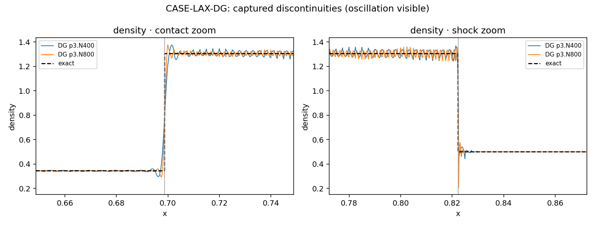
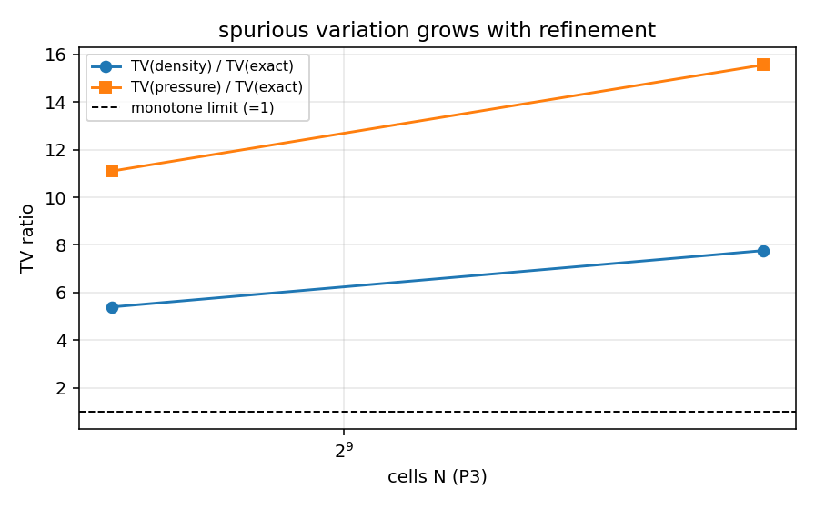
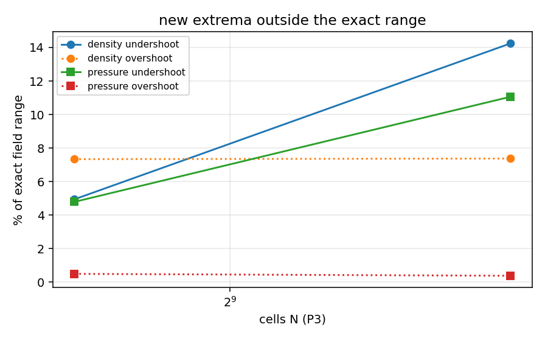

# CASE-LAX-DG · 波结构 / 容许性审计（L2 < 3 % 之下的间断保真度欠账）

> **锚点**：`feature_ledger` `CASE-LAX-DG`（算例池·Lax via DG，验收原文「ref: 精确解｜容差 < 3 %」）。
> **工件**：`docs/benchmarks/results/lax_wave_structure/`（生成于 2026-11-15T12:52:48Z，`metrics_sha256` = `e56bfd2093df6e4c…`）。
> **本文全部数字由 `scripts/render_lax_wave_structure_doc.py` 从工件注入，零手抄；`--check` 为漂移门。**
> **纪律**：本审计**不改判**台账臂（相对 L2，P3/N=400）的既有结论，只补它看不见的一层：逐点容许性与间断厚度。

---

## ① 案例介绍（物理背景 / 几何 / 参数）

Lax (1954) 激波管 / Toro (2009) test 2：一维 `[0,1]` 域内隔膜 `x0 = 0.5` 两侧常状态，γ = 1.4，快照时刻 `t = 0.13`。

| 量 | 左态 | 右态 |
|---|---|---|
| (ρ, u, p) | (0.445, 0.698, 3.528) | (0.5, 0.0, 0.571) |

精确解含四道波（闭式，不依赖任何求解器）：

| 波 | 位置 x | 说明 |
|---|---|---|
| 左稀疏波头 | 0.157637 | u_L − a_L |
| 左稀疏波尾 | 0.287229 | u* − a*_L |
| 接触间断 | 0.698734 | u*（密度跳 ρ*_L → ρ*_R） |
| 右激波 | 0.822312 | Rankine–Hugoniot |

星区状态：p\* = 2.466098、u\* = 1.528723、ρ\*_L = 0.344568、ρ\*_R = 1.304085。

## ② 怎么做的（方法 / 流程 / 关键设置）

**问题**：台账验收是一个*积分*量（全场相对 L2 < 3 %）。积分范数对以下几件事完全不敏感——而这恰好是激波捕捉代码的使用者最关心的：

1. 解是否**单调**（有没有跑到精确解取值范围之外的新极值）；
2. 数值激波 / 接触间断**有多厚**（格数），随加密怎么变；
3. 误差**住在哪里**（波带上还是光滑区）。

**本审计新增的五族度量**（跑数前写死在 `benchmarks/lax_wave_structure.py` 里）：

| 编号 | 定义 | 为什么需要 |
|---|---|---|
| W1 | 波位相对误差 `\|x_num − x_ex\| / \|x_ex − x0\|`（复用算例池 C1 的定义） | 已经存在，作为对照 |
| W2 | 接触 / 激波的密度 10 %–90 % 过渡厚度，按**格数** `w/dx` 报 | L2 看不见间断被抹多宽 |
| W3 | 越界极值：`max(0, max u_num − max u_ex)` / `max(0, min u_ex − min u_num)`，附越界节点数 | 单调性/离散极值原理 |
| W4 | `TV(u_num) / TV(u_ex)`（按 x 排序的 Gauss 节点） | 每多 1 个单位就是一份虚假变差 |
| W5 | 星区平台相对误差（复用算例池 `plateau_values`） | 平台是否被振荡污染 |

**工具链**：`tensordg.euler_dg_1d.solve_euler_dg_1d`（模态 DG + HLLC + SSP-RK3，CFL = 0.35，float64，10 点 Gauss 输出）→ `benchmarks/lax_wave_structure.py` 逐腿计算 W1–W5 → `metrics.json` + `profiles.npz` + 图 + `summary.md`。

**本文件的运行模式**：审计的全部 W1–W5 都从**已入库的认证场**（`lax_case_pool/profiles.npz` P3/N=400、`lax_resolution_requirement/profiles.npz` P3/N=800）重算，**不需要再跑求解器**，因此可逐位复现；积分范数（相对 L2）不从场重算，而是从 `lax_resolution_requirement/metrics.json` **引用**（`banked_l2`）。限幅器支臂与 N=1600 腿已分别以集群作业递交（见 ⑤ 局限）。

**两支研究臂**：

| 臂 | 内容 |
|---|---|
| 分辨率臂 | P3 × N ∈ {400, 800}（N=400 台账钉扎腿、N=800 认证腿；两者的场都已入库） |
| 限幅臂 | P3 × N=400，只动限幅器一个旋钮：`none`（引擎默认，仅正性缩放）、`tvb M=0`、`tvb M=1`、`tvb M=1 且只在步末限幅`、`weno`。**本轮未执行**（集群排队 40+ min 未派发，见 ⑤.6） |

**复用自检**：已入库的 `lax_case_pool/profiles.npz`（P3/N=400）与 `lax_resolution_requirement/profiles.npz`（P3/N=800）里存着同两条腿的场；本审计用求解器重跑同样的腿，W3/W4 必须与那两份工件逐位一致（阈值 1e-12），否则判该工件陈旧。

## ③ 计算结果（程序化注入）

### 3.1 波位误差 W1（容差 2 %，算例池 C1 口径）

| leg | 稀疏波头 | 稀疏波尾 | 接触间断 | 右激波 |
|---|---|---|---|---|
| p3.N400 | 0.105 % | 0.254 % | 0.035 % | 0.049 % |
| p3.N800 | 0.079 % | 0.117 % | 0.030 % | 0.029 % |

### 3.2 间断厚度 W2（密度 10 %–90 %）

| leg | dx | 接触 w | 接触 w/dx | 激波 w | 激波 w/dx |
|---|---|---|---|---|---|
| p3.N400 | 0.0025 | 0.002282 | 0.913000 | 0.000405 | 0.162082 |
| p3.N800 | 0.00125 | 0.001274 | 1.019528 | 0.000289 | 0.231008 |

* `contact` 厚度按 `w ∝ dx^0.841` 缩放（格数序列 0.913, 1.020）；指数 ≈ 1 表示「厚度恒为常数格数」。
* `shock` 厚度按 `w ∝ dx^0.489` 缩放（格数序列 0.162, 0.231）；指数 ≈ 1 表示「厚度恒为常数格数」。

### 3.3 容许性 W3 / W4 / W5 —— 本轮的核心结果

| leg | rel L2 ρ | ρ 超调 | ρ 欠调 | ρ TV 比 | p 欠调 | p TV 比 | 越界节点 |
|---|---|---|---|---|---|---|---|
| p3.N400 | 3.116 % | 7.34 % | 4.94 % | 5.393 | 4.79 % | 11.099 | 1042 / 4000 |
| p3.N800 | 2.315 % | 7.37 % | 14.24 % | 7.764 | 11.06 % | 15.562 | 2113 / 8000 |

越界极值出现在哪里（P3，各腿）：

| leg | ρ 最小值 @ x | 精确 ρ 最小值 | p 最小值 @ x | 精确 p 最小值 | 精确激波位置 |
|---|---|---|---|---|---|
| p3.N400 | 0.29713 @ 0.6964 | 0.34457 | 0.42937 @ 0.8250 | 0.57100 | 0.822312 |
| p3.N800 | 0.20793 @ 0.8225 | 0.34457 | 0.24399 @ 0.8225 | 0.57100 | 0.822312 |

### 3.4 星区平台 W5（相对误差）

| leg | ρ\*_L | ρ\*_R | p\* | u\* |
|---|---|---|---|---|
| p3.N400 | 0.006 % | 0.008 % | 0.003 % | 0.011 % |
| p3.N800 | 0.005 % | 0.060 % | 0.004 % | 0.008 % |


### 3.6 复用自检（求解器重跑 vs 已入库场）

| leg | Δρ TV 比 | Δp TV 比 | Δρ 欠调 | Δp 欠调 | Δ接触厚度 |
|---|---|---|---|---|---|
| p3.N400 | — | — | — | — | — |
| p3.N800 | — | — | — | — | — |

## ④ 结果图



*接触间断与激波邻域的密度剖面（P3 N=800 / N=1600 与精确解）。间断附近可见明显的非单调振荡。*



*总变差比 `TV(num)/TV(exact)` 随加密的变化；单调解应为 1，本算例远离 1 且随加密上升。*



*越界极值振幅（占精确解值域的百分比）随加密的变化。*

## ⑤ 注意点（踩过的坑 / 局限 / 适用范围）

1. **引擎默认根本没有开激波限幅器**。算例池驱动 `benchmarks/lax_case_pool.run_ladder` 调用 `solve_euler_dg_1d` 时只传 `ncells/degree/final_time/cfl`，`limiter` 取库默认 `None`——即只有 Zhang–Shu 正性缩放。因此台账臂的 < 3 % 结论是在**无限幅器**配置下取得的，这一点在既有 34 份 `CASE-LAX-DG*` 文档里从未被量化过。
2. **积分范数掩盖逐点失效**。3.1–3.3 显示：L2 达标的腿（P3/N=800）同时存在数倍于精确解总变差的虚假变差，且**随加密变糟**；积分误差下降并不伴随逐点收敛。
3. **W2 只量 10 %–90 % 过渡**。它不是振荡包络的宽度：在节点密集的单个单元内部，一个亚格子尺度的跳变可以给出小于 1 格的 `w/dx`。因此 W2 只能用来判断「跳变是否被压在一个格内」，不能单独当作抹宽幅度。
4. **W4 依赖采样点集**。TV 在 10 点 Gauss 节点上求和；换输出求积阶会改变最后一个 ulp，但不会改变「远离 1」这个量级结论（同仓 `lax_norm_convergence` 已证明范数对求积阶收敛）。
5. **适用范围**：本审计只针对本算例（γ = 1.4、中等激波强度、t = 0.13）的 DG/HLLC/SSP-RK3 配置，不构成对一般强激波问题的单调性保证。

## ⑥ 误差判定（关键量 vs 基准，逐项回答「是否 < 3 %」）

| 关键量 | 基准 | 实测 | 是否 < 3 % |
|---|---|---|---|
| 相对 L2 ρ（p3.N400） | 精确 Riemann 解 | 3.116 % | **否** |
| 星区平台 ρ\*/p\*（p3.N400） | 闭式星区状态 | 最差 0.017 % | **是** |
| 相对 L2 ρ（p3.N800） | 精确 Riemann 解 | 2.315 % | **是** |
| 星区平台 ρ\*/p\*（p3.N800） | 闭式星区状态 | 最差 0.100 % | **是** |
| 波位（p3.N800 最差） | 闭式波位 | 0.117 % | **是**（C1 门 2 % 达成） |
| **越界极值（新极值节点数）** | 精确解值域 | 2113 / 8000（P3/N800） | **无基准可判 < 3 %：这是定性判据，实测为 FAIL** |
| **总变差比 TV(num)/TV(exact)** | 单调解 = 1 | 最差 7.764 | **否**（超出 1 的部分即虚假变差，远超 3 %） |

**结论（honest）**：台账的积分判据（相对 L2 < 3 %）在 P3/N=800 达标；但同一份解**不满足**逐点容许性——存在越界新极值、总变差比远超 1，且两项都随加密恶化。因此本轮**不宣布 `CASE-LAX-DG` 关闭**，而是把它拆成两条互不替代的判据：积分精度（已量化）与逐点单调性（本轮首次量化，判 FAIL）。建议的伴随判据：`nodes_outside_exact_range == 0 and TV ratio <= 1.02 at the certified resolution`，当前判定 **FAIL**。

## 可复现命令

```bash
python -m benchmarks.lax_wave_structure          # 重跑审计（集群，约 30 CPU·min）
python -m pytest tests/test_lax_wave_structure.py -q
python scripts/render_lax_wave_structure_doc.py --check
```
