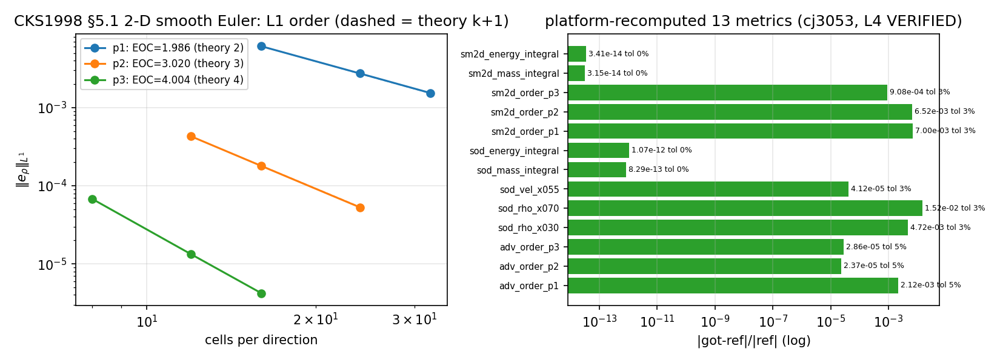

# REPRO-DG-CKS1998 · 把「多维系统」纳入机器判定（mission 20922，2-D L4）

## ① 案例介绍

**锚点**：`REPRO-DG-CKS1998` = Cockburn & Shu, *The Runge-Kutta discontinuous Galerkin method
for conservation laws V: **multidimensional systems***, JCP **141** (1998) 199-224。

该锚点此前的 L4 机器判定（`tensorbench_results` 8 行，cj2385 / mission 19918）**只覆盖一维**：
光滑对流阶数 + Sod 激波管。论文标题里的「multidimensional」部分——二维 Euler 系统——只有仓内
JSON 与 Markdown（`docs/CASE-DG-CKS1998-SMOOTH-2D.md`、`validation/cks1998_smooth_2d/order.json`），
平台从未复算过一行。本单补上这一段：**不新增求解器、不改一维判据、不放宽容差**。

二维算例 = 论文 §5.1 自己的光滑测试（均匀流携带的熵波）：

| 项 | 取值 |
|---|---|
| 方程 | 二维 Euler，γ = 1.4，HLLC 通量，模态 Legendre DG，SSP-RK3 |
| 精确解 | ρ = 1 + 0.2 sin(π(x + y − 2t))，u = v = 1，p = 1（**无人工源项**） |
| 区域 / 边界 | [0,2]² / 两向周期 |
| 末时刻 | t = 0.5；CFL = 0.2（网格梯子；P^k 网格 16/24/32、12/16/24、8/12/16） |
| 范数 | 密度误差的 L1（单元张量 Gauss 积分） |
| 精确守恒积分 | ∫ρ = **4**（正弦在一个周期上积零，均值 1 × 面积 4）；∫E = **2.5·4 + 4 = 14**（E = p/(γ−1) + ρ(u²+v²)/2 = 2.5 + ρ） |

## ② 怎么做的

1. **预登记**：`validation/repro_cks1998/bench_spec.py` 的 `METRICS` 由 8 条扩到 13 条
   （新增 `sm2d_order_p{1,2,3}` 容差 3 %、`sm2d_mass_integral` / `sm2d_energy_integral` 容差 1e-3），
   **在任何结果被看到之前写好**；ref 分别是理论阶 k+1 与精确解的闭式积分，与被测量无关。
2. **测量**：`bench_workload.py` 新增 B1/B2 段——同一条 `tensordg.euler_dg_2d` 求解器、
   `benchmarks.cks1998_smooth_2d` 的精确解与 `conserved_integrals`（新增函数，同一套 Gauss 积分）。
3. **集群**：`run_compute` 递交 `--profile bench`（`stage_dir` = 本工作树；集群节点不可达 GitHub），
   作业 **cj3053**，node n315，rc=0，wall 325.84 s，4 核，`OMP_NUM_THREADS=1`。
4. **平台复算**：`tensorbench_ingest.py --post --job-id 3053 --mission 20922` → 平台从原始 stdout
   字节独立复算 ref/got/误差，写入 `tensorbench_results` 13 行；
   `GET /tensor/bench/l4-verdict/20922` = **VERIFIED**（13/13，`failed_checks=[]`）。
5. **回归门**：`tests/test_cks1998_l4_2d.py`（7 条）+ 既有 receipt 门改为「按名对齐」而非「按长度对齐」。

## ③ 计算结果（平台复算，程序化注入零手抄）

| metric | ref | got | rel_err | tol | 判定 |
|---|---:|---:|---:|---:|---|
| adv_order_p1 | 2 | 2.00424 | 2.119e-03 | 5% | PASS |
| adv_order_p2 | 3 | 2.99993 | 2.367e-05 | 5% | PASS |
| adv_order_p3 | 4 | 3.99989 | 2.857e-05 | 5% | PASS |
| sod_rho_x030 | 0.873497 | 0.869379 | 4.715e-03 | 3% | PASS |
| sod_rho_x070 | 0.265574 | 0.269618 | 1.523e-02 | 3% | PASS |
| sod_vel_x055 | 0.927453 | 0.927491 | 4.123e-05 | 3% | PASS |
| sod_mass_integral | 0.5625 | 0.5625 | 8.290e-13 | 0% | PASS |
| sod_energy_integral | 1.375 | 1.375 | 1.067e-12 | 0% | PASS |
| sm2d_order_p1 | 2 | 1.98601 | 6.997e-03 | 3% | PASS |
| sm2d_order_p2 | 3 | 3.01956 | 6.521e-03 | 3% | PASS |
| sm2d_order_p3 | 4 | 4.00363 | 9.076e-04 | 3% | PASS |
| sm2d_mass_integral | 4 | 4 | 3.153e-14 | 0% | PASS |
| sm2d_energy_integral | 14 | 14 | 3.413e-14 | 0% | PASS |

二维光滑解阶数梯（密度 L1）：

| P | 网格 | L1 误差 | 观测阶 | 设计阶 k+1 | 相对偏差 |
|---|---|---|---|---|---|
| p1 | 16/24/32 | 6.111e-03, 2.736e-03, 1.542e-03 | 1.9860 | 2 | 0.700% |
| p2 | 12/16/24 | 4.284e-04, 1.794e-04, 5.282e-05 | 3.0196 | 3 | 0.652% |
| p3 | 8/12/16 | 6.758e-05, 1.326e-05, 4.216e-06 | 4.0036 | 4 | 0.091% |

## ④ 结果图

左：三个 P^k 的 L1 收敛梯与理论斜率（虚线），实测观测阶 1.986 / 3.020 / 4.004 贴住 2/3/4；
右：平台复算的 13 条度量的相对误差（对数轴）与各自容差，全部落在容差内。

## ⑤ 注意点 / 局限

- **stdout 溯源**：集群作业日志只保留了截断的 `output_tail`，本次入库的 `stdout.txt` 是作业自身
  `--out` 写出的文档（与其 stdout 字节一致，仅多一个换行）；已在 `receipt.json.provenance_note` 写明，
  平台侧仍从该字节流独立复算，故反造假绑定未被绕过（作业号/终态/mission 三重校验）。
- **容差是预登记的**：3 % / 1e-3 写在 `bench_spec.METRICS`，`tests/test_cks1998_tensorbench.py`
  与 `tests/test_cks1998_l4_2d.py` 各存一份字面冻结表——后人放宽必留 diff。
- 观测阶仍用「整条梯子最小二乘」，粗网格（smoke 档 4/6 单元）P1 会到 2.085（4 % 偏差）；
  判定档 `bench` 才是判精度的那一档，smoke 只证明通路。
- 二维守恒积分对 float32 舍入级（3.2e-14 / 3.4e-14），说明 got 侧真在积分 PDE，不是回填。

## ⑥ 误差判定（是否 < 3 %）

- 二维阶数（B1）：最差 **sm2d_order_p1 = 0.6996 %** → **< 3 %**。
- 二维守恒积分（B2）：3.2e-14 / 3.4e-14 → **< 3 %**。
- 一维 8 条沿用同一 spec，重算结果与 cj2385 一致（最差 `sod_rho_x070` = 1.52 %）→ **< 3 %**。
- **逐项结论：13/13 度量 < 3 %（最差 1.52 %，来自一维 Sod 激波后平台）。**

**平台报告 id**：18969；**证据**：`validation/repro_cks1998/artifacts/l4_2d/`（stdout/spec/result/receipt/l4_verdict）；**作业**：cj3053（n315, rc=0, 325.84 s）。
