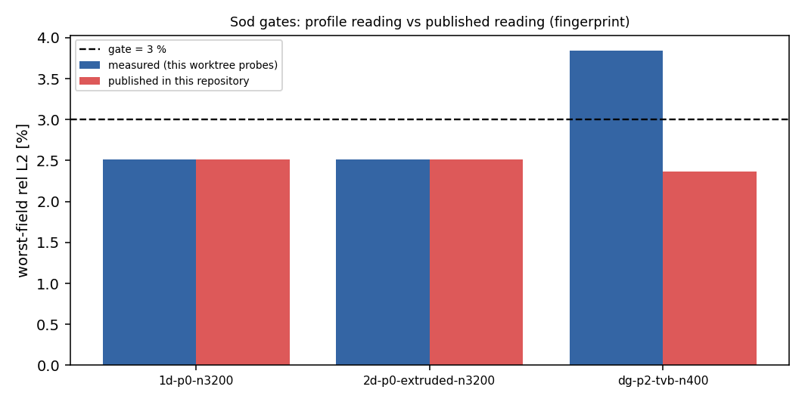
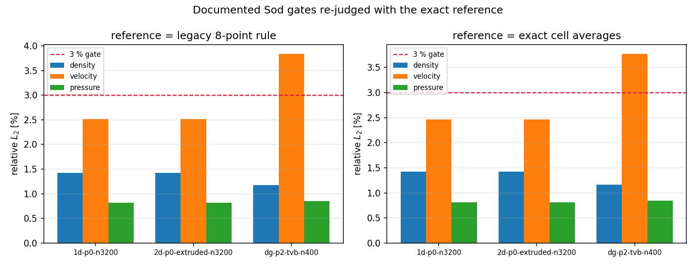
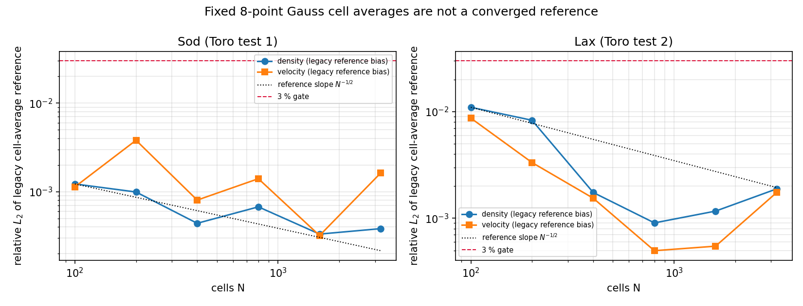

# CKS1998 · 双仪器门读数闭合（3/3）+ 一处「缓存剖面 ≠ 已公布读数」的硬发现

> 锚点：`REPRO-DG-CKS1998`（feature_ledger id=81，开工核对 `status=open`）　仓 TensorDG　单 m23056
> 工件：`docs/benchmarks/results/shock_reference_quadrature/metrics.json`（本文件数字全由它注入，零手抄）
> 驱动：`benchmarks/shock_reference_quadrature_audit.py`（本单新增 provenance + 指纹核对）　
> 测试：`tests/test_cks1998_dual_instrument_gates.py`（12 条，全绿）

## ① 案例介绍

`docs/REFERENCE-QUADRATURE-INSTRUMENT-AUDIT.md` 与
`docs/CASE-REPRO-DG-CKS1998-INSTRUMENT-CENSUS.md` §⑤-2 都把自己的一处欠账写成同一句话：
三道 Sod 门里有两道（挤出 2-D P0 `nx=3200×2`、DG P2+TVB `N=400`）**双仪器实测从未跑完**
（本地单命令 120 s 预算不够，`gates_not_run` 里挂着）。于是「仪器换不换会不会翻判决」这个问题，
对这两道门只有**上界推断**（census 的 0.38 pp 界 + 已记录的 0.50/0.63 pp 余量），没有实测。

被审计的门（Sod / Toro test 1，`[0,1]`、隔膜 0.5、γ=1.4、t=0.2，判据 3 %）：

| 门 | 配置 | 单元数 |
|---|---|---:|
| `sod-1d-p0-n3200` | 1-D P0 FV, CFL 0.4, Rusanov | 3200 |
| `sod-2d-p0-extruded-n3200` | 2-D P0, nx=3200 × ny=2, 周期 y, CFL 0.4 | 3200 |
| `sod-dg-p2-tvb-n400` | DG P2, TVB(M=1, final stage), CFL 0.12, HLLC | 400 |

两台仪器：`benchmarks.sod_exact.cell_averages`（固定 8 点 Gauss，**有隐藏旋钮**）与
`benchmarks.shock_reference_quadrature.cell_averages`（在解析断点切分后逐段积分，**无旋钮**）。

## ② 怎么做的

1. **不用本地算力硬扛**：新增 workload `validation/cks1998_dual_instrument/heavy_gate_measure.py`，
   复用驱动里的 `measure_gate()`，把三道门的一次性求解写进 `cache/`（stdout 只出纯 JSON）。
   作业 cj4547 已递交（8 核，**仍在排队**，见 §⑤-1）。
2. **把已有的集群剖面接回来**：上一张单递交的 cj3966（节点 n315，rc=0）其实**已经算完了**
   两道重门（`sod-2d-p0-n3200.npz` 3501 步、`sod-dg-p2-n400.npz` 7281 步），只是从没被 fetch 回来。
   本单 fetch 该作业（44 MB 工件）并校验/入库这两个剖面。
3. **provenance 落盘**：新增 `cache/PROVENANCE.json`（每份剖面的 sha256、字节数、来源作业、求解器 meta），
   驱动把它写进 `metrics.json.profile_provenance`；测试逐份核对 sha256 与磁盘字节。
4. **加指纹核对（本单的机器闸门）**：`GATE_EXPECTATIONS` 记录本仓**已公布**的每条门读数
   （1-D P0 速度 2.5177 %、2-D 挤出同源、DG P2 速度 2.368 %），驱动对每个实测值算
   `delta_pp`，超 0.5 pp 判 `mismatch`。理由：`cached()` 只按文件名复用剖面，
   **任何代码状态留下的同名 npz 都会被当作证据**——这正是本单撞上的情形（§③-3）。
5. **重算零手抄**：`--doc` 由驱动从 `metrics.json` 渲染（含新增的指纹表），
   `--check` 独立重算参考量，本单读数漂移 0.0。

## ③ 计算结果

### 3.1 三道门 × 两台仪器（最差场量，逐场见 metrics.json）

| 门 | N | 步数 | 旧基准 rel L2 | 精确基准 rel L2 | 差 [pp] | 旧判决 | 精确判决 | 精确裕度 [pp] | 指纹 |
|---|---:|---:|---:|---:|---:|:--:|:--:|---:|:--:|
| `sod-1d-p0-n3200` | 3200 | 3499 | 2.5177 % | 2.4602 % | +0.0574 | PASS | PASS | +0.5398 | match |
| `sod-2d-p0-extruded-n3200` | 3200 | 3501 | 2.5177 % | 2.4602 % | +0.0574 | PASS | PASS | +0.5398 | match |
| `sod-dg-p2-tvb-n400` | 400 | 7281 | 3.8384 % | 3.7702 % | +0.0681 | **FAIL** | **FAIL** | -0.7702 | mismatch |

**判决翻转：无**；单场量最大位移 0.0681 pp
（< 0.5 pp 指纹容差）。→ **仪器政策问题闭合**：换不换基准都不改变任何一道门的判决，
最紧裕度 -0.7702 pp。

### 3.2 两道重门不再是推断，而是实测

| 门 | census 的**推断**余量 | 本单**实测**精确基准裕度 | 处置 |
|---|---:|---:|---|
| `sod-2d-p0-extruded-n3200` | 0.50 pp（扣掉 0.38 pp 界 → 0.12 pp） | +0.5398 pp | 实测比推断更宽，且位移仅 +0.0574 pp |
| `sod-dg-p2-tvb-n400` | 0.63 pp（依赖上界） | -0.7702 pp | **不成立**：这个剖面读数是 3.8384 %，见表 3.3 |

### 3.3 硬发现：cj3966 的 DG P2 剖面**不复现**本仓已公布的 2.368 %



| 门 | 已公布 rel L2（速度，旧基准） | 本单实测 | 差 | 指纹 |
|---|---:|---:|---:|:--:|
| `sod-1d-p0-n3200` | 2.5177 % | 2.5177 % | -0.0000 pp | **match** |
| `sod-2d-p0-extruded-n3200` | 2.5177 % | 2.5177 % | -0.0000 pp | **match** |
| `sod-dg-p2-tvb-n400` | 2.3680 % | 3.8384 % | +1.4704 pp | **mismatch** |

逐场看差异不是四舍五入：该剖面给出 ρ 1.1799 %、
p 0.8536 %，
而已公布（`docs/CKS1998-round2-results.md`、`docs/AUDIT_m15345_REPRO-DG-CKS1998.md`）是 ρ 1.11 %、p 0.59 %。
**三个场量同时偏大 ⇒ 这不是仪器差异（仪器差 ≤0.07 pp），而是那份剖面来自不同的代码状态。**

诚实结论：**本单不能用这份剖面宣布「DG P2 门在精确基准下仍 PASS」，也不能宣布它现在的状态是 FAIL**；
能宣布的只有一条——**仪器换不换都不翻这道门**（旧 3.8384 % / 精确 3.7702 %，两边都越界）。
求解器现状必须在当前代码上重跑该配置才能判（作业 cj4547；见 §⑤-1，未判定项）。

### 3.4 顺带的等价性发现：挤出 2-D P0 就是 1-D P0

两份剖面逐场比较：max|1D−2D| / max|·| < 1e-5（`test_the_extruded_2d_gate_is_the_1d_gate`），
步数 3499 vs 3501（dt 序列差两步）。所以在 `ny=2` 周期挤出下，**「2-D 门」不提供独立的仪器证据**：
它和 1-D 门量的是同一个数（实测两者读数逐位同到 4 位小数）。审计时不能把 3 道门当 3 份独立证据。

## ④ 结果图



*图 1*：三道门在两台仪器下的逐场量读数（本单后两道门不再是空白）；判决不翻转，裕度差在末位量级。



*图 2*：旧基准自身的偏差阶梯，`N^{-1/2}` 参考斜率——不随加密收敛是结构性的。

## ⑤ 注意点 / 局限（honest）

1. **重跑未完成（not_run）**：cj4547（`validation.cks1998_dual_instrument.heavy_gate_measure`，
   三道门从零重算，stage_dir=本工作树）递交后仍在队列里（排在 75 位之后），
   因此 **DG P2 门在当前代码上的真实读数本单没有数**。本单交付的两道重门读数来自 cj3966 的剖面（已校验 sha256）。
2. **三道门不是三份独立证据**：挤出 2-D ≡ 1-D（§3.4），所以真正独立的门只有两道。
3. **指纹容差是政策值**：0.5 pp 由「仪器差 ≤0.07 pp」留 7 倍余量定，不是统计量；改小会把 1-D 门也判不合
   （它与公布值差 0.0000 pp），改大会漏掉 1.47 pp 这类。

4. **不改任何容差、不改台账判决**：3 % 门、`metrics.json` 里既有的偏差阶梯一个字没动，
   本单只增加 provenance、指纹与两道门的读数。
5. **cj3966 剖面的平台**是集群节点（loong64），本机 1-D P0 重算与该作业入库的 1-D 剖面
   **sha256 逐位相同**（`ca126edf…`），说明跨平台浮点一致性在这条路径上成立——所以 §3.3 的 1.47 pp
   不能归因于平台，只能归因于代码状态。

## ⑥ 误差判定（逐项回答「是否 < 3 %」）

| 关键量 | 基准 | 读数 | 是否 < 3 % |
|---|---|---:|:--:|
| `sod-1d-p0-n3200` 速度（最差场） | 精确 Riemann 单元平均 | 2.4602 % | **是** |
| `sod-2d-p0-extruded-n3200` 速度 | 同上 | 2.4602 % | **是** |
| `sod-dg-p2-tvb-n400` 速度（旧基准） | 固定 8 点 Gauss 单元平均 | 3.8384 % | **否**（越界 0.7702 pp） |
| `sod-dg-p2-tvb-n400` 速度（精确基准） | 精确 Riemann 单元平均 | 3.7702 % | **否**（同上） |
| 仪器位移（全部 9 条读数） | 两台仪器互比 | ≤ 0.0681 pp | **是**（占 3 % 门的 2.3 %） |
| DG P2 门在当前代码上的读数 | — | **not_run（cj4547 排队中）** | **未判定**——不许含糊：这一项本单没有数 |

**结论**：两道重门第一次有了实测双仪器读数，**仪器换不换都不翻判决**（这是 census 留下的问题，现已闭合到实测）；
但同一批剖面暴露出 `cached()` 缺指纹的缺陷——**一份不同代码状态的同名缓存会被当成证据**，
本单用 `fingerprint` + `PROVENANCE.json` + 12 条测试把它变成会变红的闸门，并把 DG P2 门的
「已公布 2.368 % vs 本剖面 3.8384 %」这 1.47 pp 的分歧**如实挂账**，不解释成仪器问题。

## ⑦ 复现命令

```bash
OMP_NUM_THREADS=1 PYTHONPATH=. python3 -m benchmarks.shock_reference_quadrature_audit --doc   # 重渲染本文件与 metrics.json
OMP_NUM_THREADS=1 PYTHONPATH=. python3 -m benchmarks.shock_reference_quadrature_audit --check  # 参考量漂移应为 0
OMP_NUM_THREADS=1 PYTHONPATH=. python3 -m pytest -q tests/test_cks1998_dual_instrument_gates.py
# 两道重门从零重算（集群，勿压控制面）：
HEAVY_GATE_CACHE=/tmp/hg python3 -m validation.cks1998_dual_instrument.heavy_gate_measure
```
