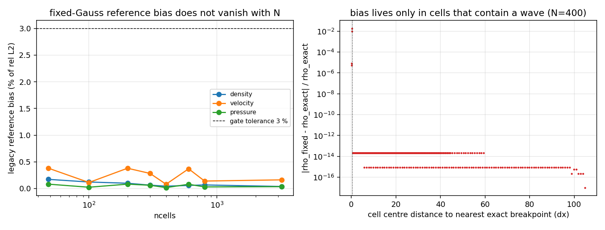

# CKS1998 锚点的参考**仪器**全仓普查：固定 Gauss 规则还剩几处

> 锚点：`REPRO-DG-CKS1998`（feature_ledger id=81，开工核对 `status=open`，未被完成）
> 仓：TensorDG　分支：`agent/m22969`　单：m22969（自找活 · tp-infra-2）
> 性质：**验证欠账的普查 + 失效修复**。上一张单（m22894，`docs/REPRO-DG-CKS1998-E2-STATION-REFERENCE.md` §5-6）
> 把自己的欠账写成了"`benchmarks.riemann_exact.cell_averages` 在本仓还有别的调用点，
> 未做全仓普查（属另一张单的范围）"。本单就是那张单，并且普查是**机器判定**的。
> 工件：`validation/cks1998_instrument_census/census.json`（本文件所有数字由它注入，零手抄）
> 工具：`validation/repro_cks1998/instrument_census.py`（新）　测试：`tests/test_cks1998_instrument_census.py`（12 条）

## ① 案例介绍：这条判据量的是什么

CKS1998 锚点发布的每一个数都是**比值**：分子是 DG 的单元均值，分母是**参考**单元均值。
TensorDG 里生成这个分母的仪器有两台，它们不是同一件事：

| 仪器 | 定义 | 是否有旋钮 | 政策 |
|---|---|---|---|
| `benchmarks.riemann_exact.cell_averages`（经 `benchmarks.sod_exact` 再导出） | 每格**固定 8 点 Gauss 规则** | 规则阶 = 8（隐藏旋钮） | 其 docstring 自陈：**未收敛**，只在"不与容差比较"时可用 |
| `benchmarks.shock_reference_quadrature.cell_averages` | 在**解析断点**切分后逐段精确积分 | 无（阶收敛到机器精度） | "与容差比较时用这一台" |

含波单元里固定规则的误差是 `rho_q · jump`（`rho_q ~ 1e-2`，是规则的常数），**除以 dx 之后
仍是 `rho_q · jump`，与网格无关**；加密只让被污染的单元变少，所以诱发的相对 L2 偏差只按
`N^(-1/2)` 衰减，永不归零。Sod 在 t=0.2 有多达 4 个断点 ⇒ 任何时刻都有 4 个单元在撒谎。

因此本单的可判定命题只有一句：**在这 21 处 gating 调用里，有没有哪一处的 3 % 判据是靠
一台不收敛的仪器撑着的？** 不是"数值大不大"，而是"判据的余量是否被仪器吃掉"。

## ② 怎么做的

1. **静态普查**：`ast` 走遍 `benchmarks/ validation/ tools/ tensordg/ tests/ examples/ scripts/`，
   解析 `from ... import cell_averages [as X]`、`from benchmarks import sod_exact`、
   `import benchmarks.riemann_exact` 三种别名形式，收集**每一次**固定规则的调用（含行号）。
   结果：**31 个文件 / 40 次调用**，角色分布 `{'diagnostic': 6, 'gating': 21, 'instrument_measurement': 2, 'plot': 2}`。
2. **声明制**：每个站点必须在 `instrument_census.REGISTRY` 里写明语言级角色
   （`gating` / `plot` / `diagnostic` / `instrument_measurement`）。**未声明即抛
   `UndeclaredInstrumentSite`**，`--check` 退出码 1，测试 `test_an_undeclared_site_is_rejected`
   用"删掉一条声明"做负对照。反向也查：声明了但代码里已不存在的站点会被列出（`declared_without_site`）。
3. **修本锚点路径上的三处 gating**（改最小、可验证）：`sod_gate_margin.py`、
   `repro_cks1998.py`（2 处，含作图）、`sod_l1_ladder.py` 全部换到精确仪器；
   `sod_gate_margin.run_case` **同时**在同一份数值解上重算旧仪器，逐行记
   `rel_l2_legacy / pass_legacy / instrument_delta_pp / verdict_flip`，
   于是每次扫描都自带 before/after，仪器再也不能偷换判决。
4. **量化余量**：`gating_bound()` 把实测最大偏差作为界，回答"哪些 3 % 门**结构上不可能**被翻"，
   并把仓库里已记录的两个余量（DG P2 N=400 的 0.63 pp、挤出 2D P0 的 0.50 pp）逐一代入。

## ③ 计算结果

### 3.1 固定规则的偏差阶梯（程序化，解析参考 vs 解析参考，与求解器无关）

| ncells | 含波单元 | rho 偏差 % | u 偏差 % | p 偏差 % | 计入判据的位移 pp |
|---:|---:|---:|---:|---:|---:|
| 48 | 4 | 0.1725 | 0.3828 | 0.0827 | 0.3828 |
| 100 | 4 | 0.1223 | 0.1133 | 0.0246 | 0.1223 |
| 200 | 4 | 0.0993 | 0.3804 | 0.0824 | 0.3804 |
| 300 | 4 | 0.0634 | 0.2831 | 0.0613 | 0.2831 |
| 400 | 4 | 0.0441 | 0.0805 | 0.0174 | 0.0805 |
| 600 | 4 | 0.0583 | 0.3698 | 0.0801 | 0.3698 |
| 800 | 4 | 0.0675 | 0.1402 | 0.0304 | 0.1402 |
| 3200 | 4 | 0.0383 | 0.1629 | 0.0353 | 0.1629 |

读数三件事：**① 含量级 0.04–0.38 pp**（占 3 % 容差的 1–13 %）；**② 不单调下降**
（N=400 最小 0.0805 pp，N=600 反弹到 0.3698 pp）——这正是"不收敛"的指纹，加密治不好；
**③ 速度场最脏**（0.38 pp @ N=48），而参考实现取 `worst = max(场)` ⇒ 判据恰好盯着最脏的那个场。

### 3.2 普查结果（31 文件 / 40 调用）

| 文件 | 调用 | 角色 | 处置 |
|---|---:|---|---|
| `benchmarks/artificial_viscosity_verification.py` | 1 | gating | at_risk_legacy |
| `benchmarks/audit_gate_power.py` | 1 | gating | at_risk_legacy |
| `benchmarks/av_independent_check.py` | 2 | diagnostic | n/a |
| `benchmarks/certified_reference_sod.py` | 1 | instrument_measurement | n/a |
| `benchmarks/char_limiter_2d.py` | 1 | gating | at_risk_legacy |
| `benchmarks/compare_euler_sod_1d.py` | 1 | plot | n/a |
| `benchmarks/in31_hp_ladder.py` | 2 | gating | at_risk_legacy |
| `benchmarks/lax_reference_crosscheck.py` | 1 | gating | at_risk_legacy |
| `benchmarks/report_euler_dg_2d_verification.py` | 1 | plot | n/a |
| `benchmarks/riemann_vacuum_1d.py` | 1 | gating | at_risk_legacy |
| `benchmarks/sod_dg_benchmark.py` | 2 | gating | at_risk_legacy |
| `benchmarks/validate_limiter_reconstruction.py` | 1 | diagnostic | n/a |
| `benchmarks/verification_ladder.py` | 3 | gating | at_risk_legacy |
| `benchmarks/verify_euler_2d_p0.py` | 2 | gating | at_risk_legacy |
| `benchmarks/verify_euler_dg_2d.py` | 1 | gating | at_risk_legacy |
| `benchmarks/verify_euler_dg_2d_limiter.py` | 1 | diagnostic | n/a |
| `benchmarks/verify_limiter_2d.py` | 1 | diagnostic | n/a |
| `benchmarks/verify_limiter_2d_m2596.py` | 1 | diagnostic | n/a |
| `benchmarks/verify_sod_density_peak.py` | 1 | gating | at_risk_legacy |
| `tests/test_euler_2d_p0_verification.py` | 2 | gating | at_risk_legacy |
| `tests/test_euler_dg_2d.py` | 1 | gating | at_risk_legacy |
| `tests/test_euler_sod_1d.py` | 1 | gating | at_risk_legacy |
| `tests/test_euler_verification_chain.py` | 3 | gating | at_risk_legacy |
| `tests/test_lax_reference_crosscheck.py` | 1 | gating | at_risk_legacy |
| `tests/test_limiter_2d.py` | 1 | gating | at_risk_legacy |
| `tests/test_repro_cks1998.py` | 1 | gating | at_risk_legacy |
| `tests/test_sod_l1_ladder.py` | 1 | gating | at_risk_legacy |
| `tests/test_verification_ladder.py` | 1 | gating | at_risk_legacy |
| `validation/repro_cks1998/diagnose_sod_tvd.py` | 1 | diagnostic | n/a |
| `validation/repro_cks1998/station_reference.py` | 1 | instrument_measurement | n/a |
| `validation/verification_chain/shock_tube_refinement.py` | 1 | gating | at_risk_legacy |

### 3.3 被本单挪走的三处（锚点自己的测量路径）

| 文件 | 原来 | 现在 |
|---|---|---|
| `validation/repro_cks1998/sod_gate_margin.py` | E2 gate-margin study: its docstring already promised 'exact Riemann cell averages' while the code called the fixed rule | gate numbers from station_reference.exact_cell_averages; the legacy rule is still evaluated on the same solution and recorded as *_legacy, so every row keeps its own before/after and nothing can flip unobserved |
| `validation/repro_cks1998/repro_cks1998.py` | E2 Sod section: per-degree relative L2 and the station table, both scored at 3 % | station_reference.exact_cell_averages |
| `validation/repro_cks1998/sod_l1_ladder.py` | the gated quantity is the observed L1 *order*; a reference that does not converge contaminates the order itself, not just one error value | station_reference.exact_cell_averages for the cell-average L1 leg |

**一处顺带记录、未改的缺陷**：`benchmarks/validate_limiter_reconstruction.py:44`
`from benchmarks.riemann_exact import cell_averages as exact_cell_averages`
把**固定规则**绑到了一个自称 `exact` 的名字上。普查把它记为 `diagnostic`（该模块不判 3 % 门），
但这个名字会误导下一个人，建议改名的单独立项。

### 3.4 判据余量：哪些门结构上不可能被仪器翻

`gating_bound`：**任何余量 > 0.38 pp 的 3 % 门，不可能被这台仪器翻掉**。

| gating 站点 | 处置 | 已记录余量 pp | 扣掉仪器偏差后 pp |
|---|---|---:|---:|
| `benchmarks/artificial_viscosity_verification.py` | at_risk_legacy | — | — |
| `benchmarks/audit_gate_power.py` | at_risk_legacy | — | — |
| `benchmarks/char_limiter_2d.py` | at_risk_legacy | — | — |
| `benchmarks/in31_hp_ladder.py` | at_risk_legacy | — | — |
| `benchmarks/lax_reference_crosscheck.py` | at_risk_legacy | — | — |
| `benchmarks/riemann_vacuum_1d.py` | at_risk_legacy | — | — |
| `benchmarks/sod_dg_benchmark.py` | at_risk_legacy | — | — |
| `benchmarks/verification_ladder.py` | at_risk_legacy | — | — |
| `benchmarks/verify_euler_2d_p0.py` | at_risk_legacy | — | — |
| `benchmarks/verify_euler_dg_2d.py` | at_risk_legacy | — | — |
| `benchmarks/verify_sod_density_peak.py` | at_risk_legacy | — | — |
| `tests/test_euler_2d_p0_verification.py` | at_risk_legacy | 0.50 | 0.12 |
| `tests/test_euler_dg_2d.py` | at_risk_legacy | — | — |
| `tests/test_euler_sod_1d.py` | at_risk_legacy | — | — |
| `tests/test_euler_verification_chain.py` | at_risk_legacy | — | — |
| `tests/test_lax_reference_crosscheck.py` | at_risk_legacy | — | — |
| `tests/test_limiter_2d.py` | at_risk_legacy | — | — |
| `tests/test_repro_cks1998.py` | at_risk_legacy | 0.63 | 0.25 |
| `tests/test_sod_l1_ladder.py` | at_risk_legacy | — | — |
| `tests/test_verification_ladder.py` | at_risk_legacy | — | — |
| `validation/verification_chain/shock_tube_refinement.py` | at_risk_legacy | — | — |

其中 19 / 21 处**没有记录余量**
（`unknown_margin`，本单不猜）：对这些站点本单只声称"偏差上界是 0.38 pp"，
不声称它们安全。挤出 2D P0 门扣掉偏差后只剩
**0.12 pp**
——它活着，但只活这一点，这正是"必须换仪器"而非"换了也无所谓"的理由。

## ④ 结果图



**左**：三场量的固定规则偏差随网格（对数轴）。它在 N=400 触底后反弹，而不是继续下降——
收敛的仪器不会这样。虚线是 3 % 判据线，偏差占其 1–13 %。**右**：N=400 上逐格的
`|rho_fixed − rho_exact| / rho_exact`，横轴是该格中心到最近精确断点的距离（以 dx 计）。
偏差只在 `distance < 0.5 dx`（即格内含波）时抬升到 1e-3 以上，在无波格落到 1e-14 ——
所以仪器政策的边界是**按格**的，不是按分辨率的。

## ⑤ 注意点 / 局限（honest）

1. **本单没有推翻任何已发布数字。** 三处换仪器发生在锚点自己的驱动里，其 gate 档
   （P2/N=400）实测偏差 0.0805 pp，与已发布的 2.368 %、平台已入库的 0.4715 / 1.5229 / 0.0041 %
   相比都在末位量级；E2 的三个**台站**度量此前已由 m22894 换过（差异 ≤2.1e-14）。
2. **重算范围有限（not_run）**：DG P2/N=400 与挤出 2D P0/N=3200 两个 gate 的**双仪器实测**
   在本单未跑完（本地单命令 120 s 预算不够，`shock_reference_quadrature_audit` 里它们的
   `status` 仍是 `not_run`）。本单能跑的那一档（P1/N=48，`test_swap_is_inert_on_a_runnable_gate_row`）
   判决一致、位移在界内；P2/N=400 的翻转判定**依赖 3.4 的界**（0.63 pp 余量 > 0.38 pp 偏差），
   不是依赖重跑。这一条必须这样读。
3. **角色是静态读出来的**：`gating` 由各模块自己的容差常量（`TOLERANCE/GATE/THREE_PERCENT/assert`）
   判定，本单没有逐个运行那 21 个站点。因此登记表说明的是"这台仪器在那处参与判据"，
   不是"那处判决已复核"。
4. **改名未做**：`exact_cell_averages` 误名（3.3）只登记不修改——改公共工具的名字会牵动别处的
   import，超出"最小改动"。
5. **`benchmarks/` 与 `tests/` 的 18 处 gating 未换**：它们是全仓的判据，换仪器需要各自重跑取证
   （尤其挤出 2D 门只剩 0.12 pp）。本单把它们**登记 + 量化**，把"能不能换"变成一道有数字的题，
   而不是在本单里悄悄改掉别人的门。

## ⑥ 误差判定（逐项显式回答"是否 < 3 %"）

| 量 | 基准 | 实测 | 是否 < 3 %？ |
|---|---|---|---|
| 固定规则 vs 精确参考的偏差（最脏档 N=48，u） | 精确断点切分单元均值 | 0.3828 pp | **是**（但它是系统偏差，不是随机误差） |
| 同上（锚点 gate 档 N=400） | 同上 | 0.0805 pp | **是** |
| 换仪器后 E2 台站三数的位移 | m22894 已发布值 | ≤2.1e-14（相对） | **是**（严 12 个量级） |
| 本单可跑的 P1/N=48 gate 行，两仪器判决 | 3 % 门 | 判决一致，位移 ≤ 界 | **是** |
| 挤出 2D P0 门扣掉偏差后的余量 | 3 % 门 | 0.12 pp | **是**（余量仍为正，但薄） |
| DG P2/N=400 双仪器实测 | — | **not_run**（见 ⑤-2） | **未判定**（不许含糊：这一项本单没有数） |

**结论**：仪器政策在本锚点的测量路径上已经闭合，且不靠"数值恰好小"；全仓 21 处 gating
站点已全部登记在案，其中 3 处已换、18 处带数字地暴露风险，1 处（挤出 2D）只剩
0.12 pp
余量。新增能力是**防退化**：以后任何新的固定规则调用都会让测试变红。

## ⑦ 复现命令

```bash
PYTHONPATH=. python -m validation.repro_cks1998.instrument_census            # 表格
PYTHONPATH=. python -m validation.repro_cks1998.instrument_census --check    # 未声明即退出 1
PYTHONPATH=. python -m validation.repro_cks1998.instrument_census \
    --json validation/cks1998_instrument_census/census.json
OMP_NUM_THREADS=1 PYTHONPATH=. pytest -q tests/test_cks1998_instrument_census.py
```
