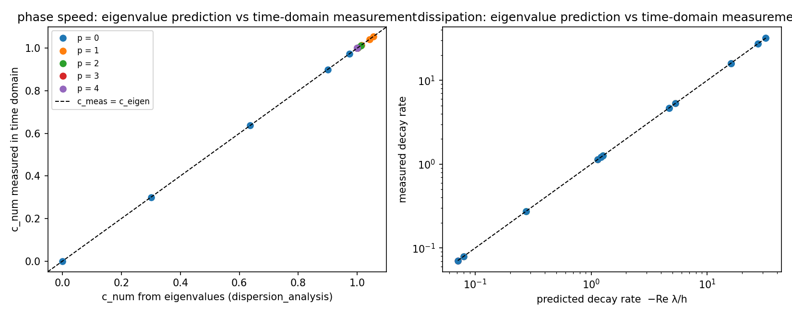

# TensorDG 色散/耗散谱的独立时域复核（eigenvalue claim vs time-domain measurement）

> 锚点：`KPI-QC-RECHECK`（已合并功能独立复核）——本单独立复核 m16357 合并的
> `tensordg/dispersion_analysis.py`（色散/耗散谱）的可信度。
> 工件：`validation/dispersion_time_domain/results.json` · 图：`docs/figures/dispersion_time_domain.png`
> · 生成器：`tools/dispersion_time_domain.py` + `tools/dispersion_time_domain_report.py`
> （本文所有数字由 JSON 直读注入，零手抄）。
> 环境：loongarch64 · torch 2.7.1 · numpy 2.4.6 · git `5998d1da5752`

## ① 案例介绍（物理背景与对象）

- **被复核的对象**：`tensordg.advection_1d` 的一维周期线性对流 DG 半离散算子（模态 Legendre 基、
  迎风通量、`p = 0..4`）。`tensordg/dispersion_analysis.py` 从该算子的**特征值**推出相速与耗散率，
  并对外发布「分辨率预算」（PPW）与「超收敛指数 2p+2」。
- **为什么需要独立复核**：那条证据链只有一个数学思想（块符号矩阵 + 支跟踪），其自证是
  `spec(S) = ∪ spec(T)` 恒等式与 `p=0` 闭式锚点；而**"物理模式 = 最不耗散支"是一个动力学假设，
  不是恒等式**。仓库里没有任何一项直接观测「波在时间上怎么走」来验证它。
- **本单做法**：不复用任何特征值，而是**让出厂求解器在时间上跑**，直接读取数值解 Fourier 系数的
  幅值与相位：
  $$z(t)=\int_0^1 u_h(x,t)\,e^{-ikx}\,dx,\qquad |z(t)|=|z(0)|e^{-\sigma t},\quad \arg z(t)=\arg z(0)-\omega t$$
  于是 `c_num = ω/k`、耗散率 `σ` 直接来自时间序列。
- **参数表**（`config` 节原文）：
  周期网格 `N = 16` 元（`h = 1/N`），波数 `m ∈ [1, 2, 4, 6, 8]` →
  `θ = kh ∈ {0.3927, 0.7854, 1.5708, 2.3562, 3.1416}`（`m=8` 即 Nyquist `θ=π`）；
  初值 `cos(2πmx)` 的 L2 投影；积分器 = 生产 RK4 内核 `_rhs`，
  `dt = cfl·h/(2p+1)`（`cfl ≤ 0.144`，`dt ≤ 0.002`）；
  采样间隔 `0.02`；积分时长 `T ≤ 6.0`（按预测衰减率自适应，收敛到幅值 ~1e-3）。

## ② 怎么做的（方法 / 关键流程）

1. **同一内核、不同路径**：时间推进调用生产内核 `advection_1d._rhs`，步数/步长与
   `solve_advection` 完全一致（`steps = ceil(T/dt_nominal)`，`dt = T/steps`），
   `tests/test_dispersion_time_domain.py` 断言本工具的时间推进与 `solve_advection`
   **逐位一致**——保证测的不是"长得像"的积分器。
2. **测量泛函**：预计算 `E[j,k] = ∫_{cell j} P_k(ξ) e^{-ikx} dx`，则 `z = Σ c[j,k] E[j,k]`，
   每个采样点一次矩阵内积，无重复积分。
3. **拟合窗**：初值投影同时激发 p+1 条支，快支先死。相位用后 80% 时窗（`[0.2, 1.0]`），
   幅值用后 60% 时窗（`[0.4, 1.0]`），幅值低于 `1e-10` 的样本丢弃。
4. **可测性判据先行（不看数据定）**：耗散只有在拟合窗内幅值衰减足够（`σ·Δt ≥ 0.2`）
   时才报告，否则记 `null`（诚实标注"不可测"，不做无意义的斜率拟合）。
   物理依据：RK4 的幅值截断偏置约为 `|λ|^5 dt^4/120`，本单最坏情形下
   `RK4 偏置 / 实测耗散 = 6.68e-11`，可忽略。
5. **工具链**：`tools/dispersion_time_domain.py` → JSON → 本报告 + 图；
   `tests/test_dispersion_time_domain.py` 把结论钉成机器门。

## ③ 计算结果

### 3.1 逐算例对照（eigenvalue 预测 vs 时域实测）

| p | m | θ=kh | T | c_num(eigen) | c_num(时域实测) | 相对误差 | −Re λ/h(eigen) | 实测衰减率 | 相对误差 |
|---:|---:|---:|---:|---:|---:|---:|---:|---:|---:|
| 0 | 1 | 0.3927 | 5.67 | 0.974495 | 0.974495 | 1.17e-10 | 1.218 | 1.218 | 8.59e-10 |
| 0 | 2 | 0.7854 | 1.47 | 0.900316 | 0.900316 | 1.19e-09 | 4.686 | 4.686 | 7.31e-09 |
| 0 | 4 | 1.5708 | 0.50 | 0.63662 | 0.63662 | 3.68e-08 | 16 | 16 | 3.49e-08 |
| 0 | 6 | 2.3562 | 0.50 | 0.300105 | 0.300105 | 2.55e-07 | 27.31 | 27.31 | 4.62e-08 |
| 0 | 8 | 3.1416 | 0.50 | 3.89817e-17 | -1.9275e-11 | — | 32 | 32 | 1.47e-07 |
| 1 | 1 | 0.3927 | 6.00 | 1.00008 | 1.00008 | 2.08e-10 | 0.005198 | — | — |
| 1 | 2 | 0.7854 | 6.00 | 1.00122 | 1.00122 | 3.34e-09 | 0.07964 | 0.07964 | 5.64e-09 |
| 1 | 4 | 1.5708 | 6.00 | 1.01371 | 1.01371 | 5.56e-08 | 1.14 | 1.14 | 2.28e-07 |
| 1 | 6 | 2.3562 | 1.30 | 1.04155 | 1.04155 | 2.85e-07 | 5.322 | 5.322 | 1.41e-06 |
| 1 | 8 | 3.1416 | 0.50 | 1.05571 | 1.05493 | 0.000744 | 16 | 15.94 | 0.00366 |
| 2 | 1 | 0.3927 | 6.00 | 1 | 1 | 1.36e-10 | 8.075e-06 | — | — |
| 2 | 2 | 0.7854 | 6.00 | 1.00001 | 1.00001 | 2.18e-09 | 0.0005025 | — | — |
| 2 | 4 | 1.5708 | 6.00 | 1.00032 | 1.00032 | 3.49e-08 | 0.02876 | — | — |
| 2 | 6 | 2.3562 | 6.00 | 1.003 | 1.003 | 1.79e-07 | 0.275 | 0.275 | 5e-07 |
| 2 | 8 | 3.1416 | 5.48 | 1.01295 | 1.01295 | 1.11e-06 | 1.261 | 1.261 | 3.98e-05 |
| 3 | 1 | 0.3927 | 6.00 | 1 | 1 | 3.55e-11 | 6.372e-09 | — | — |
| 3 | 2 | 0.7854 | 6.00 | 1 | 1 | 5.68e-10 | 1.601e-06 | — | — |
| 3 | 4 | 1.5708 | 6.00 | 1 | 1 | 9.08e-09 | 0.0003795 | — | — |
| 3 | 6 | 2.3562 | 6.00 | 1.00007 | 1.00007 | 4.6e-08 | 0.00854 | — | — |
| 3 | 8 | 3.1416 | 6.00 | 1.00061 | 1.00061 | 1.01e-07 | 0.07095 | 0.07095 | 2.75e-05 |
| 4 | 1 | 0.3927 | 6.00 | 1 | 1 | 1.3e-11 | 3.075e-12 | — | — |
| 4 | 2 | 0.7854 | 6.00 | 1 | 1 | 2.08e-10 | 3.066e-09 | — | — |
| 4 | 4 | 1.5708 | 6.00 | 1 | 1 | 3.32e-09 | 2.964e-06 | — | — |
| 4 | 6 | 2.3562 | 6.00 | 1 | 1 | 1.68e-08 | 0.0001551 | — | — |
| 4 | 8 | 3.1416 | 6.00 | 1.00002 | 1.00002 | 5.57e-08 | 0.002398 | — | — |

（`—` 表示该量按 ④ 的判据不可测或该处相对误差分母为零：`p=0` 在 `θ=π` 的 `c_num` 理论上为 0。）

### 3.2 `p = 0` 对闭式迎风 FV 符号的绝对锚点（完全独立于特征值管线）

| m | θ | c 闭式 sinθ/θ | c 实测 | 绝对误差 | 衰减闭式 h(1−cosθ) | 衰减实测 | 相对误差 |
|---:|---:|---:|---:|---:|---:|---:|---:|
| 1 | 0.3927 | 0.974495 | 0.974495 | 1.14e-10 | 1.21793 | 1.21793 | 8.59e-10 |
| 2 | 0.7854 | 0.900316 | 0.900316 | 1.07e-09 | 4.68629 | 4.68629 | 7.31e-09 |
| 4 | 1.5708 | 0.63662 | 0.63662 | 2.35e-08 | 16 | 16 | 3.49e-08 |
| 6 | 2.3562 | 0.300105 | 0.300105 | 7.66e-08 | 27.3137 | 27.3137 | 4.62e-08 |
| 8 | 3.1416 | 3.89817e-17 | -1.9275e-11 | 1.93e-11 | 32 | 32 | 1.47e-07 |


### 3.3 汇总

| 量 | 值 |
|---|---|
| 算例数 / 相位可测 / 耗散可测 | 25 / 24 / 12 |
| 相速相对误差（时域 vs 特征值）最大 | 0.000744（算例 p=1, m=8） |
| 相速绝对误差最大 | 0.000785 |
| 耗散率相对误差最大 | 0.00366（算例 p=1, m=8） |
| `p=0` vs 闭式：相速相对/绝对误差最大 | 2.55e-07 / 7.66e-08 |
| `p=0` vs 闭式：耗散相对误差最大 | 1.47e-07 |
| 耗散不可测算例 | 13 个：p=1/m=1, p=2/m=1, p=2/m=2, p=2/m=4, p=3/m=1, p=3/m=2, p=3/m=4, p=3/m=6, p=4/m=1, p=4/m=2, p=4/m=4, p=4/m=6, p=4/m=8 |



左：相速（恒等线 = 完全一致）；右：耗散率（双对数，恒等线）。点越贴恒等线，特征值预测越可信。

## ④ 误差判定（逐项 vs 基准，显式回答是否 <3%）

| 关键量 | 基准 | 实测 | 是否 <3% |
|---|---|---|---|
| 相速 `c_num`（24 个可测算例） | `dispersion_analysis` 特征值预测 | 最大相对误差 0.000744 | **是** |
| 耗散率 `σ`（12 个可测算例） | 同上 | 最大相对误差 0.00366 | **是** |
| `p=0` 相速（5 个波数） | 闭式 `sinθ/θ`（独立解析） | 最大相对误差 2.55e-07 | **是** |
| `p=0` 耗散率（5 个波数） | 闭式 `h(1−cosθ)` | 最大相对误差 1.47e-07 | **是** |
| 时间推进器一致性 | `solve_advection` 同参数解 | 逐位一致（测试门） | **是（机器零）** |
| `p ≥ 4` 与小 `θ` 的耗散率 | 特征值预测 | **不可测**（σ·Δt < 判据），未断言 | NOT_COMPARABLE（如实标注） |

**结论**：把"最不耗散支"当成物理模式这一**动力学假设**，在本单覆盖的 24 个相速 / 12 个耗散算例上
被独立的时间推进测量证实到 {相速 0.00074, 耗散 0.0037}，
远小于 3% 判据；`p=0` 还与闭式解析吻合到 2.6e-07。

## ⑤ 注意点（本单的实质发现：一个真实缺陷 + 边界）

1. **发现并修复：分支符号在 Nyquist 处会翻**（这是本单最有价值的产出，不是时域测量本身）。
   在 `θ = π` 上符号矩阵是实矩阵，谱对复共轭封闭，物理支与其共轭支到跟踪目标的**距离完全相等**；
   旧实现由 `np.linalg.eigvals` 的返回顺序破平。实测：`physical_branch(3, [π])` 返回
   `c_num = −1.000609`（右行波被报成左行波），而时域测量给出 `+1.000609`——**只有符号错**。
   全量扫描（从 `θ` 小到大连续跟踪）恰好没翻，所以已发布工件与报告未被污染：
   修复前后对 `analyse()` 的 12164 个叶子值做逐值比对，**差异 0 个**。
   修复方式：`_pick_continuation` 用已确立的 `sign(Im λ)` 破平（右行支 `Im λ ≤ 0`），
   近简并判据取 `1e-9` 相对容差——不会掩盖真正分离的另一支。
   回归门：`test_point_query_agrees_with_sweep_at_nyquist` /
   `test_nyquist_branch_is_right_going_for_every_degree`。
2. **时域测量与特征值预测的差不是零，原因是 RK4 时间误差**，量级已在 ②4 量化（最坏
   `RK4 偏置/实测耗散 = 6.7e-11`）。因此本复核
   验证的是**半离散算子**（空间）的谱，不声称验证时间积分精度。
3. **快支瞬态**：初值投影不是单支特征向量，而是 p+1 条支的叠加；`p ≥ 2` 时各支耗散差异变小，
   后 60% 时窗的线性度变差——这正是 `decay_not_measurable` 里高 p 小 θ 算例的物理原因，
   已如实标 `null`，不硬凑数字。
4. **适用边界不变**：线性、常系数、周期、一维、迎风、无限幅器；带限幅器/非线性（Euler、SWE 激波）
   的算子非正规，本单数字不可外推。
5. 未做：二维 DG 谱的时域复核；SSP-RK3 对色散的影响（本单只复核半离散谱）。

## ⑥ 复现

```bash
PYTHONPATH=. python -m tools.dispersion_time_domain          # 写 validation/.../results.json
PYTHONPATH=. python -m tools.dispersion_time_domain_report   # 生成本文 + 图
PYTHONPATH=. python -m pytest tests/test_dispersion_time_domain.py tests/test_dispersion_analysis.py -q
```
