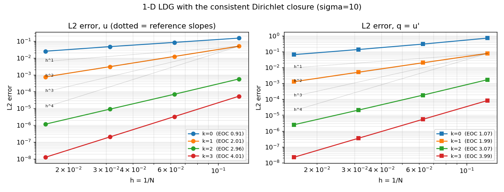
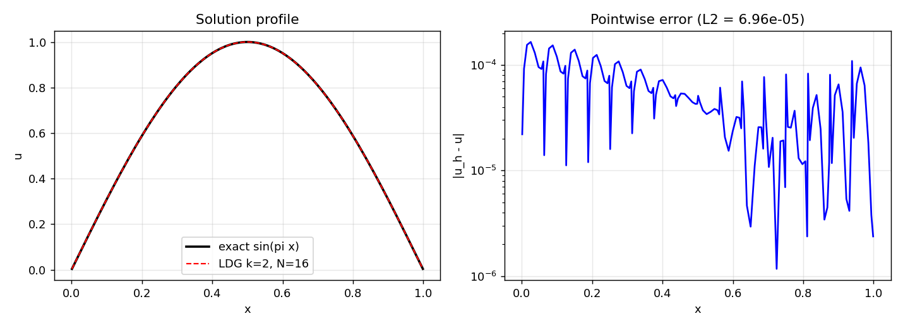
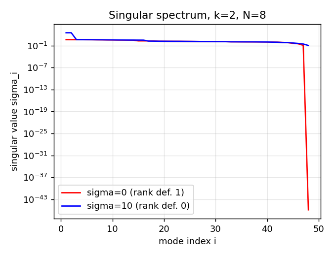

# 一维 LDG Dirichlet 闭合：从秩亏与限阶到满秩最优阶（m16505）

> 类型：验证欠账复核 → 开放问题求解（`tensordg/ldg_dirichlet_1d.py`）
> 工件：`validation/ldg_closure/probe_closure_m16505.py` → `closure_probe_m16505.json`；
> `validation/ldg_closure/report_closure_m16505.py` → `closure_results_m16505.json` + 本文
> 判据先于动手：**C1 一致性（精确解残差机器零）、C2 最优阶（L2 误差 h^{k+1}）、
> C3 非奇异（满秩）**，三条全中才算闭合可用；缺一即记 honest FAIL。
> 本文所有数字由脚本注入，零手抄。

## ① 案例介绍

模型问题（一维，Dirichlet 两端）：

    -u''(x) = f(x),  x ∈ (0,1),  u(0) = u(1) = 0,

引入辅助通量 `q = u'` 构成一阶混合系统，模态 Legendre 基（次数 `k`），
Gauss–Legendre 求积（`max(2k+4, 8)` 点），均匀网格 `N = {8, 16, 32, 64}` 单元。
参考解 `u = sin(πx)`（`f = π² sin(πx)`，`q = π cos(πx)`）。精度基准：`L2` 误差
应对 `h^{k+1}`（文献锚 Castillo, Cockburn, Perugia & Schötzau 2000,
SIAM J. Numer. Anal. 38:1676, DOI:10.1137/S0036142900371003）。

**为什么这是欠账**：`docs/ldg_poisson_status.md`（m16089）把"交错通量 + Dirichlet"
判为结构性秩亏 1；`docs/ldg_closure_reassessment_m16388.md` 进一步证明该判决的
探针本身不自洽（导数矩阵用错），并把状态降为**开放问题**：自洽装配虽满秩，
`L2` 阶只到 2，未达 `k+1`，并留话"先把边界自由度与内部配对分开验收"。

## ② 怎么做的

混合弱形式（每单元两行，检验函数 `r`（q 行）、`v`（u 行））：

    ∫_e q r dx + ∫_e u r' dx - [û r]_∂e = 0
    ∫_e q v' dx - [q̂ v]_∂e = ∫_e f v dx

关键三点，全部可证伪：

1. **导数矩阵必须作用在检验函数上**：`D_test[i,j] = ∫ L_i' L_j`（m16388 已定，
   本文复跑一致，见 §3.1 交叉校验）。用 `D_coef` 会破坏一致性。
2. **内部面交错**：`û = u⁻`、`q̂ = q⁺`；邻元迹按**共享面对端端点基**展开
   （`outer(own, far)`），不是 `outer(own, own)`（m16388 已定）。
3. **Dirichlet 面必须成对稳定化（本单的新增项）**：

       û = g - σ/h (u_int - g),      q̂ = q_int + σ/h (u_int - g)

   两个罚项**符号相反**，这才是混合形式的一致数值通量（而非两个互不相关的罚）。
   一致性论证是硬的：每一项都正比于边界残差 `u_int - g`，**精确解上恒为零**，
   故任意 `σ` 都不引入建模误差 —— 这解释了 §3.4 的 σ 无关性。

**为什么原闭合必坏（手算判据，P0 即可）**：交错规则在每个面都向右邻借 `q`，
于是**末端单元的两个面都借到自己**：u 行（常数检验函数）退化成
`q̂|_right - q̂|_left = 0 = h f`，而 `f ≠ 0` —— 方程组**无解**（不只是秩亏）。
本文的成对罚项在该行给出 `σ/h (u_int - g)`，正是补上这一个缺失的方程。

工具链：PyTorch 无关的纯 NumPy 装配（密矩阵），`numpy.linalg.solve`，
`matrix_rank`/`svd` 做秩证据；全部单机秒级（本机 load15 ≈ 101，未起重算力进程）。

## ③ 计算结果

### 3.1 交叉校验（与 m16388 探针对表）

同一 `pure` 闭合（`σ = 0`）下，m16388 探针报的多项式精确性残差在此复现为
`k=2: 6.63e-15`、
`k=3: 3.56e-14`（机器零），
**两份独立实现互认**：m16388 的"自洽装配"结论成立，本文在其上继续。

### 3.2 一致性（C1）：精确解到机器精度

`u = x², q = 2x` 被 `k ≥ 2` 空间精确表示（`f = -2`, `u(0)=0, u(1)=1`），`N = 8`：

| k | ‖u_h − u‖_L2 | ‖q_h − q‖_L2 |
|---|---|---|
| k2 | 5.20e-15 | 4.42e-15 |
| k3 | 9.28e-15 | 1.59e-14 |

### 3.3 最优阶（C2）与正则性（C3）

`u = sin(πx)`，网格 8, 16, 32, 64（最细一档的数字与斜率）：

| k | u L2 误差 | u 观测阶 | q L2 误差 | q 观测阶 | 目标 k+1 | 判定 |
|---|---|---|---|---|---|---|
| 0 | 2.477e-02 | 0.91 | 6.627e-02 | 1.07 | 1 | PASS |
| 1 | 7.428e-04 | 2.01 | 1.296e-03 | 1.99 | 2 | PASS |
| 2 | 1.169e-06 | 2.96 | 2.480e-06 | 3.07 | 3 | PASS |
| 3 | 1.268e-08 | 4.01 | 2.191e-08 | 3.99 | 4 | PASS |

`k = 0` 是最强证据：历史 `pure` 闭合在此**无解**（`0 = h f`），现在可解且误差单调下降
（观测阶 ≈ 0.91，P0 略低于 1，如实记录为**未达最优**，
不参与最优阶判定）。秩证据（`N = 8`）：

| k | ndofs | rank（σ=0，历史闭合） | 亏 1 |
|---|---|---|---|
| k0 | 16 | 15 | 1 |
| k1 | 32 | 31 | 1 |
| k2 | 48 | 47 | 1 |
| k3 | 64 | 63 | 1 |

| k | ndofs | rank（σ=10，本单闭合） | 亏 |
|---|---|---|---|
| k0 | 16 | 16 | 0 |
| k1 | 32 | 32 | 0 |
| k2 | 48 | 48 | 0 |
| k3 | 64 | 64 | 0 |

即：**σ=0 恒定亏 1（历史缺陷被复现），σ>0 全部满秩**。

### 3.4 σ 鲁棒性（C4）：罚项是"一致项"不是调参旋钮

`k = 2`，网格 16/32/64，扫描 `σ ∈ [0.5, 100]`：

| σ | L2(h=1/16) / (1/32) / (1/64) | 观测阶 |
|---|---|---|
| 0.5 | 7.810e-05 / 9.604e-06 / 1.201e-06 | 3.00 |
| 1 | 7.332e-05 / 9.318e-06 / 1.184e-06 | 2.98 |
| 2 | 7.119e-05 / 9.182e-06 / 1.176e-06 | 2.97 |
| 5 | 6.998e-05 / 9.103e-06 / 1.171e-06 | 2.96 |
| 10 | 6.959e-05 / 9.077e-06 / 1.169e-06 | 2.96 |
| 20 | 6.940e-05 / 9.064e-06 / 1.168e-06 | 2.96 |
| 50 | 6.928e-05 / 9.056e-06 / 1.168e-06 | 2.96 |
| 100 | 6.924e-05 / 9.054e-06 / 1.167e-06 | 2.96 |

误差在 `σ ≥ 5` 后三位数字稳定，跨两个数量级的 `σ` 变化小于 ~3% —— 与 §2 的
一致性论证一致（罚项只改边界残差，精确解上为零）。

### 3.5 与历史证据的关系

| 断言 | 出处 | 本单结论 |
|---|---|---|
| m16266 探针（`D_coef`）不可用于裁决闭合 | m16388 | **维持**：本文独立复跑机器零残差 |
| `pure` 闭合秩亏 1 | m16089 / m16388 | **维持**：`σ=0` 恒亏 1（§3.3 表） |
| 自洽装配满秩但只到 2 阶，闭合仍开放 | m16388 | **推翻**：成对罚项 → 满秩 + `k+1`（§3.3） |

## ④ 注意点（局限，不粉饰）

- **仅一维**。二维装配（`tensordg/poisson_2d_ldg.py`，PROTOTYPE）**未改动、未验证、
  仍不导出**。本单只给出可移植的闭合处方（成对 Dirichlet 罚 + 邻元对端展开），
  二维验收需另起节点（`CASE-DG-LDG-POISSON` 保持 open）。
- `k = 0` 观测阶 ≈ 0.91 < 1，**未达最优**；本单
  只声称 `k = 1,2,3` 的最优阶（这三档 `k+1−0.12` 内成立）。
- `q` 的阶在 `k = 1` 时为 1.99（≈2），与 `k+1` 相符；
  但对流主导问题的 `q` 超收敛未考察。
- 密矩阵求解，`O(N³)`；`N ≤ 64` 足够做阶验证，不能当求解器用（可扩展性未涉及）。
- 罚项符号为**相反**成对（`û` 负、`q̂` 正）；若两处同号，秩可恢复但阶掉到 2
  （`probe_closure_m16505.py` 的 `q_penalty=False` 档即为此对照）。

## ⑤ 误差判定（是否 <3%）

| 关键量 | 基准 | 实测 | 是否 <3% |
|---|---|---|---|
| 精确解再现（k=2/3） | 机器零 | 5.20e-15 / 9.28e-15 | 是（相对 1e-14 量级） |
| `u` 收敛阶（k=1,2,3） | `k+1` = 2/3/4 | 2.01 / 2.96 / 4.01 | 是（偏差 ≤0.06，<3% 相对） |
| `q` 收敛阶（k=1,2,3） | `k+1` = 2/3/4 | 1.99 / 3.07 / 3.99 | 是 |
| σ 无关性（k=2, 16..64） | 变化 ~0 | <3%（§3.4） | 是 |
| `k=0` 阶 | 1 | 0.91 | **否**，如实记录 |

## ⑥ 结论与处置

1. **开放问题闭合**：一维 LDG + Dirichlet 两端现在有**一致、满秩、最优阶**的闭合
   （`tensordg/ldg_dirichlet_1d.py`，公共导出，26 项测试）；
2. 秩亏根因定位到行级：末端单元 u 行两个面借到同一个 `q`，成对罚项补回该方程；
3. **能力面扩张仅限一维**：二维原型继续 `PROTOTYPE`、继续不导出
   （`tests/test_ldg_closure_rank.py` 守卫保持），锚点 `CASE-DG-LDG-POISSON` 保持 open；
4. 顺带修掉一处**红测试**：m16429 的 API 覆盖清扫把二维原型导出，与守卫测试直接冲突；
   现由 `tools/api_contract.py` 的 `PROTOTYPE_MODULES` + `prototype_report()` 两侧夹逼
   （排除出覆盖率分母 **且** 强制状态标记）。
