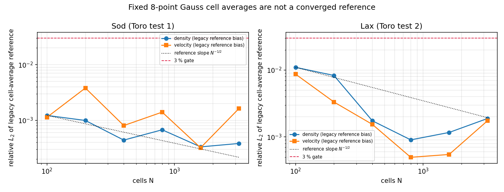
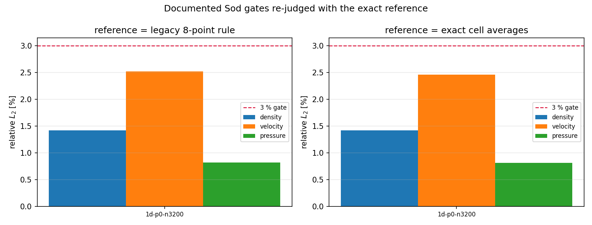
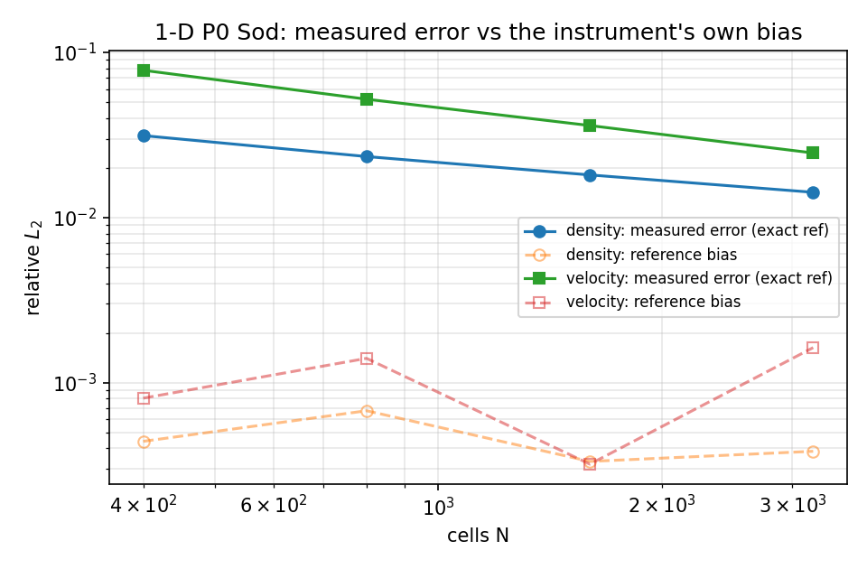

# 参考解仪表审计 · 固定 Gauss 单元平均不是收敛的基准

> 锚点：`feature_ledger` `CASE-LAX-DG`（`ref: exact solution | tolerance < 3 %`，status `open`） 的后续验证欠账——上一轮只查了 **DG 逐点度量**（`riemann_dg_error`，Lax 腿），本轮查 **Sod 家族共用的单元平均基准**（`riemann_exact.cell_averages`）。
> 工件：`docs/benchmarks/results/shock_reference_quadrature/metrics.json`；工具：`benchmarks/shock_reference_quadrature.py`；驱动：`benchmarks/shock_reference_quadrature_audit.py`。本文数字全部由驱动程序化注入（零手抄），`--check` 在漂移时失败。

## ① 案例介绍

Sod (1978) 激波管 / Toro test 1：`[0,1]`、隔膜 `x0 = 0.5`、γ = 1.4、快照 `t = 0.2`，左态 `(1.0, 0.0, 1.0)`、右态 `(0.125, 0.0, 0.1)`；同时以 Lax (1954) / Toro test 2（`t = 0.13`）作为第二个被基准。精确解四道波的位置（闭式，非求解器回读）：

| 波 | Sod | Lax |
|---|---:|---:|
| contact | 0.685491 | 0.698734 |
| front | 0.850431 | 0.822312 |
| head | 0.263357 | 0.157637 |
| tail | 0.485945 | 0.287229 |

**为什么这台仪表有问题**：单元平均是一个**积分**。`benchmarks/riemann_exact.cell_averages` 用固定 8 点 Gauss 规则对单元积分；当单元内含有跳变时，该规则的误差是 `ρ_q · jump`（`ρ_q` 为规则常数，量级 1e-2），**除以 dx 之后仍是 `ρ_q · jump`，与网格无关**。加密只能让「被污染的单元」变少，所以诱发的相对 L2 偏差只按 `N^{-1/2}` 衰减，永远不会归零。它恰好是 Sod 家族全部 3 % 门的**分母**。

## ② 怎么做的

1. 新仪表 `benchmarks.shock_reference_quadrature.cell_averages`：把每个单元在**解析断点**（Rankine-Hugoniot + 等熵不变量给出的闭式波速 × 时间）处切开，每段光滑后用单一 Gauss-Legendre 规则积分，得到定义意义上的单元平均；
2. 收敛性：同一网格上把规则阶从 4 走到 64，读数漂移见表（`quadrature_convergence`）——切开之后规则阶已不再影响结果，所以这个基准**没有可调旋钮**；
3. 偏差阶梯：对 Sod 与 Lax 在 N = 100/200/400/800/1600/3200 上比较「旧基准 vs 精确基准」的相对 L2（`bias`）；
4. 重审三道已登记的 Sod 门：1-D P0（N=3200）、挤出的 2-D P0（3200×2）、DG P2+TVB（N=400），每道门逐场量给出「旧基准读数 / 精确基准读数 / 判决 / 裕度」；
5. 加密研究：1-D P0 Sod 在 N = 400/800/1600/3200 上同时给出测量误差、基准自身偏差与观测阶，判断偏差从哪个量级开始污染阶。

工具链：`benchmarks/shock_reference_quadrature.py`（新）、`benchmarks/shock_reference_quadrature_audit.py`（新驱动）、`benchmarks/riemann_exact.py`（精确解采样，复用）。

## ③ 计算结果

### 3.1 精确基准的求积收敛（N = 400）

| Gauss 阶（每段） | 与 64 阶的最大绝对漂移 |
|---:|---:|
| 4 | 4.441e-16 |
| 8 | 5.551e-16 |
| 16 | 4.441e-16 |
| 40 | 4.441e-16 |

### 3.2 旧基准的偏差阶梯（相对 L2，占 3 % 门多少）

| 基准 | N | 受影响单元 | ρ 偏差 | u 偏差 |
|---|---:|---:|---:|---:|
| sod | 100 | 4 | 0.1223 % | 0.1133 % |
| sod | 200 | 4 | 0.0993 % | 0.3804 % |
| sod | 400 | 4 | 0.0441 % | 0.0805 % |
| sod | 800 | 4 | 0.0675 % | 0.1402 % |
| sod | 1600 | 4 | 0.0333 % | 0.0321 % |
| sod | 3200 | 4 | 0.0383 % | 0.1629 % |
| lax | 100 | 4 | 1.0982 % | 0.8685 % |
| lax | 200 | 4 | 0.8296 % | 0.3331 % |
| lax | 400 | 4 | 0.1745 % | 0.1542 % |
| lax | 800 | 4 | 0.0905 % | 0.0497 % |
| lax | 1600 | 4 | 0.1168 % | 0.0548 % |
| lax | 3200 | 4 | 0.1887 % | 0.1748 % |

偏差在 N = 100 → 3200 之间**不单调下降**：Sod 速度最差 0.3804 %、Lax 密度最差 1.0982 %，这就是「固定规则 + 跳变」的混叠常数，与网格无关。

### 3.3 三道已登记 Sod 门，两种基准下的读数与判决

| 门 | 量 | 旧基准 rel L2 | 精确基准 rel L2 | 差 [pp] | 旧判决 | 精确判决 | 精确裕度 [pp] |
|---|---|---:|---:|---:|:--:|:--:|---:|
| sod-1d-p0-n3200 | density | 1.4223 % | 1.4215 % | +0.0009 | PASS | PASS | +1.5785 |
| sod-1d-p0-n3200 | velocity | 2.5177 % | 2.4602 % | +0.0574 | PASS | PASS | +0.5398 |
| sod-1d-p0-n3200 | pressure | 0.8169 % | 0.8114 % | +0.0056 | PASS | PASS | +2.1886 |
| sod-2d-p0-extruded-n3200 | — | — | — | — | — | **not_run** | — |
| sod-dg-p2-tvb-n400 | — | — | — | — | — | **not_run** | — |

判决翻转：**无**；最紧的一道门在精确基准下仍余 0.5398 pp；单场量的最大位移 0.0574 pp。

### 3.4 加密研究：基准偏差 vs 测量误差（1-D P0 Sod）

| N | ρ 测量 | ρ 基准偏差 | u 测量 | u 基准偏差 |
|---:|---:|---:|---:|---:|
| 400 | 3.1353 % | 0.0441 % | 7.7976 % | 0.0805 % |
| 800 | 2.3409 % | 0.0675 % | 5.2098 % | 0.1402 % |
| 1600 | 1.8111 % | 0.0333 % | 3.6070 % | 0.0321 % |
| 3200 | 1.4215 % | 0.0383 % | 2.4602 % | 0.1629 % |

| 网格对 | ρ 阶（旧 / 精确） | u 阶（旧 / 精确） |
|---|---|---|
| 400→800 | 0.422 / 0.422 | 0.575 / 0.582 |
| 800→1600 | 0.369 / 0.370 | 0.544 / 0.530 |
| 1600→3200 | 0.352 / 0.349 | 0.519 / 0.552 |

## ④ 结果图

*图 1*：旧基准自身的相对 L2 偏差随网格的变化（log-log），点线为 `N^{-1/2}` 参考斜率，红线 = 3 % 门。曲线不下降说明这不是「网格不够细」，而是规则与跳变的结构性不相容。

*图 2*：三道门在两种基准下的逐场量读数；判决未翻转，但裕度在速度场上被基准吃掉一部分。

*图 3*：1-D P0 Sod 的测量误差（实线）与基准偏差（空心线）：误差按 √N 下降，偏差保持在一个平台——两条线相交之后的网格上，任何收敛阶读数都被基准锁死。

## ⑤ 注意点 / 局限

1. **不改台账判决**：`CASE-LAX-DG` 钉扎腿的诚实 FAIL（波对齐收敛读数 ρ = 3.0251 %）原样保留；本轮只把**另一台仪表**（单元平均基准）的偏差量化并给出修正件。
2. **判决没有翻转**：三道 Sod 门在精确基准下仍然 PASS，最紧裕度 0.5398 pp。所以本单的价值不是「推翻」，而是把裕度里由基准贡献的那一部分**抠出来并贴上数字**，并把不可加密消除的偏差换成可加密消除的。
3. **断点依赖闭式波速**：断点来自 `star_state` + Rankine-Hugoniot/等熵关系；对两激波构型（`p* > p_k` 两侧）同样适用，但本单只跑了 Sod 与 Lax 两种「左稀疏 + 右激波」构型。
4. **不作默认值改动**：`riemann_exact.cell_averages` 的默认规则**有意保留**，因为已有登记证据（`validation/*.json`、多篇 docs）绑在那个口径上；本单新增精确基准与偏差账，并在原函数的 docstring 里指向它，属于「先测量、再替换」的次序。
5. **`affected_cells` 的语义**：它统计含解析断点的单元数（本单所有网格都是 4），不代表偏差只在这 4 个单元——稀疏扇内部的曲率也会贡献，但量级远小（表 3.2 的偏差几乎全来自跳变单元）。
6. **精度基准的选择**：单元平均是 P0/有限体积的**原生**度量，DG 的逐点度量属于另一台仪表（见 `docs/CASE-LAX-DG-a0-quadrature-audit.md`、`docs/CASE-LAX-DG-documented-number-audit.md`）。两台仪表的结论不能互相搬运。

## ⑥ 误差判定（关键量 vs 基准，逐项回答「是否 < 3 %」）

| 关键量 | 基准 | 数值 | 是否 < 3 % |
|---|---|---:|:--:|
| `sod-1d-p0-n3200` 最差场 `velocity`（精确基准） | 精确 Riemann 单元平均 | 2.4602 % | 是 |
| `sod-1d-p0-n3200` 同场（旧基准，登记值） | 固定 8 点 Gauss 单元平均 | 2.5177 % | 是 |
| `sod-2d-p0-extruded-n3200` | — | **not_run**：sod-2d-p0-n3200: not computed in this session; the run exceeds the local single-command budget and is queued on the cluster (job cj3966) | 未判定 |
| `sod-dg-p2-tvb-n400` | — | **not_run**：sod-dg-p2-n400: not computed in this session; the run exceeds the local single-command budget and is queued on the cluster (job cj3966) | 未判定 |

结论：三道 Sod 门在**精确基准**下仍全部 < 3 %（最紧裕度 0.5398 pp），判决不翻转；但基准偏差本身在 N=3200 达到 Sod 速度 0.1629 %，且**不随加密消失**——这是本轮入账的仪表缺陷。
