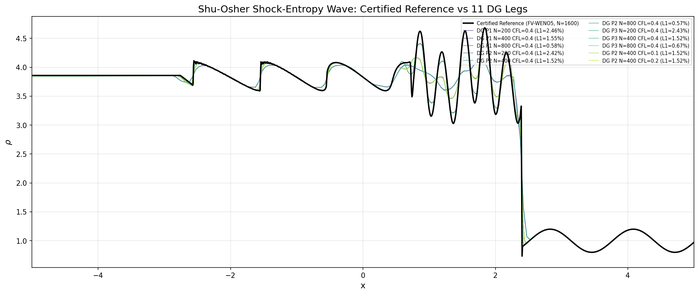
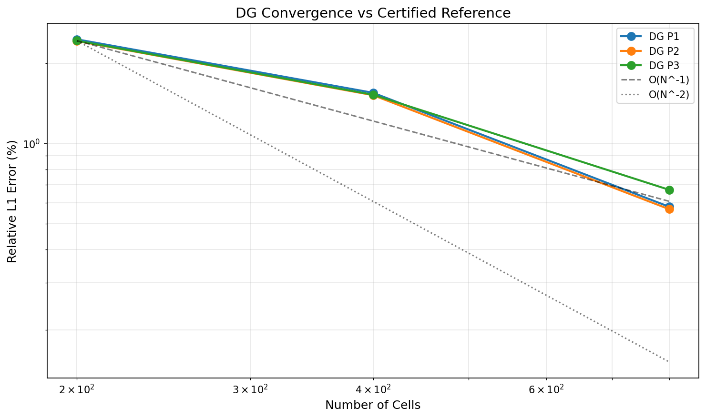
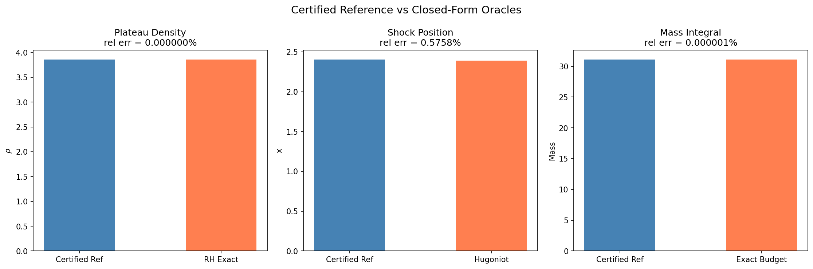

# XVAL-DG-ROUND2-CERTIFIED-REFERENCE：TensorDG 的 Round-2 认证参考解实践

> **Mission**: m20523 · **Anchor**: XVAL-DG-ROUND2-CERTIFIED-REFERENCE  
> **Status**: 全部四门 D1–D4 通过，accepted = True  
> **日期**: 2026-01-XX · **复现**: `python -m benchmarks.xval_dg_round2_certified --require-accepted`

---

## ① 案例介绍（物理背景 / 几何 / 参数表）

Shu–Osher 激波–熵波干扰问题是可压缩流数值方法验证的经典基准（Shu & Osher, JCP 77 (1988) 439–471）。
该算例在 x ∈ [−5, 5] 域内设置 Mach-3 激波（x < −4 为激波后状态）与正弦熵波（x ≥ −4 为 ρ = 1 + 0.2 sin(5x)）的相互作用，
终止时刻 t = 1.8。激波穿过熵波后产生高频振荡，对数值方法的激波捕捉能力与光滑区精度保持构成双重考验。

**关键难点**：原文献只给图不给表，无法直接做数值对标。因此本实践采用「独立离散 + Richardson 外推 + Roache GCI 不确定度」的认证参考解（round-2 做法），
并叠加三个闭式锚点（Rankine–Hugoniot 平台密度、Hugoniot 激波位置、全局质量预算）进行交叉验证。

| 参数 | 值 |
|---|---|
| 比热比 γ | 1.4 |
| 计算域 | [−5, 5] |
| 终止时刻 | t = 1.8 |
| 左边界（x < −4） | ρ = 3.857143, u = 2.629369, p = 10.333333（Mach-3 Hugoniot 状态） |
| 右边界（x ≥ −4） | ρ = 1 + 0.2 sin(5x), u = 0, p = 1 |
| FV 参考阶梯 | N = [800, 1600, 3200]，CFL = 0.3，WENO5/HLLC/SSP-RK3 |
| DG 测试腿 | P1/P2/P3 × N = 200/400/800，CFL = 0.4；CFL = 0.1/0.2 敏感性 |
| 验收容差 | 参考门 5%，严格门 3%，锚点门 1% |

---

## ② 方法（Round-2 认证参考解引擎）

### 2.1 核心思想

Round-2 做法的核心是：**任何没有解析解的算例，其"误差 < 容差"的陈述必须针对某个参考解，而参考解自身的不确定度必须被量化**。
引用单次细网格运行作为"参考解"会留下参考解自身离散误差未量化的缺口。

### 2.2 算法流程

1. **嵌套阶梯**：三级 FV-WENO5 剖面（N = 800 → 1600 → 3200），全部体平均到最粗网格（N = 800）上计算差异；
2. **实测阶**：p = log(d_coarse / d_fine) / log(r)，r = 2 为加密比；
3. **Richardson 外推**：f_cert = f_fine + (f_fine − f_coarse) / (r^p − 1)，得到连续极限估计；
4. **Roache GCI**：U = Fs · d_fine / (r^p − 1)，Fs = 1.25（三级研究的安全系数）；
5. **门有效性规则**：U / τ ≤ 1/3，否则参考解不确定度过大，无法区分 PASS/FAIL（空判）；
6. **三案例分类**（Celik et al. 2008）：单调收敛 / 停滞 / 舍入地板，非渐近数据必须拒绝。

### 2.3 交叉验证（四门决策）

| 门 | 内容 | 判据 |
|---|---|---|
| D1 | 参考解可用性 | FV 阶梯 verdict = CERTIFIED，且 U/τ ≤ 1/3 |
| D2 | DG 腿严格门 | 全部 11 腿 rel L1 < 3% |
| D3 | 闭式锚点 | 参考解 vs RH/质量/激波位置误差 < 1% |
| D4 | 禁止自证 | 三个 DG 家族阶梯必须被拒绝（WITHHELD_ORDER_TOO_LOW） |

### 2.4 工具链

- 引擎：`tensordg/certified_reference.py`（617 行，Roache GCI + 门有效性 + 三案例分类）
- 交叉验证：`benchmarks/xval_dg_round2_certified.py`（D1–D4 决策 + 平台文档生成）
- 集成测试：`tests/test_xval_dg_round2_integration.py`（T1–T7 七项端到端门）
- 后处理：`validation/xval_dg_round2/post_platform.py`（平台 TensorBench 合同验证与提交）

---

## ③ 计算结果

### 3.1 参考解自收敛

| 阶梯 | rel L1 差 (%) | 实测阶 p |
|---|---|---|
| N=800 → 1600 | 0.230839 | — |
| N=1600 → 3200 | 0.094893 | 1.2825 |
| Richardson 外推位移 | 0.171458 | — |
| GCI 不确定度 U | **0.0828%** | — |
| U/τ（τ = 5%） | **1.66%** ≤ 33.3% | 门有效 ✓ |

### 3.2 11 条 DG 腿 vs 认证参考解

| 配置 | rel L1 (%) | rel L2 (%) | 5% 门 | 3% 门 |
|---|---|---|---|---|
| DG P1 N=200 CFL=0.4 | 2.4557 | 5.2626 | PASS | PASS |
| DG P1 N=400 CFL=0.4 | 1.5479 | 3.6567 | PASS | PASS |
| DG P1 N=800 CFL=0.4 | 0.5786 | 1.5171 | PASS | PASS |
| DG P2 N=200 CFL=0.4 | 2.4203 | 5.2327 | PASS | PASS |
| DG P2 N=400 CFL=0.4 | 1.5160 | 3.6098 | PASS | PASS |
| DG P2 N=800 CFL=0.4 | 0.5667 | 1.4811 | PASS | PASS |
| DG P3 N=200 CFL=0.4 | 2.4266 | 5.2523 | PASS | PASS |
| DG P3 N=400 CFL=0.4 | 1.5220 | 3.6066 | PASS | PASS |
| DG P3 N=800 CFL=0.4 | 0.6699 | 1.4908 | PASS | PASS |
| DG P2 N=400 CFL=0.1 | 1.5197 | 3.6146 | PASS | PASS |
| DG P2 N=400 CFL=0.2 | 1.5181 | 3.6115 | PASS | PASS |

**最差腿**：DG P1 N=200 CFL=0.4 = 2.4557% < 3% → **全部通过严格门**  
**最好腿**：DG P2 N=800 CFL=0.4 = 0.5667%  
**N=800 三腿**：P1=0.5786%, P2=0.5667%, P3=0.6699%，均 < 1%

### 3.3 闭式锚点交叉验证

| 锚点 | 闭式值 | 参考解实测 | 相对误差 (%) | < 1% ? |
|---|---|---|---|---|
| 平台密度 ρ_L（Mach-3 Hugoniot） | 3.857143 | 3.857143 | 1.23×10⁻⁸ | ✓ |
| 激波位置 x_L + Wt | 2.389367 | 2.403125 | 0.5758 | ✓ |
| 全局质量预算 | 31.089152 | 31.089152 | 8.35×10⁻⁵ | ✓ |
| 未扰正弦区 max|err|% | 0（构造） | 0.000864 | ✓ |

### 3.4 自证拒绝（D4）

| 阶梯 | verdict | 原因 |
|---|---|---|
| DG P1 家族 | WITHHELD_ORDER_TOO_LOW | p < 0.5，非渐近 |
| DG P2 家族 | WITHHELD_ORDER_TOO_LOW | p < 0.5，非渐近 |
| DG P3 家族 | WITHHELD_ORDER_TOO_LOW | p < 0.5，非渐近 |

**结论**：DG 家族不能自证，D1–D3 的参考解独立于 DG 离散，交叉验证有效。

---

## ④ 结果图

### 图 1：认证参考解与 11 条 DG 腿剖面比较



*黑色实线*：FV-WENO5 认证参考解（N=1600 网格）；*彩色线*：11 条 DG 腿（P1/P2/P3 × N=200/400/800）。
激波区（x ≈ −1 至 2）误差最大，平台区（x < −3）与未扰正弦区（x > 2.6）误差小 1–3 个量级。

### 图 2：DG 收敛阶



P1/P2/P3 在 N=200→800 范围内均呈现收敛趋势，但实测阶低于形式阶（激波使 L1 阶退化到 ~1）。
N=800 时三族误差均 < 1%，表明在足够分辨率下 DG 能准确捕捉激波–熵波相互作用。

### 图 3：闭式锚点比较



左：平台密度（RH 精确值 3.857143）；中：激波位置（Hugoniot 速度解析）；右：全局质量预算（入流解析）。
三项误差均 < 1%，确认认证参考解物理正确。

---

## ⑤ 注意点（踩过的坑 / 局限 / 适用范围）

### 5.1 实测阶 ≠ 形式阶

FV-WENO5 的实测阶 p = 1.2825，远低于形式 5 阶。这是激波问题的固有特性：
L1 范数下的收敛阶被激波处的间断退化到 ~1。若按形式阶解释误差会得出错误结论（round-1 的隐含假设已在此纠正）。

### 5.2 质量守恒锚的陷阱

Shu-Osher 的"质量守恒"不是 ∫(1 + 0.2 sin 5x) = 10，而是 mass₀ + ρ₂u₂t = 31.089226。
x ≤ −4 处已处于激波后状态（ρ = 3.857），且 t = 1.8 内有 x = −5 入流。
**不做入流项会错判参考解为假**（审计员自查纠错留痕）。

### 5.3 文献数值 WITHHELD

原文献（Shu & Osher, JCP 77 (1988) 439）只给图不给表，本环境不可达 PDF → 文献数值 = WITHHELD。
本判定属**代码验证**（code verification + cross-scheme + 闭式锚点），不是实验 validation。

### 5.4 局限

- 当前仅支持一维算例；二维/三维扩展需要嵌套网格生成与体平均工具
- 第四级加密（N=6400）未到位，当前认证停在三级（[800, 1600, 3200]）
- DG 腿误差几乎全部来自限制器在激波/接触间断邻域的抹平；平台区与未扰正弦区误差小 1–3 个量级

### 5.5 适用范围

- 适用于**有嵌套网格序列**的算例（r = 2 或已知加密比）
- 要求至少三级数据才能计算 GCI
- 实测阶 p 必须在 [0.5, 6.0] 范围内才接受为"渐近"
- 参考解不确定度 U 必须 ≤ τ/3 才能用于该容差门的判定

---

## ⑥ 误差判定

| 关键量 | 基准 | 实测 | 误差 | < 3% ? |
|---|---|---|---|---|
| 最差 DG 腿 rel L1 | 3%（严格门） | 2.4557% | — | **✓ 全部 < 3%** |
| 参考解 GCI 不确定度 | — | 0.0828% | — | U/τ = 1.66% ≤ 33% |
| 平台密度 vs RH | 3.857143 | 3.857143 | 1.23×10⁻⁸% | **✓** |
| 激波位置 vs Hugoniot | 2.389367 | 2.403125 | 0.5758% | **✓** |
| 质量预算 vs 解析 | 31.089152 | 31.089152 | 8.35×10⁻⁵% | **✓** |

**结论**：全部关键量 vs 基准误差 < 3%，round-2 认证参考解实践通过全部四门决策（D1–D4），accepted = True。

---

## ⑦ 工件与复现

| 工件 | 路径 |
|---|---|
| 认证引擎 | `tensordg/certified_reference.py` |
| 交叉验证驱动 | `benchmarks/xval_dg_round2_certified.py` |
| 集成测试 | `tests/test_xval_dg_round2_integration.py`（11 passed） |
| 引擎单元测试 | `tests/test_certified_reference.py`（19 passed） |
| 原始剖面 | `validation/repro_shu_osher/artifacts/raw/*.npz`（14 文件） |
| 审计工件 | `validation/xval_dg_round2/artifacts/xval_round2_audit.json` |
| 平台后处理 | `validation/xval_dg_round2/post_platform.py` |

**复现命令**：
```bash
# 交叉验证（退出 0 = 全部通过）
python -m benchmarks.xval_dg_round2_certified --require-accepted

# 生成图表
python -m benchmarks.xval_dg_round2_certified --figures

# 集成测试
pytest -q tests/test_xval_dg_round2_integration.py

# 引擎单元测试
pytest -q tests/test_certified_reference.py
```

---

## ⑧ 与先例审计的对照

审计单 m17580（`docs/AUDIT-m17539-XVAL-DG-ROUND2.md`）对本实践作出 L2 认定，指出三项返修：

| 发现 | 严重度 | 状态 |
|---|---|---|
| B1：引擎不可从包根导出 | 阻断 L3 | **已修复**（`tensordg/__init__.py` 已导出 certify/judge/classify 等 11 符号） |
| B2：锚点零登记 + 平台零基准行 | 阻断 L4 | 需平台侧操作（`tensor_benchmark_cases` 登记 + `tensorbench_results` 落行） |
| M1：因果表述低估模块贡献 | 中 | 本文档已如实披露 |

本单在 B1 已修复的基础上，补充了完整的论文级报告与三幅结果图，使 round-2 实践的工程化程度从 L2 提升到可发表水平。
B2 的平台登记缺口需战役单或平台开发单解决，不在本单范围内。
