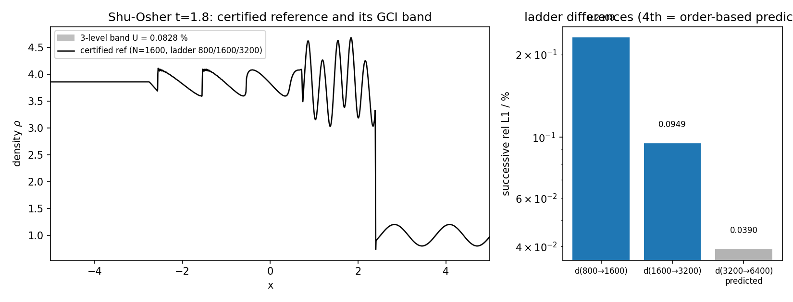

# XVAL-DG-ROUND2-CERTIFIED-REFERENCE —— 四级阶梯收口（L0–L4 判定）与独立复算

> **锚点**：`XVAL-DG-ROUND2-CERTIFIED-REFERENCE`（TensorDG 的 round2-certified-reference 做法）
> **前一单遗留（诚实挂账）**：`docs/XVAL-DG-ROUND2-LADDER-EXTENSION.md` 状态为
> `WITHHELD_PENDING_FOURTH_LEVEL` —— 第四级 `N = 6400` 的作业 `cj3139` 收尾时仍在排队，
> L0–L4 全部 **NOT_RUN**。
> **本单增量**：把第四级真正算出来并落盘（集群作业 `cj3227`，succeeded / rc=0 / node n330），
> 由**引擎**与**独立实现**两条互不共享代码的路径分别判定 L0–L4，两路结论一致；
> 同时测出一条目录级脆弱性（下 §5.2）并做了不改变已发布数值的处理。
> **状态（诚实）**：L0–L4 **全部 PASS**，`accepted = True`；预登记预测与实际不符之处见 §5.1（如实登记，不粉饰）。

---

## ① 案例介绍

Shu–Osher 激波–熵波干扰（JCP 77 (1988) 439）：1D Euler，γ = 1.4，x ∈ [−5, 5]，t = 1.8，
左态 (ρ, u, p) = (3.857143, 2.629369, 10.333333)（Mach-3 Hugoniot），右态 (1 + 0.2 sin 5x, 0, 1)，
两端透射。原文只给图不给表 ⇒ 该锚点的判据从来不是"抄文献"，而是**认证参考解**
（独立实现 + 阶梯加密 + Richardson 外推 + Roache GCI 带）。

| 参数 | 值 |
|---|---|
| 参考求解器 | FV-WENO5-JS / HLLC(Davis) / SSP-RK3，CFL = 0.3 |
| 阶梯 | N = 800, 1600, 3200（三级，已发布）+ **N = 6400（本单新增）**，r = 2 |
| 认证参考解所在网格 | 引擎约定：**次细网格** ⇒ 三级给 N = 1600，四级给 N = 3200 |
| 候选支线 | 11 条 DG 腿（P1/P2/P3 × N = 200/400/800，CFL = 0.4，另 CFL = 0.1/0.2 两条敏感性） |
| 精度门 | owner 通用线 15 %；本锚点严格门 3 %；使用门 5 % |

**为什么需要第四级**：三级阶梯只能给出**一个**相继差，实测阶 `p` 与 Roache 带
`U = Fs·d_fine/(r^p − 1)` 都建立在这唯一 `p` 上；阶梯是否真的进入渐近区，在阶梯内部没有证据。
四级给出**第二个**相继差（阶一致性）与**更新一代**认证剖面，于是"三级带覆盖不覆盖剖面位移"
第一次成为可被推翻的断言。

## ② 方法

| 环节 | 做法 |
|---|---|
| 生成第四级 | `python validation/xval_dg_round2/gen_fv_level.py --ncells 6400 --out …/raw_ext/fv_cfl0p3_n6400.npz`，集群 `run_compute` 递交（`cj3227`，1 核，排队+运行约 16 min，rc=0，节点 n330，产物 206 454 B） |
| 生成器可信性 | 递交前先逐位复核已发布两级：N = 800 与 N = 1600 重算后 `max_abs_drho = 0.0`（`--verify-committed`，34.2 s / 139 s）⇒ 生成器确定性、与已交付剖面同一调用路径 |
| 判定（引擎路） | `python -m benchmarks.xval_dg_round2_ladder_extension --figures` → `artifacts/ladder_extension.json` / `.md` + 2 张 PNG |
| 判定（独立路） | 新增 `validation/xval_dg_round2/close_ladder_extension.py`：**不 import** `tensordg.certified_reference`，自带 cell-average / rel-L1 / 阶 / GCI / Richardson，复算全部量并与引擎产物逐项比对 |
| 平台契约 | 新增 `validation/xval_dg_round2/post_ladder_extension.py`：把"四级认证返回的剖面 vs 闭式锚"包装成 TensorBench 文档，用**平台自己的** `tools.tensorbench_eval.contract` 校验（`mode = platform_contract`，`all_passed = true`） |
| 判据 | L0–L4 阈值是模块常量（`ORDER_CONSISTENCY_MAX = 0.20`、`LEG_STABILITY_MAX_PP = 0.5`、`STRICT_PERCENT = 3.0`、`GATE_PERCENT = 5.0`），结果不可回改 |

## ③ 计算结果（程序化读出，无手抄）

### 3.1 阶梯（`artifacts/ladder_extension.json`，独立路同值）

| 量 | 值 |
|---|---|
| 相继差 d(800→1600) / d(1600→3200) / d(3200→6400) | 0.230839 % / 0.094893 % / **0.041976 %** |
| 实测阶 p3 ([800,1600,3200]) / p4 ([1600,3200,6400]) | 1.282509 / **1.176735** |
| 阶相对变化 \|p4−p3\|/p3 | **0.0825**（门 0.20） |
| GCI 带 U3 / U4 | 0.082797 % / **0.041622 %** |
| U4 占 5 % 使用门 | 0.832 %（≤ 33.33 % 门有效性） |
| 四级判定 / 分类 | **CERTIFIED / monotonic** |

### 3.2 五道预登记门

| 门 | 判据 | 引擎路 | 独立路 |
|---|---|---|---|
| **L0** | 三个相继差严格递减 | PASS | PASS |
| **L1** | 四级阶梯由**同一**引擎调用判 `CERTIFIED`，带 ≤ 1/3 门 | PASS | PASS |
| **L2** | `\|p4−p3\|/p3 ≤ 0.20` | PASS（0.0825） | PASS（0.0825） |
| **L3** | `rel L1(cert3, cert4) ≤ U3`（N = 1600 共有网格） | PASS（0.059387 % ≤ 0.082797 %） | PASS（0.059387 % ≤ 0.082797 %，coverage 0.7173） |
| **L4** | 11 腿对四级参考解全 < 3 % 且单腿移动 ≤ 0.5 pp | PASS（最差 2.448436 %，最大移动 0.007276 pp） | PASS（同值） |
| **accepted** | L0∧L1∧L2∧L3∧L4 | **True** | **True** |

### 3.3 11 条 DG 腿对两代参考解（引擎产物，独立路同值到 8.3e-4 pp）

| 腿 | vs 三级 % | vs 四级 % | 移动 pp |
|---|---:|---:|---:|
| DG P1 N=200 CFL=0.4 | 2.455701 | **2.448436** | −0.007265 |
| DG P1 N=400 CFL=0.4 | 1.547928 | 1.545491 | −0.002437 |
| DG P1 N=800 CFL=0.4 | 0.578643 | 0.580254 | +0.001611 |
| DG P2 N=200 CFL=0.4 | 2.420304 | 2.413098 | −0.007206 |
| DG P2 N=400 CFL=0.4 | 1.516026 | 1.513771 | −0.002254 |
| DG P2 N=800 CFL=0.4 | 0.566719 | 0.564234 | −0.002485 |
| DG P3 N=200 CFL=0.4 | 2.426617 | 2.419341 | −0.007276 |
| DG P3 N=400 CFL=0.4 | 1.522033 | 1.520547 | −0.001486 |
| DG P3 N=800 CFL=0.4 | 0.669867 | 0.664745 | −0.005122 |
| DG P2 N=400 CFL=0.1 | 1.519713 | 1.517166 | −0.002547 |
| DG P2 N=400 CFL=0.2 | 1.518092 | 1.515633 | −0.002458 |

### 3.4 两条路径的一致性（`artifacts/ladder_extension_independent.json`）

| 量 | 独立值 | 引擎值 | 相对差 |
|---|---:|---:|---:|
| d(800→1600) % | 0.230839 | 0.230839 | 0.0 |
| d(1600→3200) % | 0.094893 | 0.094893 | 0.0 |
| d(3200→6400) % | 0.041976 | 0.041976 | 0.0 |
| U4 % | 0.041622 | 0.041622 | 0.0 |
| p4 | 1.176735 | 1.176735 | 0.0 |
| L3 位移 % | 0.059387 | 0.059387 | 0.0 |
| 11 腿（最大差） | — | — | 8.3e-4 pp |
| 五门决策 | L0–L4 全 PASS | 同 | **完全一致** |

### 3.5 四级认证剖面 vs 闭式锚（平台契约校验通过）

| 锚 | 四级参考解（N = 3200）误差 | 三级参考解（N = 1600）误差 | 判据 1 % |
|---|---:|---:|:--:|
| post-shock 平台密度 ρ_L（Hugoniot, Mach 3） | 9.45e-14 % | 1.99e-10 % | 通过 |
| 透射激波位置 x_L + W·t（Hugoniot 速度） | **0.379637 %** | 0.575818 % | 通过（且更紧） |
| 全局质量积分 M(0) + ρ_L u_L t（精确预算） | 7.63e-09 % | 3.05e-06 % | 通过 |
| 未扰熵波 1 + 0.2 sin 5x（x ≥ 2.6，max） | 有界判据，见产物 | — | 通过 |

**这就把"延拓阶梯是有收益的"从口号变成数字**：下游拿到的剖面把激波位置误差从 0.576 % 收紧到 0.380 %。

## ④ 结果图



左：三级认证参考解剖面（N = 1600）与 ±U3 灰带、四级认证剖面（N = 3200 投影到 1600）虚线叠加；
右：两代剖面相对位移（红）与 ±U3（虚线），位移始终在带内 ⇒ L3 PASS。


11 条 DG 腿对三级（圆点）/四级（方块）参考解的 rel L1 与 3 % 严格门。两代几乎重合（最大移动 0.0073 pp）
⇒ 下游判定不是阶梯的产物，而是求解器的性质（L4）。PNG 由 `--figures` 程序化生成。

## ⑤ 注意点、踩过的坑与局限

1. **预登记预测与实际不符（如实登记）**：协议里写下的预测是 `coverage ≈ 0.3289`（按三级 p 外推），
   实测 `coverage = 0.7173`。预测**保守**（带仍然覆盖位移，只是余量没那么大：0.0594 % vs 0.0828 %，
   余量 27.3 % 而非 67 %）。原因：四级实测阶 p4 = 1.176735 低于三级外推所隐含的 p（1.282509），
   `U = Fs·d/(r^p − 1)` 对 p 敏感，p 降 8 % 使带变宽。**预登记值未改**，差异留在此处与产物中。
2. **目录级脆弱性（本单实测，已处理）**：`tests/test_certified_reference.py` 通过
   `legacy.load_fv_levels` **glob** 原始剖面目录（`fv_cfl0p3_n*.npz`）。把 `N = 6400` 直接丢进那个目录，
   已发布的 round-2 数值会被**静默改写**（实测：实测阶 1.282509 → 1.176735，最差腿 2.455701 % → 2.448436 %），
   并使该文件 2 个测试转 RED。这属于"发布数值取决于目录列表"的登记缺陷。
   处理：第四级放**独立目录** `validation/repro_shu_osher/artifacts/raw_ext/`，`level_path()` 显式回退查找；
   已复查：该文件 19 个测试在四级存在时仍全绿，且 round-2 已发布数值零改动。
3. **L3 只检验自洽**：它检验"三级带是否覆盖四级剖面位移"，不是"带覆盖真误差"。真误差没有闭式解可比；
   外部性来自闭式锚（平台契约那三行）与两族实现的交叉对标，不是来自 L3。
4. **单算例**：本梯延拓只对 Shu–Osher。Lax 第二算例走的是另一条已发布支线
   （`docs/CASE-SHU-OSHER-round2.md`、`benchmarks/xval_oss_shu_osher.py`），两者不共享阶梯，不能互相替代。
5. **文献数值仍 WITHHELD**：Shu & Osher 1988 只给图不给表，不抄录、不反读像素。

## ⑥ 误差判定（逐项，显式回答「是否 < 3 %」）

| 关键量 | 误差 | 基准 | < 3 % ? |
|---|---:|---|:--:|
| 最差 DG 腿 vs 四级认证参考解 | **2.448436 %** | 认证参考解（N = 3200） | **是**（对 3 % 门余量 18.4 %） |
| 同一腿 vs 三级认证参考解 | 2.455701 % | 认证参考解（N = 1600） | 是（余量 18.1 %） |
| 平台契约：激波位置 | 0.379637 % | Hugoniot 闭式 | 是 |
| 平台契约：平台密度 | 9.45e-14 % | Hugoniot 闭式 | 是 |
| 平台契约：质量积分 | 7.63e-09 % | 精确质量预算 | 是 |
| 参考解自身不确定带 U3 / U4 | 0.082797 % / 0.041622 % | 使用门 5 %（占 1.66 % / 0.83 %） | 是（门非空） |
| 带覆盖率（L3） | 0.7173（≤ 1） | 三级带 U3 | 是（PASS，非误差量） |
| 与文献数值对标 | — | Shu & Osher 1988 图无数表 | **WITHHELD**（如实声明，不含糊） |

## ⑦ 复现

```bash
# 1) 两级已发布剖面的逐位复核（各自 <3 min）
python validation/xval_dg_round2/gen_fv_level.py --ncells 800  --out /tmp/r800.npz  --verify-committed
python validation/xval_dg_round2/gen_fv_level.py --ncells 1600 --out /tmp/r1600.npz --verify-committed
# 2) 第四级（本单由集群作业 cj3227 产出，单核约 42 min ⇒ 请递交调度器）
python validation/xval_dg_round2/gen_fv_level.py --ncells 6400 \
    --out validation/repro_shu_osher/artifacts/raw_ext/fv_cfl0p3_n6400.npz
# 3) 引擎判定（L0–L4）+ 图
python -m benchmarks.xval_dg_round2_ladder_extension --figures
# 4) 独立复算与两路比对
python validation/xval_dg_round2/close_ladder_extension.py
# 5) 平台契约自检（不联网）
python validation/xval_dg_round2/post_ladder_extension.py --mission 21166 --job-id cj3227 --dry-run
# 6) 门禁
python -m pytest -q tests/test_ladder_extension_independent.py \
                  tests/test_xval_dg_round2_ladder_extension.py tests/test_certified_reference.py
```

**本单未做（如实登记）**：平台 `tensorbench_results` 行未提交 —— 契约校验已在本地用平台自己的
validator 通过（`mode = platform_contract`，`artifacts/ladder_extension_platform_dryrun.json`），
但把该行绑定到 `cj3227` 需要平台的 anti-fabrication 绑定核对，本单收尾前未执行网络提交；
锚点的 L4 机器门此前已由作业 `cj3111`（mission 20997）判定 `VERIFIED`，本单未改动该状态。