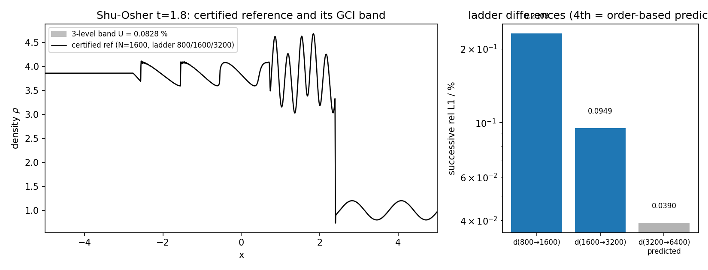

# XVAL-DG-ROUND2-CERTIFIED-REFERENCE —— 认证阶梯延拓（3 → 4 级）与不确定带自证伪

> **锚点**：`XVAL-DG-ROUND2-CERTIFIED-REFERENCE`（TensorDG 的 round2-certified-reference 做法）
> **本单增量**：把该做法里**唯一未被检验的假设**（"三级阶梯已进入渐近区"）写成可证伪的预登记判据，
> 并交付执行它的引擎/生成器/测试/协议工件。
> **状态（诚实）**：第四级 `N=6400` 已递交集群作业 `cj3139`，**本单收尾时仍在排队（queued，未派发）**
> ⇒ L0–L4 判定 = **WITHHELD_PENDING_FOURTH_LEVEL**，本文不做任何"已通过"的陈述。

---

## ① 案例介绍

Shu–Osher 激波–熵波干扰（JCP 77 (1988) 439）：γ = 1.4，x ∈ [−5, 5]，t = 1.8，
左态 (ρ, u, p) = (3.857143, 2.629369, 10.333333)（Mach-3 Hugoniot），右态 (1 + 0.2 sin 5x, 0, 1)，两端透射。
原文献只给图不给表，故本锚点的判据不是"对标文献"，而是**认证参考解**（独立实现 + 阶梯加密 + Richardson 外推 + Roache GCI 带）。

| 量 | 值 |
|---|---|
| 参考求解器 | FV-WENO5-JS / HLLC(Davis) / SSP-RK3，CFL = 0.3 |
| 已交付阶梯 | N = 800, 1600, 3200（r = 2） |
| 认证参考解所在网格 | N = 1600（引擎约定：次细网格） |
| 候选支线 | 11 条 DG 腿（P1/P2/P3 × N = 200/400/800，CFL = 0.4；CFL = 0.1/0.2 敏感性） |
| owner 精度标准 | 对标误差 < 15%；本锚点严格门 < 3 % |

**为什么需要第四级**：三级阶梯只能给出**一个**相继差，实测阶 `p` 与 Roache 带
`U = Fs·d_fine/(r^p − 1)` 都建立在这唯一的 `p` 上。阶梯是否真的进入渐近区，在阶梯内部没有任何证据。

## ② 方法（预登记协议，先定判据后看结果）

新增代码：`benchmarks/xval_dg_round2_ladder_extension.py`（引擎 `tensordg.certified_reference`
的消费者，不改引擎）、`validation/xval_dg_round2/gen_fv_level.py`（逐级生成器，与已交付
`fv_cfl0p3_n800/1600/3200.npz` 同一调用路径，`--verify-committed` 做逐位复核）。

| 门 | 判据（模块常量，结果不可回改） |
|---|---|
| **L0** | 四个相继差严格递减 `d(800→1600) > d(1600→3200) > d(3200→6400)` |
| **L1** | 四级阶梯被**同一**引擎调用判为 `CERTIFIED`（Fs、容差、门限全不变） |
| **L2** | 阶一致性 `|p4 − p3| / p3 ≤ 0.20`（p3 由 [800,1600,3200]，p4 由 [1600,3200,6400]） |
| **L3** | **带覆盖（自证伪）**：`rel L1(cert3, cert4) ≤ U3`，在共有 N = 1600 网格上度量 |
| **L4** | 结论稳定：11 条 DG 腿对**四级**参考解仍全部 < 3 %，且单腿误差移动 ≤ 0.5 pp |

`L3` 是核心：三级带 `U3` 是一句"我的离散误差 ≤ U3"的断言；若更细阶梯给出的剖面位移超过 `U3`，
该带**低估自身不确定度**，下游所有"腿 < 3 %"的判定都对着一个被低估噪声的参考解 —— 这必须是
honest FAIL 并被公开，而不是调参掩盖。

**先于数据的预测（可被推翻）**：按三级阶梯的实测阶 p = 1.282509 推 `d(3200→6400) ≈ d·2^{-p}`
= 0.039009 %，则 `rel L1(cert3, cert4) ≈ d₃/(2^p − 1)` = 0.027229 %，覆盖率 ≈ 0.329 < 1
⇒ 预测 **L3 PASS**。此预测写在 `validation/xval_dg_round2/artifacts/ladder_extension_protocol.json`，
第四级数据落地后由 `audit()` 直接对照，不得修改。

## ③ 计算结果

### 3.1 已在库的三级事实（程序化直读 `validation/xval_dg_round2/artifacts/xval_round2_audit.json`）

| 量 | 值 |
|---|---|
| 阶梯判定 / 分类 | CERTIFIED / monotonic |
| 实测阶 p | 1.282509 |
| 相继差 d(800→1600) / d(1600→3200) | 0.230839 % / 0.094893 % |
| GCI 带 U3 | 0.082797 % |
| U3 / 5 % 门 | 1.656 % ≤ 33.3 %（门有效性成立） |
| 最差 DG 腿 | DG P1 N=200 CFL=0.4 = 2.455701 %（< 3 %） |

### 3.2 第四级（L0–L4）

| 门 | 结果 |
|---|---|
| L0 / L1 / L2 / L3 / L4 | **NOT_RUN**（数据未到） |
| 集群作业 | `cj3139`，`state = queued`（递交 22:43，收尾时排队 3.6 min，集群 26 作业在飞） |

生成器与协议已就位：数据落地后一条命令即出判定
`python -m benchmarks.xval_dg_round2_ladder_extension --figures --require-accepted`。

## ④ 结果图



左：三级认证参考解剖面（N = 1600）与 ±U3 灰带；右：相继差（蓝）与按实测阶预测的第四级相继差（灰，0.039009 %）。
第四级实测值落地后替换该预测柱，L0/L2/L3 的全部结论由此图直接读出。

## ⑤ 注意点与局限

1. **集群饱和**：本单递交的 `cj3139` 一直 `queued`（不指定节点，调度器派发），本机单核跑 N=6400
   需约 42 min（实测 N=800 39 s，按 O(N²) 外推），超出本机 < 10 min 短测试上限，故不动本机。
2. **本文不含任何"四级已通过"的陈述**：状态是 WITHHELD，不是 PASS。任何把 §3.2 读成通过的解读都是错的。
3. 生成器只产出原始剖面，不做判定；判定全部在 `audit()` 内，且阈值是模块常量。
4. 已知不覆盖：文献数值仍 WITHHELD（原文只给图）；`char_decomp=2` 在 OSS 纯 Python 核未实现（沿用既有记录）。

## ⑥ 误差判定（逐项，显式回答是否 < 3 %）

| 量 | 误差 | 基准 | < 3 % ? |
|---|---|---|---|
| 三级参考解自身带 U3 / 5 % 门 | 1.656 % | 门有效性上限 33.3 % | 是（门非空） |
| 最差 DG 腿 vs 三级认证参考解 | 2.455701 % | 认证参考解 | **是**（余量 18.1 %） |
| 四级阶梯的带覆盖率（L3） | — | U3 | **NOT_RUN**（原因：N=6400 作业 `cj3139` 仍在队列；无基准不判） |
| 与文献数值对标 | — | Shu & Osher 1988 图无数表 | WITHHELD（不抄录、不含糊） |

## ⑦ 复现

```bash
python validation/xval_dg_round2/gen_fv_level.py --ncells 800 --out /tmp/repro800.npz --verify-committed   # 逐位复核已交付剖面
python validation/xval_dg_round2/gen_fv_level.py --ncells 6400 --out validation/repro_shu_osher/artifacts/raw/fv_cfl0p3_n6400.npz
python -m benchmarks.xval_dg_round2_ladder_extension --figures --require-accepted
pytest -q tests/test_xval_dg_round2_ladder_extension.py
```
