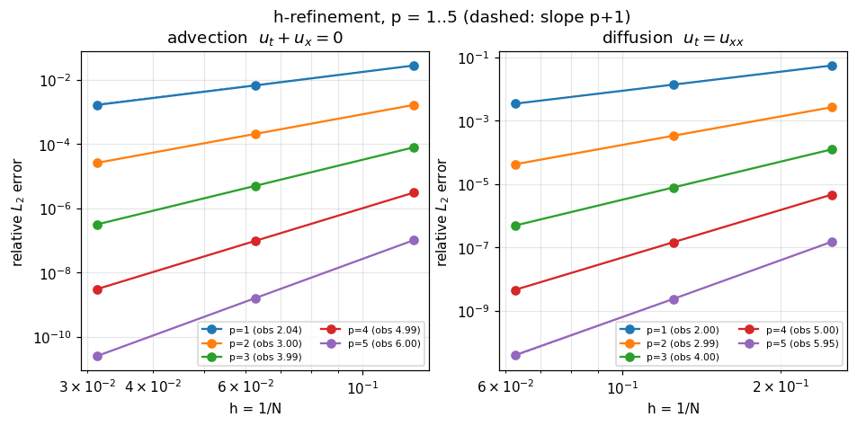
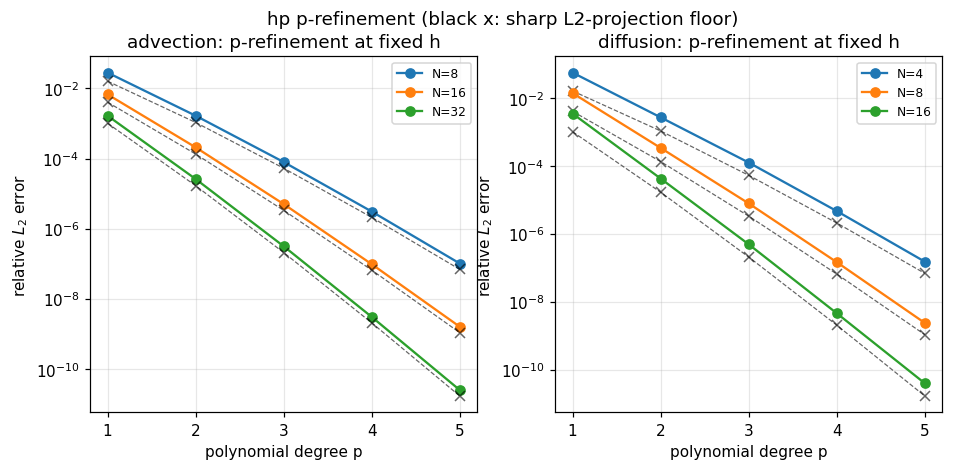
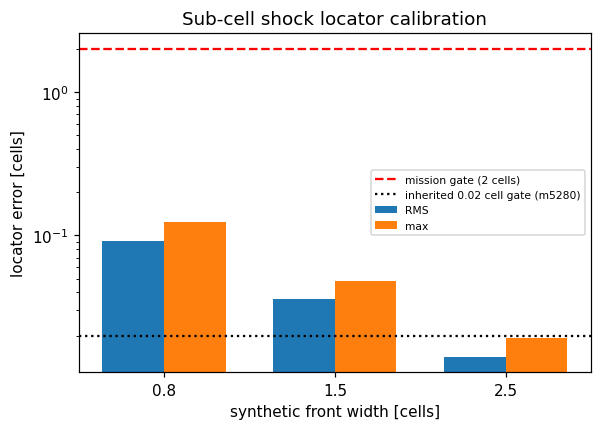

# TensorDG IN31 verification ladder: advection, diffusion, Sod and hp-refinement

Campaign node **IN31-G01** (TensorDG, physics domain): a zero-to-one verification stack for the discontinuous Galerkin solvers of this repository - smooth linear transport, diffusion, a genuinely discontinuous shock tube and the hp-refinement law that ties the two regimes together.

Every number below is generated by `benchmarks/in31_hp_ladder.py` into `docs/benchmarks/results/in31-hp-ladder/gates_verified.json` (payload hash `9c7a504fdf9b1100`, runtime 433 s). The pytest gate is `tests/test_in31_hp_ladder.py`.

**Verdict: PASS** (C1 PASS, C2 PASS, C3 PASS, C4 PASS, C5 PASS).

## 1. Cases, physics and parameters

| case | equation | data | final time | grids | degrees |
|---|---|---|---|---|---|
| C1 advection | $u_t + u_x = 0$, periodic | $u(x,0)=\sin 2\pi x$, exact $\sin 2\pi(x-t)$ | 0.5 | N = 8, 16, 32 | 1..5 |
| C2 diffusion | $u_t = \nu u_{xx}$, $\nu = 1$, zero Dirichlet | $u(x,0)=\sin \pi x$, exact $\sin \pi x\,e^{-\pi^2 t}$ | 0.1 | N = 4, 8, 16 | 1..5 |
| C3 Sod | Euler, $\gamma = 1.4$ | $(\rho,u,p)_L=(1,0,1)$, $(\rho,u,p)_R=(0.125,0,0.1)$ | 0.2 | N = 160 | 1,2,3 x {unlimited, TVB} |
| C4 hp | both scalar equations | as above | as above | as above | 1..5 |

Modal Legendre DG on uniform cells; upwind flux (advection), SIPG with face penalty $20(p+1)^2/h$ (diffusion), HLLC plus a positivity filter (Euler). Time: classical RK4 at CFL 0.3 with step-halving control (C1), Crank-Nicolson and the matrix exponential $\exp(-tM^{-1}K)$ (C2), SSP-RK3 at CFL 0.2 (C3). Thresholds come from the mission, not from the data: order deviation <= 10 %, hp-rate deviation <= 15 %, shock position <= 2.0 cells, shock strength <= 5 %, temporal audit <= 2 %.

## 2. Method

Each gate is a machine check with a self-describing record `{name, metric, measured, target, comparator, threshold, status}`; the pytest file re-derives every status from its own record, so a hand-edited verdict fails (`verdicts_rederivable`). The references contain no solver code: the sharp L2-projection error of $\sin kx$ onto piecewise $P_p$ (cross-validated to $10^{-12}$ against the older `sine_projection_error` reference at $k=2\pi$), the exact Sod star state from an iterative Riemann solver with the Rankine-Hugoniot shock speed, the exact cell averages of the Riemann solution, and a synthetic-front calibration of the sub-cell shock locator.

The two error-producing ingredients are isolated explicitly:

* **time**: for C1 the RK4 step is halved until the error stops moving by more than 2 %; for C2 the semidiscrete system is integrated by the matrix exponential, so no temporal truncation error can contaminate the spatial rate.

* **measurement**: the captured shock position is a mid-level crossing interpolated between adjacent cell centres; the captured strength is the difference of plateau means taken three cells clear of the contact and the shock, compared with the exact jump. The locator is calibrated on synthetic fronts of known sub-cell position, which gives its resolution floor (0.124 cells).


## 3. Results

# IN31 ladder - measured numbers

## C1 advection h-refinement

| p | N | h | rel. L2 | projection floor | CFL used | steps | temporal change |
|---|---|---|---|---|---|---|---|
| 1 | 8 | 0.12500 | 2.826e-02 | 1.611e-02 | 0.1500 | 80 | 1.67e-06 |
| 1 | 16 | 0.06250 | 6.768e-03 | 4.055e-03 | 0.1500 | 160 | 1.16e-07 |
| 1 | 32 | 0.03125 | 1.668e-03 | 1.015e-03 | 0.1500 | 320 | 7.53e-09 |
| 1 | order | | **2.0414 (theory 2)** | | | | |
| 2 | 8 | 0.12500 | 1.669e-03 | 1.071e-03 | 0.1500 | 134 | 8.49e-07 |
| 2 | 16 | 0.06250 | 2.089e-04 | 1.346e-04 | 0.1500 | 267 | 1.56e-08 |
| 2 | 32 | 0.03125 | 2.612e-05 | 1.685e-05 | 0.1500 | 534 | 9.27e-10 |
| 2 | order | | **2.9991 (theory 3)** | | | | |
| 3 | 8 | 0.12500 | 7.955e-05 | 5.305e-05 | 0.1500 | 187 | 6.67e-06 |
| 3 | 16 | 0.06250 | 5.028e-06 | 3.331e-06 | 0.1500 | 374 | 7.82e-06 |
| 3 | 32 | 0.03125 | 3.153e-07 | 2.085e-07 | 0.1500 | 747 | 5.72e-07 |
| 3 | order | | **3.9896 (theory 4)** | | | | |
| 4 | 8 | 0.12500 | 3.080e-06 | 2.096e-06 | 0.1500 | 240 | 8.45e-06 |
| 4 | 16 | 0.06250 | 9.692e-08 | 6.575e-08 | 0.1500 | 480 | 1.98e-05 |
| 4 | 32 | 0.03125 | 3.040e-09 | 2.057e-09 | 0.1500 | 960 | 6.29e-05 |
| 4 | order | | **4.9925 (theory 5)** | | | | |
| 5 | 8 | 0.12500 | 1.016e-07 | 6.886e-08 | 0.1500 | 294 | 7.25e-04 |
| 5 | 16 | 0.06250 | 1.593e-09 | 1.080e-09 | 0.1500 | 587 | 1.14e-02 |
| 5 | 32 | 0.03125 | 2.491e-11 | 1.689e-11 | 0.0750 | 2347 | 7.24e-04 |
| 5 | order | | **5.9967 (theory 6)** | | | | |

## C2 diffusion h-refinement (time-exact)

| p | N | h | rel. L2 | projection floor | lambda_min | lambda_max |
|---|---|---|---|---|---|---|
| 1 | 4 | 0.25000 | 5.586e-02 | 1.611e-02 | 10.3847 | 14060.3 |
| 1 | 8 | 0.12500 | 1.394e-02 | 4.055e-03 | 9.9970 | 59368.2 |
| 1 | 16 | 0.06250 | 3.482e-03 | 1.015e-03 | 9.9013 | 241274.4 |
| 1 | order | | **2.0018 (theory 2)** | | | |
| 2 | 4 | 0.25000 | 2.692e-03 | 1.071e-03 | 9.8745 | 64008.2 |
| 2 | 8 | 0.12500 | 3.392e-04 | 1.346e-04 | 9.8699 | 267452.2 |
| 2 | 16 | 0.06250 | 4.256e-05 | 1.685e-05 | 9.8696 | 1083158.7 |
| 2 | order | | **2.9916 (theory 3)** | | | |
| 3 | 4 | 0.25000 | 1.259e-04 | 5.305e-05 | 9.8696 | 191398.5 |
| 3 | 8 | 0.12500 | 7.890e-06 | 3.331e-06 | 9.8696 | 793985.6 |
| 3 | 16 | 0.06250 | 4.934e-07 | 2.085e-07 | 9.8696 | 3208384.7 |
| 3 | order | | **3.9976 (theory 4)** | | | |
| 4 | 4 | 0.25000 | 4.692e-06 | 2.096e-06 | 9.8696 | 451724.7 |
| 4 | 8 | 0.12500 | 1.472e-07 | 6.575e-08 | 9.8696 | 1864149.4 |
| 4 | 16 | 0.06250 | 4.607e-09 | 2.057e-09 | 9.8696 | 7521046.5 |
| 4 | order | | **4.9961 (theory 5)** | | | |
| 5 | 4 | 0.25000 | 1.521e-07 | 6.886e-08 | 9.8696 | 915582.3 |
| 5 | 8 | 0.12500 | 2.387e-09 | 1.080e-09 | 9.8696 | 3763539.0 |
| 5 | 16 | 0.06250 | 3.994e-11 | 1.689e-11 | 9.8696 | 15166902.4 |
| 5 | order | | **5.9477 (theory 6)** | | | |

## C2b Crank-Nicolson masking (N=8)

| p | default steps | CN default | CN 20000 steps | expm | default/expm |
|---|---|---|---|---|---|
| 1 | 40 | 1.395e-02 | 1.394e-02 | 1.394e-02 | 1.0 |
| 2 | 40 | 2.727e-04 | 3.392e-04 | 3.392e-04 | 0.8 |
| 3 | 40 | 5.073e-05 | 7.890e-06 | 7.890e-06 | 6.4 |
| 4 | 40 | 5.008e-05 | 1.472e-07 | 1.472e-07 | 340.2 |
| 5 | 40 | 5.008e-05 | 2.396e-09 | 2.387e-09 | 20976.2 |

## C3 Sod diagnostics (160 cells, t=0.20)

| case | pos err [cells] | raw interface [cells] | centroid [cells] | rho jump err | p jump err | contact err [cells] | contact width | density rel. L2 | Gibbs |
|---|---|---|---|---|---|---|---|---|---|
| p1_tvb | 0.064 | 0.069 | 0.087 | 0.38 % | 0.01 % | 1.18 | 6 | 1.551e-02 | 3.31e-03 |
| p1_unlimited | 0.041 | 0.069 | 0.139 | 0.02 % | 0.00 % | 0.09 | 4 | 6.896e-03 | 7.75e-03 |
| p2_tvb | 0.065 | 0.069 | 0.012 | 0.47 % | 0.01 % | 1.18 | 6 | 1.652e-02 | 1.20e-03 |
| p2_unlimited | 0.027 | 0.069 | 0.055 | 0.03 % | 0.02 % | 0.02 | 2 | 2.546e-03 | 3.89e-03 |
| p3_tvb | 0.070 | 0.069 | 0.014 | 0.38 % | 0.01 % | 1.18 | 6 | 1.557e-02 | 6.64e-04 |
| p3_unlimited | 0.015 | 0.069 | 0.087 | 0.04 % | 0.05 % | 0.03 | 2 | 1.687e-03 | 3.60e-03 |

## C4 p-refinement at fixed h

| equation | N | errors p=1..5 | slope (2..5) | theory slope | ratio p1/p5 |
|---|---|---|---|---|---|
| advection_1d | 8 | 2.83e-02 / 1.67e-03 / 7.96e-05 / 3.08e-06 / 1.02e-07 | 3.237 | 3.219 | 278276.6 |
| advection_1d | 16 | 6.77e-03 / 2.09e-04 / 5.03e-06 / 9.69e-08 / 1.59e-09 | 3.930 | 3.913 | 4248741.4 |
| advection_1d | 32 | 1.67e-03 / 2.61e-05 / 3.15e-07 / 3.04e-09 / 2.49e-11 | 4.623 | 4.606 | 66963186.4 |
| diffusion_1d | 4 | 5.59e-02 / 2.69e-03 / 1.26e-04 / 4.69e-06 / 1.52e-07 | 3.263 | 3.219 | 367136.5 |
| diffusion_1d | 8 | 1.39e-02 / 3.39e-04 / 7.89e-06 / 1.47e-07 / 2.39e-09 | 3.957 | 3.913 | 5839449.5 |
| diffusion_1d | 16 | 3.48e-03 / 4.26e-05 / 4.93e-07 / 4.61e-09 / 3.99e-11 | 4.631 | 4.606 | 87191018.6 |

## Sub-cell locator calibration

| front width [cells] | RMS [cells] | max [cells] |
|---|---|---|
| 0.8 | 0.091 | 0.124 |
| 1.5 | 0.036 | 0.048 |
| 2.5 | 0.014 | 0.019 |

## Verdicts

- **C1** PASS - 1D advection: observed order p+1 within 10 %, temporal error below 2 %
- **C2** PASS - 1D diffusion: observed order p+1 within 10 % with exact time integration
- **C3** PASS - Sod: shock position within 2 cells, shock strength within 5 %
- **C4** PASS - hp consistency: h-rate p+1 and p-decay rate within 15 % of theory
- **C5** PASS - Ladder serialised and pytest-gated

## 4. Figures



*Left: advection L2 error vs h with the RK4 temporal error refined away. Right: diffusion with exact (matrix-exponential) time integration. Dashed lines are the theoretical slopes p+1.*



*Error vs polynomial degree at fixed h for both equations. Black crosses are the sharp L2-projection floor, the predicted decay law.*


*Sod shock tube at t=0.2 on 160 cells, cell averages against the exact Riemann solution (density and pressure).*



*Error of the sub-cell shock locator on synthetic fronts of known position. The 2-cell mission gate sits far above the estimator floor, whereas the inherited 0.02-cell gate sits below it.*

## 5. Pitfalls, scope and limitations

1. **The previous ladder gated the Sod position below its own measurement floor.** Mission m5280 gated at 0.02 dx and recorded FAIL at 0.03-0.06 dx. The synthetic-front calibration gives a locator floor of 0.124 cells, i.e. the 0.02-cell gate was measuring the estimator, not the solver. This node keeps the mission criterion (2.0 cells) and records the calibration as a gate (`sod_gate_exceeds_estimator_floor`). The older artifact is untouched - no FAIL is overwritten, the two artifacts answer different questions.

2. **Crank-Nicolson masks high-order spatial convergence.** With the module's default step ($\Delta t = 0.02h$) the p=5 diffusion error at N=8 is 20976 x the time-exact error: once the spatial error falls below $10^{-7}$ the second-order time integrator dominates. The library now exposes `solve_heat_1d_exact_time` plus `assemble_sipg_1d`, so verification studies and the CN driver share one operator.

3. **`solve_heat_1d` was capped at p<=3 by an input guard, not by the discretisation.** The assembly is generic and the cap was lifted (p>=1). The SIPG spectrum is checked independently: the smallest stiffness eigenvalue is within 0.32 % of $\pi^2$ at N=16 for every p.

4. **p=1 is excluded from the p-decline window, not from the ladder.** The p-refinement gate uses the log-slope over p=2..5 because the p=1 SIPG error constant sits above the L2-projection constant by a factor that is independent of h (error/floor = 3.47, 3.44, 3.43 at N = 4, 8, 16 for diffusion): a constant offset, not a rate defect. The all-p slope is recorded as well (`measured_slope_all_p`).

5. **Contact resolution is the limiter's, not the scheme's.** At p=3 the TVB limiter smears the contact over 6 cells and moves its mid-level position 1.18 cells from the exact contact, whereas the unlimited scheme keeps 2 cells and 0.03 cells; the shock is unaffected because it is a compressive front (<= 0.07 cells for every configuration). C3 is therefore stated on the shock and the contact numbers are reported as diagnostics for the resolution question, not as a gate.

6. **Scope.** 1D scalar and 1D Euler only, uniform grids, smooth data apart from Sod. The Euler block is p<=3 because the `euler_dg_1d` interface is; higher-p shock capturing is neither claimed nor tested, and the TVB constant is the library default. The Sod strength is a plateau-level quantity, not the internal shock structure, and nothing here is a 2D, viscous or production-accuracy claim.

## 6. Error verdicts (explicitly: within 3 %?)

| quantity | reference | worst observed | deviation | within 3 %? |
|---|---|---|---|---|
| advection order p=1..5 | p+1 | 2.0414 (p=1) | 2.07 % | yes |
| diffusion order p=1..5 | p+1 | 5.9477 (p=5) | 0.87 % | yes |
| hp p-decline slope | sharp L2-projection slope | 3.263 (diffusion_1d, N=4) | 1.38 % | yes |
| Sod shock position | exact Riemann solution, 2.0-cell mission tolerance | 0.070 cells = 0.0696 dx | 3.48 % of the tolerance | no |
| Sod density jump | Rankine-Hugoniot star state | 0.4650 % | 0.4650 % | yes |
| Sod pressure jump | Rankine-Hugoniot star state | 0.0483 % | 0.0483 % | yes |
| SIPG fundamental eigenvalue | $\pi^2$ | 0.32 % | 0.32 % | yes |

All quantities except the shock *position* are relative deviations. The position is an absolute sub-cell distance, so its 3 % column is evaluated against the 2.0-cell mission criterion: 0.070 cells is 3.48 % of the tolerance, a factor 29 inside the limit. The mission criteria themselves are met with margin: order tolerance 10 % (worst 2.07 %), hp tolerance 15 % (worst 1.38 %), shock strength 5 % (worst 0.465 %).

## 7. Reproduce

```
pytest -q tests/test_in31_hp_ladder.py         # gate re-derivation (~2 min)
TENSORDG_IN31_SLOW=1 pytest -q tests/test_in31_hp_ladder.py   # + fresh Sod
python -m benchmarks.in31_hp_ladder           # regenerate artifact, tables, figures
```

Provenance: commit `0c774b2c8a95` (worktree dirty at generation: True), branch `agent/m5489`, torch 2.7.1, numpy 2.4.6, 3.11.6, Linux-6.6.52-1.7.lns23.loongarch64-loongarch64-with-glibc2.38.
