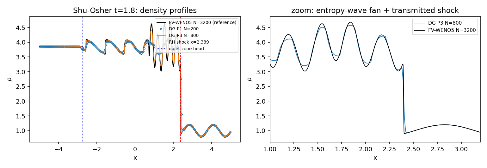
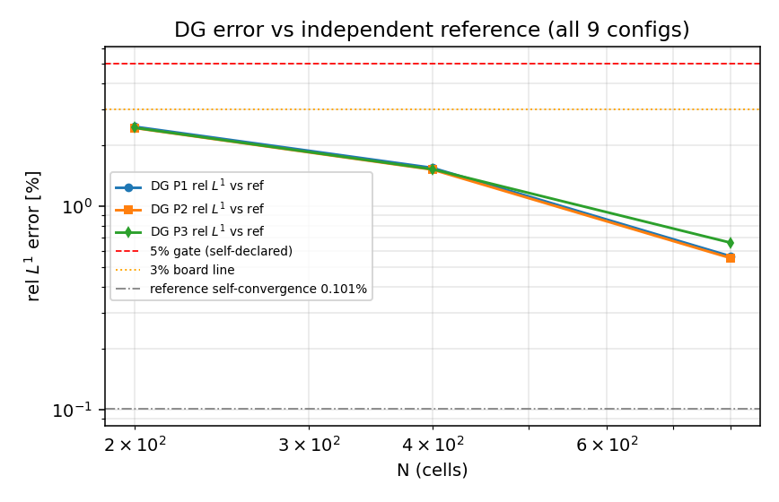

# 交差审计：m15390 CASE-SHU-OSHER（TensorDG 激波-熵波干扰 DG 算例池）

> 审计任务 m15447 · 对象 m15390（status=succeeded，finish 于 2026-11-11 23:31:58Z）
> 被审锚点 `CASE-SHU-OSHER` · 仓 TensorDG · 被审提交 `003f513`（Merge #285 → main）
> 结论：**L3**（三件套与重算均真；L4 被「基准裁判缺席」+「无观测收敛阶」阻断）
> disposition：**approve with findings**（F1–F4 需返修；L3 功能实质成立）

## ① 案例介绍

Shu–Osher (1988) 激波–熵波干扰（JCP 77:439，作为 test case 3 复述于 JCP 83:32；
Jiang & Shu 1996 JCP 126:202 的头号一维算例）：一道 M=3 右行正激波扫过静止正弦密度波，
波后转化为高频熵波/声波扇，无闭式解，只有「波骨架」闭式（激波速度、接触位置、静区头部、总质量守恒）。

| 参数 | 值 | 出处 |
|---|---|---|
| 域 / 膜片 | [-5, 5] / x0=-4 | `tensordg/cases/shock_entropy.py:57-59` |
| 左态 (ρ,u,p) | (3.857143, 2.629369, 10.33333) | `:62`，由 M=3 激波 RH 关系反推并用测试机检（见 ②） |
| 右态 | ρ=1+0.2·sin(5x), u=0, p=1 | `:65-68` |
| γ / t_end | 1.4 / 1.8 | `:56,60` |
| 离散 | DG 模态基 + HLLC 通量 + SSP-RK3，Qiu–Shu WENO 限制器，CFL 0.4 | `tensordg/euler_dg_1d.py:77-160` |
| 阶梯 | P1/P2/P3 × N=200/400/800（9 组）+ CFL 0.1/0.2/0.4 | `benchmarks/shu_osher_case_pool.py:LADDER` |

被审对象是 m15297 的**返修轮 1**：上一轮审计（m15350，report #14416）判「succeeded 但
`test_ladder_artifacts_...` FAIL、ladder 表空、基准未注册」。m15390 声称修复两处驱动缺陷
（整守恒态当密度、merge() 粗化对象错位）并把 9 组阶梯跑完。

## ② 怎么做的（审计手段，全部可复跑）

| # | 手段 | 命令/来源 | 结果 |
|---|---|---|---|
| 1 | 基准裁判（唯一裁判） | `SELECT case_name, metric, tolerance, status FROM tensor_benchmark_cases WHERE anchor_slug='CASE-SHU-OSHER'` | **0 行**（全表 16 行无此锚点）→ 裁判缺席 |
| 2 | 证据清单 sha256 | `artifacts/audit_m15447/build_audit.py:check_manifest` | 19/19 通过，0 失配；3 张 PNG 的路径解析到 `docs/figures/`（清单只存裸文件名） |
| 3 | 报告↔表交叉核对 | metrics.json vs benchmark_ref_vs_got.json | 9 行 × 2 误差列 **0 失配**；两表同源（make_evidence.py 程序化注入） |
| 4 | 单测门 | `pytest tests/test_shu_osher_case_pool.py tests/test_shock_entropy_case.py` | **12 passed / 1 skipped**（skip=ladder 门，因 `runs/` 被 gitignore 未随仓）；把 `runs/shu_osher_case_pool → validation/repro_shu_osher/artifacts` 链上后 ladder 门 **1 passed** |
| 5 | 独立重算（逐位） | `solve_dg_case(ncells=200, degree=1, cfl=0.4)` vs 已提交 npz | x/ρ/ρu/ρE **全部 array_equal=True**，steps 1274=1274，wall 20.1 s（原记录 22.5 s） |
| 6 | 负对照（限制器是否真在干活） | 同 leg `limiter=none` | ρmax 4.5875 vs 4.1376，TV 比 2.19× → 标签非空壳 |
| 7 | 参考解可信度 | FV-WENO5 1600 vs 3200 | 自收敛 rel L1 **0.1010%**，远低于 DG 各档误差 → 误差由 DG 离散主导，不是参考解瓶颈 |
| 8 | 解析锚（闭式，非文献抄录） | `rankine_hugoniot_anchor()` / `exact_mass_budget()` | 静区台面偏差 4.37e-11%、激波前正弦 5.39e-15%、质量 1.85e-06%、激波位 0.336% |

repro_cmd：`bash validation/repro_shu_osher/run_all.sh`（8 进程约 30 min，断点续跑靠 `runs/.../raw/*.npz` 记忆化）。
本单据 ⑤ 只做**单 leg 端到端复跑**，未跑全脚本。

## ③ 计算结果（数字全部程序化读自 `validation/repro_shu_osher/artifacts/metrics.json`）

参考解：独立离散 FV-WENO5/HLLC/SSP-RK3，N=3200（`benchmarks/fv_weno5_1d.py`），比较时把参考**粗化到 DG 网格**（同网格守恒投影）。

| P | N | steps | wall [s] | rel L1 [%] | rel L2 [%] | rel L∞ [%] | ρmax | ρmax vs ref [%] | x_shock | x_shock vs RH [%] | 激波前正弦 [%] | 过 5% |
|---|---|---|---|---|---|---|---|---|---|---|---|---|
| P1 | 200 | 1274 | 22.5 | 2.4615 | 5.2770 | 14.822 | 4.1314 | -11.73 | 2.4064 | 0.7139 | 0.0347 | True |
| P1 | 400 | 2576 | 48.5 | 1.5438 | 3.6584 | 12.441 | 4.3462 | -7.14 | 2.4026 | 0.5537 | 0.0086 | True |
| P1 | 800 | 5174 | 111.4 | 0.5676 | 1.4696 | 10.472 | 4.5677 | -2.41 | 2.4005 | 0.4650 | 0.0021 | True |
| P2 | 200 | 2122 | 35.6 | 2.4260 | 5.2470 | 14.868 | 4.1376 | -11.60 | 2.4068 | 0.7288 | 0.0348 | True |
| P2 | 400 | 4281 | 83.9 | 1.5136 | 3.6126 | 12.385 | 4.3540 | -6.97 | 2.4024 | 0.5473 | 0.0086 | True |
| P2 | 800 | 8607 | 192.8 | 0.5561 | 1.4342 | 10.492 | 4.5712 | -2.33 | 2.4003 | 0.4576 | 0.0021 | True |
| P3 | 200 | 2969 | 65.1 | 2.4322 | 5.2660 | 14.886 | 4.1391 | -11.57 | 2.4071 | 0.7419 | 0.0348 | True |
| P3 | 400 | 5991 | 126.4 | 1.5204 | 3.6096 | 12.415 | 4.3556 | -6.94 | 2.4023 | 0.5418 | 0.0086 | True |
| P3 | 800 | 12049 | 295.4 | 0.6618 | 1.4443 | 10.523 | 4.5729 | -2.30 | 2.4002 | 0.4535 | 0.0020 | True |

解析锚（本算例的闭式骨架）：激波速度 3.549648（与 3c₁=3.549648 一致），
激波位置 x=2.389367，静区头部 x=-2.753107，接触面 x=0.732864；
质量预算 M(0)=12.833818 + 入流 18.255334 = 31.089152。
CFL 0.1/0.2/0.4 的 L1 散布仅 **0.0033 个百分点**（时间步收敛）。

三件套核验（逐项，非叙述）：

| 要件 | 指针 | 判定 |
|---|---|---|
| run_artifacts | `validation/repro_shu_osher/artifacts/raw/*.npz`（13 个）+ `metrics.json` + `profiles.npz`（16 文件已入库，sha256 19/19 通过） | 真 |
| benchmark ref vs got | `validation/repro_shu_osher/benchmark_ref_vs_got.json`（9 组配置，含 ref/got/容差/判定），与 metrics.json 0 失配 | 真（但裁判是自定） |
| repro_cmd 可执行 | `bash validation/repro_shu_osher/run_all.sh`；本单实跑其中 DG P1 N=200 leg，逐位一致 | 真（单 leg；全脚本未端到端跑） |

## ④ 结果图

**图 1** DG 阶梯 vs 独立 FV-WENO5 参考解的密度剖面（t=1.8），竖线为 RH 激波位与静区头部；
右图放大熵波扇与透射激波。N=200 的 P1 与参考在幅值上已重合，差异集中在激波层与熵波尖峰处。

**图 2** 相对 L1 误差–网格（双对数），含自定 5% 门、榜单 3% 线与参考解自收敛线。
P 加密（P1→P3）几乎不改变误差，N 加密 2× 误差降约 1.6–2.7×；参考自收敛线（0.101%）远在曲线下方。

## ⑤ 注意点（findings，按严重度）

| ID | 严重度 | 发现 | 证据 |
|---|---|---|---|
| F1 | **HIGH** | **基准裁判缺席**：`tensor_benchmark_cases` 中 `CASE-SHU-OSHER` **0 行**（全表 16 行）；5% 容差是交付方在 `make_evidence.py:TOLERANCE_PERCENT=5.0` 自定，非平台基准判据 → L4 不可判（与 m15309 REPRO-DG-CKS1998「L4 阻断于基准裁判 0」同一判法） | `SELECT case_name, metric, tolerance, status FROM tensor_benchmark_cases WHERE anchor_slug='CASE-SHU-OSHER'` → 空 |
| F2 | **MEDIUM** | **m15390 无平台报告**：`tensor_reports` 中 `mission_id=15390` **0 行**；最近一份 Shu–Osher 报告是 #14392（mission 15297，22:10，早于本单 23:31 完成，且不含修复后数值 2.4615）。任务 result 提到写过 `/tmp/report.json`（make_evidence.py --report 只落盘不投递），本单以 budget_exhausted+forced_finish 收尾 → 六要素报告欠账；且 `report_owed=false`，守望线不会自动补派 | `SELECT id, mission_id, title FROM tensor_reports WHERE mission_id=15390` → 空；`make_evidence.py:24-28` |
| F3 | MEDIUM | **收敛阶缺失/非单调**：P 加密几乎不降误差（N=200：P1 2.4615%、P2 2.4260%、P3 2.4322%），N=800 时 P3 0.6618% **劣于** P1 0.5676%；文档记录自收敛（P3 400→800 L1 1.215%）但无 Richardson/GCI 外推、无观测阶表 → 「0.66% vs ref」无法与离散误差分离 | `metrics.json:dg_self_convergence`；`docs/reports/shu-osher-dg-case-pool.md:109` |
| F4 | MEDIUM | **报告未显式回答「是否<3%」**：仓内报告以自定 5% 门为口径，全文无 3% 判据口径；按范数逐项看 L1 全过 3%、L2 仅 N=800 过、L∞ 全部 10.5–14.9% 不过（详见 ⑥） | `grep -n "3%" docs/reports/shu-osher-dg-case-pool.md` → 无命中 |
| F5 | LOW | **证据清单不便机检**：`artifacts.sha256.json` 只存裸文件名，3 张 PNG 实际在 `docs/figures/` 而 `artifacts/` 无副本，`sha256sum -c` 不能直接跑，需按解析规则重映射（本次 19/19 全过，属可读性问题不是失配） | `['shu_osher_case_pool_cfl.png', 'shu_osher_case_pool_convergence.png', 'shu_osher_case_pool_profiles.png']` |
| F6 | INFO | 该单以 `fail_stage=budget_exhausted+forced_finish` 结束，`server_quality_audit.gate_valid=false / gate_missing_warning=true`，succeeded 来自 `TP_AUTO_APPROVE_DEV_ACCEPTANCE` 自动批准而非质量门 → 「succeeded」≠「质量已核」 | `tensor_dev_missions.result`（id=15390） |

**未跑的检查（如实记 not_run）**：① `run_all.sh` 全脚本端到端复跑（30 min×8 进程）—— 已递交集群 cj1125 探 torch 可用性，未等结果；
② 第三方求解器交叉验证（本机无 CLAWPACK/Athena++，参考解与 DG 同仓同作者，仅「不同离散」级别独立）；
③ 文献图像数值比对（1988/1989 论文无 PDF 可达，交付方亦标 WITHHELD，本审计不重抄）；
④ GPU 路径与 P4+ 高阶未测。

**局限**：本审计接受「解析 RH 骨架 + 同网格守恒投影比较」作为误差度量，未重造第四个解算器；
fig1/fig2 由已提交 npz 直接绘制（非重算），与 ③ 表同源。

## ⑥ 误差判定（逐项，是否 <3%）

| 配置 | rel L1 [%] | rel L2 [%] | rel L∞ [%] | L1<3% | L2<3% | L∞<3% |
|---|---|---|---|---|---|---|
| DG P1 N=200 | 2.4615 | 5.2770 | 14.822 | ✔ | ✘ | ✘ |
| DG P1 N=400 | 1.5438 | 3.6584 | 12.441 | ✔ | ✘ | ✘ |
| DG P1 N=800 | 0.5676 | 1.4696 | 10.472 | ✔ | ✔ | ✘ |
| DG P2 N=200 | 2.4260 | 5.2470 | 14.868 | ✔ | ✘ | ✘ |
| DG P2 N=400 | 1.5136 | 3.6126 | 12.385 | ✔ | ✘ | ✘ |
| DG P2 N=800 | 0.5561 | 1.4342 | 10.492 | ✔ | ✔ | ✘ |
| DG P3 N=200 | 2.4322 | 5.2660 | 14.886 | ✔ | ✘ | ✘ |
| DG P3 N=400 | 1.5204 | 3.6096 | 12.415 | ✔ | ✘ | ✘ |
| DG P3 N=800 | 0.6618 | 1.4443 | 10.523 | ✔ | ✔ | ✘ |

**显式回答「是否 <3%」**：

- 全场相对 **L1**：**是**（9/9 组，最差 2.4615% < 3%）。
- 全场相对 **L2**：**否**（仅 N=800 三档 <3%，最差 5.277%）；**L∞**：**否**（10.49%–14.89%，最差在 N=200 P3）。
- 关键量—激波位置 vs Rankine–Hugoniot：**是**（0.336%（参考解）～0.714%（N=200 P1））。
- 关键量—静区台面 ρ=3.857143：**是**（4.37e-11%）。
- 关键量—总质量守恒：**是**（1.85e-06% of initial）。
- 关键量—激波前未扰动正弦：**是**（5.39e-15%（参考）/ 0.0021–0.0347%（DG））。
- 关键量—**密度尖峰 ρmax**（最挑剔的量）：**否**在粗网格（N=200 P1：-11.73% vs 参考 4.6804），
  **是**在 N≥400（N=800 P3：-2.30%）。
- **裁判口径声明**：以上 3% 线是榜单口径，交付方自定门是 5%；平台基准表对本锚点 0 行，
  故「基准误差是否达标」在机器意义上是**未判（WITHHELD，裁判缺席）**，只能给出内部一致性与解析锚的判定。

## 判级

- L0 文档 ✅（`docs/reports/shu-osher-dg-case-pool.md` 六段 + 三张图）
- L1 数学/单元验证 ✅（RH 反推 <1e-6、WENO5 重构观测阶 >4、质量预算恒等式、参考解满足闭式锚）
- L2 独立功能实现 ✅（`tensordg/cases/shock_entropy.py:80-118` 真跑核心解算器；`benchmarks/fv_weno5_1d.py` 独立 FV；CLI `python -m benchmarks.shu_osher_case_pool`）
- L3 系统集成 ✅（`tensordg/cases/__init__.py:8` 导出；`benchmarks/shu_osher_case_pool.py`、`benchmarks/shu_osher_1d.py` 调用；pytest 门控）
- L4 基准验证 ❌（裁判 0 行 + 无观测收敛阶/Richardson + L∞ 10.5% + 文献表 WITHHELD）
- L5 ❌

**最终：L3。**
