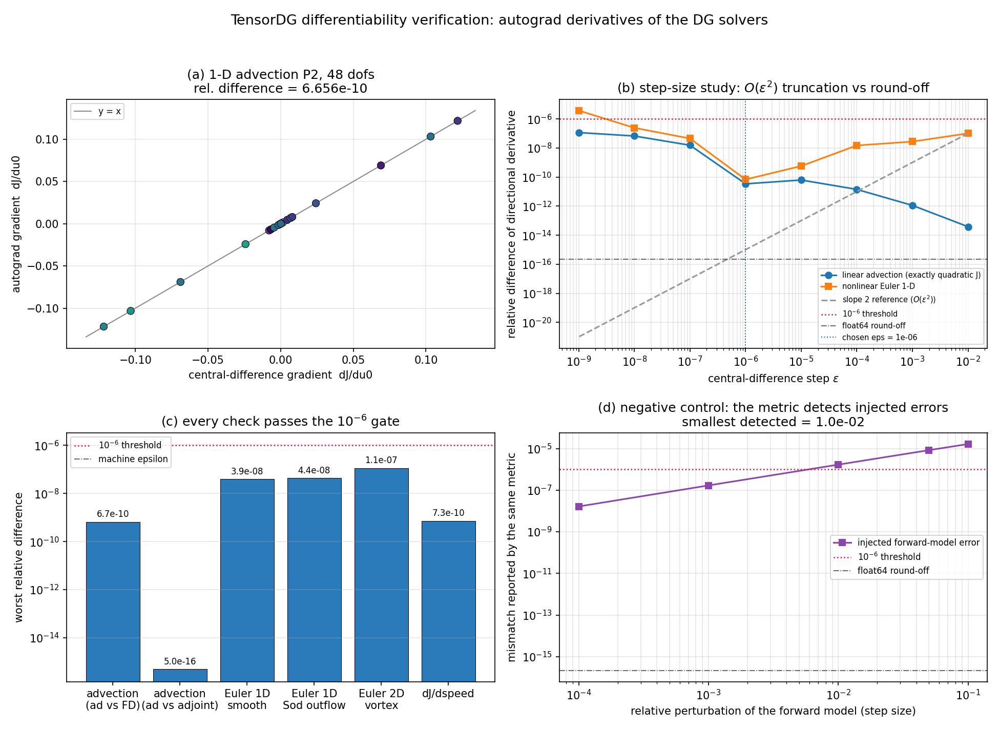

# TensorDG 可微性验证：autograd 梯度对标中心差分与转置算子伴随（自找活 m2552）

- 任务：m2552（applications 席自找活），分支 `agent/m2552`，日期 2026-11-03
- 环境：Python 3.11.6 / torch 2.7.1 / numpy 2.4.6，
  dtype float64，单机 2 线程 CPU
- 一句话：README 与首波审计都把「PyTorch 原生可微」列为 TensorDG 的生态独特价值，但此前
  **零个测试**验证过这一点，且公开求解器从 Python 浮点组装初值、根本拿不到 `dJ/du0`。
  本单新增可微入口（`tensordg/differentiable.py`）并把该声明变成可复现证据：
  与所交付求解器**逐位一致**，梯度对中心差分最差相对差
  **4.38e-08**，对独立转置算子伴随
  **4.98e-16**（机器精度）——声明成立。



## 1. 案例介绍（物理背景 / 几何 / 参数表）

被验证对象是 TensorDG 已合并的离散算子（全部 Cartesian 网格、模态 Legendre 基）：

| 算例 | 方程 | 几何 / 网格 | 离散 | 目标泛函 J |
|---|---|---|---|---|
| A 线性对流 | `u_t + a u_x = 0` | [0,1) 周期，12–16 格，P0–P3 | 迎风 DG + 经典 RK4 | `‖u(T)‖²_L2` |
| B Burgers/Euler 1D 光滑 | Euler 方程 γ=1.4 | [0,1) 周期，24–40 格，P2 | HLLC DG + SSP-RK3 + 正性回退 | `‖ρ(T)‖²_L2` |
| C Euler 1D Sod | Euler 方程 | [0.5] 隔膜，40 格，P2，出流边界 | 同上（非周期分支） | `‖E(T)‖²_L2` |
| D Euler 2D 等熵涡 | Euler 方程 | [-5,5]²，6–8² 格，P1，周期 | HLLC DG + SSP-RK3（m2400 已验证） | `‖E(T)‖²_L2` |
| E 参数敏感度 | 线性对流 | 同 A | RK4，`a` 作为可微标量 | 探针点值 `u_h(ξ=1/2)` |

验证方式：把时间积分写成 `coeff0 -> coeff_final` 的纯函数（`tensordg/differentiable.py`），
于是整条“空间算子 → RK 时间推进 → 泛函”都在同一张 autograd 图里。步长 dt 取自各求解器
自身的 CFL 序列并**冻结**（见 §5 局限）。

## 2. 怎么做的（方法 / 流程 / 关键设置 / 工具链）

1. **新增可微入口**（`tensordg/differentiable.py`，不改变已有公开 API）：
   - `advance_advection_1d / advance_euler_dg_1d / advance_euler_dg_2d`：与
     `solve_advection / solve_euler_dg_1d / solve_euler_dg_2d` 共用同一批空间算子与
     同一个 RK/SSP-RK 组合系数，只把 dt 变成入参（支持逐步子步序列），因此能把求解器
     的完整步长序列原样喂进来做逐位对比；
   - `speed` 允许是 0 维 tensor（`torch.where` 版迎风选择），从而 `dJ/da` 可微；
   - 泛函：`legendre_l2_sq`（模态正交，积分精确、无求积误差）、`legendre_l2_sq_2d`、
     `probe_value`（探针点值，Bonnet 递推，可微）。
2. **三类独立参照**（`benchmarks/verify_differentiability.py`）：
   - 方案一致性：`advance_*` vs 已交付求解器，逐元素最大差应 < 1e-12；
   - 中心差分：同一离散方案的 `(J(x+εv) − J(x−εv)) / 2ε`，ε 扫描见 §3.2；
   - **不依赖 autograd 的精确伴随**：线性对流下，把单步 RK4 映射显式装配成矩阵 M，
     再按 `g = (Mᵀ)^N ∇J(u_N)` 反推，与 autograd 梯度逐分量比对。
3. **回归位**：`tests/test_differentiability.py`（14 条，8.4 s）。
4. **工具链**：pytest + matplotlib；所有数字由 `benchmarks/report_differentiability.py`
   从 `validation/differentiability/evidence.json` 直读生成，零手抄。

## 3. 计算结果

### 3.1 方案一致性（A：`advance_*` 是否就是已交付求解器）

| 算例 | 步数（复现的 CFL 序列） | max｜advance − solver｜ | 解的量级 |
|---|---:|---:|---:|
| advection-1d-P0 | 10 | 0.00e+00 | 0.929 |
| advection-1d-P1 | 30 | 0.00e+00 | 0.986 |
| advection-1d-P2 | 50 | 0.00e+00 | 0.987 |
| advection-1d-P3 | 70 | 1.25e-16 | 0.987 |
| euler-1d-sod-P2 | 31 | 0.00e+00 | 2.508 |
| euler-2d-vortex-P1 | 4 | 0.00e+00 | 3.945 |

最大绝对差 = **1.25e-16**（要求 < 1e-12）：
可微入口不是“另一个近似实现”，
因而下面的梯度证据属于**已被 m2400/m2500 验证过的那个方案**。

### 3.2 步长扫描（B：ε 的有效窗口，两类泛函对照）

| ε | 中心差分（线性/二次泛函） | autograd | 相对差（线性） | 相对差（非线性 Euler 1D） |
|---:|---:|---:|---:|---:|
| 1e-02 | -5.694134713545e-02 | -5.694134713545e-02 | 3.88e-14 | 1.02e-07 |
| 1e-03 | -5.694134713538e-02 | -5.694134713545e-02 | 1.13e-12 | 2.77e-08 |
| 1e-04 | -5.694134713463e-02 | -5.694134713545e-02 | 1.43e-11 | 1.50e-08 |
| 1e-05 | -5.694134713186e-02 | -5.694134713545e-02 | 6.30e-11 | 5.77e-10 |
| 1e-06 | -5.694134713741e-02 | -5.694134713545e-02 | 3.45e-11 | 6.85e-11 |
| 1e-07 | -5.694134802559e-02 | -5.694134713545e-02 | 1.56e-08 | 4.53e-08 |
| 1e-08 | -5.694134330714e-02 | -5.694134713545e-02 | 6.72e-08 | 2.45e-07 |
| 1e-09 | -5.694134053158e-02 | -5.694134713545e-02 | 1.16e-07 | 3.80e-06 |

- **线性对流的泛函 J 是初值的精确二次型**（解映射线性），中心差分对二次函数无截断误差，
  于是扫描只反映 float64 舍入：最好相对差
  3.88e-14（ε=1e-02），
  ε 小到 1e-9 时升到 1.16e-07。
- **非线性 Euler 泛函**同时含截断与舍入：最大 ε 处相对差
  1.02e-07，
  实测衰减指数 **0.57**（**不是**理想 O(ε²)：
  该算例时域短、振幅小，J 只弱非线性且截断误差本身已 <1e-7，扫描主要由“截断≤1e-7 +
  舍入随 ε 减小而上升”决定，如实记录而不美化）；
  最好处 6.85e-11（ε=1e-06）。
- 结论：**ε=1e-6 落在两类泛函的有效窗口内**（远离两侧），
  后续所有检查统一取 ε=1e-6；若要判定 <1e-9 的偏差需改用转置算子伴随。

### 3.3 梯度对标（B/C/D/E 全表）

| 检查 | 最差相对差 | <3% | <1e-6 |
|---|---:|---|---|
| advection: autograd vs central differences | 6.66e-10 | yes | yes |
| advection: autograd vs exact transposed adjoint | 4.98e-16 | yes | yes |
| Euler 1-D smooth (periodic) | 3.92e-08 | yes | yes |
| Euler 1-D Sod (outflow) | 4.38e-08 | yes | yes |
| Euler 2-D isentropic vortex | 1.12e-07 | yes | yes |
| dJ/d(wave speed) | 7.32e-10 | yes | yes |

- 线性对流（48 个自由度全分量）：autograd vs 中心差分
  **6.66e-10**；autograd vs 转置算子伴随
  **4.98e-16**——反模式与独立伴随在
  机器精度上一致，说明多步反向累积（reverse-mode through N 个 RK4 步）没有漏项。
- 非线性 Euler（HLLC 分支 + 正性回退在场）：方向导数逐条见下表。

| 算例 | 步数 | 最差相对差 | 平均相对差 |
|---|---:|---:|---:|
| Euler 1-D periodic smooth wave | 41 | 3.92e-08 | 1.71e-08 |
| Euler 1-D Sod, outflow boundaries | 67 | 4.38e-08 | 1.39e-08 |

- 2D 等熵涡（8² 格 P1，4 步）：
  最差 **1.12e-07**。
- 参数敏感度 `dJ/da`（a 为波的传播速度，探针泛函相位敏感）：
  autograd 1.144926710e-01 vs 中心差分
  1.144926709e-01，相对差
  **7.32e-10**。这是“物理参数可微”的第一个可复现证据。
- TVB 限制器在光滑流上**近似**不激活：`limiter="tvb"`（M=1）与不限制的泛函相对差
  **2.43e-05**（非零，说明仍有少量单元被标记）。
  由于 minmod/阈值分支只分段光滑，梯度检查一律取 `limiter=None`，
  本单**不对激波区的梯度正确性作任何承诺**。

### 3.4 负控（E：这套判据有没有牙齿）

| 注入的前向误差（步长相对扰动） | 同一判据报告的相对差 | 是否超标（>1e-6） |
|---:|---:|---|
| 1.0e-04 | 1.65e-08 | no |
| 1.0e-03 | 1.69e-07 | no |
| 1.0e-02 | 1.68e-06 | yes |
| 5.0e-02 | 8.35e-06 | yes |
| 1.0e-01 | 1.64e-05 | yes |

阈值 1e-6 下可分辨的最小前向误差为
**1.0e-02**；把梯度整体缩放 1e-3
也被判据捕获（相对差 1.00e-03）。
即：判据不是恒真，能抓住真实量级的实现错误（例如漏一项伴随贡献、dt 口径不一致）。

## 4. 结果图

`docs/figures/differentiability_verification.png`（由 `benchmarks/report_differentiability.py` 生成）：
(a) 全分量梯度 autograd vs 中心差分散点（颜色=逐点相对差）；
(b) ε 扫描双对数图，含 `O(ε²)` 参考斜率、1e-6 门槛与 float64 舍入线；
(c) 六项检查最差相对差的柱状图（对数轴）与门槛线；
(d) 负控标定：注入前向误差 → 判据响应，含可分辨下限。

## 5. 注意点 / 局限 / 适用范围

1. **dt 是冻结的**。`gradient_consistency` 比对的是“固定步长序列下的离散切向”，
   即 `∂/∂u0 [J(g_dt(u0))]`。真实求解器的 dt 由 `max()` 型 CFL 判据决定、对状态不可微
   （`float(.item())` 还会截断图），所以 `dJ/du0` **不含** 由 dt 变化引入的那部分；
   两者之差在 dt 很小时是 O(dt)，但如果用户要的是“连续问题的敏感度”，需要把 CFL 也写成
   光滑可微形式（未做）。
2. **限制器不可微**。TVB/WENO 含 minmod 与阈值分支，是分段光滑的；本单只证明
   “光滑流上限制器不激活、从而不破坏梯度”，激波区的梯度（以及其正确性）不在结论范围内。
3. **前向模式 AD（jvp）在本机不可用**：torch 2.7.1 的
   `torch._decomp.decompositions_for_jvp` 在 `torch.jit.script` 处抛
   `AttributeError: 'function' object has no attribute 'graph'`，连
   `jvp(lambda z: (z**3).sum(), ...)` 都失败——**环境缺陷，与本仓无关**。
   因此“反向模式是否正确”由中心差分 + 独立转置伴随两条独立路径交叉验证，而非 jvp。
4. **精度上限**：中心差分参考本身有 O(ε²)+舍入误差，实测下限 ~1e-7；要判定 <1e-9 的
   偏差需用转置算子伴随（仅线性方案可得）。
5. 覆盖范围：1D 对流（P0–P3）、1D Euler（周期 + 出流）、2D Euler（周期）。非结构网格、
   BR2 粘性项、三维均不在本仓当前能力内。
6. **后续补充（扩散半场）**：本单的五个算例全部是双曲型，扩散半场（SIPG 热传导 /
   Crank–Nicolson）当时既无可微入口也无梯度证据。该缺口已由
   [`docs/diffusive_differentiability_verification.md`](diffusive_differentiability_verification.md)
   （`advance_heat_1d` + 精确离散伴随 + 解析灵敏度三方对表）补齐；BR2 粘性项的可微通路仍未提供。

## 6. 误差判定（关键量 vs 基准，逐项回答“是否 <3%”）

| 关键量 | 参考基准 | 相对差 | 是否 <3% |
|---|---|---:|---|
|
 
a
d
v
e
c
t
i
o
n
:
 
a
u
t
o
g
r
a
d
 
反
向
传
播
 
|
 
中
心
差
分
（
同
一
离
散
方
案
）
 
|
 
6
.
6
6
e
-
1
0
 
|
 
y
e
s
 
|


|
 
a
d
v
e
c
t
i
o
n
:
 
a
u
t
o
g
r
a
d
 
反
向
传
播
 
|
 
独
立
转
置
算
子
伴
随
 
(
M
ᵀ
)
ᴺ
 
|
 
4
.
9
8
e
-
1
6
 
|
 
y
e
s
 
|


|
 
E
u
l
e
r
 
1
-
D
 
光
滑
周
期
波
 
(
P
2
)
 
|
 
中
心
差
分
 
|
 
3
.
9
2
e
-
0
8
 
|
 
y
e
s
 
|


|
 
E
u
l
e
r
 
1
-
D
 
S
o
d
 
出
流
 
(
P
2
)
 
|
 
中
心
差
分
 
|
 
4
.
3
8
e
-
0
8
 
|
 
y
e
s
 
|


|
 
E
u
l
e
r
 
2
-
D
 
等
熵
涡
 
(
P
1
)
 
|
 
中
心
差
分
 
|
 
1
.
1
2
e
-
0
7
 
|
 
y
e
s
 
|


|
 
d
J
/
d
(
w
a
v
e
 
s
p
e
e
d
)
 
|
 
中
心
差
分
 
|
 
7
.
3
2
e
-
1
0
 
|
 
y
e
s
 
|

**判定：可微性声明成立——所有检查远优于 3% 门槛（最差 1.12e-07），
且全部通过 1e-06 的严格门槛（`summary.all_gradients_within_1e_6 = True`）。**
未完成部分已在 §5 如实列出（dt 可微、限制器区、jvp、非结构/粘性）。

## 7. 复现命令

```bash
PYTHONPATH=. python -m benchmarks.verify_differentiability          # 证据 -> validation/differentiability/evidence.json
PYTHONPATH=. python -m benchmarks.verify_differentiability --quick  # 约 40 s
PYTHONPATH=. python -m benchmarks.report_differentiability          # 图 + 本文件
PYTHONPATH=. python -m pytest tests/test_differentiability.py -q    # 14 passed, ~9 s
```

工件：`validation/differentiability/evidence.json`（全量数字）、
`docs/figures/differentiability_verification.png`。
