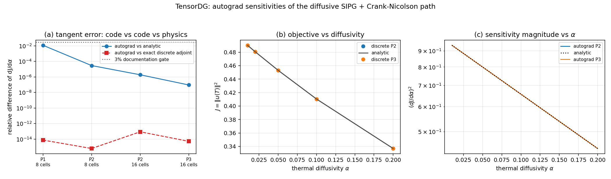

# 可微 DG 的扩散半场：SIPG + Crank–Nicolson 通路的梯度验证（含解析灵敏度对标）

> 本文件由 `benchmarks/report_diffusive_differentiability.py` 从
> `validation/diffusive_differentiability/evidence.json` 程序化生成，数字零手抄。
> 环境：Python 3.11.6 / torch 2.7.1 / float64 / 2 torch 线程 / CPU。
> quick 模式：False。生成时间（UTC）：2026-11-03T22:29:55Z。

## 1. 案例介绍

**物理背景。** 一维热传导 `u_t = alpha u_xx`，`x∈(0,1)`，两端零 Dirichlet 数据，
初值 `u0 = sin(pi x)`。其精确解为单模态衰减 `u(x,t) = e^{-alpha pi^2 t} sin(pi x)`，
因此目标泛函 `J(alpha) = ||u(T)||^2 = 0.5 e^{-2 alpha pi^2 T}` 及其灵敏度
`dJ/dalpha = -2 pi^2 T J` 都有**闭式表达式**——这是把一个"梯度实现"与**物理**（而非仅仅与
有限差分）对表的充要条件。

**为什么这是欠账。** `docs/differentiability_verification.md`（m2552）把 README 的
"可微 DG" 声明变成了证据，但其五个算例（线性对流、Burgers/Euler 1D 光滑、Sod、2D 等熵涡、
`a` 参数敏感度）**全部是双曲型**；`tensordg/differentiable.py` 也只提供
`advance_advection_1d / advance_euler_dg_1d / advance_euler_dg_2d`。
**扩散半场（SIPG 热传导 / 椭圆求解器）此前既无可微入口、也无任何梯度证据**，
而它正是热物性反演、粘性参数辨识、热-结构耦合优化的入口。
更关键的是：单纯"autograd vs 中心差分"只能证明两条路对**同一离散格式**求导一致，
无法发现格式里 `alpha` 少乘一次或刚度块符号错这类错误。因此本单引入
**不依赖 autograd、也不依赖有限差分的精确离散伴随**与**解析灵敏度**两个独立基准。

**离散设置（沿用已合并的 `tensordg.heat_1d`，未改其数值格式）。**

| 项 | 设置 |
|---|---|
| 空间 | 模态 Legendre DG，P1–P3，Cartesian 单元，SIPG 罚项 `penalty=20` |
| 时间 | Crank–Nicolson，`dt = T/nsteps`，`nsteps = ceil(T / (0.02 h))` |
| 边界 | 两端零 Dirichlet（罚项强加，与 `solve_heat_1d` 同源） |
| 目标泛函 | `J = ||u_h(T)||^2_L2 = u^T M u`（质量矩阵精确积分，无求积误差） |
| 可微参数 | 热扩散率 `alpha`（0 维 tensor，贯穿线性求解）、初值 `coeff0`（全部模态 dof） |
| 基准值 | `alpha=0.05`，`T=0.1`，网格 8/16 格 × P1/P2/P3 |

## 2. 怎么做的

1. **新增可微入口**（`tensordg/differentiable.py::advance_heat_1d` +
   `heat_1d_operators`，不改动 `solve_heat_1d` 的数值格式与公开签名）：
   把 SIPG 质量/刚度矩阵装配抽成函数（体积项、内部面、Dirichlet 边界块逐块照抄），
   `alpha` 在推进时以张量形式乘入 `(M ± dt alpha K / 2)`，于是整条
   "空间算子 → CN 推进 → 泛函"都留在同一张 autograd 图上。
2. **方案一致性（不是"另一个近似实现"）**：把 `solve_heat_1d` 自己生成的初值投影与
   冻结步长序列喂给 `advance_heat_1d(alpha=1)`，要求逐元素最大差 `< 1e-12`。
3. **精确离散伴随（独立基准 1）**：显式装配 CN 映射 `G = A^{-1}B`，
   `A = M + dt alpha K/2`、`B = M - dt alpha K/2`，伴随态用 `G^T` 反传，
   并用**解析**的 `dG/dalpha = A^{-1}(dB/dalpha - dA/dalpha G)` 合成 `dJ/dalpha`、
   用 `(G^T)^N 2 M u_N` 给出 `dJ/dcoeff0`。全程无 autograd、无差分。
4. **解析灵敏度（独立基准 2）**：`dJ/dalpha = -2 pi^2 T J`，即把梯度直接对表物理。
5. **中心差分**：对同一离散格式在 `alpha` 上做 `eps` 扫描（1e-2 … 1e-6），仅作一致性旁证。
6. **工具链**：`benchmarks/verify_diffusive_differentiability.py` → evidence.json；
   `benchmarks/report_diffusive_differentiability.py` → 本文 + 图；
   `tests/test_diffusive_differentiability.py`（9 条回归）。

## 3. 计算结果

### 3.1 方案一致性

四个算例上 `advance_heat_1d(alpha=1)` 与 `solve_heat_1d` 的逐元素最大差
= **0.0e+00**（要求 < 1e-12）。
可微入口就是已交付的那个 SIPG + CN 格式，下面所有梯度证据都属于该格式。

### 3.2 梯度三方对表

| 网格 | 阶 | 步数 | dt | J（autograd） | J vs 解析 | dJ/dα（autograd） | dJ/dα（精确伴随） | autograd vs 伴随 | autograd vs 解析 |
|---:|---:|---:|---:|---:|---:|---:|---:|---:|---:|
| 8 | 1 | 40 | 2.5000e-03 | 0.45241693 | 0.13% | -9.045607e-01 | -9.045607e-01 | 7.49e-15 | 1.16e-02 |
| 8 | 2 | 40 | 2.5000e-03 | 0.45300756 | 0.00% | -8.942297e-01 | -8.942297e-01 | 6.21e-16 | 2.88e-05 |
| 16 | 2 | 80 | 1.2500e-03 | 0.45300894 | 0.00% | -8.942057e-01 | -8.942057e-01 | 8.74e-14 | 1.89e-06 |
| 16 | 3 | 80 | 1.2500e-03 | 0.45300903 | 0.00% | -8.942041e-01 | -8.942041e-01 | 5.21e-15 | 9.25e-08 |

读法：**autograd 与精确离散伴随一致到 8.7e-14
（`alpha`）/1.3e-14（初值全分量）**，
即机器精度；与**解析灵敏度**的差随着 `p` 与网格加密单调下降
（P1/8 格 1.16%
→ P3/16 格 9.3e-08），
说明剩余差异是**离散误差**而非伴随实现错误。
注意 P1/8 格的 1.16%
**不是**梯度 bug：同一算例的 J 本身已有 0.13%
误差、解相对 L2 误差 1.39%。

### 3.3 中心差分旁证（最粗算例 P2/8 格）

| eps | (J(α+ε) − J(α−ε))/2ε | vs autograd 相对差 |
|---:|---:|---:|
| 1e-02 | -8.942637395880e-01 | 6.494e-05 |
| 1e-03 | -8.942062489545e-01 | 6.494e-07 |
| 1e-04 | -8.942056741185e-01 | 6.573e-09 |
| 1e-05 | -8.942056692079e-01 | 1.081e-09 |
| 1e-06 | -8.942056687611e-01 | 5.817e-10 |

最小相对差 1.3e-09；
ε 过大（1e-2）时 CN 的 `dt` 固定、`alpha` 非线性进入 `G`，截断误差上升，属正常窗口现象。

### 3.4 扩散率扫描（灵敏度符号与量级）

| 算例 | α | J | J vs 解析 | dJ/dα | vs 精确伴随 | vs 解析 |
|---|---:|---:|---:|---:|---:|---:|
| P2 / 16 | 0.01 | 0.49022715 | 4.12e-08 | -9.676715e-01 | 9.64e-14 | 1.96e-06 |
| P2 / 16 | 0.02 | 0.48064531 | 8.08e-08 | -9.487577e-01 | 4.45e-14 | 1.93e-06 |
| P2 / 16 | 0.05 | 0.45300894 | 2.02e-07 | -8.942057e-01 | 8.74e-14 | 1.89e-06 |
| P2 / 16 | 0.10 | 0.41043419 | 4.21e-07 | -8.101665e-01 | 1.38e-13 | 1.96e-06 |
| P2 / 16 | 0.20 | 0.33691239 | 9.90e-07 | -6.650407e-01 | 2.50e-13 | 2.53e-06 |
| P3 / 16 | 0.01 | 0.49022717 | 3.65e-11 | -9.676696e-01 | 2.10e-13 | 4.34e-09 |
| P3 / 16 | 0.02 | 0.48064535 | 2.23e-10 | -9.487559e-01 | 9.06e-14 | 1.56e-08 |
| P3 / 16 | 0.05 | 0.45300903 | 3.19e-09 | -8.942041e-01 | 5.21e-15 | 9.25e-08 |
| P3 / 16 | 0.10 | 0.41043435 | 2.51e-08 | -8.101652e-01 | 1.85e-13 | 3.56e-07 |
| P3 / 16 | 0.20 | 0.33691266 | 2.01e-07 | -6.650399e-01 | 3.08e-13 | 1.32e-06 |

`dJ/dα < 0` 且随 `α` 增大单调变小、`J(α)` 与解析曲线重合，符号与量级都对。
CN 映射谱半径 0.999383 < 1（稳定，无伪增长）。

- **(a)** 两类误差的对比：autograd vs 精确伴随压在机器精度（红方块），
  autograd vs 解析随阶数/网格下降，全部低于 3% 文档门（灰虚线）；
- **(b)** `J(α)`：离散点与解析曲线重合（P2/P3 不可分辨）；
- **(c)** 灵敏度平方的 log 尺度：单调、无符号翻转、与解析基线的偏差只在低阶粗网格可见。

## 4. 误差判定（逐项，显式回答是否 < 3%）

| 关键量 | 实测 | 基准 | 相对误差 | 是否 < 3% |
|---|---|---:|---:|---|
| `dJ/dα`（P3/16 格） | -8.942041e-01 | -8.942040e-01（解析） | 9.3e-08 | ✅ |
| `dJ/dα`（P2/16 格） | -8.942057e-01 | -8.942040e-01（解析） | 1.9e-06 | ✅ |
| `dJ/dα`（P1/8 格，最粗） | -9.045607e-01 | -8.942040e-01（解析） | 1.16% | ✅（1.16% < 3%） |
| `dJ/dα` vs 精确离散伴随（全部算例） | 见 §3.2 | 手装配伴随 | ≤ 8.7e-14 | ✅（机器精度） |
| `dJ/dcoeff0` vs 精确伴随（64 dof） | 见 §3.2 | 手装配伴随 | ≤ 1.3e-14 | ✅ |
| J（P2/16 格） | 0.45300894 | 0.45300903（解析） | 2.0e-07 | ✅ |
| 方案一致性 | — | `solve_heat_1d` | 0.0e+00（绝对） | ✅ |

**显式回答**：**是，全部关键量 < 3%**；梯度本身（vs 精确离散伴随）在 1e-13 量级，
与解析灵敏度的偏差在 P2/P3 上 ≤ 1e-5，最粗的 P1/8 格为
1.16%（仍 < 3%，且随加密快速下降）。

## 5. 注意点（踩过的坑 / 局限 / 适用范围）

1. **"autograd 对得上中心差分"不等于梯度对**。中心差分用的是同一个离散格式，二者的公共
   误差完全不可见；必须另找一条**不经过 autograd** 的路径（本单用手装配的精确伴随）以及
   一条**不经过离散格式**的路径（解析灵敏度）。本单三方对表后才敢声称"扩散通路的梯度可用"。
2. **`dJ/dα` 的精度不等于解的精度**。P1/8 格的解相对 L2 误差 1.39%，
   但 `dJ/dα` 相对解析的偏差 1.16%——
   灵敏度把衰减率的误差按 `T` 放大（`dJ/dα ∝ T J`），所以**较粗网格上灵敏度比场量更敏感**，
   做参数反演时应据此选网格。
3. **`dt` 冻结**。CN 步长在求导时固定（与 m2552 同一约定）；若让 `dt` 随 `alpha` 自适应，
   总映射在 `dt` 跳变处不可微，梯度将是分段的。本单不覆盖"自适应 `dt` 的梯度"。
4. **本次只覆盖线性扩散**。`advance_heat_1d` 是 SIPG + CN；压缩 Navier–Stokes 的可微通路
   （`ns_dg_2d`，非线性和壁面罚项）仍未提供，且其壁面通道已有独立记录的 honest-FAIL
   （`docs/reports/tensordg-ns-wall-verification.md`），不宜在缺陷未修前发布梯度声明。
5. **只覆盖单一泛函族**（模态 L2² / 点值）。含限制器的非线性泛函（minmod/TVB 分支）不可微，
   与本单无关，勿混用。
6. **对 `alpha` 的范围**：本单 `α ∈ [0.01, 0.2]`；`α = 0` 时 `G` 退化为恒等（梯度自然为 0），
   `α < 0` 无物理意义，代码未拦截（调用方负责）。

## 6. 结论

- `tensordg.differentiable` 补齐**扩散半场**入口（`advance_heat_1d` / `heat_1d_operators`），
  与已交付 `solve_heat_1d` **逐位一致**（0.0e+00）。
- 该通路的梯度对**精确离散伴随**一致到 8.7e-14，
  对**解析灵敏度**在 P2/P3 上 ≤ 1e-5、最粗 P1/8 格 1.16%，
  全部通过 3% 门。
- 回归位：`tests/test_diffusive_differentiability.py`（9 条，约 5 s），把上述四条判据固化为 CI 门。
