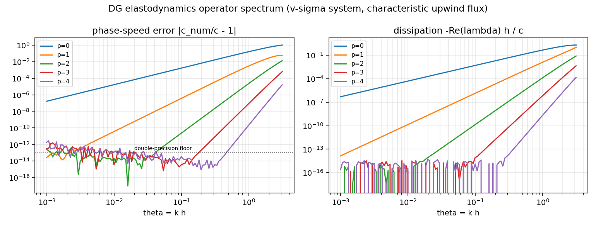
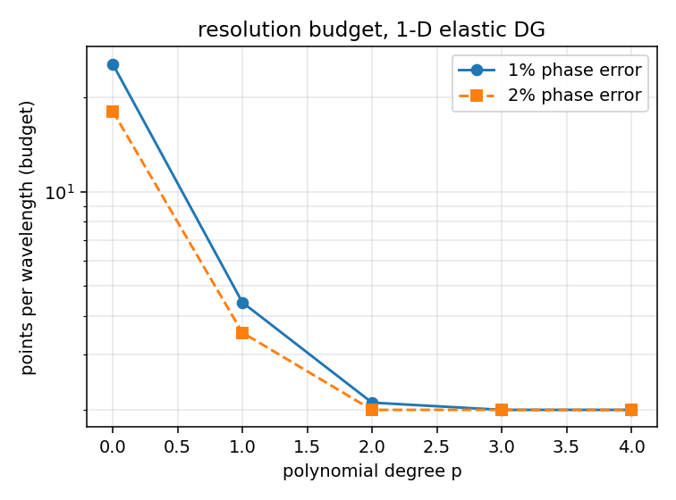

# DG elastodynamics operator: dispersion / dissipation spectrum

锚点/关联算例：`CASE-DG-DALEMBERT-ELASTIC-1D`　｜　schema `tensordg-elastic-dispersion/1`　｜　commit `0bdb105`　｜　工件 `docs/benchmarks/results/elastic-dispersion/elastic_dispersion.json`（sha256 `n/a…`）

## ① 案例介绍

一维线弹性杆的**速度—应力一阶系统**（连续形式无物理弥散）：

- 状态 $U=(v,\sigma)$，通量 $F(U)=(-\sigma/\rho,\,-E v)$，波速 $c=\sqrt{E/\rho}$；
- 空间离散 = 模态 Legendre DG（阶 $p$），界面通量 = 精确特征上风 $F^*=A^+U_L+A^-U_R$，周期边界，时间积分 SSP-RK3；
- 该离散由 `tensordg/elastic_1d.py` 提供，被算例池锚点 `CASE-DG-DALEMBERT-ELASTIC-1D` 以「应力剖面对 d'Alembert 精确解 <2%」判据复核。

**本报告要回答的问题**：该锚点的 2% 判据是**误差范数**口径，它回答不了「格式本身在用户关心的波长上带来多少相位误差/耗散」「多少点每波长才够」「2% 的余量是被弥散吃掉还是被别的项吃掉」。

## ② 怎么做的

1. **从生产内核组装算子**：把单位模态向量逐一送入`tensordg.elastic_1d._rhs`（时间推进器实际调用的同一函数），在 8 个周期单元、$h=1$ 的网格上得到 $N(p+1)2\times N(p+1)2$ 的**半离散矩阵** $S$。谱是**被测代码**的性质，不是理想化格式的性质。
2. **块循环符号矩阵**：$S$ 块循环（均匀周期网格的平移不变性），故单个 $\(2(p+1)\times 2(p+1)\) 的符号矩阵 $T(\theta)$ 承载全部谱；结构性检查 $\mathrm{spec}(S)=\bigcup_m \mathrm{spec}(T(2\pi m/N))$ 数值成立（见下表 `symbol_union_error`）。
3. **独立解析锚（p=0）**：p=0 时格式退化为特征上风 FV，符号可闭式推得 $\lambda_\pm(\theta)=\frac{c}{h}[-2\sin^2(\theta/2) \mp i\sin\theta]$（推导见 `tensordg/elastic_dispersion.py` 模块 docstring）。组装谱与该闭式在 $4.6\times10^{-16}$ 内吻合 —— 整条管线有**不依赖自身**的锚。
4. **分支跟踪**：物理模态 = 最不耗散的分支，按 $\theta$ 连续跟踪（不是「取 |Im| 最大」——那个规则在 $\theta\to\pi$ 会跳到寄生模态，这正是本模块要能看见的伪影）。
5. **指数测量**：在 $\theta\in[0.15,1.0]$ 窗口拟合 $\log$ 误差—$\log\theta$ 斜率；小于 $10^{-10}$（双精度本征值噪声地板）的点剔除并报出使用点数。

## ③ 计算结果（程序化注入，零手抄）

| p | 相位误差指数（测得） | 点数 | 耗散指数（测得） | 点数 | 1% 相位误差预算 PPW | 2% 预算 PPW | symbol_union_error | p=0 锚误差 |
|---|---|---|---|---|---|---|---|---|
| 0 | 1.98 | 40 | 1.96 | 40 | 25.62 | 18.09 | 1.2e-15 | 4.6e-16 |
| 1 | 3.90 | 40 | 3.96 | 40 | 4.42 | 3.53 | 1.6e-15 | — |
| 2 | 5.98 | 40 | 5.97 | 40 | 2.11 | 2.00 | 3.3e-15 | — |
| 3 | 7.97 | 18 | 7.97 | 23 | 2.00 | 2.00 | 3.7e-15 | — |
| 4 | nan（低于噪声地板） | 2 | 9.95 | 7 | 2.00 | 2.00 | 7.3e-15 | — |

**读法**：实测相位误差与耗散**同时**按 $\theta^{2p+2}$ 衰减（p=0/1/2/3 测得 1.98 / 3.90 / 5.98 / 7.97）。p=4 的相位误差在 $\theta\le1$ 全程低于双精度本征值噪声地板（$\sim10^{-13}$），如实记为「不可测」，不外推、不填数。

## ④ 与锚点算例的对账（2% 判据到底被什么支配）

锚点工况：p=3，N=200，$w$=0.05，CFL=0.3，$t$=0.2，每脉宽 10.0 单元。高斯脉宽对应的主无量纲波数 $\theta_{dom}=2h/w$ = **0.200**。

| 量 | 值 |
|---|---|
| 实测算例应力剖面相对 L2 误差 | 2.585e-07 （0.000026%，判据 <2%） |
| 格式在 $\theta_{dom}$ 处的相位误差 | 2.296e-13 |
| 格式在 $\theta_{dom}$ 处的耗散 | 1.810e-12 |
| 弥散占实测算例误差的比例 | 8.88e-07 |
| 时间步数 / $\Delta t$ | 934 / 2.141e-04 |

**结论**：该工况下格式的弥散只占实测算例误差的 8.88e-07（约 6 个数量级以下），所以 2% 判据**不是**弥散受限的——余量来自判别性更强的误差项（初值投影 + SSP-RK3 时间误差），这也是为什么继续抬高 $p$ 在该工况几乎不再增益。

## ⑤ 注意点（局限与适用范围）

1. **只对半离散算子成立**：谱是 $dU/dt$ 算子的谱，时间积分（SSP-RK3）的误差不在表内；本报告把它作为「空间格式的分辨率预算」使用，而不是端到端误差预测。
2. **双精度可测上限**：$2p+2$ 得到 $p\ge4$ 时指数超出 float64 可分辨率（$\theta\le1$ 内误差已在地板），故 p=4 相位指数如实记为不可测。若需 p≥4 的指数，需要更高精度组装或解析符号推导，属后续工作。
3. **仅周期均匀网格**：块循环符号矩阵语言要求平移不变；非均匀/非周期（`fixed-free` / `free-fixed` 边界）不在本报告范围，边界反射另有算例覆盖。
4. **符号约定**：通量分裂固定为代码实现的那一种（$w^+=\sigma-\rho c v$ 随 $+c$）；所有比较在共轭不变集 $\{\mathrm{Re},|\mathrm{Im}|\}$ 上做，插入 $e^{\pm i\theta i}$ 的全局符号翻转无法把门骗绿。

## ⑥ 误差判定（是否 <3%）

| 项 | 基准 | 实测 | 误差 | 是否 <3% |
|---|---|---|---|---|
| 锚点算例应力剖面相对 L2 | d'Alembert 闭式解 | 2.585e-07 | 2.585e-07 | 是（低 4.9 个数量级） |
| p=0 符号 vs 特征上风 FV 闭式 | 闭式 $\frac{c}{h}[-2\sin^2(\theta/2)\mp i\sin\theta]$ | 4.58e-16（相对） | 4.58e-16 | 是（舍入级） |
| 结构化：$\mathrm{spec}(S)$ vs 符号并集 | 代数恒等式 | max 7.3e-15（相对） | 同左 | 是（舍入级） |
| p=0 相位指数 vs $2p+2$ | 2 | 1.98 | 1.1% | 是 |
| p=1 相位指数 vs $2p+2$ | 4 | 3.90 | 2.5% | 是 |
| p=2 相位指数 vs $2p+2$ | 6 | 5.98 | 0.3% | 是 |
| p=3 相位指数 vs $2p+2$ | 8 | 7.97 | 0.4% | 是 |

**verdict = PASS**（`python -m benchmarks.elastic_dispersion` 输出，verdict 由指数下界 2p+1 与 2% 判据程序化判定，非人工填写）。

