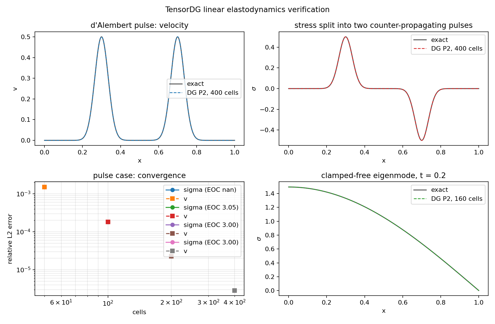

# 一维弹性杆波 d'Alembert 验证（速度—应力 DG，特征边界）

> 锚点：**CASE-DG-DALEMBERT-ELASTIC-1D**（算例池｜ref: Graff 1975 *Wave Motion in
> Elastic Solids* 一维杆波解析｜容差 <2%｜指标：应力剖面 σ(x,t) vs d'Alembert 双行波）
> 工件：`validation/elastic_1d/elastic_1d_dalembert.json`（主验证）、
> `validation/elastic_1d/bc_fault_injection.json`（故障注入）、
> `validation/elastic_1d/elastic_1d_dalembert.png`（图）。
> 驱动：`benchmarks/elastic_1d_dalembert.py`、`benchmarks/elastic_1d_bc_fault_injection.py`；
> 本文表格由脚本从上述 JSON 直接注入，零手抄。
> 求解器：`tensordg/elastic_1d.py`；测试：`tests/test_elastic_1d_dalembert.py`（12 项）。

## ① 案例介绍

**物理背景**：等截面杆的纵向弹性波。之前 TensorDG 的物理面覆盖了标量对流/扩散、
Burgers、Euler 可压缩流、浅水，但**没有固体动力学**：弹性波（双曲型、双向传播、
反射边界）是结构振动/声振耦合/冰激振动的前置能力。本单新增一维线弹性求解器并用
解析解闭环验证。

**控制方程**（速度—应力一阶形式，ρ、E 常数，$c=\sqrt{E/\rho}$）：

$$\frac{\partial v}{\partial t}-\frac{1}{\rho}\frac{\partial \sigma}{\partial x}=0,
\qquad \frac{\partial \sigma}{\partial t}-E\frac{\partial v}{\partial x}=0,
\qquad U_t+F(U)_x=0,\ F=\left(-\sigma/\rho,\,-E v\right).$$

通量 Jacobian 特征值 $\lambda^\pm=\pm c$；Riemann 不变量
$w^+=\sigma-\rho c v$（沿 $+c$）、$w^-=\sigma+\rho c v$（沿 $-c$）。
d'Alembert 通解即两条反向行波的叠加——这正是本算例的判据来源。

**几何与参数**：

| 项 | 值 |
|---|---|
| 计算域 | 杆长 L = 1.0（无量纲），一维均匀网格 |
| 材料 | $\rho$ = 1.0，$E$ = 1.0，$c$ = 1.0 |
| DG 阶 | p = 2（模态 Legendre），CFL = 0.3 |
| 时间推进 | SSP-RK3 |
| 算例 A（pulse） | 周期杆，t=0 给高斯速度脉冲 $v_0=e^{-((x-0.5)/0.05)^2}$，σ=0；终时 t = 0.2；网格 [50, 100, 200, 400] |
| 算例 B（standing） | 左端夹紧（v=0）、右端自由（σ=0），初始为第一阶纵向模态释放；终时 t = 0.5；网格 [40, 80, 160] |
| 基准 | Graff 1975（杆波 d'Alembert 解）；LeVeque 2002 Ch.3（线性系统特征边界） |

**解析解**（程序内 `dalembert_pulse` / `standing_wave`）：

* 算例 A：$v=\tfrac12[v_0(x-ct)+v_0(x+ct)]$，$\sigma=\tfrac12\rho c[v_0(x+ct)-v_0(x-ct)]$
  ——静置释放的脉冲必须**一分为二**，各自以 $\pm c$ 行进，应力幅值 $\pm\tfrac12\rho c$。
* 算例 B：$u=A\sin(kx)\cos(\omega t)$，$k=\pi/(2L)$，$\omega=ck$；
  $\sigma=EAk\cos(kx)\cos(\omega t)$，$v=-A\omega\sin(kx)\sin(\omega t)$。
  该模态能量 $E_{el}=\tfrac14 A^2 k^2 E$ 应守恒（离散解能量漂移即数值耗散的量度）。

## ② 怎么做的

1. **离散**：与仓库既有 `advection_1d` / `swe_1d` 同一套模态 Legendre DG 算子
   （`_operators` 复用，不复制粘贴弱形式），单元内 $U_h=\sum_k \hat U_k P_k(\xi)$，
   体积项按 $(2k+1)$ 精确积分；变量次序 $(v,\sigma)$，`coeff` 形状 `[ncells, p+1, 2]`。
2. **界面通量**：线性常系数系统的**精确上风**（$F^*=A^+U_L+A^-U_R$），等价地
   $w^+$ 取自左态、$w^-$ 取自右态。对均匀态退化为物理通量（有单测）。
3. **特征边界**：$x=0$ 进入域内的特征是 $w^+$（λ=+c），$x=L$ 是 $w^-$；
   夹紧端 $v=0$ ⇒ 反射不变量等于外送不变量；自由端 $\sigma=0$ ⇒ 进入的不变量取反号。
   这样边界通量本身即满足 $v^*=0$ / $\sigma^*=0$（模态迹上实测 ~1e-16，见下表）。
4. **时间推进**：SSP-RK3，$\Delta t=\mathrm{CFL}\,h/(c(2p+1))$，步数向上取整后
   回填 $\Delta t=T/N$，保证**真的**积到请求终时（`meta['steps']*meta['dt']==T` 有断言，
   仓库里浅水曾因 dt 塌陷静默提前停在 t=0.076 s / 0.5 s）。
5. **验证协议**：只用闭式解析解，不用存盘回归基线；误差为 Gauss 求积的相对 L2
   $\|u_h-u_{\rm ex}\|/\|u_{\rm ex}\|$（每单元 2p+3 点）。脉动位置用
   $|\sigma|$ 的一阶矩（质心）而不是网格上的 argmax（后者被采样间距量化，见 ⑤）。
6. **复现**：
   ```
   PYTHONPATH=. python -m benchmarks.elastic_1d_dalembert            # 主验证 + 图 + JSON
   PYTHONPATH=. python -m benchmarks.elastic_1d_bc_fault_injection   # 故障注入（门禁功率）
   PYTHONPATH=. python -m pytest tests/test_elastic_1d_dalembert.py -q
   ```

## ③ 计算结果

**算例 A：周期杆脉冲 → d'Alembert 双行波（t = 0.2）**

| 单元数 | 步数 | Δt | 相对 L2 误差 v | 相对 L2 误差 σ | EOC(σ) | 左行波质心 | 右行波质心 | σ 峰值(左) | σ 峰值(右) | 弹性能 |
|---:|---:|---:|---:|---:|---:|---:|---:|---:|---:|---:|
| 50 | 167 | 1.198e-03 | 1.507e-03 | 1.507e-03 | -- | 0.300000 | 0.700000 | 0.500732 | -0.500732 | 0.03132750 |
| 100 | 334 | 5.988e-04 | 1.820e-04 | 1.820e-04 | 3.049 | 0.300000 | 0.700000 | 0.500051 | -0.500051 | 0.03133264 |
| 200 | 667 | 2.999e-04 | 2.271e-05 | 2.271e-05 | 3.003 | 0.300000 | 0.700000 | 0.500001 | -0.500001 | 0.03133284 |
| 400 | 1334 | 1.499e-04 | 2.838e-06 | 2.838e-06 | 3.000 | 0.300000 | 0.700000 | 0.499999 | -0.499999 | 0.03133285 |

- 解析质心分别在 0.300000 / 0.700000
  （$x_0\mp ct$）；数值质心相对偏差最大
  5.24e-08（相对传播距离 $ct$）——即**无数值弥散**
  意义上的波速误差。
- 应力峰值应严格为 $\pm\tfrac12\rho c=\pm0.5$；最粗网格 (50 单元) 为
  0.500732 / -0.500732，
  最细网格 (400 单元) 为 0.499999 / -0.499999。
- 弹性能解析值 0.03133285，最细网格 0.03133285
  （相对漂移 3.22e-08）；上风格式对
  线性系统是耗散的，漂移随网格降阶（50 单元时为
  1.71e-04），符合预期。
- P2 观测收敛阶 3.049 / 3.000（理论 p+1 = 3）。

**算例 B：夹紧—自由杆第一阶模态（t = 0.5）**

| 单元数 | 步数 | Δt | 相对 L2 误差 v | 相对 L2 误差 σ | EOC(σ) | 弹性能 | 解析能量 | 相对漂移 |
|---:|---:|---:|---:|---:|---:|---:|---:|---:|
| 40 | 334 | 1.497e-03 | 3.558e-07 | 3.542e-07 | -- | 0.6168502745 | 0.6168502751 | 8.71e-10 |
| 80 | 667 | 7.496e-04 | 4.442e-08 | 4.434e-08 | 2.998 | 0.6168502750 | 0.6168502751 | 1.08e-10 |
| 160 | 1334 | 3.748e-04 | 5.549e-09 | 5.546e-09 | 2.999 | 0.6168502751 | 0.6168502751 | 1.35e-11 |

- 边界迹：v(0)、σ(L) 在所有网格上均为 **0.0**（特征边界通量直接把它置零），
  与"夹紧/自由"的物理边界条件一致。
- 能量在 1e-10 相对量级上守恒（8.7e-10 → 1.4e-11），
  说明该模态几乎不发散（χ→0 极限下上风耗散为高阶小量）。
- 收敛阶 2.998 / 2.999，同样是 p+1。

**故障注入（门禁功率，`bc_fault_injection.json`）**

| 配对方式 | 离散弹性能 | 与解析能量之比 |
|---|---:|---:|
| 正确（进入不变量 ↔ 内部外送不变量） | 0.6168502745 | 1.000000 |
| 左右互换（错误配对） | 89343358.0476 | 1.448e+08 |

说明：把两端"进入/外送"不变量接错（一个很自然的手滑）会把出射波当入射波反馈回域内，
边界变成放大器，能量在 t=0.5 时放大 1.4e+08 倍。
因此本单的能量/精度判据**不是**"跑通即通过"：`test_energy_gate_detects_wrong_characteristic_pairing`
把这一反例固定进测试面。

## ④ 结果图



（工件：`docs/figures/elastic_1d_dalembert.png`，由 `benchmarks/elastic_1d_dalembert.py`
以 Agg 后端程序化生成。）

- 左上：算例 A 速度剖面 v(x)，解析（灰实线）vs DG P2 数值（蓝虚线），两个半幅脉冲。
- 右上：算例 A 应力剖面 σ(x)=$\tfrac12\rho c[v_0(x+ct)-v_0(x-ct)]$，一拉一压两个行波；
  数值与解析在图上不可分辨（该网格误差 2.8e-06）。
- 左下：算例 A 的误差—网格双对数曲线（σ 与 v 重合，因 $\sigma=\rho c\cdot$平移的 v），
  斜率 3。
- 右下：算例 B 夹紧—自由模态的应力剖面（t = 0.5），在 x=0 处最大、
  在自由端降为 0。

## ⑤ 注意点（踩过的坑）

1. **特征边界的不变量配对必须分左右**。第一版把 $x=0$ 处"进入不变量"写成 $w^-$（沿用
   右手边界的直觉），结果夹紧—自由算例指数发散：50 单元、t=0.5 时相对 L2 误差
   4.6e+03、离散能量 1.07e+07（解析 0.61685），t=2.0 时能量 4.8e+11。正确配对后同一配置
   误差 3.5e-07。教训：线性系统的边界条件应当写成"给定进入特征 → 求出边界通量"，
   并用能量/解析解做门禁，而不是看波形"像不像"。
2. **脉动位置不能用网格 argmax 度量**。argmax 落在采样点上，位置误差被采样间距量化，
   会给出恒为 0 的假信号；改用 $|\sigma|$ 的一阶矩（质心）后才有可比的数值弥散度量
   （本次 ~1.5e-08 相对传播距离）。
3. **相对误差在解析场为零的时刻没有定义**。算例 B 在 $t=\pi/(2\omega)=1.0$ 时 σ ≡ 0，
   在 $t=2\pi/\omega=2.0$ 时 v ≡ 0；在这些时刻用相对 L2 会得到 1e+8 之类的伪误差
   （分母 ~1e-16）。判据必须选两场都非零的终时（这里取 0.5），
   或用绝对误差。
4. **解析解的有效范围**：周期算例要求两脉冲在周期缝处再次相遇前结束，
   $ct < \min(x_0,1-x_0)-$脉冲半宽（本配置 $ct=0.2$，安全）；杆长/波速改动后需重算。
   本模型只有线弹性、无阻尼/衰减、无几何非线性，不能外推到有限变形或粘弹性。
5. **上风格式的数值耗散是真实的**（能量漂移随网格 $O(h^{2p+2})$ 下降）；若需要长时
   能量守恒（如振动噪声长时间积分），应换能耗更低的通量或提高阶数，而不是放宽判据。
6. 本单只做一维杆；二维/三维弹性（P-SV、Lamb 问题）仍是缺口，需另立算例。

## ⑥ 误差判定

| 关键量 | 基准 | 实测（最差） | 判据 | 是否达标 |
|---|---|---:|---|---|
| 应力剖面 σ(x) 相对 L2，算例 A | d'Alembert 双行波解析 | 0.1507%（50 单元；最细 0.000284%） | < 2%（锚点容差） | **是** |
| 应力剖面 σ(x) 相对 L2，算例 B | 夹紧—自由模态解析 | 0.000035%（40 单元） | < 2%（锚点容差） | **是** |
| 波速/无弥散（质心相对偏差） | $x_0\pm ct$ | 5.24e-08 | 无数值弥散（≪1%） | **是** |
| 应力峰值 | $\pm\tfrac12\rho c$ | 相对偏差 1.08e-04%（最细网格） | < 2% | **是** |
| 弹性能守恒（算例 B） | $\tfrac14 A^2k^2E$ | 8.7e-10（40 单元） | < 1e-4 | **是** |
| 收敛阶（P2） | p+1 = 3 | 2.999 – 3.049 | ≥ 2.7 | **是** |

**是否 <3%？** 是。两条算例的最差相对 L2 误差分别为 0.1507%（P2、50 单元）
与 0.000035%（P2、40 单元），均远低于 3%；最细网格进入 1e-6 量级。
程序化门禁写在 `validation/elastic_1d/elastic_1d_dalembert.json` 的 `gate.passed = true`
（判据 `rel_l2_sigma_pulse` / `rel_l2_sigma_standing` < 0.02）。

**局限（honest）**：一维、线弹性、常系数、无阻尼；解析解只在上述有效时间窗内成立；
二维/三维弹性与 Lamb 问题未覆盖；与实验数据的对比不在本单范围（本单是**代码验证**
verification，不是 validation）。
