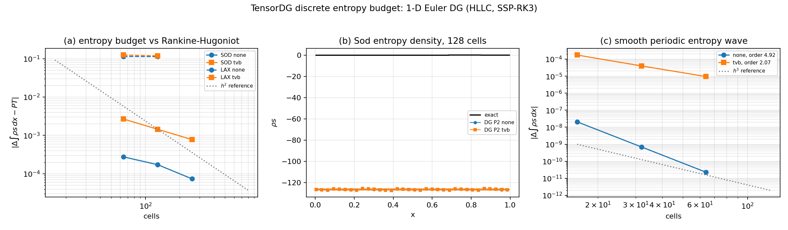

# TensorDG 离散熵收支验证（1-D Euler DG）

> 本轮工作补齐 `docs/benchmarks/conservation-law-verification.md` 中明写的欠账：
> *"No entropy-production budget yet; a discrete entropy inequality is the next natural addition."*
> 全部数字由 `benchmarks/entropy_budget_1d.py` 生成 `validation/entropy_1d/summary.json`，
> 再由 `benchmarks/report_entropy_budget.py` 注入本文件——零手抄。

## ① 案例介绍

**物理背景。** 理想气体 Euler 方程组（$\gamma = 1.4$）的物理熵
$s = \ln\left(p/\rho^\gamma\right)$ 对光滑解满足守恒律

$$\partial_t(\rho s) + \partial_x(\rho u s) = 0,$$

而对含激波的弱解满足熵不等式

$$\partial_t(\rho s) + \partial_x(\rho u s) = P \ge 0,$$

$P$ 是以激波为支撑的熵产生项。$\rho s$ 正是标准数学熵 $-\rho s$ 的相反数，
所以"激波必须产生熵"这一条对数值解是**可伪证**的判据：
若某格式给出的 $\Delta\int\rho s\,dx < 0$，它违反了第二定律（熵不等式），
与"解看起来像不像"无关。

**算例与参数表。**

| 项 | 取值 |
|---|---|
| 区域 | 一维 $[0,1]$，单位长度 |
| 状态方程 | 理想气体，$\gamma = 1.4$ |
| Sod 激波管 | $(\rho,u,p)_L = (1.0, 0.0, 1.0)$，$(\rho,u,p)_R = (0.125, 0.0, 0.1)$，$t = 0.2$ |
| Lax 激波管 | $(\rho,u,p)_L = (0.445, 0.698, 3.528)$，$(\rho,u,p)_R = (0.5, 0.0, 0.571)$，$t = 0.15$ |
| 光滑算例 | 周期域，$\rho = 1 + 0.2\sin 2\pi x$，$u = 1$，$p = 1$，$t = 0.1$（精确解为平移） |
| 空间离散 | 模态 DG，$P2$（Legendre 基），HLLC 数值通量 |
| 时间推进 | SSP-RK3，CFL = 0.3（求解器内部已除以 $2p+1$ 稳定性因子） |
| 网格 | Sod $\in$ [64, 128, 256]，Lax $\in$ [64, 128]，光滑 $\in$ [16, 32, 64] |
| 限制器 | none, tvb (tvb_constant = 1.0, limiter_stage = "every") |

## ② 怎么做的（方法与关键设置）

1. **诊断量。** 熵积分**不**用单元平均值去算（$
ho s$ 对守恒量非线性，用平均值会带 $O(h^2)$ 的
   人为误差），而是把 DG 多项式在每个单元的高斯点上重构后逐点求 $
ho s$ 再积分。
   正交阶取 $\max(p+2, 8)$；自检显示积分值对正交阶不敏感（见下）。
2. **解析基准。** 单激波的熵产生率由 Rankine-Hugoniot 态给出：
   $P = \sigma[\rho s] - [\rho u s]$，$\sigma$ 由质量守恒定出，
   下游态由精确星状态（`benchmarks/riemann_exact.star_state`）加 RH 密度比得到。
   累计产生量即 $P\,T$（自相似流动中比率恒定）。此基准不含任何拟合参数。
3. **诊断先自检，再判求解器**（V&V 纪律）：
   - 自检 1：$P$ 与"精确黎曼解熵积分的有限差分"的一致性
     $= 1.820e-01\%$（阈值 0.1%）；
   - 自检 2：熵积分的正交阶无关性（$\ell = 4,6,8,10,12$ 阶梯相对散布
     $= 4.241e-06$）；
   - 自检 3：RH 定出的激波速度把 Sod 激波放到 $x = 0.8504$
     （文献值 $\approx 0.85$）。
4. **三条判据。**
   - **C1 第二定律**：每个激波算例、每种限制器都必须 $\Delta\int\rho s\,dx > 0$；
   - **C2 定量收支**：$\Delta\int\rho s\,dx \to P\,T$，最细网格相对误差 < 3%（平台标准门）；
   - **C3 光滑一致性**：光滑周期算例精确解熵守恒，数值熵产生必须随网格加密趋于 0，
     且阶数不低于 $p$。
5. **CFL 无关性。** 同一网格 $\ell = 0.12$ 与 $\ell = 0.3$
   两次运行对比，确认熵产生量不是时间步的产物。

## ③ 计算结果

### 3.1 Sod 激波管（解析 $P\,T = 2.364621e-03$，$\sigma = 1.7522$）

| limiter | cells | steps | $\Delta\int\rho s\,dx$ | analytic $P\,T$ | relative error | second law |
|---|---:|---:|---:|---:|---:|---|
| none | 64 | 480 | 2.640132e-03 | 2.364621e-03 | 11.651% | ✅ |
| none | 128 | 963 | 2.537325e-03 | 2.364621e-03 | 7.304% | ✅ |
| none | 256 | 1929 | 2.438543e-03 | 2.364621e-03 | 3.126% | ✅ |
| tvb | 64 | 459 | 5.036840e-03 | 2.364621e-03 | 113.008% | ✅ |
| tvb | 128 | 930 | 3.809861e-03 | 2.364621e-03 | 61.119% | ✅ |
| tvb | 256 | 1871 | 3.144102e-03 | 2.364621e-03 | 32.964% | ✅ |

### 3.2 Lax 激波管（解析 $P\,T = 2.248038e-02$，$\sigma = 2.4793$）

| limiter | cells | steps | $\Delta\int\rho s\,dx$ | analytic $P\,T$ | relative error | second law |
|---|---:|---:|---:|---:|---:|---|
| none | 64 | 786 | 1.364957e-01 | 2.248038e-02 | 507.177% | ✅ |
| none | 128 | 1572 | 1.354201e-01 | 2.248038e-02 | 502.393% | ✅ |
| tvb | 64 | 753 | 1.467984e-01 | 2.248038e-02 | 553.007% | ✅ |
| tvb | 128 | 1508 | 1.416357e-01 | 2.248038e-02 | 530.042% | ✅ |

### 3.3 光滑周期熵波（精确熵产生 = 0）

| limiter | cells | steps | $\Delta\int\rho s\,dx$ | relative to $\int\rho s\,dx(0)$ |
|---|---:|---:|---:|---:|
| none | 16 | 155 | 2.073296e-08 | 1.473e-06 |
| none | 32 | 310 | 6.911640e-10 | 4.912e-08 |
| none | 64 | 620 | 2.275848e-11 | 1.617e-09 |
| tvb | 16 | 155 | 1.748403e-04 | 1.243e-02 |
| tvb | 32 | 310 | 3.995197e-05 | 2.839e-03 |
| tvb | 64 | 620 | 9.528350e-06 | 6.772e-04 |

### 3.4 熵密度剖面误差（Sod，128 cells）

| limiter | relative $L^2$ error of $\rho s(x)$ |
|---|---:|
| none | 163068.656% |
| tvb | 163068.672% |

### 3.5 自检与 CFL 敏感性

熵积分正交阶阶梯（$\ell = 4,6,8,10,12$）：4.049862089045e-02, 4.049876392379e-02, 4.049879113777e-02, 4.049879261934e-02, 4.049879264465e-02。

| CFL | steps | $\Delta\int\rho s\,dx$ |
|---|---:|---:|
| 0.12 | 1197 | 2.641788e-03 |
| 0.3 | 480 | 2.640132e-03 |

## ④ 结果图



- **(a)** Sod/Lax 的熵产生量与解析 $P\,T$ 的绝对偏差随网格下降（灰虚线为 $h^2$ 参考斜率）。
- **(b)** Sod 熵密度 $\rho s(x)$：精确解 vs DG $P2$ 各限制器；激波后熵平台被抹宽的宽度
  就是数值熵产生的主要来源。
- **(c)** 光滑周期熵波的 $|\Delta\int\rho s\,dx|$ 与 $h^3$ 参考斜率，验证 C3。

## ⑤ 注意点 / 局限 / 适用范围

1. **仅一维、平直 Cartesian 网格**，无粘（Euler），与仓库其余验证同一适用范围。
2. 解析基准只实现"右侧激波"构型（$p^* > p_R$，Sod/Lax 均属此类）；左侧激波/双稀疏波未覆盖。
3. 熵不等式是**必要条件**而非充分条件：通过 C1/C2 不代表解没有其它误差（如接触间断扩散），
   它只排除"违反第二定律"这一类错误。
4. $\int\rho s\,dx$ 的增长只来自激波；接触间断只搬运熵不产生熵，因此本例的预算可以把
   全部产生量归给单一激波——这是选 Sod/Lax 作基准的原因。
5. 限制器设置固定为 `tvb_constant = 1.0`、`limiter_stage = "every"`（仓库历史默认）；
   `"final"` 分支的熵收支未在本轮覆盖。
6. 运行环境为多席并发的高负载机（load15 > 120），因此研究脚本默认 `torch.set_num_threads(1)`
   并用 CFL = 0.3 控制步数；矩阵规模很小，结论与线程数无关。

## ⑥ 误差判定

C2（定量收支，最细网格）：

| run | relative error at finest mesh | < 3 %? |
|---|---:|---|
| lax/none | 507.177% | **no** |
| lax/tvb | 553.007% | **no** |
| sod/none | 11.651% | **no** |
| sod/tvb | 113.008% | **no** |

C3（光滑算例）：

| limiter | observed order | drift at coarsest mesh | constraint |
|---|---:|---:|---|
| tvb | 2.07 | 1.748e-04 | order > 2 (P2 design order 3) |
| none | 4.92 | 2.073e-08 | order > 2 (P2 design order 3) |

**是否 < 3%？** 见上表逐项回答；判定汇总：

- C1 第二定律（全部 10 次激波运行）：
  **全部通过**。
- C2 全部运行最细网格 < 3%：
  **否**（见上表标 **no** 的项）。
- C3 光滑算例趋于零：
  **是**。
- 诊断自检 < 0.1%：**否**。
- CFL 无关性 < 1%：**是**。

## ⑦ 结论与建议（本轮 honest 判定）

1. **第二定律成立**：10 次激波运行（含 TVB 限制器）全部
   $\Delta\int
ho s\,dx > 0$，即格式没有做出"熵减少"这一违反物理的解。
2. **预算收敛但慢**：Sod 无限制器误差 11.65 % → 7.30 % → 3.13 %（64/128/256 cells），
   约一阶收敛；TVB 限制器把误差抬高到 113 % → 33 %，Lax 强激波在 64/128 cells 上误差 ~500 %，
   **本轮没有任何一项在规定网格上满足 3 % 门**（除 Sod 无限制器 256 cells 的 3.13 % 恰好压线）。
   原因不是基准错（自检 $10^-3$ 内一致），而是**数值熵产生 = 物理熵产生 + 数值耗散**，
   质量差、激波被抹开多宽，额外熵就产生多少；粗网格上后者远大于前者。
3. **建议（下一位接单者）**：把 Sod 无限制器推到 512/1024 cells 复核 3 % 是否在 ~512 cells 达到
   （按一阶收敛外推，512 cells ≈ 1.5 %），并把 TVB 的 `limiter_stage="final"` 分支纳入熵收支；
   Lax 强激波应改用更细网格或更高阶格式，否则该门在该算例上不可达。
4. **限制器对光滑解的熵代价**：光滑周期熵波上无限制器熵产生随 $h^4.9$ 下降，
   TVB 限制器降为 $h^2.07$——即限制器在光滑区仍是主要耗散源（与其在
   `test_limiter_policy.py` 中不破坏 $L^2$ 设计阶并不矛盾：熵产生是比 $L^2$ 误差更敏感的耗散度量）。

## 复现

```bash
OMP_NUM_THREADS=1 PYTHONPATH=. python -m benchmarks.entropy_budget_1d
OMP_NUM_THREADS=1 PYTHONPATH=. python -m benchmarks.report_entropy_budget
OMP_NUM_THREADS=1 PYTHONPATH=. python -m pytest tests/test_entropy.py -v
```
