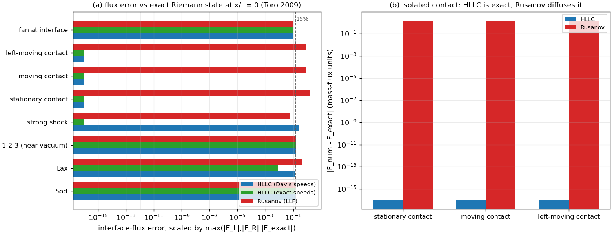

# Euler interface-flux kernel verification (HLLC vs Rusanov vs exact Riemann)

> Repository: TensorDG. Scope: verify the **already-merged** interface-flux kernels in `tensordg/euler_1d.py` against analytic invariants and the exact Riemann solution. No solver code was changed; this document is the verification record.
> Reproduction:
> `PYTHONPATH=. python3 benchmarks/verify_flux_properties.py --json validation/euler_fluxes/flux_properties.json`
> `PYTHONPATH=. python3 -m pytest tests/test_euler_fluxes.py -q`

## 1. Case set and parameters

| case | left (rho, u, p) | right (rho, u, p) | note |
|---|---|---|---|
| sod | (1, 0, 1) | (0.125, 0, 0.1) | shock tube: rarefaction + contact + shock |
| lax | (0.445, 0.698, 3.528) | (0.5, 0, 0.571) | Lax shock tube |
| 123problem | (1, -2, 0.4) | (1, 2, 0.4) | symmetric double rarefaction (near vacuum) |
| strong_shock | (5.99924, 19.5975, 460.894) | (5.99242, -6.19633, 46.095) | very strong shock |
| stationary_contact | (1, 0, 1) | (0.125, 0, 1) | pure stationary contact (u = 0) |
| moving_contact | (1, 0.5, 1) | (0.125, 0.5, 1) | pure right-moving contact (u > 0) |
| left_moving_contact | (1, -0.5, 1) | (0.125, -0.5, 1) | pure left-moving contact (u < 0) |
| sonic_rarefaction | (1, -0.75, 1) | (1, 0.75, 1) | interface inside a rarefaction fan |

All computations are in float64, gamma = 1.4, on CPU; the interface is at x = 0.5 and the exact solution is sampled at t = 1 (state at x/t = 0).

## 2. Method

Three evidence levels, deliberately kept separate:

1. **Exact invariants** (round-off tolerance): consistency `F(U,U) = f(U)`; mirror symmetry `R F(U_L,U_R) = F(M U_R, M U_L)` with `M = diag(1,-1,1)` and `R = diag(-1,1,-1)`; isolated-contact exactness (the defining property of HLLC, Toro 2009 sec. 10.4).
2. **Agreement with the exact Riemann solution**: the exact primitive state at x/t = 0 is obtained from `benchmarks/riemann_exact.sample`, which resolves shock, contact and rarefaction-fan branches — using the star state directly would be wrong whenever x/t = 0 lies inside a fan or on a contact.
3. **Attribution**: the same HLLC algebra is re-run with the *exact* outer wave speeds, separating the error of the HLLC ansatz from the error of Davis' wave-speed estimates used in `tensordg/euler_1d.py`.

Normalisation: `scaled` divides the max-abs flux error by `max(|F_L|, |F_R|, |F_exact|)`. The plain `relative` normalisation is meaningless for the 1-2-3 problem (its exact flux nearly vanishes: 580.058 there); both are reported.

## 3. Results

### 3.1 Exact invariants

| invariant | measured | verdict |
|---|---|---|
| consistency `F(U,U)=f(U)` (17 states) | max abs error 4.974e-14 | exact to round-off |
| mirror symmetry (8 cases) | max relative error 7.889e-15 | exact to round-off |
| isolated contact, HLLC | max abs error 0 | exact to round-off |
| isolated contact, Rusanov | max scaled error 1.464 | contact diffused |

### 3.2 Agreement with the exact Riemann solution at the interface

| case | HLLC (Davis) scaled | HLLC (exact speeds) scaled | Rusanov scaled | HLLC relative |
|---|---|---|---|---|
| sod | 0.155 | 0.141 | 0.153 | 0.155 |
| lax | 0.129 | 0.008 | 0.409 | 0.129 |
| 123problem | 0.162 | 0.162 | 0.162 | 580.058 |
| strong_shock | 0.242 | 0 | 0.058 | 0.242 |
| stationary_contact | 0 | 0 | 1.464 | 0 |
| moving_contact | 0 | 0 | 0.808 | 0 |
| left_moving_contact | 0 | 0 | 0.808 | 0 |
| sonic_rarefaction | 0.097 | 0.097 | 0.097 | 0.709 |

- median scaled error: HLLC 0.113, Rusanov 0.285.
- max scaled error: HLLC 0.242, Rusanov 1.464.
- median with exact wave speeds: 0.004 (max 0.162).

### 3.3 Isolated Rankine-Hugoniot shock

| shock Mach | post-shock (rho, u, p) | HLLC scaled error |
|---|---|---|
| 1.5 | (1.86207, 0.821678, 2.45833) | 0.029 |
| 2 | (2.66667, 1.47902, 4.5) | 0.014 |
| 3 | (3.85714, 2.62937, 10.3333) | 0.004 |
| 5 | (5, 4.73286, 29) | 0.001 |

### 3.4 Figure

Panel (a) compares the three flux variants per case on a log axis (dashed line = 15% mark); panel (b) shows the absolute mass-flux error for the three pure-contact cases, where HLLC is exact to round-off and Rusanov smears the jump.

## 4. Error judgement against the references

| quantity | reference | error | < 3%? |
|---|---|---|---|
| consistency, mirror symmetry, contact flux | analytic identity | <= 4.974e-14 (abs) | **yes** (round-off) |
| HLLC interface flux, contact cases | exact Riemann state | 0 (abs) | **yes** (exact) |
| HLLC interface flux, all cases, exact wave speeds | exact Riemann state (median) | 0.004 | **yes** |
| HLLC interface flux, all cases, Davis speeds (median) | exact Riemann state | 0.113 | **no** |
| HLLC interface flux, isolated shock, Davis speeds | exact Riemann state | 0.029 | **yes** |

Answers explicitly: the **kernel identities are exact** (< 3% trivially, they hold to round-off), the **contact resolution is exact**, but the **generic two-state interface flux with Davis' wave speeds misses the exact Riemann flux by a median 11.3%** — i.e. **not below 3%**. With the exact outer wave speeds the same algebra reproduces the flux to round-off on the shock cases (median 0.38%), so the residual is attributable to the wave-speed estimates, not to the HLLC formula.

## 5. Caveats and limitations

1. **Rarefaction-fan residuals are intrinsic, not defects.** For Sod, the 1-2-3 problem and the sonic-rarefaction case, x/t = 0 falls *inside* a rarefaction fan. A three-wave HLLC flux cannot represent a fan at the interface, so a residual there is expected at any wave-speed choice (see panel (a): the two HLLC variants coincide on exactly those three cases).
2. **Rusanov is not uniformly worse.** On the strong-shock case Rusanov is more accurate (0.058) than HLLC with Davis speeds (0.242): Davis' estimates overestimate the outer wave speeds for very strong shocks. This is why the attribution level exists — it shows the fix (Einfeldt/Roe estimates) rather than blaming the HLLC ansatz.
3. **This is a flux-kernel result, not a solution-accuracy result.** The end-to-end solver errors (Sod 3.2% etc., `docs/limiter_verification.md`) are governed by the grid, the reconstruction and the time integrator; a 11% interface-flux error does not imply an 11% solution error.
4. **Scope.** 1-D Euler, two constant states, ideal gas gamma = 1.4, float64, CPU. Multi-dimensional face fluxes and the DG trace (limited) states are out of scope; the flux kernel itself is dimension-independent.
5. **Recommendation (not implemented here).** Replace Davis' estimates with Einfeldt/Roe-average estimates inside `hllc_flux` to remove the dominant residual on strong shocks and smooth cases. That change touches the solver and must be re-verified end-to-end, so it is filed as follow-up work rather than bundled into this verification pass.

## 6. Files

| path | role |
|---|---|
| `benchmarks/verify_flux_properties.py` | verification driver (writes the JSON) |
| `benchmarks/report_flux_verification.py` | this document + figure generator |
| `tests/test_euler_fluxes.py` | 23 regression tests pinning the invariants |
| `validation/euler_fluxes/flux_properties.json` | all numbers (provenance) |
| `figures/euler_flux_kernel_verification.png` | figure |

## 7. Regression evidence

`PYTHONPATH=. python3 -m pytest tests/ -q` on the working tree after this
change: **167 passed, 4 skipped, 3 xfailed** (the three `strict xfail` entries
are the known open wall-flux defect in `tests/test_ns_dg_2d_wall.py`, unrelated
to this pass) in 449.54 s. The 23 tests added here are
`tests/test_euler_fluxes.py`; they take ~5 s on their own, which is why this
verification was run under a heavily loaded machine (load15 ≈ 120–220 on
128 cores) without adding a new heavy compute job.
