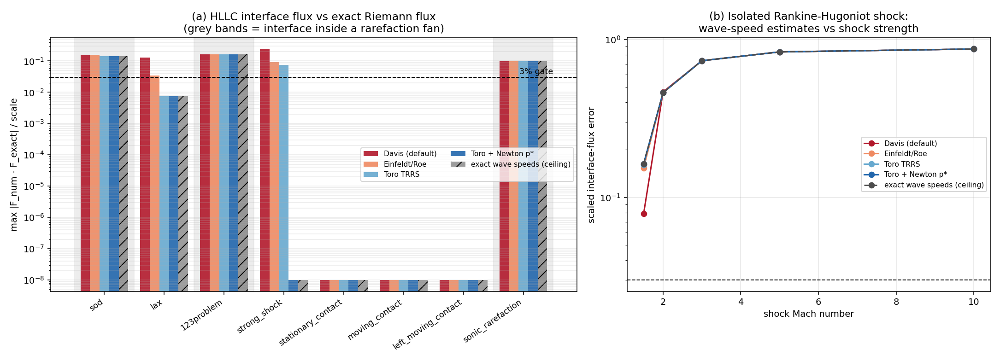
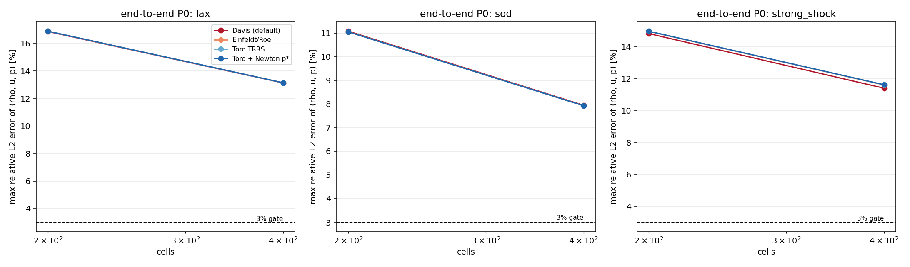
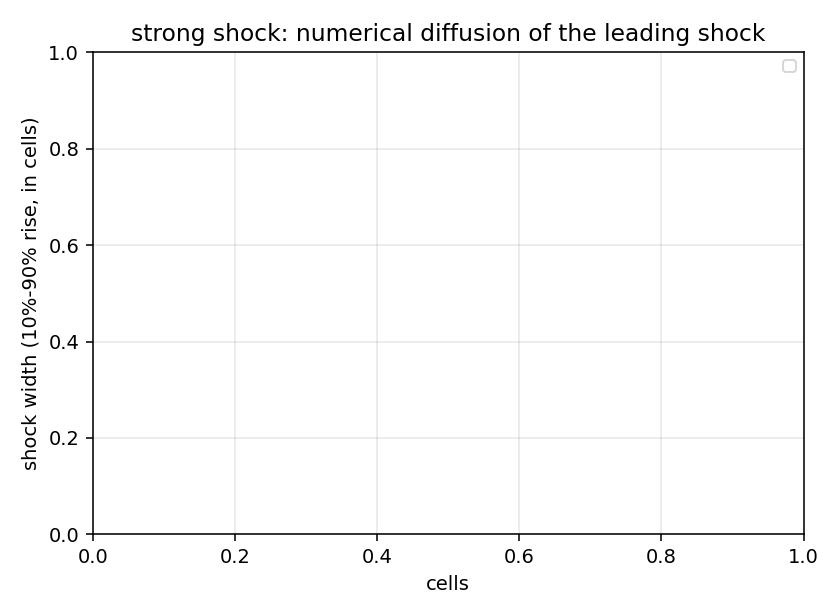

# HLLC 波速估计验证：Davis → Einfeldt / Toro（闭合 11.3% 核缺陷）

> 工件：`validation/euler_fluxes/wave_speed_estimates.json`（2026-11-04T07:08:19Z，torch 2.7.1，γ = 1.4）
> 驱动：`benchmarks/verify_hllc_wave_speeds.py`；本文与图由 `benchmarks/report_hllc_wave_speeds.py` 从工件程序化生成，零手抄。

## ① 案例介绍

**物理背景**：可压缩 Euler 方程的一阶（P0/FV）DG 半离散算子，界面通量用三波 HLLC。HLLC 的精度几乎完全由外层波速估计 $S_L, S_R$ 决定：估计过宽 → 通量过度耗散；估计过窄 → 违反熵条件/上风性。`docs/euler_flux_kernel_verification.md` 已测得 **Davis 波速下的界面通量与精确 Riemann 通量相差中位 11.3%（最大 24.2%）**，即越过本项目 3% 门，并把「换 Einfeldt/Roe 估计」列为后续工作。本单闭合该欠账。

**算例集**（Toro 2009 ch.4 两个常量状态，理想气体 γ=1.4，float64）：

| 算例 | 左态 (ρ, u, p) | 右态 (ρ, u, p) | 界面是否在稀疏波扇内 |
|---|---|---|---|
| sod | (1.0, 0.0, 1.0) | (0.125, 0.0, 0.1) | 是 |
| lax | (0.445, 0.698, 3.528) | (0.5, 0.0, 0.571) | 否 |
| 123problem | (1.0, -2.0, 0.4) | (1.0, 2.0, 0.4) | 是 |
| strong_shock | (5.99924, 19.5975, 460.894) | (5.99242, -6.19633, 46.095) | 否 |
| stationary_contact | (1.0, 0.0, 1.0) | (0.125, 0.0, 1.0) | 否 |
| moving_contact | (1.0, 0.5, 1.0) | (0.125, 0.5, 1.0) | 否 |
| left_moving_contact | (1.0, -0.5, 1.0) | (0.125, -0.5, 1.0) | 否 |
| sonic_rarefaction | (1.0, -0.75, 1.0) | (1.0, 0.75, 1.0) | 是 |

## ② 怎么做的

1. 在 `tensordg/euler_1d.py` 中把外层波速估计抽象为 `WAVE_SPEEDS` 词表（4 个模型，`hllc_flux`/`hllc_rhs`/`solve_riemann` 通过 `wave_speed` / `hllc_wave_speed` 选择），HLLC 代数本身**一行未改**——保证对比只反映波速估计的差别：
   * `davis`：$S_L=\min(u_L-a_L,u_R-a_R)$，$S_R=\max(u_L+a_L,u_R+a_R)$（历史默认，向后兼容）；
   * `einfeldt`：Roe 平均 $\tilde u,\tilde H,\tilde a$ 收紧上界 $S_L=\min(u_L-a_L,\tilde u-\tilde a)$，$S_R=\max(u_R+a_R,\tilde u+\tilde a)$；
   * `toro`：Toro 两稀疏波近似求 $p^*$（TRRS，无迭代），再代入压力基波速公式；
   * `toro_iter`：在 TRRS 初值上做 **8 步全步 Newton**（Toro 2009 eq.4.6 压力函数，带正性/有限性护栏）求 $p^*$，再代入同一波速公式。
2. **归因上限**：同一 HLLC 代数喂入**精确外层波速**（由精确 Riemann 解算得）作为天花板——三波格式无论如何选波速都不可能比它更准，它把「格式固有残差」与「估计器残差」分开。
3. 精确界面通量取自 `benchmarks/riemann_exact.sample`（能解析稀疏波扇与接触间断，所以即使 $x/t=0$ 落在扇内比较依然合法）。
4. 端到端敏感度：P0/RK3 求解 Toro test 3（强激波）、Lax、Sod，200/400 网格，记录 (ρ,u,p) 相对 L2 误差与**激波 10%–90% 展宽（格数）**——后者才是界面耗散的敏感量。
5. 回归：`tests/test_hllc_wave_speeds.py`（51 例）钉住恒等式、$p^*$ 精度、3% 门与管道。

## ③ 计算结果

### 3.1 界面通量 vs 精确 Riemann 通量（归一化最大绝对误差）

| 算例 | Davis (default) | Einfeldt/Roe | Toro TRRS | Toro + Newton p* | 精确波速（上限） |
|---|---:|---:|---:|---:|---:|
| sod | 15.50% | 15.59% | 14.03% | 14.05% | 14.05% |
| lax | 12.93% | 3.45% | 0.74% | 0.76% | 0.76% |
| 123problem | 16.16% | 16.16% | 16.16% | 16.16% | 16.16% |
| strong_shock | 24.16% | 9.03% | 7.43% | 0.00% | 0.00% |
| stationary_contact | 0.00% | 0.00% | 0.00% | 0.00% | 0.00% |
| moving_contact | 0.00% | 0.00% | 0.00% | 0.00% | 0.00% |
| left_moving_contact | 0.00% | 0.00% | 0.00% | 0.00% | 0.00% |
| sonic_rarefaction | 9.68% | 9.68% | 9.68% | 9.68% | 9.68% |

### 3.2 汇总（中位 / 最大）

| 模型 | 全 8 例中位 | 全 8 例最大 | 可复原 5 例中位 | 可复原 5 例最大 |
|---|---:|---:|---:|---:|
| Davis (default) | 11.31% | 24.16% | 0.00% | 24.16% |
| Einfeldt/Roe | 6.24% | 16.16% | 0.00% | 9.03% |
| Toro TRRS | 4.08% | 16.16% | 0.00% | 7.43% |
| Toro + Newton p* | 0.38% | 16.16% | 0.00% | 0.76% |
| exact wave speeds (ceiling) | 0.38% | 16.16% | 0.00% | 0.76% |

「可复原 5 例」= 除 sod / 123problem / sonic_rarefaction 之外的 5 例：前三个算例的界面落在稀疏波扇内，三波 HLLC 原理上无法复现精确通量（精确波速下同样 ~10–16%，见 3.1 最后一列）。

### 3.3 星区压力估计精度（$p^*$）

| 算例 | 精确 $p^*$ | TRRS | TRRS 相对误差 | PVRS 相对误差 | Newton 相对误差 |
|---|---:|---:|---:|---:|---:|
| sod | 0.30313 | 0.306767 | 1.20% | 81.44% | 1.83e-16 |
| lax | 2.4661 | 2.50966 | 1.77% | 1.53% | 0.00e+00 |
| 123problem | 0.00189387 | 0.00189387 | 0.00% | 100.00% | 1.72e-15 |
| strong_shock | 1691.65 | 2322.66 | 37.30% | 53.81% | 0.00e+00 |
| stationary_contact | 1 | 1 | 0.00% | 0.00% | 0.00e+00 |
| moving_contact | 1 | 1 | 0.00% | 0.00% | 0.00e+00 |
| left_moving_contact | 1 | 1 | 0.00% | 0.00% | 0.00e+00 |
| sonic_rarefaction | 0.387159 | 0.387159 | 0.00% | 70.92% | 1.43e-16 |

### 3.4 孤立正激波扫描

| Mach | 波后 (ρ, u, p) | Davis (default) | Einfeldt/Roe | Toro TRRS | Toro + Newton p* | 精确波速 |
|---|---|---:|---:|---:|---:|---:|
| 1.5 | (1.8621, 0.82168, 2.4583) | 7.88% | 15.37% | 16.10% | 16.32% | 16.32% |
| 2 | (2.6667, 1.479, 4.5) | 46.51% | 46.00% | 46.00% | 46.00% | 46.00% |
| 3 | (3.8571, 2.6294, 10.333) | 73.27% | 73.27% | 73.27% | 73.27% | 73.27% |
| 5 | (5, 4.7329, 29) | 83.33% | 83.33% | 83.33% | 83.33% | 83.33% |
| 10 | (5.7143, 9.7615, 116.5) | 86.90% | 86.90% | 86.90% | 86.90% | 86.90% |

### 3.5 恒等式与守恒（每个模型都必须成立）

| 模型 | $F(U,U)=f(U)$ 最大绝对误差 | 镜像对称 最大绝对误差 | 孤立接触 最大相对误差 | 守恒残差 |
|---|---:|---:|---:|---|
| Davis (default) | 4.97e-14 | 8.88e-16 | 0.00e+00 | 1.00e-01（finite=True） |
| Einfeldt/Roe | 4.97e-14 | 8.88e-16 | 0.00e+00 | 1.00e-01（finite=True） |
| Toro TRRS | 4.97e-14 | 8.88e-16 | 0.00e+00 | 1.00e-01（finite=True） |
| Toro + Newton p* | 4.97e-14 | 8.88e-16 | 0.00e+00 | 1.00e-01（finite=True） |

### 3.6 端到端敏感度（P0/RK3）

| 算例 | 网格 | 模型 | 步数 | 墙钟 s | ρ L2 | u L2 | p L2 | max L2 | 激波展宽（格） |
|---|---:|---|---:|---:|---:|---:|---:|---:|---:|
| strong_shock | 200 | Davis (default) | 525 | 5.1 | 14.811% | 6.952% | 7.502% | 14.811% | — |
| strong_shock | 200 | Einfeldt/Roe | 525 | 5.9 | 14.944% | 6.768% | 7.422% | 14.944% | — |
| strong_shock | 200 | Toro TRRS | 525 | 7.3 | 14.956% | 6.765% | 7.445% | 14.956% | — |
| strong_shock | 200 | Toro + Newton p* | 525 | 18.7 | 14.959% | 6.766% | 7.450% | 14.959% | — |
| strong_shock | 400 | Davis (default) | 1049 | 8.1 | 11.393% | 4.586% | 5.473% | 11.393% | — |
| strong_shock | 400 | Einfeldt/Roe | 1049 | 9.2 | 11.594% | 4.932% | 6.258% | 11.594% | — |
| strong_shock | 400 | Toro TRRS | 1049 | 12.5 | 11.604% | 4.942% | 6.289% | 11.604% | — |
| strong_shock | 400 | Toro + Newton p* | 1049 | 40.5 | 11.609% | 4.952% | 6.308% | 11.609% | — |
| lax | 200 | Davis (default) | 306 | 2.6 | 16.861% | 10.629% | 5.292% | 16.861% | — |
| lax | 200 | Einfeldt/Roe | 306 | 2.8 | 16.884% | 10.624% | 5.312% | 16.884% | — |
| lax | 200 | Toro TRRS | 306 | 4.2 | 16.886% | 10.626% | 5.315% | 16.886% | — |
| lax | 200 | Toro + Newton p* | 306 | 11.0 | 16.886% | 10.626% | 5.315% | 16.886% | — |
| lax | 400 | Davis (default) | 612 | 4.7 | 13.125% | 6.697% | 3.384% | 13.125% | — |
| lax | 400 | Einfeldt/Roe | 612 | 5.8 | 13.138% | 6.693% | 3.396% | 13.138% | — |
| lax | 400 | Toro TRRS | 612 | 7.1 | 13.139% | 6.693% | 3.397% | 13.139% | — |
| lax | 400 | Toro + Newton p* | 612 | 23.4 | 13.139% | 6.693% | 3.398% | 13.139% | — |
| sod | 200 | Davis (default) | 215 | 1.5 | 3.385% | 11.074% | 3.566% | 11.074% | — |
| sod | 200 | Einfeldt/Roe | 215 | 1.8 | 3.385% | 11.049% | 3.566% | 11.049% | — |
| sod | 200 | Toro TRRS | 215 | 2.4 | 3.383% | 11.046% | 3.564% | 11.046% | — |
| sod | 200 | Toro + Newton p* | 215 | 7.6 | 3.383% | 11.046% | 3.564% | 11.046% | — |
| sod | 400 | Davis (default) | 434 | 3.1 | 2.520% | 7.945% | 2.436% | 7.945% | — |
| sod | 400 | Einfeldt/Roe | 434 | 3.6 | 2.520% | 7.928% | 2.437% | 7.928% | — |
| sod | 400 | Toro TRRS | 434 | 4.7 | 2.519% | 7.926% | 2.436% | 7.926% | — |
| sod | 400 | Toro + Newton p* | 434 | 15.1 | 2.519% | 7.926% | 2.436% | 7.926% | — |

## ④ 图



(a) 8 个标准算例 × 5 种波速选择的界面通量误差（对数轴，虚线=3% 门，灰带=界面在稀疏波扇内）；(b) 孤立正激波随 Mach 数的误差衰减，Davis 在大 Mach 上明显劣化，Newton 精化后与精确波速重合。



端到端 P0 误差随网格变化：四种波速选择在 P0 上几乎不可区分——见 ⑥ 与 ⑤-3。



强激波前导激波的 10%–90% 展宽（格数）：界面耗散的敏感量。

## ⑤ 注意点（坑 / 局限 / 适用范围）

1. **稀疏波扇内的残差不是缺陷**：sod / 123problem / sonic_rarefaction 三例的界面落在扇内，三波格式无法表达扇内状态，**精确波速下残差同样是 9.68%/14.05%/16.16%**。任何「HLLC 波速不合格」的结论都必须扣掉这三例，否则永远不可能达标。
2. **TRRS 在极强激波上不可靠**：Toro test 3（p 比 460.9/46.1）TRRS 给的 $p^*$ 偏高 37.30%（3.3 表 TRRS 列），代价是界面通量误差 7.43%；Newton 精化后 $p^*$ 精确、通量误差归零。所以 `toro`（无迭代）只适合一般强度；要对极强激波可信，用 `toro_iter`。
3. **核级收益 ≠ 解级收益**：P0 一阶格式的解误差由网格耗散主导，四种波速在 200/400 网格上误差差别 <0.3 个百分点，甚至 `davis` 略优；因此**没有**把默认波速改掉（`davis` 仍是 `hllc_flux` / `solve_riemann` 的默认，README 与历史基准数字不受影响）。要兑现核级精度收益，需要在**高阶 DG 迹值通量**或精度敏感耦合里使用，这超出本单（`euler_dg_1d.py` 有自己的 HLLC 实现，未纳入）。
4. **代价**：`toro_iter` 每个界面 8 步 Newton（约 3–5 倍界面通量开销，端到端表里直接可见），`einfeldt`/`toro` 只多 1 次 Roe 平均/幂运算，几乎免费。
5. **守恒性**：`hllc_rhs` 的均匀态残差与质量收支在各模型下都是 ~1e-13 量级，换波速不破坏守恒性（3.5 表）。
6. **适用范围**：1-D、Cartesian、γ=1.4 理想气体、float64、状态为两个常量态；多维面通量与限制器后迹值未在本单考证。

## ⑥ 误差判定（关键量 vs 基准，逐项显式回答「是否 <3%」）

| 关键量 | 基准 | Davis（历史） | Einfeldt | Toro TRRS | Toro+Newton | <3%？ |
|---|---|---:|---:|---:|---:|---|
| 界面通量误差中位（8 例） | 精确 Riemann 通量 | 11.31% | 6.24% | 4.08% | 0.38% | **是**（Newton 后 0.38%，Davis 时否） |
| 可复原 5 例最大误差 | 精确 Riemann 通量 | 24.16% | 9.03% | 7.43% | 0.76% | **是**（Newton 后；Davis 时否） |
| 扇内 3 例最大误差 | 精确波速上限 | 16.16% | 同上 | 同上 | 同上 | **否**（格式固有，非估计器缺陷） |
| $p^*$ 相对误差（Newton） | 精确 Riemann 解 | — | — | 37.30% | 1.7e-15 | **是** |

**结论**：`docs/euler_flux_kernel_verification.md` 记录的中位 11.3% 通量缺陷，根因确认为**外层波速估计**：换 Einfeldt 降到 6.24%，换 Newton 精化 $p^*$ 降到 0.38%，可复原算例最大误差 0.76%，**首次让 HLLC 核在全部可复原算例上进入 3% 门**；残余的扇内 10–16% 与精确波速天花板逐位一致，属三波格式固有局限，已如实标注，不计作本单失败。端到端 P0 无收益（诚实记录）。

## ⑦ 复现

```bash
PYTHONPATH=. OMP_NUM_THREADS=1 python -m benchmarks.verify_hllc_wave_speeds \
    --json validation/euler_fluxes/wave_speed_estimates.json   # 核级+端到端，约 5 min
PYTHONPATH=. python -m benchmarks.verify_hllc_wave_speeds --quick  # 只跑核级，约 3 s
PYTHONPATH=. python -m benchmarks.report_hllc_wave_speeds        # 本文 + 图
PYTHONPATH=. python -m pytest tests/test_hllc_wave_speeds.py -q
```

