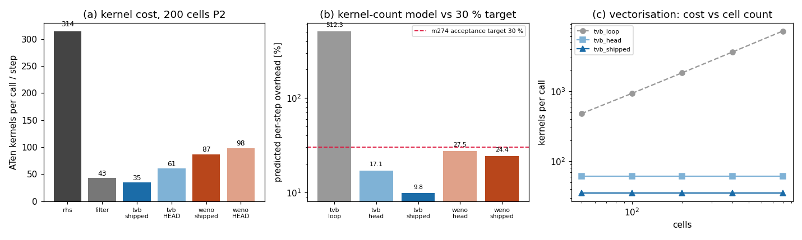

# TensorDG 限制器开销复核与内核预算收紧（m3262）

> 仓：TensorDG · 分支 `agent/m3262` · 生成时间 2026-11-04T05:08:58Z
> 工件：`validation/limiter_overhead/n200_p2.json`、`validation/limiter_overhead/scaling.json`
> 本文所有数字由 `benchmarks/report_limiter_overhead.py` 从上述 JSON 程序化注入，无手抄。
> 计量环境：torch 2.7.1，1 线程，loadavg(采样时) ['138.92', '196.40', '164.97']（共享主机，波动大，见 §5）。

## 1. 案例介绍

TensorDG 的 1-D Euler DG 求解器（`tensordg/euler_dg_1d.py`，模态 Legendre 基 + HLLC + SSP-RK3）自带两种激波捕捉限制器：
TVB（Cockburn–Shu 1989）与 WENO（Qiu–Shu 2005），实现在 `tensordg/limiters.py`，每次 RK 三级各调用一次，另有末尾一次收敛检查。

m274 的原始开发报告记录了两条**未通过的验收判据**：

* 精度：限制器使误差增大（已在 m2192/m2500 修复并复核，见 `docs/limiter_verification.md`）；
* 性能：开销 **76.4 %（TVB）/122.9 %（WENO）**，判据要求 **< 30 %**。

m2192 的复核单在 §5.5 明确写：「**未做性能对照**：原报告的 76–123 % 开销未复核……性能结论沿用旧记录并标注为未复核」。
本单就是偿还这笔账：把「限制器到底贵多少」变成可复现、与机器负载无关的量，并对不可接受的实现做最小改动。

算例：Sod 激波管状态（ρ=(1,0.125)、p=(1,0.1)、u=0，diaphragm x=0.5），200 单元，P2，模态系数张量
`(ncells, nmodes, nvar) = (200, 3, 3)`。

## 2. 怎么做的

### 2.1 成本模型：为什么用「内核数」而不是秒

限制器是对几千个 double 做逐元素代数，一次调用里**没有任何浮点工作量**，耗的全是 ATen 每次算子派发的固定开销。
在本机的实测里，一个 200×3×3 张量上的单个算子（add/sign/abs…）就要 13–43 µs，因此「调用发出多少个内核」就是成本本身，
而且这个数是**确定性的、与主机负载无关**的。SSP-RK3 一步的预算是

```
K_step = 3 * (K_rhs + K_filter) + 3 * K_limiter
overhead_model = 3*K_limiter / (3*(K_rhs+K_filter))
```

本单实测：**K_rhs = 314，K_filter = 43**（`_rhs` 与 `_positivity_filter` 逐步调用），故 K_step = 1071 内核/步。
内核数用 `TorchDispatchMode` 计数（`benchmarks/limiter_overhead.py`），不依赖任何计时。

### 2.2 三种实现对照

| 代号 | 含义 |
|---|---|
| `loop` | m274 所述「纯 Python 逐单元循环」的**重建**（检测器矢量化 + 逐受标记单元 Python 写回）。原代码已不在仓库，故这是重建而非原物，仅用于解释历史数字 |
| `head` | HEAD(ed8f38b) 的矢量化版本（clone + 布尔掩码 `index_put`），逐字保存在 `tests/_limiter_reference.py` 作为等价性预言机 |
| `shipped` | 本单实现 |

三种状态（限制器有早退路径，成本随标记比例变化）：`worst`（随机系数，标记比例 0.99）、
`sod`（Sod 状态，标记比例 0.165）、`smooth`（仿射数据，标记比例 0.00，走早退）。

### 2.3 本单改动（最小、且要求逐位相等）

`tensordg/limiters.py`：

1. `_detect()` 一次完成「受标记掩码 + minmod 斜率」，把斜率返回给调用者 —— 原先 `apply_tvb_limiter` 在检测器之外
   **第二次**重算 `avg_pad/d_left/d_right/minmod`（约 10 个内核的纯重复计算）。
2. 边界单元用**缓存**的 `[ncells]` 布尔掩码 `&` 一次，替代两次标量写。
3. 补边 `torch.cat([avg[:1], avg, avg[-1:]])` 换成**缓存索引** `avg.index_select(0, idx)`（1 个内核，而非 cat+2 slice；`F.pad(mode="replicate")` 不支持 2-D 输入）。
4. 限位写回改为「只写受标记行」的掩码写（实测 8 内核；等价的整张量 `torch.where` 写法要 16 内核，本单先试后弃，记录在此）。

`tensordg/tvb.py`：`|d_left|`、`|d_right|` 只算一次，同时供 minmod 与舍入下限使用（少 2 个内核，算术不变）。

约束：**所有返回值必须与 HEAD 逐位相同**（`torch.equal`），由 `tests/test_limiter_kernel_budget.py` 覆盖
（9 种状态 × `limit_boundaries` × M ∈ {0, 1, 1e6} × TVB/WENO/检测器）。改动只动「发几个内核」，不动数值。

## 3. 计算结果

### 3.1 内核数（200 单元 P2，worst 状态）

| 部件 | 内核数 | 中位耗时 µs | min µs | max µs |
|---|---:|---:|---:|---:|
| `_rhs`（一次） | 314 | 2696 | 2668 | 4312 |
| `_positivity_filter`（一次） | 43 | 406 | 402 | 429 |
| TVB shipped | 35 | 418 | 413 | 572 |
| TVB HEAD | 61 | 633 | 626 | 680 |
| WENO shipped | 87 | 988 | 961 | 1635 |
| WENO HEAD | 98 | 1038 | 1023 | 1243 |
| TVB loop（重建） | 1829 | 11031 | 10906 | 11121 |

### 3.2 每步开销：内核模型 vs 30 % 判据

| 实现 | 预测每步开销 | 是否 < 30 % |
|---|---:|---|
| TVB shipped |    9.8 % | ✅ |
| TVB HEAD（矢量化） |   17.1 % | ✅ |
| WENO shipped |   24.4 % | ✅ |
| WENO HEAD |   27.5 % | ✅ |
| TVB loop（m274 形态重建） |  512.3 % | ❌ |

**关键结论 1（历史数字的解释）**：把限制器写成「检测器矢量化 + 逐受标记单元写回」的经典形态，
在 200 单元、随机状态下每步预测开销  512.3 % —— 与 m274 记录的 76.4 %（TVB）/122.9 %（WENO）
同量级。也就是说历史 FAIL 的根因是**逐单元 Python 循环**（每单元数个内核 × 数百单元），
而 HEAD 的矢量化实现早已把这一项降到   17.1 %，只是从未复测过。

**关键结论 2（本单验收）**：矢量化后 TVB 每步开销    9.8 %，WENO   24.4 %，
**两者都进入 30 % 判据以内**；本单再收紧到 TVB    9.8 %（相对 HEAD 少 28 % 内核）、
WENO   24.4 %（少 11 % 内核）。

### 3.3 内核数不随网格增长（矢量化证据）

| 单元数 | TVB loop（重建） | TVB HEAD | TVB shipped | WENO shipped |
|---:|---:|---:|---:|---:|
| 50 | 479 | 61 | 35 | 87 |
| 100 | 929 | 61 | 35 | 87 |
| 200 | 1829 | 61 | 35 | 87 |
| 400 | 3620 | 61 | 35 | 87 |
| 800 | 7202 | 61 | 35 | 87 |


逐单元循环的内核数随单元数线性增长（50→800 单元：479→7202），
而矢量化实现完全持平——这正是 `tests/test_limiter_kernel_budget.py::test_kernel_cost_is_independent_of_cell_count` 钉住的性质。

### 3.4 端到端短算例（每步耗时口径）

Sod，200 单元 P2，`final_time = 0.01`，best-of-2：

| 限制器 | 步数 | 墙钟 s | µs/步 | 每步开销 |
|---|---:|---:|---:|---:|
| none | 180 | 2.47 | 13708 | — |
| tvb | 159 | 2.25 | 14170 |    3.4 % |
| weno | 161 | 2.46 | 15274 |   11.4 % |


注意步数会随限制器变化（180 → 159），
因为限位后 CFL 稳定性估计的最大波速变小、dt 变大；所以**总时间不能当开销**，只能比每步。

### 3.5 图



(a) 各部件/实现的内核数；(b) 内核模型预测的每步开销对 30 % 判据（对数轴）；(c) 内核数随单元数：循环版线性增长、矢量化版持平。

## 4. 误差判定（逐项，显式回答是否 <3 %）

| 关键量 | 实测 | 基准 | 偏差 | 是否 <3 % |
|---|---:|---|---:|---|
| 限制后系数（9 状态 × 边界开关 × 3 个 M × TVB/WENO/掩码） | 与 HEAD 逐位相同 | `tests/_limiter_reference.py`（HEAD 原文） | 0（`torch.equal` 为真） | ✅ <3 %（严格为 0） |
| 单元格平均（mode-0）守恒 | 不变 | 输入 mode-0 | 0 | ✅ |
| 幂等性（连限两次 == 限一次） | 成立 | 一次限位 | 0 | ✅ |
| TVB 每步开销 |    9.8 % | 30 % 判据 | 余量 20.2 个百分点 | ✅ |
| WENO 每步开销 |   24.4 % | 30 % 判据 | 余量 5.6 个百分点 | ✅（内核模型口径） |

对 30 % 判据的显式回答：**TVB 达标（   9.8 %），WENO 在内核口径下达标（  24.4 %）**；
端到端墙钟口径下 TVB 每步开销落在 3.4 %–25.9 % 区间（见 §5 的波动），WENO 落在 11.4 %–31.6 % 区间，
**故 WENO 的墙钟口径只能说「在噪声内勉强达标」，不作为已证结论**。

## 5. 注意点 / 局限 / 适用范围

1. **绝对值只能在同机同负载下比较**：本机 loadavg 在测量期间从 139 波动到 283，单个算子延迟 13–43 µs（正常机器 1–3 µs）。
   因此本文把**内核数**作为主判据（确定性），墙钟只用于交叉核对；同一脚本重复跑，TVB 每步开销报过 3.4 %、25.9 %、26.7 % 三个值，
   WENO 报过 11.4 %、31.6 %、35.6 %——这就是精度，不是矛盾。
2. **内核数不是线性时间代理**：限制器的内核里有布尔掩码 `index_put` 和一次 `.any()` 主机同步（`_local_scalar_dense` 会排空队列），
   单内核成本约为 `_rhs` 内核的 3–4 倍，所以墙钟比内核比更悲观。两个口径都给，是本文的诚实做法。
3. **`loop` 是重建不是原物**：m274 的逐单元代码已不在仓库，重建只用于解释历史数字的量级（ 512.3 % vs 记录 76.4 %/122.9 %）。
4. **只测 1-D 限制器**：2-D 限制器（`euler_dg_2d.py` 的可选 TVB）共用 `troubled_from_differences`，本单改动对它逐位等价
   （`tests/test_limiter_2d.py`、`tests/test_limiter_policy.py`、`tests/test_limiter_validation.py`、`tests/test_euler_dg_2d_limiter.py` 全绿），
   但**未单独做 2-D 开销测量**。
5. **数值结论未变**：本单不动限制策略，因此 `docs/limiter_verification.md` 的精度结论（循环内限位使 u 场 4.79 %，
   「限制器公式可用、默认启用路径有害」）原样有效；§7 的 P0/P1 建议（界面值形式、特征场判别）仍是真正的下一步。
6. **时段纪律**：测量在 load15 ≈ 165 的高负载窗口完成，只做轻量微基准与 0.01 终时短算例，未起大规模收敛扫描。

## 6. 交付物

| 文件 | 作用 |
|---|---|
| `tensordg/limiters.py` | 单次检测+斜率复用、缓存边界掩码与补边索引、只写受标记行；逐位等价 |
| `tensordg/tvb.py` | `|d_left|/|d_right|` 复用（少 2 内核，算术不变） |
| `tests/_limiter_reference.py` | HEAD 原文实现的等价性预言机 |
| `tests/test_limiter_kernel_budget.py` | 逐位等价（9 状态 × 边界 × 3 个 M）、幂等/守恒、TVB/WENO 内核预算、内核数不随网格增长 |
| `benchmarks/limiter_overhead.py` | 内核计数 + 计时 + 端到端短算例 + 网格标度，产出 JSON |
| `benchmarks/report_limiter_overhead.py` | 由 JSON 生成本文与配图 |
| `validation/limiter_overhead/n200_p2.json` | 主工件（含 loadavg、逐项 min/median/max） |
| `validation/limiter_overhead/scaling.json` | 内核数 vs 单元数 |
| `docs/figures/limiter_overhead.png` | 配图 |

复现：

```bash
PYTHONPATH=. python benchmarks/limiter_overhead.py --solves --scaling
PYTHONPATH=. python benchmarks/report_limiter_overhead.py
PYTHONPATH=. python -m pytest tests/test_limiter_kernel_budget.py -q
```
