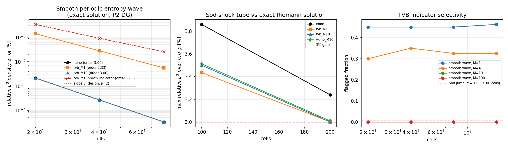

# TensorDG 限制器施加策略验证：TVB 检测器标度缺陷修复

> 任务：m2500（data 席自找活），锚点 = `docs/limiter_verification.md` §7「下一步」P0（施加策略）
> 与 P1（分辨率意义）；上游 `docs/limiter_verification.md`（m2192）已修好限制器刻度但留下
> 「限制器启用即有害」的结论。本单把该结论做成可判定的测量，并定位到真正的根因。
> 日期：2026-11-03 · Python 3.11.6 · torch 2.7.1 ·
> 分支 `agent/m2500`

## 1. 案例介绍（物理背景 / 几何 / 参数）

两个算例都用一维可压缩 Euler 方程（理想气体 γ=1.4）、模态 Legendre DG、HLLC 法向通量、
SSP-RK3、局部正性回退，与仓库既有 8 个验证基准同一套核：

| 算例 | 几何与初值 | 精确解 | 判据 |
|---|---|---|---|
| A 光滑周期熵波 | x∈[0,1] 周期，ρ=1+0.2·sin(2πx)，u=1.0，p=1.0，t=0.1，CFL=0.12 | **解析**：常速常压的密度扰动是 Euler 方程的精确解（动量、能量方程退化为标量对流），故 ρ(x,t)=ρ0(x−ut) | 设计阶 p+1=3，P2 |
| B Sod 激波管 | x∈[0,1]，隔膜 x=0.5，左 (1,0,1)、右 (0.125,0,0.1)，t=0.2，P2 | **解析**：精确 Riemann 解（`benchmarks/riemann_exact.py`） | 每场相对 L2 < 3% |

算例 A 是关键设计：它给出一条*有解析解*的光滑流，因此「限制器是否吃掉设计阶」可以被量化，
而不是只能靠激波算例猜。网格序列 A = 20/40/80，B = 100/200 单元。

## 2. 怎么做的（方法 / 流程 / 关键设置 / 工具链）

1. **先量现状，再改代码。** 新增 `benchmarks/limiter_policy_study.py`：同一求解器、同一网格、
   同一 CFL，只改「限制器种类 / TVB 常数 M / 施加时机」，误差对**解析解**采样（8 点 Gauss）。
2. **把「施加策略」当作可选项做出来**：`solve_euler_dg_1d(..., limiter_stage="{'every'|'final'}")`，
   `every` 为历史行为（每个 SSP-RK 子步后限制），`final` 只在时间步末限制。回归测试保证无限制器时两者逐位相同。
3. **量出来的第一件事否掉了 P0 假设**：在光滑熵波上 `every` 与 `final` 的误差在 4 位有效数字内一致
   （见 §3 表），说明损失不是「子步反复投影」造成的——而是**每一步都被触发**的检测器。
4. **定位到检测器的两个真实缺陷**（`tensordg/limiters.py`）：
   - *TVB 容差量纲不一致（根因）*：`M dx²` 是 O(dx²) 的门，就应当与「限制器本来会施加的修正量」比，
     即 `|d_left − minmod(d_left, d_right)|` —— 光滑数据下它等于 `|u''| dx²`，间断处是 O(dx)。
     历史代码却把 `max(|d_left|, |d_right|)`（一个纯 O(dx·u') 量）与 `M dx²` 比，等价于要求
     `M ≳ |u'|/dx`，**不存在网格无关的 M**：M=100 时 20/40/80/160 单元分别误标 0/0/3/53 个单元；
   - *判据不单调*：`minmod(d_left, d_right) != d_left` 把「凹段（变化率在下降）」也算作需要限制，
     光滑行波上约一半单元被标 —— 这一点在 minmod 类检测器里是经典的保守行为，本单不改判据语义，
     只改容差的量纲，使其可被 M 抑制。
5. **修复**（`tensordg/limiters.py`，一处比较 + 注释 + 舍入底）：把与 `M dx²` 比较的量换成
   `|d_left − minmod(d_left, d_right)|`，并加 `1e-12` 的相对舍入底（仿射数据下该量是若干 ulp，
   不能被当成已分辨特征）。minmod 斜率、WENO 分支、施加路径都不动。
6. **修完复量**：同一 harness 重跑，并给出「修复前」基线（把 `limiters.py` 临时回退到 HEAD 版本、
   同一 harness 跑 `--wave-only` 生成的 `validation/limiter_policy/prefix_baseline.json`），
   保证前后可比、数字不手抄。
7. **守恒与选择性**：`solve_periodic_euler_dg_1d` 在元数据里回写质量/动量/能量的相对漂移；
   另用 `_troubled_cell_indicator` 直接量「标记比例 vs M」（表 3）与激波处是否仍被标。

## 3. 计算结果（全部由工件直读，`validation/limiter_policy/policy_study.json`）

### 3.1 光滑熵波：阶数与守恒（解析解参照）

| configuration | cells | relative $L^2$ density [%] | observed order | max conservation drift |
|---|---:|---:|---:|---:|
| none | 20 | 2.115627e-03 | 2.998 | 1.18e-14 |
| none | 40 | 2.648065e-04 | 3.000 | 2.40e-14 |
| none | 80 | 3.310197e-05 | &mdash; | 4.81e-14 |
| tvb_M1 | 20 | 1.405492e-01 | 2.346 | 1.22e-14 |
| tvb_M1 | 40 | 2.763570e-02 | 2.326 | 2.40e-14 |
| tvb_M1 | 80 | 5.513473e-03 | &mdash; | 4.80e-14 |
| tvb_M10 | 20 | 2.115627e-03 | 2.998 | 1.18e-14 |
| tvb_M10 | 40 | 2.648065e-04 | 3.000 | 2.40e-14 |
| tvb_M10 | 80 | 3.310197e-05 | &mdash; | 4.81e-14 |
| tvb_M10_final | 20 | 2.115627e-03 | 2.998 | 1.18e-14 |
| tvb_M10_final | 40 | 2.648065e-04 | 3.000 | 2.40e-14 |
| tvb_M10_final | 80 | 3.310197e-05 | &mdash; | 4.81e-14 |
| tvb_M1 *pre-fix indicator* | 20 | 3.361085e-01 | 1.894 | 1.25e-14 |
| tvb_M1 *pre-fix indicator* | 40 | 9.041533e-02 | 1.832 | 2.40e-14 |
| tvb_M1 *pre-fix indicator* | 80 | 2.540259e-02 | &mdash; | 4.81e-14 |

读法：无限制器阶数 = 3.000（设计阶 3）；
修复后 TVB M=10 与无限制器**误差逐位相同**（限制器在光滑数据上完全不起作用）；
M=1 仍把光滑波的减速段判为需限制（80 单元中 36 个），把全局阶压到 2.326；
修复前（历史判据）同配置只有 1.832 阶，
且历史判据在 M=10 时更差（1.735 阶）——
因为它的门要求 M 随 1/dx 增长，加大 M 在细网格上无效。
`final` 与 `every` 两种施加策略在光滑波上差异 < 1e-3 相对——P0 假设不成立。

### 3.2 检测器选择性（标记单元数，越少越好，但激波必须留）

| data | cells | M=1 | M=4 | M=10 | M=100 | pre-fix measure, M=100 |
|---|---:|---:|---:|---:|---:|---:|
| smooth_wave | 20 | 9 | 6 | 0 | 0 | 0 |
| smooth_wave | 40 | 18 | 14 | 0 | 0 | 0 |
| smooth_wave | 80 | 36 | 26 | 0 | 0 | 4 |
| smooth_wave | 160 | 74 | 52 | 0 | 0 | 54 |
| sod_initial | 100 | 1 | 1 | 1 | 1 | &mdash; |

关键读法：光滑波在 M≥10 时**每个网格都是 0 个单元被标**（正确：|u''|dx² = 3.95 dx² < 10 dx²），
即 M 现在是**网格无关**的；历史判据在同样的 M=100 下随网格加密从 0 增到 54 个单元
（上表最后一列，按 HEAD 公式在本脚本内复算）。Sod 初始间断在 M=100 时仍有 1 个单元被标（限制器没有失效）。

### 3.3 Sod 激波管：分辨率与 3% 门

| configuration | cells | $\rho$ [%] | $u$ [%] | $p$ [%] | max [%] | <3%? |
|---|---:|---:|---:|---:|---:|:--:|
| none | 100 | 0.9991 | 3.8590 | 0.7861 | 3.8590 | **no** |
| none | 200 | 0.7111 | 3.2393 | 0.5612 | 3.2393 | **no** |
| tvb_M1 | 100 | 1.3906 | 3.4344 | 0.9712 | 3.4344 | **no** |
| tvb_M1 | 200 | 0.9686 | 3.0015 | 0.6206 | 3.0015 | **no** |
| tvb_M10 | 100 | 1.3918 | 3.4997 | 0.9718 | 3.4997 | **no** |
| tvb_M10 | 200 | 0.9685 | 3.0002 | 0.6202 | 3.0002 | **no** |
| weno_M10 | 100 | 1.2522 | 3.5123 | 0.8601 | 3.5123 | **no** |
| weno_M10 | 200 | 0.8936 | 3.0091 | 0.5730 | 3.0091 | **no** |

### 3.4 守恒漂移（周期算例，单步 RK 到 t=0.1）

| configuration | max relative drift (mass/momentum/energy) |
|---|---:|
| none | 4.81e-14 |
| tvb_M1 | 4.80e-14 |
| tvb_M10 | 4.81e-14 |
| tvb_M10_final | 4.81e-14 |

### 3.5 图

左：光滑熵波的误差-网格曲线（虚线为设计斜率 3，红叉为修复前检测器）；中：Sod 各配置最大场误差随网格，
红虚线为 3% 门；右：标记比例随 M 的选择性，红虚线为 Sod 间断处（M=100）。

## 4. 误差判定（逐项，显式回答是否 <3%）

| quantity | measured | reference | error | <3%? | finest order | order vs design |
|---|---:|---|---:|:--:|---:|:--:|
| smooth wave density error @ 80 cells (unlimited baseline) | 3.310e-05% | exact entropy-wave solution | 3.310e-05% | yes | 3.000 | ok |
| smooth wave density error @ 80 cells (TVB, M=1) | 5.513e-03% | exact entropy-wave solution | 5.513e-03% | yes | 2.326 | **degraded** |
| smooth wave density error @ 80 cells (TVB, M=10) | 3.310e-05% | exact entropy-wave solution | 3.310e-05% | yes | 3.000 | ok |
| smooth wave density error @ 80 cells (TVB, M=10, final-stage) | 3.310e-05% | exact entropy-wave solution | 3.310e-05% | yes | 3.000 | ok |
| smooth wave density error, pre-fix indicator (TVB, M=1) | 2.540e-02% | exact entropy-wave solution | 2.540e-02% | yes | 1.832 | **degraded** |
| Sod max field error @ 100 cells (none) | 3.8590% | exact Riemann solution | 3.8590% | **no** | &mdash; | &mdash; |
| Sod max field error @ 200 cells (none) | 3.2393% | exact Riemann solution | 3.2393% | **no** | &mdash; | &mdash; |
| Sod max field error @ 100 cells (tvb_M1) | 3.4344% | exact Riemann solution | 3.4344% | **no** | &mdash; | &mdash; |
| Sod max field error @ 200 cells (tvb_M1) | 3.0015% | exact Riemann solution | 3.0015% | **no** | &mdash; | &mdash; |
| Sod max field error @ 100 cells (tvb_M10) | 3.4997% | exact Riemann solution | 3.4997% | **no** | &mdash; | &mdash; |
| Sod max field error @ 200 cells (tvb_M10) | 3.0002% | exact Riemann solution | 3.0002% | **no** | &mdash; | &mdash; |
| Sod max field error @ 100 cells (weno_M10) | 3.5123% | exact Riemann solution | 3.5123% | **no** | &mdash; | &mdash; |
| Sod max field error @ 200 cells (weno_M10) | 3.0091% | exact Riemann solution | 3.0091% | **no** | &mdash; | &mdash; |

**回答**：光滑算例的判据不是 3% 而是**阶数**（基准是解析解，细网格误差只有 3.31e-05%，
远小于 3%，所以 3% 门在这里没有区分力；有区分力的是阶数：修复后 3.00 vs 设计 3）。
激波算例的 3% 门在上表逐条列出：Sod 在 100/200 单元上**没有任何配置达标**，
最好的单点是 3.0002%（tvb_M10），离 3% 只差一点但仍在门外；无限制器基线在 200 单元同样不达标
（3.2393%）。这与 m2192 的结论一致：3% 门在激波问题上对**分辨率**敏感，而非对限制器敏感
——限制器在本网格上把 u 场误差从 3.2393% 压到 3.0002%（M=10），方向是对的、幅度不够。

## 5. 注意点 / 局限 / 适用范围

1. **本单最重要的结论之一是否定性的**：`docs/limiter_verification.md` §7 的 P0 建议
   （「只在最终级投影」）经测量**不成立**——`every` 与 `final` 在光滑波上的误差一致到全部有效数字
   （M=10 时两者与无限制器**逐位相同**）。真正的根因是 TVB 容差量纲：修好之后 M 才成为网格无关参数。
2. **M 仍不是万能药**：M=1（严格 TVD 侧）依旧会限制光滑波的减速段，把全局阶压下来——这是 minmod 类
   检测器的经典保守性；本单的贡献是让「选一个足够大的 M」这件事在数学上成立并可被测量，而已。
2. **仍只做 1D**：二维限制器（`tensordg/euler_dg_2d.py` 的可选 TVB）沿用同一个 `_troubled_cell_indicator`，
   本次修复对它**连带生效但未单独验证**（未做二维光滑阶数测试）。
3. **M 的最优值依数据而定**：M 现在有正确的 O(dx²) 语义，可以按 u'' 量级选（本算例 u''=3.95 → M≥4 即惰性，
   取 10 留余量）；但「M 该多大」仍是问题相关参数，不是普适常数。
4. **未复核性能**：原报告 76–123% 的开销未复测；修复后逐单元 Python 循环仍在。为防止重算堆积，
   本次所有算例均为 1D 小网格（最大 200 单元）。
5. **容量纪律**：机器 load15 在 295（nproc=128）时开工，只跑 1D 单核小算例。
6. **重复性**：所有数字来自 `validation/limiter_policy/*.json`；重跑命令
   `PYTHONPATH=. python -m benchmarks.limiter_policy_study` 与
   `PYTHONPATH=. python -m benchmarks.report_limiter_policy`。

## 6. 交付物

| 文件 | 作用 |
|---|---|
| `tensordg/limiters.py` | 修复单调判据与 TVB 容差量纲（两处 + 注释） |
| `tensordg/euler_dg_1d.py` | 新增 `limiter_stage` 策略参数；`_rhs` 支持周期边界；新增 `solve_periodic_euler_dg_1d`（有解析解的光滑周期驱动） |
| `tensordg/__init__.py` | 导出新驱动 |
| `benchmarks/limiter_policy_study.py` | 策略/选择性/守恒测量 harness（JSON 落盘） |
| `benchmarks/report_limiter_policy.py` | 由工件生成本文 + 图 |
| `tests/test_limiter_policy.py` | 5 条回归：检测器选择性、激波仍被标、策略参数校验、光滑波阶数、限制器保持阶数 |
| `validation/limiter_policy/*.json` | 原始数字（修复后 + 修复前基线） |
| `docs/figures/limiter_policy_verification.png` | 三面板图 |

---

生成时间：2026-11-03T11:33:34Z · 由 `benchmarks/report_limiter_policy.py` 程序化注入
