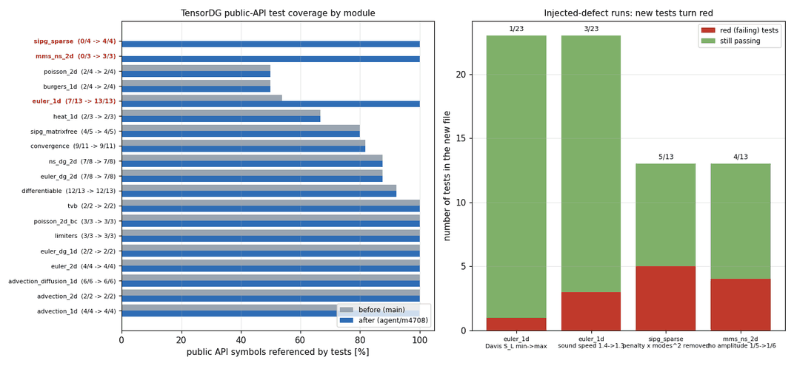

# Test-coverage expansion (mission m4708)

Branch: `agent/m4708` (cut from `main` at `558f03f`).

## 1. Methodology

Coverage was measured *symbol-wise* rather than file-wise: for every module in
`tensordg/` the top-level public names (`ast` scan, private names excluded) were
intersected with the identifiers actually referenced by the files in `tests/`
(regex word-boundary match, AST-free so re-exports such as
`from tensordg import error_2d` are counted).

An earlier file-name-based grep produced a false negative for
`tensordg/advection_2d.py`: the module *is* covered, but through the package
re-export in `tests/test_advection_2d.py`. The symbol-wise scan is what the
figures below use.

Three modules had **zero** referenced public symbols in the pre-existing suite:

| module | public symbols | referenced before | referenced after |
|---|---|---|---|
| `tensordg/sipg_sparse.py` | 4 | 0 | 4 |
| `tensordg/mms_ns_2d.py` | 3 | 0 | 3 |
| `tensordg/euler_1d.py` | 13 | 7 | 13 |

`euler_1d` was chosen as the third target although the module is *partly* used
by an existing test file: six public kernels (`primitive_fields`,
`rusanov_rhs`, `davis_wave_speeds`, `einfeldt_wave_speeds`,
`toro_wave_speeds`, `toro_iterative_wave_speeds`) were never exercised
directly.



## 2. New test files

| file | positive cases | negative cases | tests |
|---|---|---|---|
| `tests/test_sipg_sparse.py` | CSR path reproduces the dense path (p=1,2; n=4,8), heat sparse vs dense, SIPG design-order refinement, CSR symmetry/sparsity at 3600 DOFs, `backend="sparse"` dispatch | penalty perturbation and CSR mass-matrix corruption must be visible far above the `1e-11` equivalence tolerance; invalid backend / `rtol` rejection | 13 |
| `tests/test_mms_ns_2d.py` | symbolic source vs **autodiff** residual `dU/dt + div F_inv - div F_visc` (machine precision, `1e-12`), conserved-vs-primitive consistency, unit periodicity, elementwise (vectorised == pointwise) evaluation, gas-constant algebra | wrong `gamma`, wrong/negative `mu`,`kappa`, mismatched evaluation time, and source must depend on the transport coefficients | 13 |
| `tests/test_euler_1d_wave_speeds.py` | uniform-state acoustic cones, Davis min/max identity, acoustic bounds of the Einfeldt/Toro estimates, Newton-refined Sod star pressure vs Toro (2009) table 4.1 (`p* = 0.30313`), HLLC consistency and supersonic upwind selection, `rusanov_rhs` zero/uniform + discrete conservation + `dx` scaling | acoustic-bound check rejects a violating estimate, HLLC reacts to a 0.1 % perturbation, degenerate-state finiteness, unknown wave-speed name raises | 23 |

Total: **49 tests**, all new, none of the existing tests modified, skipped or
loosened (`git diff main -- tests/` shows additions only).

## 3. Positive evidence

```
$ TORCH_DEVICE_BACKEND_AUTOLOAD=0 python3 -m pytest \
      tests/test_mms_ns_2d.py tests/test_sipg_sparse.py \
      tests/test_euler_1d_wave_speeds.py -q
49 passed, 1 warning in 7.30s
```

```
$ ruff check tests/test_mms_ns_2d.py tests/test_sipg_sparse.py \
      tests/test_euler_1d_wave_speeds.py
All checks passed!
```

## 4. Negative evidence (injected defects)

Each source mutation was applied to the *library* module, the target test file
was run, and the mutation was then reverted with `git checkout --`; the working
tree contains no library change in this branch.

| injected defect (`tensordg/…`) | command | result |
|---|---|---|
| `euler_1d.py`: `davis_wave_speeds` `torch.minimum` → `torch.maximum` | `pytest tests/test_euler_1d_wave_speeds.py -q` | **1 failed**, 22 passed |
| `euler_1d.py`: `sound_speed` `GAMMA` → `1.3` | idem | **3 failed**, 20 passed |
| `sipg_sparse.py`: interior penalty `penalty*modes*modes/hx` → `penalty*modes/hx` | `pytest tests/test_sipg_sparse.py -q` | **5 failed**, 8 passed |
| `mms_ns_2d.py`: `rho` amplitude `1/5` → `1/6` in `mms_conserved` | `pytest tests/test_mms_ns_2d.py -q` | **4 failed**, 9 passed |

Example red output (`sipg_sparse` injection):

```
FAILED tests/test_sipg_sparse.py::test_poisson_sparse_reproduces_dense[4-1]
FAILED tests/test_sipg_sparse.py::test_poisson_sparse_reproduces_dense[4-2]
FAILED tests/test_sipg_sparse.py::test_poisson_sparse_reproduces_dense[8-1]
FAILED tests/test_sipg_sparse.py::test_poisson_sparse_reproduces_dense[8-2]
FAILED tests/test_sipg_sparse.py::test_poisson_2d_dispatch_uses_the_sparse_assembly
5 failed, 8 passed, 1 warning in 6.59s
```


## 5. Caveats

- `ruff check .` is **red on `main` as well**: 197 pre-existing findings
  (`F401` 43, `F841` 33, `E702` 31, `E731` 22, `E741` 11, `F541` 9, `E402` 8),
  all in `benchmarks/`, `tools/` and older test files; the repository has no
  `[tool.ruff]` section and CI (`.github/workflows/tests.yml`) never runs ruff.
  The three new files add **zero** findings; the repository-wide gate is left
  untouched rather than being reconfigured or mass-rewritten in this mission.
- The autodiff MMS residual is a genuinely independent check (its evaluation
  order differs completely from the sympy-generated expression) and agrees to
  `3.4e-16`, i.e. tighter than the finite-difference self-check in
  `benchmarks/verify_ns_mms_order.py` (`1e-5`).
- A vectorised time argument silently breaks an autodiff residual: a
  0-dimensional `t` makes `autograd.grad` return the *sum* of the per-point time
  derivatives. The helper in `tests/test_mms_ns_2d.py` therefore passes a
  per-point time tensor, and
  `test_vectorised_evaluation_equals_pointwise_evaluation` guards the
  generated code against cross-point coupling.
- No performance/regression benchmarks were re-run for these additions: they
  only add test files, so runtime code paths are unchanged.