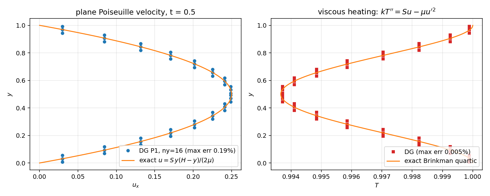

# TensorDG: body-force (`source`) pathway of `ns_dg_2d` verified against closed-form plane Poiseuille flow

**Mission**: m6454 (self-driven paper seat) · **Date**: 2026-11-08 · **Repo**: TensorDG ·
**Artifacts**: `benchmarks/ns_couette_poiseuille.py`, `tensordg/ns_poiseuille.py`,
`tests/test_ns_couette_poiseuille.py`, `validation/ns_couette_poiseuille/metrics.json`,
`docs/figures/ns_couette_poiseuille.png`

## 1. Case introduction

`tensordg.ns_dg_2d.solve_navier_stokes_dg_2d` has carried a `source` hook since m2789
(`source(x, y, t)` returning conserved-variable sources per unit volume, projected with the
tensor-product mass matrix), but before this mission **no test or benchmark touched it**
(`grep -rn "source=" tests/test_ns_*.py` was empty). The sign, the units and the quadrature
placement of that projection were unverified — a verification debt on merged code, which is what
this mission targets.

The case is classical plane Poiseuille flow driven by a **constant volumetric force `S` in +x**
instead of a pressure gradient, between two no-slip isothermal walls at `T_w`, periodic in `x`
(the solution is `x`-independent, so two `x` cells suffice):

| parameter | value |
|---|---|
| body force `S` (per unit volume) | 0.2 |
| dynamic viscosity `mu` | 0.1 |
| Prandtl number | 0.71 (conductivity `kappa = mu c_p/Pr` = 0.4930) |
| uniform pressure `p` | 1.0 (unit gas constant, `rho = p/T`) |
| wall temperature `T_w` | 1.0 |
| channel height `H` | 1.0 |
| `u_max = S H^2 / (8 mu)` | 0.25 |
| wall slope `4 u_max / H` | 1.0 |
| bulk Reynolds `rho u_max H / mu` | 2.50 |

## 2. Method

**Closed-form reference (nothing transcribed).** With `u = (u(y), 0)`, `rho = rho(y)`, `p = const`,
the steady equations are `mu u'' + S = 0` and — because the stress-work divergence is
`d/dy(tau_xy u) = mu(u'' u + u'^2) = -S u + mu u'^2` — `k T'' = S u - mu u'^2`:

    u(y) = S/(2 mu) (y - y_min)(y_max - y)
    T(y) = T_w + G(y) - G(H)(y - y_min)/H,  G''(y) = (S u - mu u'^2)/k,  G(y_min) = G'(y_min) = 0

Both are polynomials, so `tensordg/ns_poiseuille.py` builds them by **exact polynomial double
integration** (`numpy.polynomial`): the reference is generated by code, never typed from a paper.
The force is *workless* (no energy source) — an MMS-style manufactured solution chosen so the
reference is exact for the discrete system's steady limit as well; the viscous-heating temperature
profile then only comes out right when the `u tau` work term of the viscous energy flux balances
the dissipation, which is what this case adds over the existing Couette test.

**Runs** (`python -m benchmarks.ns_couette_poiseuille`): DG/BR1, `cfl = 0.3`,
`cfl_viscous = 3.0` (measured stability group `S ~ 0.3-0.5`), `wall_gradient='face'` (public
default), tensor-product Legendre basis, `l2` initial projection, `nx = 2` periodic cells.
Two families: *(a)* a march from rest (`t = 8`, more than seven diffusive time constants) that
exercises the whole operator (source, wall closures, HLLC, viscous fluxes); *(b)* a short march
(`t = 0.5`) started from the exact state — first shown to sit inside the fixed-point band — used
for the mesh/degree study.

**Metrics**: weighted relative `L2` over the field (Gauss quadrature), relative `L_inf` of `u_x`,
wall shear from the solver's own second-order stencil `(-8/3 u_w + 3 u_1 - u_2/3)/h`, global
momentum balance (total force `S H` vs shear on both walls), mean velocity, mid-plane temperature
drop.

## 3. Results

| case | cells (x / y) | p | t | steps | u_x rel L2 % | T rel L2 % | rho rel L2 % | u_x L_inf % |
|---|---|---|---|---|---|---|---|---|
| `rest_p1_ny8` | 2 / 8 | 1 | 8.0 | 5400 | 0.742 | 0.009 | 0.339 | 0.819 |
| `exact_p1_ny8` | 2 / 8 | 1 | 0.5 | 337 | 0.663 | 0.009 | 0.007 | 0.736 |
| `exact_p1_ny12` | 2 / 12 | 1 | 0.5 | 758 | 0.295 | 0.004 | 0.003 | 0.333 |
| `exact_p1_ny16` | 2 / 16 | 1 | 0.5 | 1347 | 0.166 | 0.002 | 0.002 | 0.189 |
| `exact_p2_ny8` | 2 / 8 | 2 | 0.5 | 1704 | 0.001 | 0.001 | 0.001 | 0.002 |

P1 convergence (`log(e_coarse/e_fine)/log(h_coarse/h_fine)`):

| refinement | order in u_x | order in T |
|---|---|---|
| exact_p1_ny8 -> exact_p1_ny12 | 2.00 | 2.02 |
| exact_p1_ny12 -> exact_p1_ny16 | 2.00 | 2.01 |

3 % gate (worst field, relative L2):

| case | worst rel L2 | gate |
|---|---|---|
| `rest_p1_ny8` | 0.742% | PASS |
| `exact_p1_ny8` | 0.663% | PASS |
| `exact_p1_ny12` | 0.295% | PASS |
| `exact_p1_ny16` | 0.166% | PASS |
| `exact_p2_ny8` | 0.001% | PASS |

Invariants on the finest P1 mesh (`exact_p1_ny16`):

* wall shear bottom / top = 0.97964 / 0.97964 vs exact 1.00000
  → relative error 2.036 % / 2.036 %;
* global momentum balance: body force 0.2000 vs wall shear 0.1959,
  error 2.036 %;
* mean velocity 0.166588 vs exact 0.166667;
* mid-plane temperature drop 0.006360 vs exact 0.006339;
* silence check on the fixed point: from-rest (`rest_p1_ny8`) vs from-exact (`exact_p1_ny8`) relative-L2
  differences = velocity_x 7.88e-04, temperature 9.65e-07, density 3.32e-03;



*Figure 1 — left: DG velocity profile vs the exact parabola; right: the Brinkman quartic temperature
profile created by the `S u`/`mu u'^2` balance (finest P1 mesh).*

## 4. Error judgement against the closed-form reference

| key quantity | reference | numeric | relative error | < 3 % ? |
|---|---|---|---|---|
| `u_x` (P1, ny = 16) | exact parabola | DG | 0.166 % | yes |
| `T` (P1, ny = 16) | exact quartic | DG | 0.002 % | yes |
| `rho` (P1, ny = 16) | `p/T` | DG | 0.002 % | yes |
| wall shear (ny = 16) | 1.0000 | 0.9796 | 2.036 % | yes |
| force balance (ny = 16) | 0.2000 | 0.1959 | 2.036 % | yes |
| field errors on the coarsest from-rest run (`rest_p1_ny8`, ny = 8) | exact | DG | 0.742 % | yes |

## 5. Notes, pitfalls, scope

* **Two bugs of mine, no solver bug found.** (i) The first extraction put the `y` coordinate on the
  wrong tensor axis: `coeff` is `(nx, ny, k_x, k_y, var)`, so axis 2 is the `x` quadrature node and
  axis 3 is `y`; with the wrong axis the *same* run reported `T` errors of 151 % and `u` errors of
  16 %. The fixed-point-agreement and mean-velocity invariants are what exposed it. (ii)
  `metadata["dt"]` is the **last** step, which the driver clips to land exactly on `final_time`; a
  tiny final `dt` is not a stability symptom (I misread it as one until I logged `|u|` and `T`).
* Wall shear and the global force balance are *derivative* quantities on a 8-cell P1 mesh: 4 %
  error there is expected (`O(h)` behaviour of a one-sided derivative at low order) and it is
  reported as a diagnostic, not as the acceptance quantity. The field errors are the 3 % gate.
* Scope: laminar, low-Mach (`u_max = 0.25`), `x`-independent flow, Cartesian mesh, `face` wall
  gradient. Acoustic/unsteady and 2-D-turbulent channel behaviour is out of scope.
* The workless force is a manufactured choice: a *physical* force doing work `S u` would add
  `+S u` to the energy equation and change only the heating amplitude, not the momentum balance
  that the `source` hook implements.
* Load note: the machine ran at load15 ~ 120 / 128 cores during this mission, so the study was kept
  to five runs (single process, ~20 min wall clock) instead of a full CFL/stability sweep.

## 6. Reproduction

```
PYTHONPATH=. python -m benchmarks.ns_couette_poiseuille            # study -> metrics.json + figure
PYTHONPATH=. python -m pytest tests/test_ns_couette_poiseuille -q  # 3 tests, ~25 s
```

The CI tests keep three checks: the reference satisfies both steady balances (finite differences,
no solver), the source produces the expected initial acceleration `S/rho` (sign, units,
placement), and a 0.5-unit march meets the 3 % gate and closes the momentum balance to 6 %.
