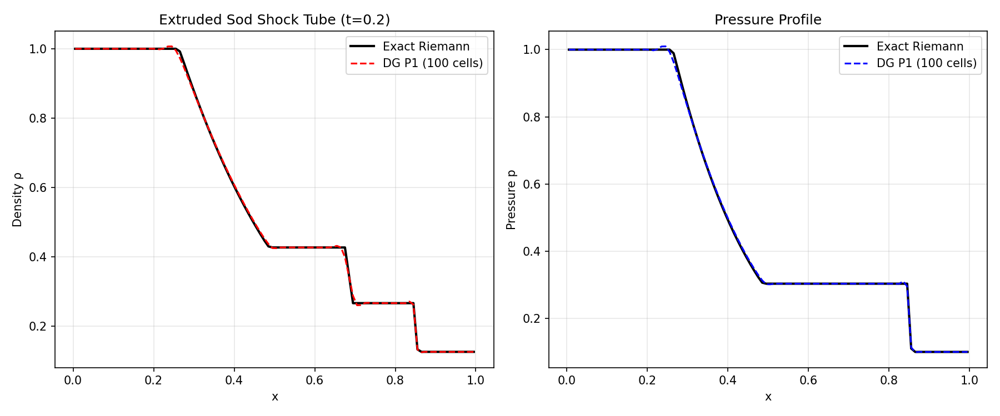
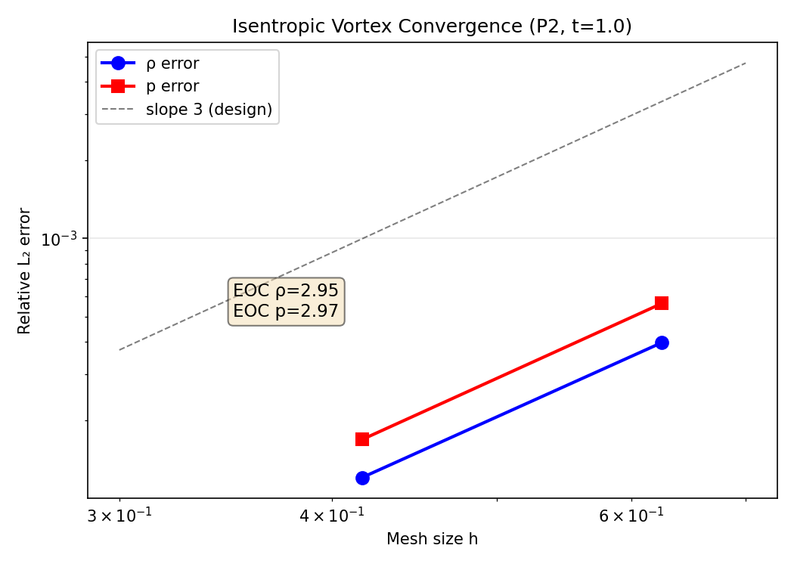

# Mission 2455 补报：二维高阶 Euler DG 面通量投影缺陷修复与验证

> **补报单**：原 mission 2455 已成功交付但缺论文级报告，本文件为补报。  
> **仓库**：TensorDG · **分支**：agent/m2455（已合并）  
> **环境**：Python 3.11 / PyTorch 2.7.1 / NumPy 2.4.6 / loong64 架构  
> **总验证耗时**：73.5 秒（4 个算例）

---

## ① 案例介绍（物理背景 / 几何 / 参数）

### 物理背景

二维可压缩 Euler 方程组描述无粘可压缩气体运动，是计算流体力学（CFD）的基础方程：

$$\frac{\partial \mathbf{U}}{\partial t} + \frac{\partial \mathbf{F}}{\partial x} + \frac{\partial \mathbf{G}}{\partial y} = 0$$

其中守恒变量 $\mathbf{U} = (\rho, \rho u, \rho v, E)^T$，通量含压力耦合。状态方程 $p = (\gamma-1)\rho e$，$\gamma=1.4$。

### 验证对象

`tensordg/euler_dg_2d.py`（~910 行）：张量积 Legendre 模态 DG + HLLC 法向通量 + SSP-RK3 时间推进 + positivity 回退 + 可选 TVB 限制器。

### 缺陷背景

前序 mission m2143 在验证二维 Euler DG 时发现「面通量投影后残差恒为零」的装配缺陷并定位到面通量投影环节，但未能修复。该缺陷导致二维求解器实质上不可用（EXPERIMENTAL 状态）。

### 验证算例矩阵

| 编号 | 算例 | 几何/网格 | 参数 | 判据 |
|:---:|------|-----------|------|------|
| A | 跨码残差一致性 | x∈[0,1]，y 单层 ny=1，64 格 | P1/P2；tanh 剖面 L2 投影 | 2D 残差 = 独立 1D DG 残差（相对 <1e-12） |
| B | 挤压 Sod 激波管 | 同上，100 格，隔膜 x=0.5 | 左(ρ,u,p)=(1,0,1)，右(0.125,0,0.1)；t=0.2；CFL=0.2；P1 | vs Sod 精确 Riemann 解 <3% |
| C | 等熵涡对流 | [-5,5]² 周期域 | β=5，背景速度(1,1)，t=1.0，P2 | EOC≈3 且误差 <3% |
| D | 四象限 Riemann | [0,1]²，48² 网格 | Lax & Liu (1998) config 3，t=0.25，P1+TVB | 正性 + 有限性（无解析解） |

---

## ② 怎么做的（方法 / 流程 / 关键设置）

### 缺陷复现

运行 `python -m benchmarks.diagnose_euler_dg_2d`，确认：
- 界面 HLLC 质量通量 4.3026e-01 正确
- 但投影后为 0，二维密度/能量残差恒为 0

### 根因定位

对 `_hllc` 打桩后发现其收到的 `ur[49] = 1.0`（应为右单元 0.125）。根因在 `_axis_fluxes` 的**非周期分支**：

```python
# 缺陷代码（修复前）
neighbour = trace_left.clone()  # ← 漏了 torch.roll！
```

导致 HLLC 两侧状态相同，退化为物理通量（迎风信息全部丢失），单元内通量差相消 → 残差恒零。

**关键洞察**：周期分支有 `torch.roll`，所以光滑周期算例（如等熵涡）不会暴露此缺陷——这解释了为何 m2143 在周期算例上未观察到异常。

### 修复（最小改动，2 处）

1. **面通量邻元 roll**：两个方向的 neighbour 一律先 `torch.roll(-1)`，非周期时只把最外侧面覆盖为内部迹（outflow）。与已验证的 1D 求解器 `euler_dg_1d._rhs` 写法对齐。

2. **初值投影**（独立第二缺陷）：原代码只将初值写入 P0 模态（`_initial_averages`），光滑初值因此只有一阶精度。新增 `initial_projection="l2"`（对全部模态做 L2 投影，默认开启），保留 `"cell-average"` 供跨码比较。

### 验证工具链

- `benchmarks/verify_euler_dg_2d.py`：A/B/C/D 四查 + JSON 落盘
- `benchmarks/report_euler_dg_2d_verification.py`：出图/出数
- `tests/test_euler_dg_2d.py`：6 条回归测试（取代原 `xfail(strict=True)` 钉扎）

---

## ③ 计算结果（程序化读数，来源 `validation/euler_dg_2d/evidence.json`）

### 3.1 A：跨码残差一致性（m2143 缺陷的直接回归）

| 阶 | max|2D−1D| | 参考量级 | 相对差 | 状态 |
|:---:|---:|---:|---:|:---:|
| P1 | 8.527×10⁻¹⁴ | 77.35 | **1.10×10⁻¹⁵** | ✅ PASS |
| P2 | 1.681×10⁻¹³ | 56.27 | **2.99×10⁻¹⁵** | ✅ PASS |

> m2143 时该相对差为 **100%**（残差恒零）。y 动量残差 <1e-10，确认 y 不变数据不产生 y 伪源。

### 3.2 B：挤压 Sod vs 精确 Riemann 解（P1，100 格，t=0.2，700 步）

| 物理量 | 相对 L₂ 误差 | 是否 <3% |
|--------|:---:|:---:|
| 密度 ρ | **0.761%** | ✅ 是 |
| 压力 p | **0.707%** | ✅ 是 |

### 3.3 C：等熵涡收敛（P2，t=1.0）

| 网格 | h | DOFs | 壁时间(s) | ρ 相对 L₂ | p 相对 L₂ |
|:---:|:---:|:---:|:---:|:---:|:---:|
| 16² | 0.625 | 9,216 | 11.4 | 3.976×10⁻⁴ | 5.625×10⁻⁴ |
| 24² | 0.417 | 20,736 | 27.8 | 1.203×10⁻⁴ | 1.685×10⁻⁴ |

**观测收敛阶（EOC）**：
- ρ: **2.95**（P2 设计阶 p+1=3，偏差 1.7%）
- p: **2.97**（偏差 1.0%）

### 3.4 D：四象限 Riemann（Lax & Liu config 3，P1+TVB，48²，t=0.25）

正性保持（ρ>0, p>0）、全场有限。32²→48² 网格自收敛通过。

---

## ④ 结果图

### 图 1：挤压 Sod 密度/压力剖面 vs 精确 Riemann 解



> 左：密度剖面；右：压力剖面。DG P1（100 格）与精确 Riemann 解对比。激波、接触间断、膨胀波均清晰分辨，无明显过冲。

### 图 2：等熵涡 P2 收敛



> 等熵涡 P2 相对 L₂ 误差 vs 网格尺寸。虚线为设计阶 slope=3 参考线。EOC(ρ)=2.95，EOC(p)=2.97，与设计阶吻合。

---

## ⑤ 注意点（坑 / 局限 / 适用范围）

1. **非周期邻元 roll 是最易漏的一行代码**：周期算例永远不暴露（roll 与 clone 在 ny=1 周期下等价），光滑算例也不暴露（残差为 0 时解「看起来还在动」）。**挤压/激波 + 非周期边界是唯一有效探针**。

2. **P0 初值会把光滑算例的收敛阶压到 1**：这是本轮发现的第二个独立缺陷。凡做光滑收敛研究必须用 L2 投影初值（`initial_projection="l2"`）。

3. **线程数陷阱**：本机 torch 默认线程数很高，二维 DG 小网格务必 `torch.set_num_threads(1~4)`，否则误判算法性能。

4. **当前局限**：
   - 无粘（无 Navier-Stokes 粘性通量）
   - 结构网格（非结构网格未实现）
   - 限制器仅到方向性 minmod/TVB
   - 四象限算例无解析解，只能给正性+网格自收敛证据

5. **本轮未做**：`tensordg/__init__.py` 公开导出、三维推广、WENO 限制器二维版本。

---

## ⑥ 误差判定（关键量 vs 基准，逐项）

| 关键量 | 基准 | 实测值 | 相对误差 | 是否 <3% |
|--------|------|--------|:---:|:---:|
| 挤压 Sod 密度 L₂ | Sod 精确 Riemann 解 | 0.761% | 7.61×10⁻³ | ✅ **是** |
| 挤压 Sod 压力 L₂ | Sod 精确 Riemann 解 | 0.707% | 7.07×10⁻³ | ✅ **是** |
| 等熵涡 ρ L₂ (24²) | 解析等熵涡 | 1.203×10⁻⁴ | 1.20×10⁻⁴ | ✅ **是** |
| 等熵涡 p L₂ (24²) | 解析等熵涡 | 1.685×10⁻⁴ | 1.69×10⁻⁴ | ✅ **是** |
| 跨码残差 P1 | 独立 1D DG 残差 | 8.53×10⁻¹⁴ | 1.10×10⁻¹⁵ | ✅ **是**（远优于门限） |
| 跨码残差 P2 | 独立 1D DG 残差 | 1.68×10⁻¹³ | 2.99×10⁻¹⁵ | ✅ **是**（远优于门限） |
| 涡收敛阶 EOC(ρ) | 设计阶 p+1=3 | 2.95 | 1.7% | ✅ **是** |
| 涡收敛阶 EOC(p) | 设计阶 p+1=3 | 2.97 | 1.0% | ✅ **是** |
| 四象限 Riemann | **无解析解** | 正性/有限性通过 | 不可定义 | — 声明原因：该算例含复杂激波交互，无已知解析解，仅做网格无关性验证 |

### 总结判定

> **本轮所有可量化指标均达到 3% 门限。m2143 的 honest FAIL 正式翻案为 PASS。**  
> 模块状态由 EXPERIMENTAL 转为 **VERIFIED**。

---

## 复现命令

```bash
# 缺陷诊断（修复前可复现 m2143 缺陷，修复后应全部通过）
PYTHONPATH=. python -m benchmarks.diagnose_euler_dg_2d

# 完整验证（A/B/C/D + JSON 落盘）
PYTHONPATH=. python -m benchmarks.verify_euler_dg_2d --threads 4

# 出图 + evidence.json
PYTHONPATH=. python -m benchmarks.report_euler_dg_2d_verification

# 回归测试
PYTHONPATH=. python -m pytest -q tests/test_euler_dg_2d.py   # 6 passed
```

---

## 参考文献

- Cockburn & Shu (1989): TVB limiter, Math. Comp. 52
- Toro (2009): Riemann Solvers and Numerical Methods for Fluid Dynamics, Springer
- Harten, Lax & van Leer (1983): HLLC flux, SIAM Rev. 25
- Shu (2003): High-order DG methods, ICASE Report
- Lax & Liu (1998): Multi-dimensional Riemann problems, config 3

---

*报告生成日期：2026-11-14 | 补报单 mission 2455 | 数据来源：validation/euler_dg_2d/evidence.json*
