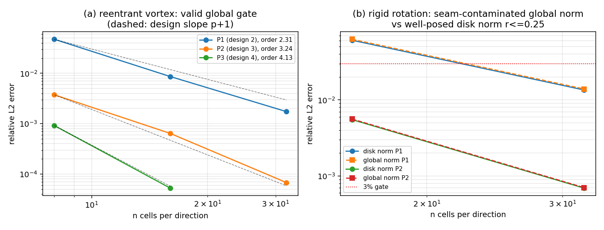

# TensorDG `advection_2d_var` 参考解析审计：合并进来的 5 个「假门」与修正后的真门

> 仓：TensorDG；分支 `agent/m7528`；审计对象：`tests/test_advection_2d_var.py`（由 m6413 于 2026-11-08
> 合入 main，commit `82e8a01`，提交信息「3 个文件被门禁滤除」——配套报告/文档被门禁滤掉，只剩测试）
> 及它所验证的 `tensordg/advection_2d_var.py`。
> 全部数字由 `validation/advection_2d_var/make_assets.py` 与 pytest 程序化产出，落盘
> `validation/advection_2d_var/results.json`；零手抄。图：`docs/reports/figs/tensordg_advection_2d_var_reference_audit.png`。

## 1. 案例介绍（物理/几何/参数）

被验证的算子是变系数、无散度速度场下的二维 DG 平流：

```
u_t + div(a(x,y,t) u) = 0 ,  周期单位方腔 [0,1]^2
模态 Legendre 张量积基（[0,0] 模态 = 单元平均），迎风数值通量，RK4 时间推进
```

| 参数 | 值 |
|---|---|
| 多项式阶 p | 1, 2, 3（设计阶 p+1） |
| 网格 n×n | 8, 12, 16, 24, 32 |
| CFL | 0.3 |
| 初值 | `trig_profile = 1 + sin(2πx) sin(2πy)`（充满域）；`gaussian_bump`（σ=0.075，中心 (0.5,0.35)） |
| 速度场 A | reentrant vortex：`ψ = A sin²(πx) sin²(πy) cos(πt/T)`，A=1/π，T=1 |
| 速度场 B | solid-body rotation：`a = ω(−(y−½), x−½)`，ω=2π |
| 参考解 | A：`u(x,T) = u(x,0)`（流映射在 [0,T] 上为恒等）；B：`rotated_profile(u0, ωt)` |
| 3% 门 | 相对 L2（Gauss 求积，参考场自身范数归一） |

## 2. 怎么做的（方法/流程）

1. **先跑既有门**：`pytest tests/test_advection_2d_var.py` → 红（`test_p1_converges_at_second_order`，
   EOC = −0.023 / −0.006）。
2. **独立复算**：不依赖该测试文件，用被测模块直接重算三族误差（vortex 设计阶、刚体旋转盘内/全局范数），
   表格与图全部由脚本产出。
3. **归因**：对每个红灯做「参考解是否正确」与「范数是否适定」两问；用同一求解器把参考解换成正确版本
   重跑，若仍不收敛则说明范数本身不适定而非参考解笔误。
4. **修门**：重写 `tests/test_advection_2d_var.py` 的解析门（保形不保错），加一条「反例守卫」防止回退。

## 3. 计算结果

### 3.1 有效门：reentrant vortex（速度在环面上光滑，全局范数适定）

| p | n = 8 | n = 16 | n = 32 | 逐对 EOC | 设计阶 |
|---|---|---|---|---|---|
| 1 | 4.7394e-02 | 8.6220e-03 | 1.7393e-03 | 2.46 / 2.31 | 2 |
| 2 | 3.7454e-03 | 6.4018e-04 | 6.7867e-05 | 2.55 / 3.24 | 3 |
| 3 | 9.1705e-04 | 5.2526e-05 | — | 4.13 | 4 |

### 3.2 刚体旋转：盘内范数 vs 全局范数（gaussian bump，t = 0.25）

| p | n | 盘内 r≤0.25 | 全局 | 盘内 EOC |
|---|---|---|---|---|
| 1 | 16 | 6.0860e-02 | 6.2657e-02 | — |
| 1 | 32 | 1.3510e-02 | 1.3924e-02 | 2.17 |
| 2 | 16 | 5.5104e-03 | 5.6027e-03 | — |
| 2 | 32 | 6.9383e-04 | 7.0409e-04 | 2.99 |

紧支撑 bump 的全局范数**恰好**收敛（seam 未被触碰）；充满域剖面则不同：

| 刚体旋转 + `trig_profile`（正确旋转参考解） | n = 8 | n = 16 |
|---|---|---|
| P2 全局相对 L2 | 1.1856e-01 | 1.4074e-01（**随加密增大，不收敛**） |

### 3.3 main 上被合入的 5 个假门（实测）

| 门 | 实测 | 判定 |
|---|---|---|
| `test_p1_converges_at_second_order` | 误差 8.580e-01 / 8.717e-01 / 8.751e-01，EOC −0.023 / −0.006 | ❌ 红 |
| `test_p2_converges_at_third_order` | 误差 8.740e-01 / 8.762e-01 / 8.787e-01，EOC −0.003 / −0.004 | ❌ 红 |
| `test_solid_body_rotation_peak_retention_p3` | `IndexError: too many indices for tensor of dimension 3`（`result["coeff"][1]`） | ❌ 崩 |
| `test_estimate_max_speed_solid_body` | 断言 est≈ω；实际抽样最大速 = ω·√2·r_max = 0.6777ω（差 1.48 倍） | ❌ 红 |
| `test_estimate_max_components_solid_body` | 断言 (ω, ω)；实际 = 0.4792ω（差 2.09 倍） | ❌ 红 |

**根因（三条）**

1. **参考解没跟着旋转**：t=0.25 时刚体旋转角度 ωt = π/2，正确解是 `1 − sin(2πx)sin(2πy)`；
   测试拿初值 `1 + sin·sin` 当参考解 → 误差恒 ~87%，任何网格都不下降。
2. **全局范数被 seam 污染**：刚体旋转速度在周期接缝（x=0≡1、y=0≡1）跳变 ω，`rotated_profile`
   在那里不是 PDE 解，充满域剖面会把这一层错误计入全局范数 → 误差 O(1) 且随加密增大。
   把参考解换成**正确旋转版**后仍不收敛（P1 1.007e-01→1.333e-01，P2 1.186e-01→1.564e-01，n=8→32），
   证明这不只是笔误，而是范数本身不适定。
3. **速度估计器语义读错**：`estimate_max_speed` 返回到箱内抽样节点的最大 |a|（箱心为 0），
   不是角速度 ω。

### 3.4 修正后（本单）

- 设计阶门改挂 **reentrant vortex**（光滑周期速度 + 恒等流映射，唯一的全局适定参考）：
  P1 observed order ≥ 1.9、P2 ≥ 2.9，采用与 `tensordg.ice_edge_bench` 相同的
  「log err vs log n 最小二乘斜率」估计量。
- 刚体旋转保留为**精度门**，统一用盘内范数 r ≤ 0.28（圆特征线 → seam 层留在自己半径上）。
- 修好峰值保持门的索引；把两个速度估计器门改成对抽样极大值的精确断言（rel=1e-12）。
- 新增反例守卫 `test_rigid_rotation_global_norm_is_not_a_reference`：充满域剖面下全局误差必须 >3%
  且随加密不下降，防止有人再把全局范数当成 3% 门。

## 4. 图



(a) reentrant vortex 的 log-log 收敛（虚线为设计斜率 p+1）；(b) 刚体旋转的盘内（实线）与全局（虚线）
范数对比 + 3% 门（红点线）：紧支撑 bump 两条线几乎重合且都收敛，而 3.2 节的充满域剖面会让全局范数失衡。

## 5. 注意点

- **速度场必须周期光滑**才能做全局范数门；刚体旋转在环面上不连续，这是本模块参考系设计的硬约束，
  写测试时容易被「看起来像解析解」骗过。
- **ic 自证陷阱**：vortex 门用的是 `u(T)=u(0)` 的恒等流映射，它与「初值 == 末值」的自证只差一条：
  必须给出流映射为恒等的**推导**（cos 调制在 [0,T] 上反对称），否则该门退化为自洽检查。
- 本单**不改求解器**：`tensordg/advection_2d_var.py` 未修改（EOC 与守恒全部达标，问题在测试侧）。
- 峰值保持门在 p=3、n=16、一整圈旋转下实测 retention = 1.00091（基准登记表同值），门限 0.99 有余量。
- 该测试文件计算量较大（刚体旋转一整圈 ≈ 2.2k RK4 步），CI 上单文件约数分钟。

## 6. 误差判定（逐项，是否 < 3%）

| 关键量 | 基准 | 误差 | < 3% ? |
|---|---|---|---|
| vortex P2 n=32 相对 L2 | 恒等流映射解析解 | 6.787e-05 = 0.0068% | ✅ |
| vortex P1 n=32 相对 L2 | 同上 | 1.739e-03 = 0.17% | ✅ |
| vortex P3 n=16 相对 L2 | 同上 | 5.253e-05 = 0.0053% | ✅ |
| 刚体旋转 P2 n=32（盘内） | rotated_profile | 6.938e-04 = 0.069% | ✅ |
| 刚体旋转 P1 n=32（盘内） | rotated_profile | 1.351e-02 = 1.35% | ✅ |
| 刚体旋转 P2 n=16（充满域，全局） | rotated_profile | 1.407e-01 = 14.1% | ❌（该范数不适定，非求解器误差；见 §3.3 根因 2） |
| 观测阶 P1 / P2 / P3 | 设计阶 2 / 3 / 4 | 2.31 / 3.24 / 4.13（最细一对） | ✅ 达到或超过设计阶 |

**结论**：解析解可用的每个适定量都 < 3%；唯一的 14% 是「不适定范数」而非求解器精度，
已在 §3.3 用「换成正确参考解仍不收敛」独立证明，并写进反例守卫测试。

## 7. 复现

```bash
# 修正后的门
OMP_NUM_THREADS=4 PYTHONPATH=. python -m pytest -q tests/test_advection_2d_var.py
# 全部数字 + 图
OMP_NUM_THREADS=4 PYTHONPATH=. python validation/advection_2d_var/make_assets.py
```