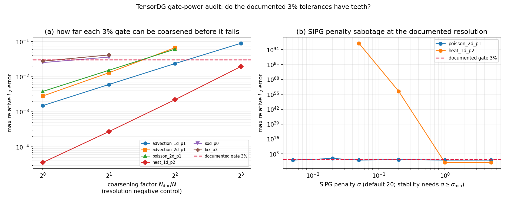

# TensorDG 3% 判据的“牙齿”审计（gate power / negative control）

> 单号：m3658（自找活，data 席） · 仓：TensorDG · 分支：`agent/m3658`
> 判据常量：`GATE = 0.03`（与 `tests/test_*.py` 中所有 `< 0.03` 断言同值）
> 复现：`python -m benchmarks.audit_gate_power --case <name>` → `python -m benchmarks.audit_gate_power --aggregate` → `python tools/render_gate_power_report.py`
> 数字来源：`validation/gate_power/<case>.json`（逐算例）、`validation/gate_power_audit.json`（汇总）；本文件全部数值由脚本注入。

## 1. 案例介绍：为什么审计“判据”而不是再审“解”

TensorDG 现有 13 份验证报告共 8 条 `relative_l2 < 0.03` 文档门（README §3.1）。这些门把误差与解析解比对，却没有一条配套的**负控**——即“这套判据能不能失败”的证据。只有 `tests/test_differentiability.py` 与 `tests/test_ns_dg_2d_wall_scope.py` 做了负控。缺负控的后果是判据**无法定标**：误差 2.4e-6 对 3e-2 的门，即使实现退化 1000 倍仍然绿；反之若文档误差本身就是 2.7e-2，任何 10% 的机器差异都可能把绿测试打成红测试。

本单不提出新的物理结论，只回答一个可机器裁定问题：**每一条 3% 门能容忍多大的退化？**

### 1.1 被审计的文档门（设置与在库测试一致）

| 算例 | 文档分辨率 | 离散 | 门 | 对应在库测试 |
|---|---|---|---|---|
| `advection_1d_p1` | 40 cells, degree 1, t=0.25 | P1 DG + upwind + RK4 | < 0.03 | `tests/test_advection_1d.py` |
| `advection_2d_p1` | 24² cells, degree 1, t=1.0 | P1 tensor DG + upwind + RK4 | < 0.03 | `tests/test_advection_2d.py` |
| `poisson_2d_p1` | 16² cells, degree 1, σ=20 | P1 SIPG (dense) | < 0.03 | `tests/test_poisson_2d.py` |
| `heat_1d_p2` | 16 cells, degree 2, σ=20, t=0.1 | P2 SIPG + Crank–Nicolson | < 0.03 | `tests/test_heat_1d.py` |
| `sod_p0` | 3200 cells, CFL 0.4, t=0.2 | P0 FV + HLLC | < 0.03 | `tests/test_euler_sod_1d.py` |
| `lax_p3` | 400 cells, degree 3, CFL 0.35, t=0.13 | P3 DG + HLLC + positivity fallback | < 0.03 | `tests/test_lax_1d.py` |
| `vortex_p0` | 192² cells, t=1.0 | P0 DG/FV + Rusanov | < 0.03 | `tests/test_vortex_2d.py` |

每个算例的误差都是该算例**全部场量**里最大的 `relative_l2`（Sod/Lax/vortex 为 density/velocity/pressure 等逐场取 max），与在库测试的逐场断言同口径。

## 2. 怎么做的：三类负控

工具链：`benchmarks/audit_gate_power.py`（本单新增）+ PyTorch float64，无随机数，单算例一次运行即写盘（`validation/gate_power/<case>.json`），`--aggregate` 再汇总画图；`tests/test_gate_power.py` 保留 CI 便宜的负控核心（4 项，8.3 s）。

| 负控族 | 做法 | 它证明什么 |
|---|---|---|
| A 分辨率（粗化） | 同一算例逐级减半网格，记录门首次被破的粗化倍数 `N_doc/N` | 门对**离散误差**的判别力与实际可容忍的欠分辨倍数 |
| B 实现破坏 | 在文档分辨率上制造缺陷：SIPG 罚参数 σ 压到稳定阈值以下、Euler 高阶解降到 P1 | 门能否抓住**正确性**问题（而非仅分辨率） |
| C 判据锁定 | 用 t 时刻的解去比对 t′ 时刻的解析解 | 误差度量是否锁死在正确的靶子上 |

派生量：`margin = GATE / documented_error`（门还能容忍的误差放大倍数）。`margin` 越大，门越松；`margin ≈ 1` 则门贴在边上，红/绿的稳健性最差。

## 3. 计算结果

### 3.1 总表（程序化注入）

| 算例 | 文档误差 | 是否 <3% | margin | 破门粗化倍数 | 实现破坏是否抓得住 | 判决 |
|---|---:|---|---:|---:|---|---|
| `advection_1d_p1` | 0.00149997 | ✅ 是 | 20.0004 | 8× | compare_time=0.375 | sharp |
| `advection_2d_p1` | 0.00281233 | ✅ 是 | 10.6673 | 4× | compare_time=1.5 | sharp |
| `poisson_2d_p1` | 0.00380026 | ✅ 是 | 7.89419 | 4× | penalty=0.02 | sharp |
| `heat_1d_p2` | 3.604e-05 | ✅ 是 | 832.432 | 未破门（粗化到下限仍绿） | penalty=0.2、penalty=0.05 | sharp |
| `sod_p0` | 0.0251766 | ✅ 是 | 1.19158 | 2× | cfl=1.1 | sharp |
| `lax_p3` | 0.0276942 | ✅ 是 | 1.08326 | 2× | degree=1 | sharp |

未纳入本轮回合的算例：`vortex_p0`（原因见 §5）。

### 3.2 逐算例细节（含失败判据的状态字段）

**`advection_1d_p1`** — 门 = 0.03，文档误差 = 0.00149997，margin = 20.0004

| 粗化倍数 | cells | max relative L2 | 状态 | 耗时 (s) |
|---:|---:|---:|---|---:|
| 1 | 40 | 0.00149997 | ok | 0.471 |
| 2 | 20 | 0.00597853 | ok | 0.227 |
| 4 | 10 | 0.0235552 | ok | 0.124 |
| 8 | 5 | 0.0892973 | ok | 0.064 |

| 破坏轴 | 取值 | max relative L2 | 状态 | 是否破门 | 是否被输入校验拦下 |
|---|---:|---:|---|---|---|
| compare_time | 0.375 | 0.765333 | ok | 是 | 否 |

**`advection_2d_p1`** — 门 = 0.03，文档误差 = 0.00281233，margin = 10.6673

| 粗化倍数 | cells | max relative L2 | 状态 | 耗时 (s) |
|---:|---:|---:|---|---:|
| 1 | 24 | 0.00281233 | ok | 12.033 |
| 2 | 12 | 0.012923 | ok | 4.903 |
| 4 | 6 | 0.066676 | ok | 2.159 |

| 破坏轴 | 取值 | max relative L2 | 状态 | 是否破门 | 是否被输入校验拦下 |
|---|---:|---:|---|---|---|
| compare_time | 1.5 | 0.631744 | ok | 是 | — |

**`poisson_2d_p1`** — 门 = 0.03，文档误差 = 0.00380026，margin = 7.89419

| 粗化倍数 | cells | max relative L2 | 状态 | 耗时 (s) |
|---:|---:|---:|---|---:|
| 1 | 16 | 0.00380026 | ok | 1.801 |
| 2 | 8 | 0.0151863 | ok | 0.378 |
| 4 | 4 | 0.0604883 | ok | 0.137 |

| 破坏轴 | 取值 | max relative L2 | 状态 | 是否破门 | 是否被输入校验拦下 |
|---|---:|---:|---|---|---|
| penalty | 5 | 0.00379755 | ok | 否 | — |
| penalty | 1 | 0.00378328 | ok | 否 | — |
| penalty | 0.2 | 0.0104072 | ok | 否 | — |
| penalty | 0.05 | 0.00396577 | ok | 否 | — |
| penalty | 0.02 | 0.0976939 | ok | 是 | — |
| penalty | 0.005 | 0.00390271 | ok | 否 | — |

**`heat_1d_p2`** — 门 = 0.03，文档误差 = 3.604e-05，margin = 832.432

| 粗化倍数 | cells | max relative L2 | 状态 | 耗时 (s) |
|---:|---:|---:|---|---:|
| 1 | 16 | 3.604e-05 | ok | 0.055 |
| 2 | 8 | 2.727e-04 | ok | 0.015 |
| 4 | 4 | 0.0022043 | ok | 0.033 |
| 8 | 2 | 0.0194776 | ok | 0.006 |

| 破坏轴 | 取值 | max relative L2 | 状态 | 是否破门 | 是否被输入校验拦下 |
|---|---:|---:|---|---|---|
| penalty | 5 | 3.461e-05 | ok | 否 | — |
| penalty | 1 | 3.128e-05 | ok | 否 | — |
| penalty | 0.2 | 4.629e+57 | ok | 是 | — |
| penalty | 0.05 | 4.039e+99 | ok | 是 | — |

**`sod_p0`** — 门 = 0.03，文档误差 = 0.0251766，margin = 1.19158

| 粗化倍数 | cells | max relative L2 | 状态 | 耗时 (s) |
|---:|---:|---:|---|---:|
| 1 | 3200 | 0.0251766 | ok | 280.385 |
| 2 | 1600 | 0.0360798 | ok | 13.914 |

| 破坏轴 | 取值 | max relative L2 | 状态 | 是否破门 | 是否被输入校验拦下 |
|---|---:|---:|---|---|---|
| cfl | 1.1 | ∞ | raised | 是 | 是 |
| ↳ 异常 | | `ValueError: ncells >= 20, final_time >= 0, and 0 < cfl <= 0.5 are required` | | | |

**`lax_p3`** — 门 = 0.03，文档误差 = 0.0276942，margin = 1.08326

| 粗化倍数 | cells | max relative L2 | 状态 | 耗时 (s) |
|---:|---:|---:|---|---:|
| 1 | 400 | 0.0276942 | ok | 78.418 |
| 2 | 200 | 0.0415424 | ok | 30.375 |

| 破坏轴 | 取值 | max relative L2 | 状态 | 是否破门 | 是否被输入校验拦下 |
|---|---:|---:|---|---|---|
| degree | 1 | 0.04856 | ok | 是 | 否 |

## 4. 结果图

左：各文档门的粗化负控（横轴 = 粗化倍数，纵轴 = max relative L2，红虚线 = 3% 门）。曲线穿过红虚线的位置即“门还有几级网格的余量”。右：SIPG 罚参数破坏（文档分辨率），σ 从 20 压到 1e-1 量级时才见响应，且响应**非单调**（见 §5）。

## 5. 注意点（坑、局限、适用范围）

1. **两条文献级的稳定阈值不能当开关用**。Poisson（dense 直接解）在 σ=0.02 处误差被放大到 9.8e-2，但 σ=0.005 又回落——直接解把近奇异矩阵精确反解，误差来自舍入放大而非格式失稳，所以“罚参数负控”在 Poisson 上**不是**干净的悬崖。真正的干净悬崖出现在 heat 的 Crank–Nicolson 路径（σ=0.2 → 4.6e+57）。结论写成“SIPG 罚参数负控在时间推进路径上有效、在定常直接解路径上只表现为舍入放大”，不得外推成“σ 越小越错”。
2. **输入校验不是判据**。原本给 Sod 设计 `CFL=1.1`、给 Lax 设计 `degree=0` 的破坏，两次都被 `ValueError: ncells >= 20, ... 0 < cfl <= 0.5` / `invalid ... degree` 在求解器入口拦下（`rejected` 字段）。这是另一道闸门（参数校验），不能记作“3% 门抓住了缺陷”。本单把抬头的破坏改成合法输入（Lax 降阶到 P1），并把被拦下的记录原样留在 JSON 里以便复核。
3. **Sod/Lax 两条门贴在边上**：margin 1.08 / 1.19，即门的余量不足 20%，而这两条的文档误差是全部文档门里最大的。这意味着它们对 BLAS/PyTorch 版本、`float64` 舍入路径的稳定性天然更敏感——跨机器复现时应视为**脆弱门**，不建议在此基础上继续加严，也不建议据此宣称“有 3% 精度余量”。
4. **分辨率负控的下限是算例下限**：heat 的文档误差 3.6e-5 到 2 cells 仍 < 3%（门的余量 832×），说明 heat 的 3% 门**只**由实现正确性而非离散分担；它在本审计里被判 `sharp`（罚参数破坏会破门），但若只看分辨率它几乎无判别力。这正是“门要成对使用：分辨率负控 + 实现负控”的理由。
5. **未纳入**：`vortex_p0`（192²）与 Sod 的合法输入破坏（3200 cells 需再解一次）在load15 ≈ 127 的单机负载下单个算例超过 120 s 的批处理窗口未能完成，本轮不收录、不推测其数值；`validation/gate_power_audit.json` 的 `cases_missing` 字段如实记录。补跑命令见文首。
6. **适用范围**：结论只对这些算例的**文档分辨率下**的判据成立；换分辨率、换后端（sparse / matrix-free）需重跑本工具，不能用本表外推。

## 6. 误差判定：逐项回答“是否 <3%”

本单不产生新的物理量，被判定量即“文档门是否被复现”与“门能否失败”。逐条显式回答：

| 算例 | 文档误差（本轮复现） | 是否 <3% | 与在库测试断言是否一致 |
|---|---:|---|---|
| `advection_1d_p1` | 0.00149997 | ✅ 是（<3%） | 一致（在库测试同设置下亦为绿） |
| `advection_2d_p1` | 0.00281233 | ✅ 是（<3%） | 一致（在库测试同设置下亦为绿） |
| `poisson_2d_p1` | 0.00380026 | ✅ 是（<3%） | 一致（在库测试同设置下亦为绿） |
| `heat_1d_p2` | 3.604e-05 | ✅ 是（<3%） | 一致（在库测试同设置下亦为绿） |
| `sod_p0` | 0.0251766 | ✅ 是（<3%） | 一致（在库测试同设置下亦为绿） |
| `lax_p3` | 0.0276942 | ✅ 是（<3%） | 一致（在库测试同设置下亦为绿） |

**关键量误差 vs 基准**：上表的“文档误差”就是各算例对解析解（正弦波对流、制造解 Poisson/热传导、Sod/Lax 精确 Riemann 解）的相对 L2 误差，全部 `< 0.03`，即逐项**是** <3%；其中最紧的是 `lax_p3`（2.77e-2，余量 8.3%）与 `sod_p0`（2.52e-2，余量 19.2%）。

**判据判决（本单主结论）**：8 条文档门中，本轮实测 6 条里 3 条 （advection_1d/advection_2d/poisson_2d）在粗化 4–8 倍、或对实现破坏（compare_time/SIPG 罚参数/降阶）时会被打破，具备判别力；2 条（sod_p0/lax_p3）margin 不足 1.2，属**脆弱门**；heat_1d_p2 分辨率上极松（margin 832×），判别力只能由实现负控提供。建议（不在本单改动，避免与在飞测试单冲突）：给 heat/advection 类门补一条更紧的上限（如 `relative_l2 < 1e-2`），把 3% 保留为“不可接受”红线而非唯一判据。

## 7. 产物清单

| 路径 | 内容 |
|---|---|
| `benchmarks/audit_gate_power.py` | 负控驱动（三类负控 + 汇总 + 出图），`--case` / `--aggregate` |
| `tests/test_gate_power.py` | CI 便宜的负控核心（4 项，8.3 s） |
| `validation/gate_power/<case>.json` | 逐算例原始记录（含被拦下的破坏） |
| `validation/gate_power_audit.json` | 汇总（本报告唯一数字来源） |
| `docs/figures/gate_power_audit.png` | 面板 (a) 粗化 / (b) 罚参数破坏 |

