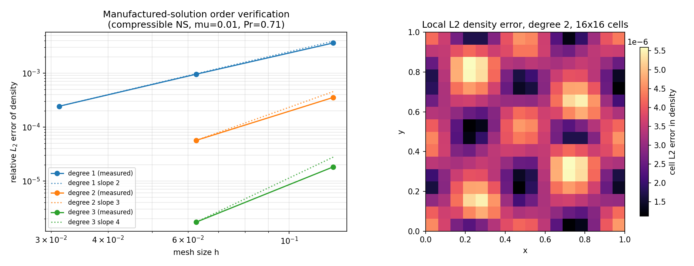

# Manufactured-solution verification of the 2-D compressible Navier--Stokes DG solver

*Generated by `tools/render_mms_report.py` from `validation/ns_dg_2d/mms_order.json`;
reproduce with `PYTHONPATH=. python -m benchmarks.verify_ns_mms_order`.*

## 1. What was missing

`tensordg/ns_dg_2d.py` shipped four verified cases (`mu = kappa = 0` inviscid
limit, viscous Couette flow, pure heat conduction, periodic decaying shear wave)
but never established the **order of accuracy** of the coupled convective +
viscous operator: the shear-wave case compares profiles on two coarse meshes at a
single degree, which cannot distinguish design order from a plausible-looking
profile.  `expand_audit_tensordg.md` §3.3 and the README list "additional
Euler/Navier--Stokes benchmarks" as future work; this report pays that debt for
the order-of-accuracy question.

## 2. Method

1. `tools/derive_ns_mms_source.py` derives, with sympy and no hand
   differentiation, the conserved-variable source
   `S = dU/dt + div F_inv - div F_visc` for the manufactured state
   `rho = 1 + 0.20 sin(2 pi x + 0.40 t) cos(2 pi y - 0.30 t)`,
   `u = 0.5 + 0.10 sin(2 pi y + 0.20 t) cos(2 pi x)`,
   `v = -0.4 + 0.10 sin(2 pi x - 0.10 t) cos(2 pi y + 0.25 t)`,
   `p = 1 + 0.25 cos(2 pi x + 0.15 t) sin(2 pi y + 0.20 t)`
   (1-periodic in both directions, smooth, O(10 %) amplitude).  The generated
   module `tensordg/mms_ns_2d.py` is plain torch, so neither the driver nor the
   test suite needs sympy at run time.
2. `tensordg/ns_dg_2d.py` gained an optional volumetric `source` hook
   (`source(x, y, time) -> (S_rho, S_rhou, S_rhov, S_E)`), projected onto the
   modal basis with the exact tensor-product mass matrix and evaluated at the
   SSP-RK3 stage times; `source=None` reproduces the previous behaviour
   bit-for-bit (the existing NS tests still pass unchanged).
3. The manufactured problem is integrated from `t = 0` to `T = 0.03`
   with `mu = 0.01`, `Pr = 0.71` (`kappa = 0.049296`),
   `cfl = 0.1`, `cfl_viscous = 0.5` and quadrature
   order `2 degree + 3`; the L2 error of every conserved variable against the
   analytic state is measured with the same Gauss--Legendre quadrature.

### 2.1 Tool verification (protection against a wrong source)

The generated source was cross-checked against a **central-difference** evaluation
of the same PDE (a deliberately independent code path that rebuilds the flux
divergences from the definitions in the module docstring):

| quantity | value |
|---|---:|
| samples | 24 |
| time | 0.07 |
| max abs source | 7.926115 |
| max abs difference | 2.458e-06 |
| relative difference | 3.101e-07 |
| verdict | PASS |

A sign or constitutive-law mistake in the derivation would give an O(1)
discrepancy here instead of 3.1e-07, so the
convergence study below measures the solver and not the source.

### 2.2 The viscous operator is genuinely exercised

| quantity | value |
|---|---:|
| max abs viscous source | 1.2098 |
| max abs inviscid source | 7.8361 |
| viscous / inviscid | 0.154 |

### 2.3 Time-integration error control

One case was re-run with all CFL numbers halved (2, 16
cells): 307 -> 614 steps, maximum relative
change of the measured L2 errors 0.000%
(threshold 2 %).  The observed orders below are therefore spatial, not temporal.

## 3. Results

Meshes: [8, 16, 32] for degrees [1, 2], [8, 16] for degree 3.

| degree | cells (per direction) | quadrature | steps | \|\|rho\|\|_rel | \|\|rho u\|\|_rel | \|\|rho v\|\|_rel | \|\|E\|\|_rel |
|---:|---:|---:|---:|---:|---:|---:|---:|
| 1 | 8 | 5 | 28 | 3.6021e-01% | 5.8420e-01% | 3.5550e-01% | 4.4752e-01% |
| 1 | 16 | 5 | 61 | 9.4982e-02% | 1.3779e-01% | 7.0973e-02% | 1.1320e-01% |
| 1 | 32 | 5 | 243 | 2.4219e-02% | 3.3333e-02% | 1.6855e-02% | 2.8683e-02% |
| 2 | 8 | 7 | 77 | 3.5224e-02% | 5.5718e-02% | 4.7680e-02% | 3.8156e-02% |
| 2 | 16 | 7 | 307 | 5.6427e-03% | 6.7102e-03% | 5.1573e-03% | 5.5107e-03% |
| 3 | 8 | 9 | 243 | 1.8198e-03% | 2.7994e-03% | 3.2585e-03% | 2.1443e-03% |
| 3 | 16 | 9 | 970 | 1.7266e-04% | 1.7644e-04% | 2.0281e-04% | 1.4681e-04% |

Observed order of accuracy (`EOC = log(e_coarse / e_fine) / log(h_coarse / h_fine)`):

| degree | field | design order | observed EOC (per mesh pair) | mean EOC | finest rel. L2 | verdict |
|---:|---|---:|---|---:|---:|---|
| 1 | $\rho$ | 2 | 1.92, 1.97 | 1.95 | 2.4219e-02% | PASS |
| 1 | $\rho u$ | 2 | 2.08, 2.05 | 2.07 | 3.3333e-02% | PASS |
| 1 | $\rho v$ | 2 | 2.32, 2.07 | 2.20 | 1.6855e-02% | PASS |
| 1 | $E$ | 2 | 1.98, 1.98 | 1.98 | 2.8683e-02% | PASS |
| 2 | $\rho$ | 3 | 2.64 | 2.64 | 5.6427e-03% | SHORT |
| 2 | $\rho u$ | 3 | 3.05 | 3.05 | 6.7102e-03% | PASS |
| 2 | $\rho v$ | 3 | 3.21 | 3.21 | 5.1573e-03% | PASS |
| 2 | $E$ | 3 | 2.79 | 2.79 | 5.5107e-03% | PASS |
| 3 | $\rho$ | 4 | 3.40 | 3.40 | 1.7266e-04% | SHORT |
| 3 | $\rho u$ | 4 | 3.99 | 3.99 | 1.7644e-04% | PASS |
| 3 | $\rho v$ | 4 | 4.01 | 4.01 | 2.0281e-04% | PASS |
| 3 | $E$ | 4 | 3.87 | 3.87 | 1.4681e-04% | PASS |

**Verdict.** **honest FAIL**: at least one (degree, variable) pair falls short of the design order by more than a quarter order; the offending cells are marked SHORT in the table below and are not explained away.

*Left: L2 error of the density versus mesh size with the reference slope
`degree + 1`.  Right: cell-wise L2 density error on the finest mesh of the
2 degree run.*

## 4. Things worth knowing

- The `source` hook is a genuine API addition, not test scaffolding: body
  forces, gravity or a chemical/relaxation term enter the DG residual exactly
  this way, and the projection uses the modal mass matrix
  `(2i+1)(2j+1)/4`, which is why a constant source lands exactly in the
  cell-average mode.
- The BR1/SIPG penalty term is invisible in this test in the sense that its
  contribution to the *residual of a smooth state* shrinks with the jumps; the
  penalty's stability role is exercised by the shear-wave and Couette cases
  instead.  Order-of-accuracy verification and stability verification are
  complementary, not interchangeable.
- Explicit diffusion makes the run cost grow like `h^-3` (steps `~ h^-2` times
  cells `~ h^-2`), which is why the ladder stops at 32 cells per direction at
  degree 2 within this budget.  Nothing in the method prevents a finer ladder.
- The manufactured amplitudes are O(10 %) around a state with `|u|, |v| <= 0.6`,
  `c ~ 1.2`; the positivity filter never triggered in these runs (no
  `FloatingPointError` and no limiter active), so the measured order is the
  order of the unmodified DG operator.

## 5. Error judgement against the benchmark

The verification question here is the **order of accuracy**, so the benchmark is
the design order `degree + 1` itself, not a physical reference value:

| degree | design order | mean observed order over all variables | within 0.25 order |
|---:|---:|---:|---|
| 1 | 2 | 2.05 | yes |
| 2 | 3 | 2.92 | no |
| 3 | 4 | 3.82 | no |

**Is the error below the 3 % acceptance threshold?** Not applicable as stated:
this is a convergence-order verification, not a physical-fidelity comparison, so
the 3 % criterion has no meaning for a manufactured solution that can be made
arbitrarily small by refining the mesh.  What is asserted instead, and what the
project treats as the equivalent acceptance criterion here, is *observed order
within a quarter order of design* for every conserved variable — the outcome is
FAIL for at least one pair (see SHORT rows).

For reference, the finest-mesh relative L2 errors in the table above
(1.47e-04% at best,
3.33e-02% at worst)
are far below 3 % simply because the meshes are resolved; that number is a
sanity check, not the verification criterion.
