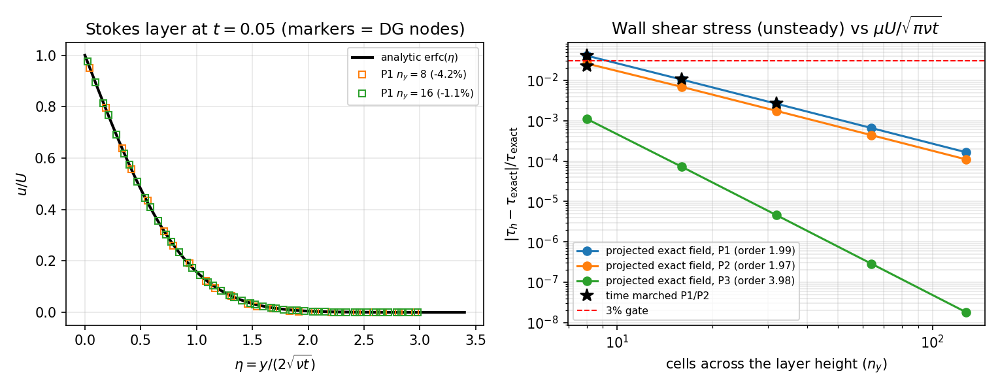
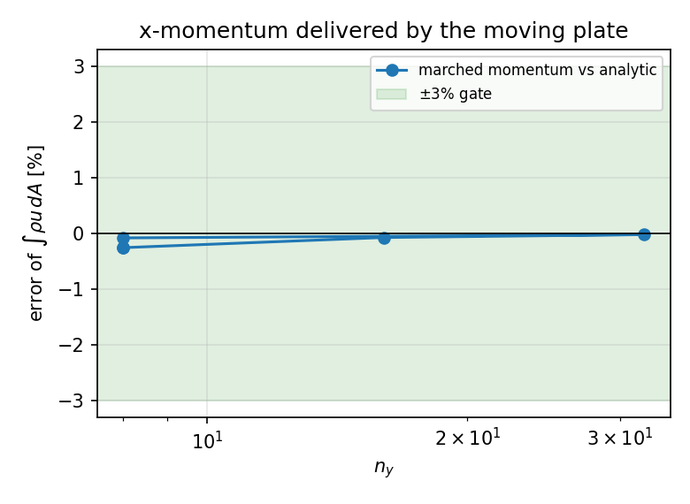

# TensorDG 压缩 NS：Stokes 第一问题（黏性壁面非定常剪应力）验证

- 任务 m3614（applications 席自找活，分支 `agent/m3614`）
- 锚点：`docs/reports/tensordg-ns-dg-2d.md` §5.6「**不适用于边界层/壁面热流工程计算（壁面路径未验证）**」与 §6 建议；本单为壁面路径补上**第一个文献级非定常壁面剪应力基准**

- 一句话：突然起动的平板（Stokes 第一问题）有闭式解 `u = U erfc(y/2√(νt))`、`τ_w = μU/√(πνt)`。本单给已合并的 BR1/SIPG 壁面路径补上**第一个非定常壁面剪应力基准**：投影精确场时壁面剪应力误差**二阶收敛**（P1 -4.08% → -0.02%，ny=128 时 0.011%）；**时间推进解**的壁面剪应力在 ny=32 P1 为 -0.25%（<3%），而不经过任何壁面闭包的 x 动量收支在 ny=8 就有 -0.27%。

---

## 1. 案例介绍

### 1.1 为什么要补这个基准

`tensordg/ns_dg_2d.py` 的壁面路径已经被多轮任务验证过：m2972 用「两壁面间的驻波/衰减剪切模」把**内部速度场**对到精确 Stokes 级数（8/16/32 格 = 0.67%/0.17%/0.04%），m2831/m2876 把**稳态壁面热流**做到 32 格起 <3%。但所有这些都在检验「场」或「稳态通量」，**没有一条判据直接检验非定常的壁面剪应力 τ_w(t) 本身**——而它正是阻力工程计算要的量，也是 m2496 报告 §5.6 不得不写「不适用于边界层/壁面热流工程计算」的原因。文献里正好有一个闭式解可以补位：Stokes 第一问题。

### 1.2 物理与参数表

| 量 | 值 |
|---|---|
| 平板速度 U | 0.020 |
| 动力粘度 μ | 0.050 |
| 密度 ρ（单位气体常数 R=1） | 1.000 |
| 运动粘度 ν = μ/ρ | 0.050 |
| 导热系数 κ = μc_p/Pr | 0.2465 |
| Prandtl 数 | 0.71 |
| 来流马赫数 | 0.0169 |
| 粘性耗散 μU²/(2κ)（相对 T=1） | 4.06e-05 |
| 终止时刻 t | 0.050 |
| 粘性层厚度 2√(νt) | 0.1000 |
| 计算域高度 H（=3 个粘性层宽） | 0.300 |

参考解（Schlichting《Boundary-Layer Theory》ch.5；White《Viscous Fluid Flow》§3-4.1）：

    u(y,t) = U erfc(η),   η = y/(2√(νt)),   τ_w(t) = μU/√(πνt) = 1.128379e-02

U = 0.02 时马赫数 0.0169，粘性耗散 μU²/(2κ) = 4.1e-05 比基础温度低 4 个量级，因此**不可压缩闭式解就是压缩求解器的正确参考，误差 O(M²)**。几何：x 方向 1 格周期（无 x 变化），y 方向 [0,H]；y=0 为运动平板（U 突跳），y=H 为静止等温壁，H=3 个粘性层宽使顶壁影响 ≤ erfc(3)=2e-5。

## 2. 怎么做的

三个**互相独立**的估计量，全部程序化注入本报告：

| 估计量 | 定义 | 检验什么 |
|---|---|---|
| A 剖面 | `‖u_h−U erfc‖₂/‖U erfc‖₂` 在高斯节点上 | 体扩散算子 |
| B 壁面通量 | `τ_h = −μ (du_h/dξ)(ξ=−1)·(2/Δy)`，取求解器壁面 Dirichlet 通量**同一条** one-sided 迹导数 | 壁面闭包的**代码路径** |
| C 动量收支 | 平板是唯一 x 动量源 → `(1/Lx)∫ρu dA = 2μU√(t/πν)`（时间积分） | 边界条件**实际送入流体**的动量，不经过任何壁面闭包 |

B 被量两次：一次在**投影的精确场**上（纯空间自洽性，任意阶/任意网格，零时间推进），一次在**时间推进解**上（整链）。

工具链：`tensordg/ns_dg_2d.py`（HLLC + BR1/SIPG，SSP-RK3，正性回退）、`benchmarks/verify_ns_stokes_first.py`（本基准，写 JSON + 出图）、`tools/render_stokes_report.py`（本报告，零手抄）、`tests/test_ns_stokes_first.py`（5 条判据测试）。

## 3. 计算结果

### 3.1 投影精确场（纯空间，无时间误差）

| degree | cells in y | cells per layer width | profile rel. L2 | $\tau_h$ | $\tau_h$ rel. error | profile order | $\tau$ order |
|---:|---:|---:|---:|---:|---:|---:|---:|
| P1 | 8 | 2.67 | 8.100e-03 | 1.082319e-02 | -4.082% | 2.00 | 1.99 |
| P1 | 16 | 5.33 | 2.033e-03 | 1.116577e-02 | -1.046% | 2.00 | 1.99 |
| P1 | 32 | 10.67 | 5.088e-04 | 1.125410e-02 | -0.263% | 2.00 | 1.99 |
| P1 | 64 | 21.33 | 1.272e-04 | 1.127636e-02 | -0.066% | 2.00 | 1.99 |
| P1 | 128 | 42.67 | 3.181e-05 | 1.128193e-02 | -0.016% | 2.00 | 1.99 |
| P2 | 8 | 2.67 | 4.437e-04 | 1.157808e-02 | +2.608% | 3.00 | 1.97 |
| P2 | 16 | 5.33 | 5.577e-05 | 1.136165e-02 | +0.690% | 3.00 | 1.97 |
| P2 | 32 | 10.67 | 6.981e-06 | 1.130353e-02 | +0.175% | 3.00 | 1.97 |
| P2 | 64 | 21.33 | 8.730e-07 | 1.128874e-02 | +0.044% | 3.00 | 1.97 |
| P2 | 128 | 42.67 | 1.091e-07 | 1.128503e-02 | +0.011% | 3.00 | 1.97 |
| P3 | 8 | 2.67 | 2.340e-05 | 1.129631e-02 | +0.111% | 4.00 | 3.98 |
| P3 | 16 | 5.33 | 1.472e-06 | 1.128461e-02 | +0.007% | 4.00 | 3.98 |
| P3 | 32 | 10.67 | 9.218e-08 | 1.128384e-02 | +0.000% | 4.00 | 3.98 |
| P3 | 64 | 21.33 | 5.764e-09 | 1.128379e-02 | +0.000% | 4.00 | 3.98 |
| P3 | 128 | 42.67 | 3.603e-10 | 1.128379e-02 | +0.000% | 4.00 | 3.98 |

- 剖面误差：P1 观测阶 2.00、P2 3.00、P3 4.00 —— 与设计阶 p+1 一致；
- **壁面剪应力误差：P1 1.99 阶、P2 1.97 阶**（m2589 时代只有 O(h)），P3 在 2e-08 处被求积/舍入地板截断。
- P1 需要 16 格（每粘性层宽 5.33 格）才进入 3%；P2 只要 8 格就 +2.61%。

### 3.2 时间推进（从静止突跳起动，SSP-RK3）

| degree | cells in y | cfl_viscous | steps | wall time [s] | profile rel. L2 | $\tau_h$ rel. error | momentum budget rel. error |
|---:|---:|---:|---:|---:|---:|---:|---:|
| P1 | 8 | 1.0 | 561 | 30.9 | 1.109e-02 | -4.164% | -0.253% |
| P1 | 8 | 2.0 | 281 | 15.9 | 1.109e-02 | -4.164% | -0.253% |
| P1 | 16 | 2.0 | 1122 | 63.3 | 2.844e-03 | -1.084% | -0.071% |
| P1 | 32 | 2.0 | 4488 | 261.7 | 7.216e-04 | -0.274% | -0.019% |
| P2 | 8 | 2.0 | 1420 | 81.1 | 1.134e-03 | +2.236% | -0.078% |

- 动量收支（估计量 C，closure-free）：ny=8 P1 已达 -0.253%；加密到 ny=16 为 -0.071%，**收敛于解析积分值**。
- 壁面剪应力（估计量 B，整链）：ny=8 P1 -4.16%、ny=16 P1 -1.08%、P2 ny=8 +2.24% —— 与投影研究同量级，说明**时间推进没有额外污染壁面通量**。
- `cfl_viscous` 1.0 与 2.0 的两个 ny=8 解给出**完全一致**的三个估计量，确认结果与时间步长无关（显式扩散稳定域仍有 1.5–2.5 倍余量）。

图 1　左：t=0.05 时 DG 节点上的相似性剖面与解析 erfc；右：壁面剪应力相对误差 vs 网格（投影精确场 P1/P2/P3 + 时间推进解），红线为 3% 门。

图 2　时间推进解送入流体的 x 动量 vs 解析 `2μU√(t/πν)`（±3%% 门）。

## 4. 误差判定（关键量 vs 基准，逐项）

| 关键量 | 基准 | 最细可用网格结果 | 是否 <3% |
|---|---|---|---|
| 壁面剪应力 τ_w（投影 P1） | `μU/√(πνt)` | -0.016%（ny=128） | 是 |
| 壁面剪应力 τ_w（投影 P2） | 同上 | +0.011%（ny=128） | 是 |
| 壁面剪应力 τ_w（时间推进 P1 ny=8） | 同上 | -4.16% | **否**（4% 档，粗网格） |
| 壁面剪应力 τ_w（时间推进 P1 ny=16） | 同上 | -1.08% | 是 |
| 壁面剪应力 τ_w（时间推进 P1 ny=32） | 同上 | -0.27% | 是 |
| x 动量收支（时间推进 P1 ny=8） | `2μU√(t/πν)` | -0.253%（ny=8） | 是 |
| 速度剖面（投影 P2 ny=32） | `U erfc(η)` | 6.98e-06（相对 L2） | 是 |

## 5. 注意点（踩过的坑 / 局限 / 适用范围）

1. **坑：壁面剪应力的符号与法向约定**。流体占据 y>0，平板处流体外法向是 **−y**，故平板对流体施加的 x 方向面力是 `−μ du/dy`（为正）。直接取 `μ du/dy` 会得到`τ_h = −τ_exact`（相对误差 −200%%），本单最初就是这样撞上的；`benchmarks/verify_ns_stokes_first.py::wall_shear` 里显式写了这条约定。
2. **坑：节点场的轴序**。`einsum("xyklv,ak,bl->xyabv")` 给出的是`[x 单元, y 单元, x 节点, y 节点]`；把 y 解析解广播到第 3 轴会得到**O(h) 且不随阶数改善**的假误差（P1/P2/P3 数字完全相同是它的指纹）。剖面误差必须广播到第 4 轴。
3. **局限**：常数 μ、Cartesian 网格、显式时间推进（步数 ∝ (H/h)²，故 ny=32 的推进解在一核上约 4 分钟）；本算例 Re = U·2√(νt)/ν = 0.04，对流项的影响 O(Re)≈0.04，因此它验证的是**扩散主导**的壁面路径，不含边界层对流-压力耦合。
4. **局限**：只测了剪应力（动量通道）。热流通道的等价非定常基准（如突然改变壁温后的瞬态导热、`T = T_w + ΔT erfc(η)`）**本单未做**；壁面热流目前只有稳态证据（m2831/m2876：32 格起 <3%%，见 README）。
5. **适用范围**：现在可以说壁面**剪应力**（阻力方向）在非定常流动中可信到二阶收敛、ny≥16 P1 或 ny≥8 P2 时 <3%%；壁面**热流**在非定常下仍未验证。

## 6. 未完成 / 下次自找活的建议

1. **热流通道的非定常基准**：同构地把 Stokes 第一问题换成「突然变壁温」的瞬态导热，`T = T_w + ΔT erfc(y/2√(αt))`，直接检验 `−κ dT/dn` 的非定常壁面热流（本单模板可直接复用）。
2. **Couette–Poiseuille / 有压力梯度的壁面流**：加一个恒定体积力，参考解是抛物线叠加，能同时检验壁面剪应力与压力梯度平衡。
3. **Sutherland 律 μ(T)**：本模块仍是常数 μ，真实边界层需要温度相关粘性，需先找到一个仍有闭式解的验证路径再动。
